# AS21 FlexRay 与 CAN FD 通信栈技术白皮书

## 摘要

AS21 通信软件以 **FlexRay 为主，CAN FD 为辅**。通信栈的工作不只是把一串字节送到控制器，而是让应用数据在约定的网络、约定的格式、约定的时间和正确的通信状态下完成发送与接收，并在发生异常时能够定位问题。

AUTOSAR Classic 把传统底软中往往写在一起的信号打包、报文路由、总线接口、控制器驱动和网络状态管理拆成不同模块。各模块职责清晰，但它们不是彼此独立的“积木”：信号映射、驱动配置、任务执行时机、网络参数和模式控制必须配套。特别是 FlexRay，**应用提出发送请求**与**总线在指定时隙实际发帧**是两回事。

本文从一条应用信号出发，先解释数据通路、模式控制和时间调度如何相互影响，再深入说明 FlexRay 启动同步、协议操作状态、`FrIf` 定时作业、帧缓冲与发送确认；然后沿相反方向解析接收通知、`Com` 更新位和超时监控。后续将 CAN FD 的收发、总线关闭恢复以及跨总线路由纳入同一观察框架。关键通信术语在首次出现时给出中文、英文和缩写，后文以中文为主。

本项目目前涉及两个软件运行环境：先使用 TC387 开发板及现有工具资源形成可验证的实验通信链路，后在 TC367 正式项目平台上集成。正式 FlexRay 网络配置、通信矩阵、两端基础软件版本和供应边界尚未全部确定。因此，下文中用于解释机制的信号名、帧名及接口路径均是**技术示意**，不代表已确认的 AS21 通信配置。`classic-platform-master.zip` 可帮助理解旧版 AUTOSAR 模块的代码组织，但不能据此认定存在可直接运行在 TC387 或 TC367 上的完整 FlexRay 驱动。

## 1. 通信栈究竟要解决什么问题

### 1.1 从“发一条消息”到“完成一次可靠的数据交换”

以一个周期更新的设备状态为例，应用只关心状态值，但通信软件还需要回答多层问题：这个值占几个位，字节顺序是什么，放在哪个报文里，由哪个总线发送；何时允许发送；对端怎样知道数据更新过；收不到新值时怎么办；在通信网络尚未准备好时，又由谁负责阻止无效发送。

这些问题可分为三个相互联系、但不能混淆的方向：

| 方向 | 回答的问题 | 主要模块或机制 |
|---|---|---|
| 数据通路 | 数据怎样从应用变成总线帧，再还原成应用值 | `RTE`、`Com`、`PduR`、`FrIf`/`CanIf`、驱动 |
| 控制通路 | 网络能不能通信、何时启动、何时进入休眠或恢复 | `EcuM`、`ComM`、`BswM`、`FrSM`/`CanSM` 等 |
| 时间通路 | 多久处理一次信号，何时装帧、轮询、回调和执行驱动操作 | 操作系统任务、主函数、FlexRay 作业清单、控制器定时器 |

即使数据缓冲里的内容完全正确，控制通路没有允许通信，或者时间通路错过了 FlexRay 发送机会，总线上仍可能没有目标帧。因此，通信故障必须沿三个方向交叉检查。

### 1.2 AUTOSAR 与手写底软的本质区别

手写工程中，一个函数可能完成“读取应用变量 → 打包字节 → 填写控制器缓冲 → 启动发送”，甚至顺手处理超时和网络错误。AUTOSAR 将这些职责分层，目的是减少上层对硬件细节的依赖，并让通信定义能通过配置被一致地落实到各模块。

但 AUTOSAR 并不意味着“配置完就能运行”。模块间的接口要对得上，生成配置要与二进制驱动匹配，主函数与中断要被正确调度。开发思路应从“找到哪个寄存器能发帧”扩展为“找到这条数据在哪一层被接收、排队、触发、发送和确认”。原有的中断、时钟、缓冲区和驱动调试经验依然非常重要，只是需要放到更大的调用链中使用。

## 2. AUTOSAR Classic 通信栈的整体结构

### 2.1 分层位置与主要职责

AUTOSAR Classic 通常将软件分为应用层、运行时环境（Runtime Environment，`RTE`）和基础软件（Basic Software，`BSW`）。通信模块横跨服务层、通信接口层和微控制器抽象层。以下结构以常见 Classic 4.x 的通信路径说明；具体供应商实现及新版规范可能调整模块边界或路由接口。

**图 1｜经典接口模型下的应用信号数据通路**

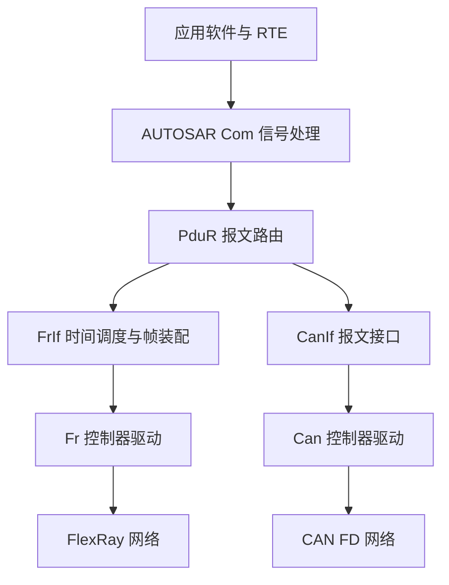

图示说明：本图按旧版参考代码中可直接追踪的 `Com → PduR → FrIf/CanIf` 路径表达普通信号流，不代表所有 AUTOSAR Release 的统一接线。诊断和网络管理数据不一定经过 `Com`；自 R24-11 起，官方 FlexRay Interface 与 CAN Interface 规范均将相邻上层通信接口调整为 `LSduR`；图中的 `PduR → FrIf/CanIf` 不能不加辨别地作为新版接口定论。

| 模块 | 在数据链路中实际做什么 | 不负责什么 |
|---|---|---|
| `RTE` | 向应用提供发送、接收接口，连接软件组件 | 不决定 FlexRay 时隙或 CAN 标识符 |
| `Com` | 组织信号、信号组与 I-PDU，处理发送模式、接收更新和超时 | 不直接操作芯片通信寄存器 |
| `PduR` | 按配置将 PDU 转交给正确的下层或上层 | 不解析一个信号的物理量和位含义 |
| `FrIf` | 面向 FlexRay 的帧映射、PDU 装配和时间相关操作 | 不自行定义集群的网络参数 |
| `Fr` | 访问 FlexRay 控制器、缓冲区及协议状态 | 不知道业务信号代表什么 |
| `CanIf` | CAN 报文标识符与硬件接收对象映射、发送和通知处理 | 不替代控制器的总线仲裁机制 |
| `Can` | 访问 CAN 控制器，处理报文对象、中断及错误状态 | 不生成应用信号的业务内容 |

FlexRay 对应的网络状态管理通常是 `FrSM`，CAN 对应 `CanSM`。`ComM` 处理通信模式请求，`BswM` 可以根据模式与状态触发配置好的动作；`EcuM`、操作系统和定时任务构成整套软件启动、执行的基础。这些模块**控制通信的可用性**，不能把它们误认为普通发送路径中的连续数据搬运节点。

### 2.2 一条报文可能存在多种上层来源

普通应用信号、诊断消息和网络管理消息的用途不同，路径也不完全相同：

| 数据类别 | 常见处理路径 | 典型关注点 |
|---|---|---|
| 应用信号 | 应用/RTE → `Com` → 路由 → 总线接口 → 驱动 | 打包、发送模式、更新、超时 |
| 诊断数据 | `Dcm` → `PduR` → `FrTp`/`CanTp` → 总线接口与驱动 | 长数据分段、流控、超时、会话 |
| 网络管理数据 | `FrNm`/`CanNm` 及相关通道接口 | 节点通信需求、休眠与唤醒协调 |
| 模式控制信息 | `ComM`、`FrSM`/`CanSM`、`BswM` | 网络状态与模块启停，不一定承载业务 PDU |

诊断路径是否启用 `FrTp`，取决于实际项目是否在 FlexRay 上承载所需诊断业务。网络管理模块是否存在、使用什么报文方式，也应由正式系统设计确定。不要因为附件里有一个模块目录，就自动认为正式产品必然启用它。

### 2.4 不同 AUTOSAR 版本的接口边界

AUTOSAR 是一套分层规范，不是一组永远不变的 C 函数调用顺序。对软件工程尤其重要的是：**看图、看配置和看源码时，三者必须属于同一接口版本。** `classic-platform-master.zip` 可用于理解旧版 `FrIf_Transmit`、`FrIf_JobListExec` 等函数的真实组织方式，但它并不是 AS21 已确认的产品 BSW。

| 观察对象 | 旧版参考包可见事实 | 较新官方规范的变化 | 在 AS21 中如何解释 |
|---|---|---|---|
| 普通信号路由 | `Com`、`PduR`、`FrIf` 均有相应实现 | R24-11 起 `FrIf` 的相邻上层通信接口改为 `LSduR` | 先对照所选 Release 的接口关系，再跟源码调用 |
| CAN 接口关系 | 旧版 `PduR` 与 `CanIf` 可直接查找 | R24-11 的 CAN Interface 也改用 `LSduR` 对接上层通信接口 | CAN FD 路径同样按正式版本核对 |
| FlexRay 接口作业 | 存在 `FrIf_JobListExec` 及全局时间核对逻辑 | 作业和通信操作仍属于核心机制，接口细节可能调整 | 不假定所有供应商具有相同导出函数名 |
| 发送取数与确认 | 可见接口发送、驱动状态查询及相关运行数据 | 触发取数、解耦缓冲及确认行为有版本化约束 | 逐条核对配置启用的模式，不将示例当固定实现 |
| 网络模式 | `FrSM`、`ComM` 有分离的状态/接口 | 具体状态机与配置项可能变动 | 记录 `ComM`、`FrSM` 与 POC 三层实际状态 |

这里的 `LSduR` 仅指明**新版总线接口相邻模块关系的变化**，不意味着可以凭这句话推导完整上层链路；具体 `Com`/`PduR` 如何与该层衔接，仍以选定 Release 的规范和供应商软件为准。后文的时序图均是明确注明前提的机制示意，不是对未知 AS21 BSW 版本的接口承诺。

### 2.3 软件“已接受”不等于总线“已发送”

发送过程至少有三个不同的时刻：上层提出发送请求、底层接受并安排发送、控制器在总线上尝试实际发帧。对 FlexRay 而言，这三个时刻常常因为周期调度而明显分离。发送确认（Tx Confirmation）表示哪一级确认了何种发送事件，必须结合具体模块的接口语义解释；它不是远端应用已成功消费数据的证明。

接收方向也有类似区别：分析仪看到帧、控制器获取帧、接口层递交 PDU、`Com` 更新信号以及应用读到新值，是一条连续但不同步保证的链路。只有明确每层观测点，才能避免“抓包有数据，所以软件肯定没问题”这类误判。

## 3. 通信数据对象：信号、PDU 和总线帧

### 3.1 各层使用的名字不是同一个“编号”

| 名称 | 中文与含义 | 所在位置 | 关键关系 |
|---|---|---|---|
| Signal | 信号：一个逻辑业务值 | 应用、`Com` | 有类型、位长、字节序及打包位置 |
| Signal Group | 信号组：需要按组处理的一组相关信号 | `Com` | 关心同组数据的一致性 |
| I-PDU | 交互层协议数据单元（Interaction Layer PDU） | `Com`、`PduR` | 多个信号可组成一个 I-PDU |
| L-PDU | 链路层协议数据单元（Link Layer PDU） | 总线接口、驱动 | 与接口/控制器的发送接收对象关联 |
| Frame | 总线帧 | FlexRay/CAN 总线 | 最终在总线上出现的数据与协议字段 |
| PDU ID | 模块内部使用的 PDU 标识 | 各通信模块 | 同一数字在不同模块中未必是同一个对象 |

例如，`Com` 中某 I-PDU 的配置编号与 `PduR` 路由编号、`FrIf` 发送 PDU 编号、`Fr` 驱动使用的缓冲编号可能完全不同。排查配置时应看**对象引用关系**，不应凭“数字恰好一样”判定对应正确。

对于 FlexRay，还需建立 I-PDU 与总线帧装载位置之间的关系：同一帧载荷中可能按约定放置多个上层 PDU。对于 CAN FD，通常通过 `CanIf` 的发送 PDU 配置把数据关联到具体 CAN 标识符、控制器和硬件发送对象。不同总线的帧定义不能套用同一套“帧编号”概念。

### 3.2 信号打包是通信栈最容易产生“看得见但不正确”问题的地方

`Com` 的信号处理通常涉及位位置、位长、字节序、初值、发送触发条件、更新标识、数据无效处理和接收超时等配置。配置正确时，应用值被编码到 I-PDU 指定位置；接收端必须以相同的定义取回数值。

若某信号跨越字节边界，字节序和起始位解释尤其关键。不能只对照十六进制结果“看起来差不多”，应以通信定义中的位映射作为依据。物理量的比例因子、偏移和有效范围是否由应用、数据转换层或 `Com` 周边逻辑处理，要按实际工程约定区分；不要假设 `Com` 会自动完成所有工程单位换算。

### 3.3 更新标识、发送确认和应用有效性不是一回事

更新位（Update Bit）可以在特定配置下表示 PDU 中的数据是否按某规则更新，但它的具体位置、清除时机、检查规则依赖使用的模块与配置。`Com` 的信号更新行为与 `FrIf` 帧装配中可能使用的 PDU 更新标识，不能仅因为都叫“更新位”就混为一谈。

接收数据有效性还可能涉及通信超时、信号无效值、应用层计数器或端到端保护（End-to-End Protection，E2E）。这些机制彼此不同，若项目未配置某机制，就不应在白皮书中默认为已启用。

## 4. FlexRay 协议：先理解时间，再理解发送

### 4.1 FlexRay 为什么不能按 CAN 的习惯来调试

CAN 总线在空闲时通过标识符仲裁发送机会；FlexRay 则使用网络共同认可的周期结构。节点必须知道**在哪个通信周期、哪个通道、哪个时隙**允许发送某帧。应用即使连续发出两次请求，也不能据此认为总线会立刻连续出现两帧。

FlexRay 的通信周期（Communication Cycle）包含静态段（Static Segment），在集群配置启用时还可包含动态段（Dynamic Segment）、符号窗口（Symbol Window）和网络空闲时间（Network Idle Time，NIT）。静态段按固定时隙分配通信位置；动态段利用微时隙机制管理可变发送机会。具体段长、数量和是否使用，由集群参数统一定义，而不是由某个节点自行决定。

**图 2｜FlexRay 一个通信周期内的时间先后关系**

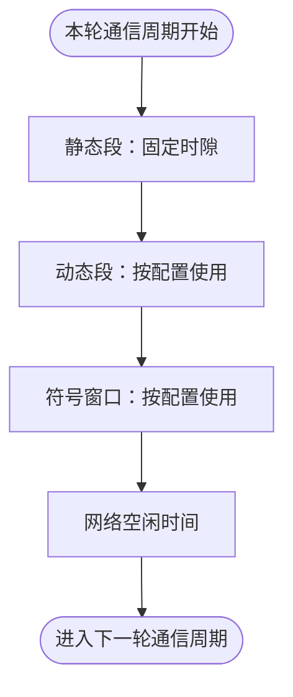

图示说明：本图强调区段的**先后顺序**，不代表各区段时长相同，也不保证每个集群都对所有可选区段分配非零时间。静态时隙按固定分配运行；动态段使用微时隙和可变占用机制，不能将它理解为“另一串固定静态时隙”。

### 4.2 集群参数需要在网络节点之间一致

通信周期长度、静态时隙数量、宏节拍、同步与启动参数、通道选择等，属于整网必须协调的配置。如果两端使用了看似接近但并不相同的参数，一端驱动可能初始化成功，网络仍无法进入预期同步状态。

| 术语 | 英文 | 工程含义 |
|---|---|---|
| 集群 | Cluster | 共享 FlexRay 时间与协议配置的网络节点集合 |
| 通信周期 | Communication Cycle | 重复执行的一轮总线时间结构 |
| 时隙 | Slot | 周期中规定的传输位置 |
| 宏节拍 | Macrotick | 用于控制器全局时间与调度的时间单位 |
| 通道 | Channel A / B | 物理传输通道；可按网络定义单独或共同使用 |
| 冷启动 | Coldstart | 按协议条件参与网络启动的能力和过程 |
| 同步 | Synchronization | 节点建立并维持一致网络时间基准 |
| 周期过滤 | Cycle Filtering | 决定一帧在哪些通信周期具备发送/接收机会 |

FlexRay 的周期计数按 0～63 循环，因此同一帧不仅受时隙约束，还可能通过基准周期（Base Cycle）与重复周期（Cycle Repetition）只在部分周期出现。例如，若一条仅用于演示的帧设置为基准周期 1、重复周期 4，则它的候选发送周期是 1、5、9……61，而不是 0～63 的每一轮。这个例子不代表 AS21 已确认的调度参数；实际还需检查协议允许的组合、通道和帧触发配置。

全局时间不是普通 OS 定时器加总的毫秒值。控制器依据本地微节拍（Microtick）形成宏节拍（Macrotick）时间基准，并通过协议同步过程进行偏移校正（Offset Correction）与速率校正（Rate Correction），减少各节点时钟差异。对上层调度最有用的观测是：当前周期号、宏节拍位置、POC 及同步相关状态，而非单独打印一条“驱动初始化成功”。

### 4.3 启动、同步与正常通信是不同的状态过程

FlexRay 控制器存在协议操作控制（Protocol Operation Control，POC）状态，常见状态包括 `READY`、`STARTUP`、`NORMAL_ACTIVE`、`NORMAL_PASSIVE`、`HALT` 等；实际还存在与配置、协议过程相关的其他状态及子状态。

`READY` 只表示控制器达到相应准备状态，不是全网已经正常通信。`STARTUP` 表示正在参与启动过程。`NORMAL_ACTIVE` 与 `NORMAL_PASSIVE` 都应按协议定义理解，不能把所有 `NORMAL_*` 状态一律视作“可正常发送业务帧”。网络无法同步时应关注启动帧、同步帧、对端节点能力、通道、控制器状态变化及错误信息。

不同节点在网络中的启动角色并不相同。冷启动节点（Coldstart Node）承担按协议条件发起启动过程的特定职责，配置为同步节点的设备则按网络约定提供用于同步的帧。两种资格与相关帧、关键时隙配置必须按整网定义相互匹配。**冷启动、同步和日常数据收发不是同一件事**：控制器即使已准备好本地发送缓冲，仍可能因为启动条件不满足而无法进入正常活动状态。

只有一台控制器完成本地初始化，通常不足以证明完整 FlexRay 集群已可工作；能否启动取决于网络节点能力、真实集群配置以及可用的第二节点或仿真设备。也不要把 FlexRay 的协议启动直接交给 `FrNm` 去解释，网络管理与协议启动属于不同层次。

### 4.4 一帧的定位条件比“帧标识”更多

| 定位维度 | 为什么需要它 |
|---|---|
| 集群 | 不同网络可以有相似编号，却采用不同时间配置 |
| 发送节点 | 确认哪个节点对这条帧负责 |
| 通道 | 确认位于 A、B 或按设计使用的通道组合 |
| 时隙标识 | 确认一轮周期中的发送位置 |
| 基准周期与重复周期 | 确认帧在哪些通信周期出现 |
| 载荷长度及映射 | 确认包含哪些 I-PDU、偏移与长度 |
| 发送与接收配置 | 确认控制器缓冲区及接口对象匹配 |

因此，“时隙编号对了”仍不等于帧配置正确。周期过滤或通道选择错误时，帧可能在错误的轮次出现，也可能完全看不到；偏移或长度错误时，分析仪能看到帧，但上层数据仍不正确。

### 4.5 周期过滤、调度机会与数据年龄

FlexRay 通信机会不是单独的“时隙号”，而是**通道、时隙与周期条件**的交集。周期计数通常在 0～63 循环。若帧配置为“每 4 个周期中的指定相位出现一次”，那么其他周期抓不到该帧是正常现象；但是只有拿到真实的基准周期、重复周期和帧触发配置，才能判定哪几个周期应出现。

同一份数据还存在四个时间点：应用写入时刻、`Com` 发起 I-PDU 请求时刻、`FrIf` 实际提供载荷的时刻、控制器在总线发送帧的时刻。周期过滤决定机会是否存在，软件任务与接口作业决定数据能否赶上该机会。两者叠加后影响数据年龄（Data Age）：总线上发出的帧可以完全符合协议，但载荷仍可能是上一个应用更新周期的数据。

| 情形 | 应当观察什么 | 不能直接得出的结论 |
|---|---|---|
| 本轮没有目标帧 | 周期过滤、通道、时隙、节点状态 | 不能直接认定驱动没工作 |
| 有目标帧但值较旧 | `Com` 缓冲、接口取数时刻、应用更新时间 | 不能直接认定 FlexRay 同步失败 |
| 只在部分周期丢帧 | 全局时间、作业触发时刻、接口同步状态 | 不能仅用应用循环延时解释 |
| 目标帧时间正确但载荷错位 | I-PDU 到帧的偏移和长度 | 不能仅检查时隙配置 |

### 4.6 协议操作控制状态：不要把“控制器已启动”理解为“网络已可用”

POC（Protocol Operation Control，协议操作控制）是 FlexRay 控制器内部的协议运行状态。`READY`、`STARTUP`、`NORMAL_ACTIVE`、`NORMAL_PASSIVE` 和 `HALT` 的意义不同，且有些状态内部还有更细的子状态。以下图形只截取**与上层软件排障密切相关的典型状态关系**，省略配置、唤醒和错误处理中的其他协议路径，不能替代 FlexRay 协议完整状态机。

**图 3｜FlexRay POC 典型运行状态关系**

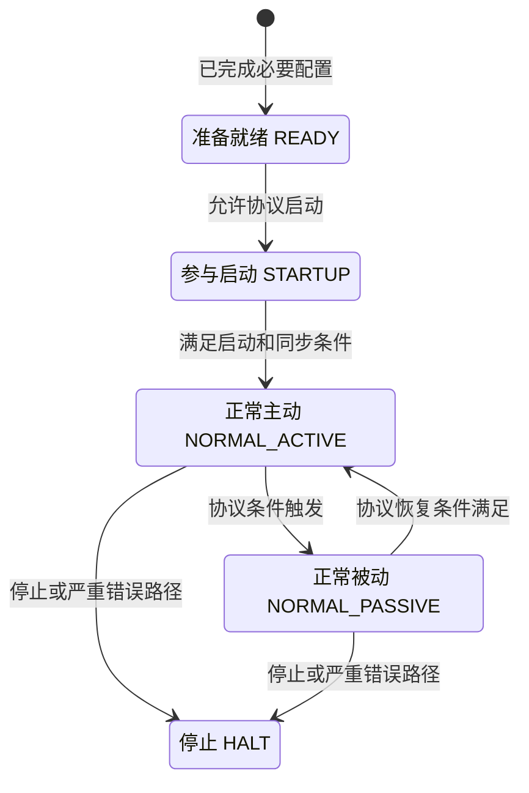

图示说明：图中的箭头是工程观察视角下的典型状态关系，**不是所有允许的 POC 命令和自动转换的全集**。具体如何从 `HALT` 重新准备，以及启动失败时走哪条路径，必须看控制器协议版本和当前驱动所执行的命令。

网络启动时应把三类状态分别取样：`Fr` 报告的 POC、`FrSM` 内部协调状态、`ComM` 的通信模式。`FrSM` 报告全通信并不自动证明所有帧都已经按预定周期成功传输；POC 处于 `NORMAL_PASSIVE` 也不能按主动正常通信处理。无法启动时优先查看网络有无符合要求的启动/同步节点、集群参数是否一致以及是否存在通道或协议错误，再分析上层 PDU。

## 5. FlexRay 通信模块：每一层到底做什么

### 5.1 `Fr`：真正面向控制器的驱动

`Fr` 位于微控制器抽象层（MCAL）一侧，直接处理 FlexRay 控制器初始化、协议状态、发送/接收缓冲区以及相关定时器操作。典型职责包括：

- 将已生成的控制器与消息缓冲配置写入实际控制器；
- 根据接口层请求准备或发送链路层数据（LPDU）；
- 从硬件接收缓冲读取数据及接收状态；
- 报告控制器的协议状态、全局时间、通道状态和错误信息；
- 配合控制器定时器，为上层按时间执行通信操作提供条件。

例如，所附旧版开源源码声明了 `Fr_ControllerInit`、`Fr_StartCommunication`、`Fr_GetPOCStatus`、`Fr_GetGlobalTime`、`Fr_TransmitTxLPdu` 和 `Fr_ReceiveRxLPdu` 等接口。它们可用于理解模块边界，**但函数存在不等于该源码已具备 TC387/TC367 的可用底层实现**。实际项目还须使用匹配的芯片驱动、配置生成器、编译工具和接口版本。

### 5.2 `FrIf`：把上层 PDU 对应到 FlexRay 时间表

`FrIf` 是 FlexRay 接口层。上层可能在某时刻提出发送某个 PDU 的请求，但 FlexRay 真正的帧发送机会由时间表决定。`FrIf` 需要在两者之间建立可执行的关系：上层数据与某个帧结构关联，该帧在配置规定的通信时间被装配、交给驱动，并按配置处理接收及确认。

它主要关注四类对象：

| 对象 | 作用 | 如果不匹配会怎样 |
|---|---|---|
| 接口 PDU | 承接上层发来的数据 | `PduR` 到接口的编号或长度不一致 |
| 帧结构 | 指明一个帧中包含哪些 PDU，位于哪些偏移 | 总线帧存在，但多个 PDU 相互覆盖或数据错位 |
| 帧触发配置 | 关联通道、帧标识、周期条件及驱动资源 | 帧出现的通道、时隙或周期不符合预期 |
| 作业清单 | 在规定的全局时间执行发帧、收帧等操作 | 初始化成功，运行时却未执行应有操作 |

#### 5.2.1 作业清单与控制器的全局时间

FlexRay 接口常按作业清单（Job List）组织与网络时基同步的操作。作业指定通信周期和宏节拍位置，并规定该位置执行哪些动作，例如取待发数据、向驱动提供发送数据、检查发送状态、读取接收缓冲及向上层通知。

这与普通操作系统周期任务不同：操作系统任务可推动软件处理，但 FlexRay 帧的实际时间位置受网络全局时间约束。`FrIf` 作业执行太晚、相关定时器没有正常触发，或者配置对象指向错误的发送缓冲区，都会导致有请求却没有按预期发帧。

附件源码中可看到 `FrIf_JobListExec` 及与绝对定时器、作业配置有关的实现。这说明该源码采用怎样的调度组织方式；不同 Release 和供应商不一定使用完全相同的可见函数名。

作业清单常按“通信周期 + 宏节拍”定位每次操作。旧版参考源码中，`FrIf_JobListExec` 会读取全局时间，将实测周期与宏节拍对照作业配置；当同步偏差超出配置容限或取时失败时，可以设置作业同步丢失状态并取消后续绝对定时器。因而**控制器网络同步正常**和**接口作业清单同步正常**是两个不能混为一谈的检查项。

**图 4｜FlexRay 定时作业、装帧与实际发送机会**

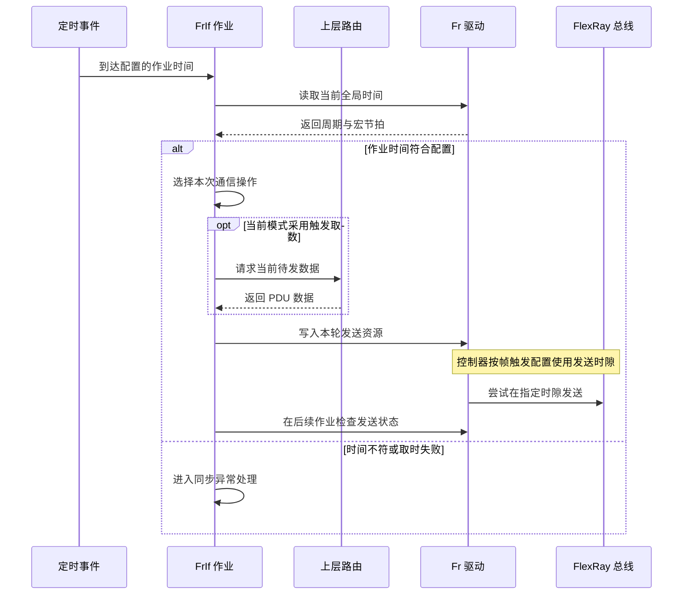

图示说明：这是包含触发取数分支的解释性时序，不表示每一次作业都执行全部操作。`Fr_TransmitTxLPdu` 等接口调用负责提交数据与触发所需硬件动作；**物理帧的时隙位置由 FlexRay 控制器与配置决定**，不能把接口调用发生的 CPU 时刻画成等价的总线起始位时刻。不同版本的上层回调可能经过 `PduR` 或 `LSduR` 等不同接口。

| 作业层观察点 | 能说明什么 | 对应常见问题 |
|---|---|---|
| 定时事件发生且回调进入 | 软件具备执行作业的入口 | 定时器未配置或中断未运行 |
| 全局时间读取成功 | 控制器当前提供时间数据 | 不能单凭此证明帧映射正确 |
| 作业周期/宏节拍匹配 | 当前软件作业与时基相符 | 错过执行窗口或同步偏差过大 |
| 选中通信操作与发送资源 | 帧配置映射到目标缓冲 | 错用控制器、帧触发或缓冲区 |
| 驱动接受待发数据 | 数据已交至更低层 | 不等于帧一定被对端接收 |
| 后续发送状态检查 | 可确认底层处理到哪一步 | 未启用/延迟确认与失败状态 |

#### 5.2.2 一帧装多个 PDU 时需要注意什么

多个上层 PDU 可能被放入同一个 FlexRay 帧载荷。`FrIf` 根据配置进行偏移放置、长度处理和可能的更新标识设置。若其中一个 PDU 当轮没有更新，不一定意味着整个帧都不发；是否发送、填什么数据以及怎样解释更新标志，应由当前版本的配置与规则决定。

要区分两个层次：`Com` 将**信号打包成 I-PDU**；`FrIf` 则可能将**一个或多个 PDU 装入 FlexRay 帧**。这不是重复打包，而是两个不同的映射层级。

#### 5.2.3 发送请求、触发取数和确认

在部分配置下，`FrIf_Transmit` 并不是立即把完整载荷送到总线，而是记录或处理一次发送请求；真正的取数与装帧可能发生在后续作业执行时。有的路径会使用触发发送（Trigger Transmit）回调向上层获取当时的数据。这样一来，**提出请求时的数据**与**实际取数时的数据**可能存在时间间隔，缓冲区一致性就非常重要。

发送确认也可能在后续作业中处理。应先确认所用实现采用哪一种数据提供方式、是否允许覆盖待发数据，以及确认信号具体代表什么，不能仅凭“调用返回成功”判断对端已接收到。

#### 5.2.4 待发数据的两种常见提供方式

`FrIf` 可能从上层请求时获得数据并先行保存，也可能在配置的通信作业到来时才通过触发发送回调取数。实际应按“**请求缓冲**、**取数时刻**、**硬件缓冲**、**发送状态**”四个对象理解：

| 关注点 | 请求时缓存数据 | 作业到来时触发取数 |
|---|---|---|
| 待发数据的取样时刻 | 较靠近上层请求 | 较靠近本轮装帧作业 |
| 发送前多次更新 | 可能受到覆盖/队列策略影响 | 可能取到较新的当前值 |
| 数据一致性风险 | 请求缓冲被覆盖、拷贝不完整 | 跨任务同时更新和临界区长度 |
| 排障切入点 | `FrIf_Transmit` 接受后的缓冲内容 | 触发取数回调及返回值 |

**注意**：上表只说明缓冲策略的典型区别，不是承诺某版本必须同时具备两种模式。上层收到的发送确认，可能与当前发出的数据版本存在时间差。要把一次确认关联到具体业务值，必须确认 I-PDU 的覆盖策略、触发次数、确认计数及底层报文状态语义。

### 5.3 `FrSM`：处理 FlexRay 网络能否进入通信状态

FlexRay 状态管理器（FlexRay State Manager，`FrSM`）协调网络通信模式与底层控制器状态。在典型 Classic 软件中，上层通过 `ComM` 等提出通信模式需求，`FrSM` 按配置调用相关接口以处理控制器准备、启动、唤醒以及停止等过程，同时向相关模块报告模式变化。

它不负责编码应用信号，但会影响业务数据何时能真正发送。比如 `Com` 已准备好一条 I-PDU，如果对应网络还没有达到允许通信的条件，上层数据链路仍然不能证明“网络已可用”。

需要特别区分：

- `ComM` 的 `FULL_COMMUNICATION` 是网络通信服务层面的模式请求/结果；
- `FrSM` 处理的是 FlexRay 网络状态管理及与其他模块的协调；
- `Fr` 控制器报告的是具体 POC 等底层协议状态。

它们相互关联但不是三个叫法不同的同一状态。状态诊断应同时对照三层信息，不能只检查 `ComM` 模式就认定 POC 已同步。

### 5.4 `FrTrcv`、`FrNm`、`FrTp`：根据功能选择使用

| 模块 | 中文说明 | 什么时候需要关注 |
|---|---|---|
| `FrTrcv` | FlexRay 收发器驱动（Transceiver Driver） | 软件需要管理收发器模式、唤醒或状态时；是否由独立模块实现取决于交付包 |
| `FrNm` | FlexRay 网络管理（Network Management） | 网络设计需要节点管理、睡眠协调与相关网络管理报文时 |
| `FrTp` | FlexRay 传输协议（Transport Protocol） | 上层需要通过分段和重组传送超过单次承载能力的数据时，例如某些诊断场景 |
| `Dcm` | 诊断通信管理（Diagnostic Communication Manager） | 处理诊断服务请求与响应，不负责普通周期应用信号 |
| `Nm` | 通用网络管理接口 | 需要屏蔽不同总线网络管理差异时 |

一个常见错误是把 `FrNm` 当成 FlexRay 网络冷启动的唯一负责人。FlexRay 物理/协议层的启动与同步、通信模式管理、AUTOSAR 网络管理，是不同层次的机制。若项目没有启用 `FrNm`，也不能因此简单推断 FlexRay 控制器无法启动。

## 6. 从应用到总线：完整的 FlexRay 发送过程

### 6.1 普通信号的发送链路

下图把不同模块之间的交接顺序表现出来。它是常见实现关系的抽象，并不要求各软件版本逐字采用相同函数或同步回调方式。

**图 5｜应用信号进入 FlexRay 发送机会的端到端时序**

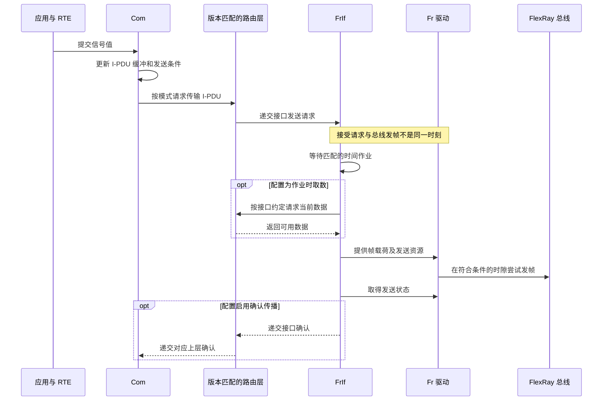

图示说明：路由层使用抽象称谓，避免把不同 Release 的 `PduR` / `LSduR` 接口误合并为唯一 API。时序图不保证一次发送请求必定对应一帧，亦不表示接口请求成功、驱动接受数据、控制器发帧和远端应用接收是同一个成功事件。是否出现触发取数与确认传播，取决于实际配置。

从排障角度，发送链路至少分为以下几个观测时刻：

| 时刻 | 典型发生事件 | 该时刻足以证明的事实 |
|---|---|---|
| T0 | 应用更新信号 | 应用给出了新值，不代表已请求总线发送 |
| T1 | `Com` 依模式生成 I-PDU 请求 | 上层请求产生，仍可能被模式或路由条件约束 |
| T2 | `FrIf` 接受请求或在作业中触发取数 | 取到的内容可能不同于 T0 原始值 |
| T3 | 驱动准备了发送资源 | 数据进入目标硬件处理路径，尚需满足发送机会 |
| T4 | 分析仪实际观察到目标帧 | 已有本端总线证据，仍不等于远端应用已处理 |

### 6.2 接收链路不是简单把箭头反过来

接收方向通常从控制器获取新帧开始，经 `FrIf` 对帧中的上层 PDU 作区分与处理，再由路由转交 `Com`，最后由应用读取信号。接收可能依赖 `FrIf` 定时作业、底层状态和配置的通知路径，因此总线上的帧到达时间并不一定等于应用变量被更新的时间。

**图 6｜FlexRay 帧到达后逐层变成应用信号的时序**

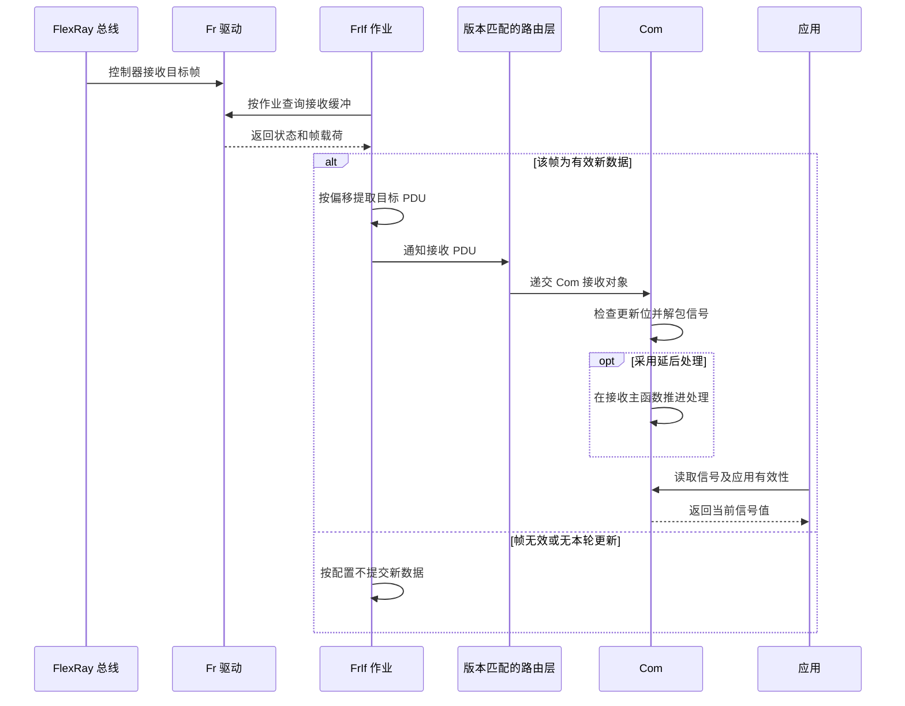

图示说明：驱动的“新数据”、`FrIf` 的 PDU 更新标志与 `Com` 的信号更新位不是同一含义。`Com` 的立即/延后处理由配置决定；图中应用主动读取信号是常见使用方式，不排除配置了接收通知回调的实现。

接收时要特别区分：

| 层级 | 需要确认的事实 |
|---|---|
| 总线层 | 指定通道、时隙和周期确有帧，校验与载荷条件符合协议 |
| 驱动层 | 控制器接收缓冲拿到的是本轮新数据，且长度、状态有效 |
| `FrIf` | 帧中目标 PDU 被正确提取，偏移、长度和更新标识处理正确 |
| `PduR` | 源接口 PDU 被路由到正确的 `Com` 接收对象 |
| `Com` | 解包位置、字节序、更新位、无效值和超时处理符合配置 |
| 应用层 | 读取时机正确，能够区分新值、旧值和超时替代值 |

如果分析仪看到正确帧，但应用值不变，不应立即改动底层驱动；更有效的做法是在相邻层之间查找数据从哪里开始偏离。反过来，如果控制器从未收到目标帧，就不应先纠结 `Com` 的信号回调。

### 6.3 时间触发通信带来的数据一致性问题

假设应用每隔一段时间更新一次状态，但 FlexRay 只在特定周期发送一次对应帧，那么在两次发帧之间，发送缓存可能被更新多次。不同配置下，最终发到总线的数据可能是作业取数时的最新值，也可能来自此前锁定的缓冲数据。

这会产生三个需要明确的关系：应用更新频率与总线发送频率的关系、数据缓冲在跨任务/中断读写时的一致性、发送确认与数据版本的关联方式。不能靠给应用额外加延时来“修复”这些问题，而应先读清发送方式与实际缓存策略。

### 6.4 缓冲更新、丢次与延迟怎样串起来看

应用更新周期、`Com` 请求周期、`FrIf` 作业周期和总线帧重复周期不一定相同。假如应用在相邻的两个发送机会之间多次更新某个信号，通信栈可能只发送其中一次抽样值。**没有发送每一次中间值，并不自动构成丢帧**；要先判断上层定义的是“最新状态”还是“每一次事件必须送达”。后者通常不能仅靠周期状态信号保证。

可以把端到端延迟拆成：应用更新到 `Com` 请求、请求到 `FrIf` 作业、作业到可用总线时隙、总线传输到接收作业、接收作业到应用消费。每一段都有独立的调度或配置依据，最坏值不能凭一个“发送周期”代替。尤其当目标帧不是每周期发送，等待周期过滤条件本身可能成为主要延迟。

| 数据现象 | 可能属于正常配置行为 | 需要核实的异常 |
|---|---|---|
| 某次应用更新未单独上总线 | 状态信号发送节拍低于应用更新节拍 | 需要逐次传输的事件被错误按状态量配置 |
| 发出的内容比应用当前值旧 | 上一次作业已经完成取数 | 共享缓冲竞争或主函数长期未调度 |
| 帧连续出现但值不变 | 信号值未变化，或使用上次缓存 | 更新位及应用写入未按预期生效 |
| 发送确认相对较晚 | 确认由后续作业检查和上报 | 确认与请求计数、配置版本不匹配 |

## 7. `Com` 与 `PduR`：通信栈上半部分的细节

### 7.1 `Com` 不只是字节打包器

`Com` 负责应用信号与 I-PDU 的对应，还涉及发送与接收策略。常见的发送方式有周期发送（Periodic）、直接触发（Direct）、混合方式（Mixed）及不主动触发（None）等；具体选择可能受配置、信号过滤或发送模式选择条件影响。

| 功能 | 实际意义 | 排查重点 |
|---|---|---|
| 信号打包 | 将一个或多个信号写入 I-PDU 的指定位域 | 长度、起始位、字节序、信号组一致性 |
| 周期发送 | 根据配置的周期请求发送 PDU | `Com` 主函数是否被调度、周期与模式是否吻合 |
| 直接触发 | 特定信号事件或请求触发发送 | 触发条件是否成立、是否被最小延时限制 |
| I-PDU 组 | 控制一组 PDU 的启停与相关状态 | 启动时是否启用了正确的组 |
| 更新与过滤 | 判断某数据是否需要传播或如何处理 | 过滤条件、更新位、数据变化规则 |
| 接收超时 | 超过规定时间没有有效接收时采取动作 | 超时计时起点、主函数、替代值或通知 |
| 发送确认与通知 | 按配置向上层反馈事件 | 回调是否启用、所代表的事件层级 |

例如一个周期发送的 I-PDU，在 `Com_MainFunctionTx` 未被正确调用、I-PDU 组处于停止状态或网络模式禁止发送时，可能不会产生预期请求。`Com_SendSignal` 调用返回成功，也不能代替对整条发送路径的检查。具体接口名称和调用上下文应以实际 Release 与实现为准。

#### 7.1.1 发送模式、传输属性和最小发送间隔是不同开关

`Com` 的发送模式（如周期、直接、混合）、单个信号的传输属性（如触发或等待）以及最小发送延时，决定了**什么事件能产生 I-PDU 发送请求**，并不改变 FlexRay 时隙本身。某信号设为触发发送，也只是让 `Com` 更早或按配置重复请求下层，并不会让 FlexRay 控制器获得一个原本不存在的时隙。

| 配置因素 | 它主要控制什么 | 与 FlexRay 时间表的关系 |
|---|---|---|
| I-PDU 发送模式 | 发送请求按周期还是由事件驱动 | 请求到达后仍受帧触发条件限制 |
| 信号传输属性 | 更新该信号会否触发 I-PDU 传输 | 某些更新只改变缓冲，不立即请求 |
| 最小发送延时 | 限制相邻发送请求的间隔 | 容易与帧周期叠加影响刷新时间 |
| 直接发送重复次数 | 按配置多次请求以提高机会 | 不等于每次请求都对应唯一总线帧 |
| I-PDU 组启停 | 允许或禁止一组 I-PDU 的处理 | 组启用也不能替代网络状态就绪 |

#### 7.1.2 `Com` 更新位与 `FrIf` 帧内更新标志不可混用

`Com` 的信号更新位通常针对信号或信号组是否获得新数据；`FrIf` 的帧内更新标志则可用于识别同一 FlexRay 帧中具体 PDU 的新旧状态，两者的粒度和配置来源不同。一个有效总线帧可能包含更新了的 PDU 和未更新的 PDU；同一 PDU 的接收通知也未必意味着其中每个 `Com` 信号都按新值处理。

解释“帧来了为什么信号没变”时，正确路径是：先判断帧和 PDU 是否有效，再看 `FrIf` 是否递交该 PDU，最后检查 `Com` 是否因更新位或过滤条件未处理某信号。反过来，`Com` 接收超时也不一定意味着底层完全没有帧。

### 7.2 接收超时与信号超时不能依靠抓包直接判定

接收超时监控（Deadline Monitoring）是上层对“预期数据是否按时更新”的判断。即使总线上始终有某个 FlexRay 帧，如果目标 PDU 的更新标识不满足接收规则，或路由、接收任务没有运行，上层仍可能判为数据超时。反过来，上层变量保留了上一次正常值，也不能证明最近一个周期已经收到新数据。

因此，需要同时记录接收帧时间、接口层数据递交时间、`Com` 处理时间和应用读取时间。计时阈值与替代动作应来自实际通信设计，而不是现场临时凭感觉设定。

#### 7.2.1 接收超时的起点、复位条件与动作

接收超时监控（Reception Deadline Monitoring）关注在规定时限内是否出现**满足上层更新规则的有效数据**，不能与“控制器没有收到物理帧”画等号。其起点可能受 I-PDU 组启动、首次接收和配置初始超时参数影响；后续计时复位则与配置的接收和更新条件相关。

超时之后有些配置只发出通知并保留最后值，有些配置使用预设替代值或无效值处理。具体动作必须从当前 `Com` 配置与规范版本确认，不能假定所有项目都采用一种超时替代策略。

还有发送超时监控（Transmission Deadline Monitoring），它观察下层发送进展，不能用接收超时的含义解释。AUTOSAR COM 规范明确区分接收与发送超时监控；上层发送请求已经产生但确认迟迟未出现，与目标信号长期未有效接收，是两类不同的问题。

### 7.3 `PduR` 只关心“这份 PDU 去哪里”

`PduR` 根据配置把 PDU 从源模块转到一个或多个目的模块。它可能处理普通接口 PDU 路由，也可能参与传输协议数据的路由；一些配置支持网关转发。其重点是源/目的 PDU 对象、路由路径、长度和缓存/数据提供方式，而不是信号的工程意义。

典型错误是：`Com` 生成的 I-PDU 没问题，但 `PduR` 的目的 PDU 配置关联了错误的 `FrIf`/`CanIf` 对象。此时上层表现为“发送成功”，下层却看不到预期数据，或者发到了另一个总线接口。

不同软件版本可能对接口 PDU、传输 PDU、触发取数以及底层路由职责作出调整。特别是较新规范可能出现 `LSduR` 等划分，**不要把旧版开源工程的 PduR/FrIf 调用关系当作所有 AUTOSAR Release 的硬规定**。

## 8. 初始化、通信模式与任务：让各模块真正协同运行

### 8.1 模块存在不代表模块已经开始工作

一个可执行工程至少要处理初始化顺序、模块配置、控制器状态、任务调度及中断。典型启动过程中，先具备微控制器时钟、中断和基础运行条件，再初始化通信驱动、接口层和上层通信服务；随后通过模式管理启动或允许网络通信。实际顺序必须符合所用 BSW 的集成说明，不能把以下示意当成固定的 API 调用清单。

**图 7｜通信模块运行与 FlexRay 网络可用性的条件链**

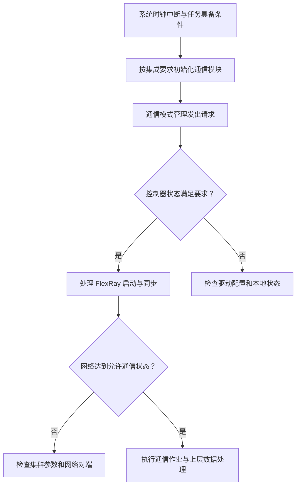

图示说明：这是通信可用性的**条件判断图**，不是按真实时间展开的启动 API 调用表。它强调模块初始化完成、控制器可用和全网完成启动同步是不同条件；CAN FD 不采用 FlexRay 的网络冷启动与全局时间同步机制。对应模块间的交互见下一张时序图。

### 8.1.1 `ComM`、`FrSM`、`FrIf` 与 POC 的状态不能只看一个

`ComM` 管通信需求，`FrSM` 协调 FlexRay 网络状态，`FrIf` 提供控制器访问与通信作业，`Fr` 返回实际协议状态。关键是：上层提出 `FULL_COMMUNICATION` 请求，并不保证下一个函数返回时 POC 已处于 `NORMAL_ACTIVE`。这中间可能发生唤醒、冷启动、等待同步、模式反馈和作业启停。

**图 8｜FlexRay 通信请求到网络可用的典型交互**

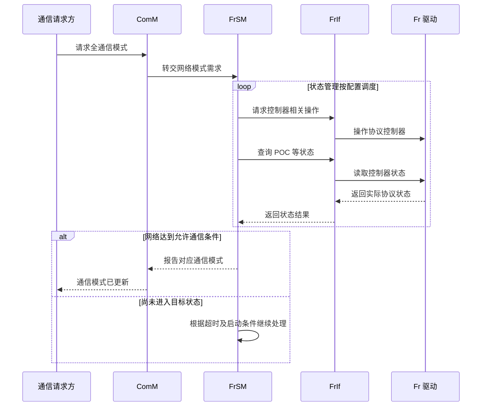

图示说明：图中“请求控制器相关操作”是对多种可能操作的归纳，并不表示 `FrSM` 每次主函数都按上述顺序调用两个接口。是否配置网络管理、唤醒路径及模式通知对象，与所选 BSW 版本和项目配置有关。调试时应并列记录请求模式、`FrSM` 实际状态和底层 POC，而不是拿一个“在线”布尔值概括全部过程。

### 8.2 运行时机：操作系统周期任务与 FlexRay 定时作业

| 执行单元 | 典型职责 | 常见失败表现 |
|---|---|---|
| `Com` 发送主函数 | 处理周期发送、触发及部分发送状态 | 应用有新值，但未发起预期发送请求 |
| `Com` 接收主函数 | 处理接收通知、超时监控等配置功能 | 帧已收到，信号刷新或超时判断异常 |
| `FrSM` 等状态主函数 | 推进模式和协议状态协调 | 网络准备条件具备但模式不进入预期状态 |
| `FrIf` 作业执行 | 按通信周期与宏节拍执行帧相关操作 | 发送请求已产生，但未在对应时隙发帧 |
| 底层中断与驱动回调 | 处理硬件事件与必要的状态更新 | 接收或发送状态丢失、偶发异常 |

这些调用不一定都需要独立的 OS 任务，有的由中断或调度器间接触发。关注点是**实际执行频率、相对优先级和最长阻塞时间**，不是简单地把所有主函数都放进一个延时循环。若某一 FlexRay 作业依赖控制器绝对定时器，还必须避免被同一集群的重入执行破坏时序一致性。

### 8.3 两类容易被忽略的竞争条件

第一类是**跨任务读写同一待发数据**。应用正在更新信号，通信作业在另一上下文中取数，若缺少正确的互斥/复制策略，帧可能包含两个版本拼在一起的数据。第二类是**模式切换与发送请求并发**。某次请求到达时，网络正在从全通信进入停止或休眠，调用结果与最终发送结果可能不同。

这些问题需要按实际 BSW 的可重入性约束、中断保护和缓存策略处理；不能仅因为某接口在单线程台架上正常，就假设它在完整操作系统调度下也安全。

## 9. 从通信定义到可执行配置

### 9.1 配置链由多个互相关联的视角组成

正式网络配置通常来源于项目的网络定义与通信数据库，再由各模块配置工具生成对应代码。AUTOSAR 工程常使用 ARXML 表达不同层次的配置对象，但不同输入文件和工具并不一定具备“一键生成全部通信栈”的能力。

**图 9｜从业务信号到 FlexRay 发送资源的配置引用关系**

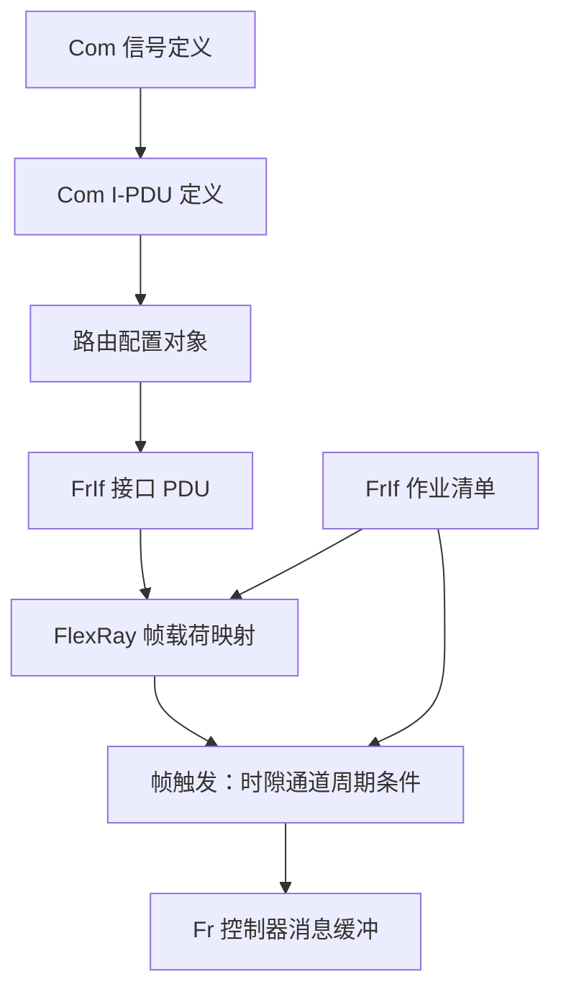

图示说明：本图表示配置对象的**逻辑关联**，不是生成工具内部的实际数据结构，也不代表每一个配置实体在所有 AUTOSAR Release 中都采用同一个名称。`FrIf` 接口 PDU 到帧载荷的映射、帧触发到控制器资源的映射和作业清单对动作的约束，均需在工程配置中能够反查；专业通信数据库和 ARXML 才是正式配置源，Mermaid 不能替代它们。

一条配置链需要同时建立横向关系和运行关系。横向关系回答“信号究竟放在哪个帧里”，运行关系回答“该帧是否在该时刻由允许的控制器发出”。仅验证生成代码没有编译错误，不能替代两条关系的检查。

### 9.2 应当能从一个信号追到一个具体发送机会

以 FlexRay 普通信号为例，配置里应能查清下面这条关系：

| 关系层级 | 需要核对的关键内容 |
|---|---|
| 应用信号 → `Com` | 信号名、数据类型、位长、更新条件 |
| `Com` → I-PDU | I-PDU 对象、位位置、字节序、发送策略 |
| I-PDU → `PduR` | 源路由对象、目的路由对象、方向和长度 |
| `PduR` → `FrIf` | 上下层 PDU 引用、接口编号、数据提供方式 |
| `FrIf` → FlexRay 帧 | 载荷偏移、长度、更新标识、帧触发关系 |
| 帧 → `Fr` 资源 | 控制器、通道、时隙、周期条件及消息缓冲 |
| 运行配置 → 总线 | 模式、时间作业、任务/中断与抓包结果 |

这张表的目的不是复制通信矩阵，而是展示**不同配置文件之间必须对应的关系**。反向接收还要核对接收缓冲、接收通知以及 `Com` 接收信号的解包和超时配置。

### 9.3 EB tresos 与基础软件版本的配套

现有较旧版本的 EB tresos 工具与 MCAL 配置资源可以用于观察驱动配置、模块依赖和生成文件，但兼容性必须按组合判断：目标芯片与具体衍生型号、MCAL 版本、插件版本、配置工具版本、编译器版本以及 BSW 接口版本缺一不可。

一个工具工程能打开、能生成，最多说明**工具接受当前配置输入**，并不能证明其生成对象适用于 TC387，更不能证明开源 `FrIf`、第三方 `Fr` 驱动和 `FrSM` 可以直接跨版本拼接。尤其不要把 `Fr.h` 里的函数声明误当成完整硬件实现，也不要通过手改生成文件掩盖根配置错误。生成代码如果确有缺陷，应回到适配层或供货方提供的修复路径处理。

## 10. CAN FD 通信栈：相同的上层思想，不同的总线行为

### 10.1 CAN FD 与 FlexRay 的关注点不同

CAN FD（CAN with Flexible Data-rate）在单个数据帧内最多可承载 64 字节，且可以按配置在数据相位使用与仲裁相位不同的位速率。它不使用 FlexRay 的静态时隙与全网同步周期，因此其调试重点是 CAN 标识符、帧格式、位时序、仲裁、错误状态和发送缓冲。

| 对比项 | FlexRay | CAN FD |
|---|---|---|
| 发送机会 | 由集群周期、时隙与周期条件约束 | 由发送请求、总线空闲及标识符仲裁决定 |
| 时间相关故障 | 不同步、时隙/周期配置错误、作业超时 | 仲裁延迟、位时序不匹配、错误重发等 |
| 接口/驱动 | `FrIf` / `Fr` | `CanIf` / `Can` |
| 网络状态管理 | `FrSM` | `CanSM` |
| 常见辅助模块 | `FrNm`、`FrTp` | `CanNm`、`CanTp` |
| 帧内数据 | 受 FlexRay 帧与集群配置约束 | CAN FD 数据区最多 64 字节 |

辅助 CAN FD 不是“少量报文就可以少做配置”。即使只承载几条报文，也需要明确控制器能力、发送与接收对象、标识符、帧类型、长度、位时序、模式和错误恢复行为。

### 10.2 `Can`、`CanIf` 与 `CanSM` 的分工

`Can` 驱动操作控制器、发送和接收硬件对象，并处理相关中断和错误。`CanIf` 根据配置把上层 PDU 对应到控制器与 CAN 标识符，负责过滤与通知等接口层行为。`CanSM` 处理 CAN 网络通信模式切换，包括相关控制器状态与总线关闭（Bus-off）恢复流程。

`CanIf` 接口成功接收一份发送请求，通常不表示 CAN 控制器已经获得总线发送机会。发送可能因仲裁、控制器忙碌、模式不允许或错误状态而延后或失败；发送确认的具体含义同样需按所用驱动和接口规则理解。

### 10.3 DLC、BRS 与帧格式

数据长度码（Data Length Code，DLC）不是“任何值都等于字节数”。对 CAN FD，常见的 DLC 编码与有效字节数如下：

| DLC | 0～8 | 9 | 10 | 11 | 12 | 13 | 14 | 15 |
|---|---|---|---|---|---|---|---|---|
| 数据字节数 | 对应 0～8 | 12 | 16 | 20 | 24 | 32 | 48 | 64 |

位速率切换（Bit Rate Switching，BRS）用于表示在满足条件时切换数据相位速率；它与 DLC 没有直接的等价关系。CAN FD 还需关注标准/扩展标识符、FD 帧格式、发送/接收控制器配置及对端能力。一个控制器支持 CAN FD，并不代表当前通道配置、驱动构建选项和对端都已启用 CAN FD。

### 10.4 CAN FD 的数据收发与异常

普通应用信号的数据通路与 FlexRay 上层相似：`Com` 形成 I-PDU，`PduR` 路由到 `CanIf`，`Can` 驱动操作控制器发送。接收时则需经过硬件接收对象、CAN 标识符过滤、接口通知及上层解包。

值得关注的异常包括：控制器未进入启动/正常模式、CAN 标识符或过滤配置不匹配、FD 格式不一致、位时序设置错误、数据段位速率不兼容、发送硬件对象占用、总线错误以及 Bus-off。`CanSM` 的恢复策略也可能与应用的发送节奏产生交互，因此不能把“Bus-off 后再次调用发送”当成完整恢复方案。

### 10.5 总线关闭恢复不是简单重试发送

当 CAN 控制器发生总线关闭（Bus-off）时，上层通信模式必须与控制器错误状态协调。典型 Classic 实现中，底层错误经接口回调交给 `CanSM`，其恢复过程可能涉及停止/重启控制器、计时、重复尝试与恢复确认。上层不能在尚未恢复时通过连续调用 `CanIf_Transmit` 强行得到有效通信。

**图 10｜CAN 网络总线关闭及模式恢复的逻辑状态**

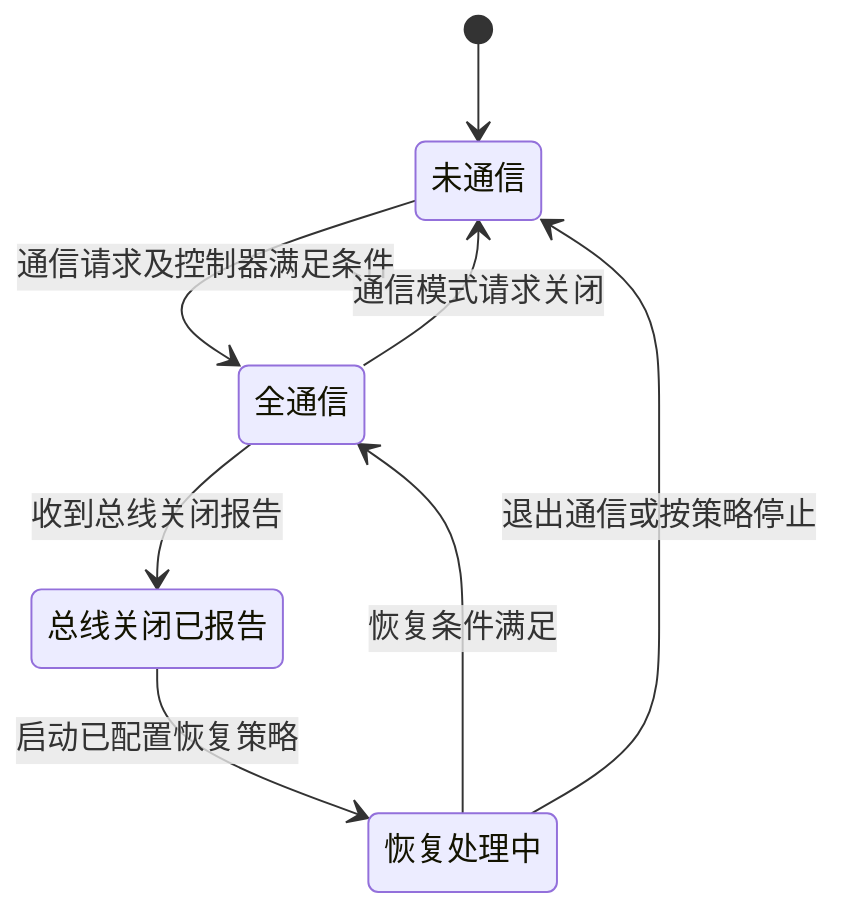

图示说明：图中状态是**排障用的逻辑抽象**，不是某个 AUTOSAR Release 的 `CanSM` 内部状态枚举，也不指定定时参数或重试次数。实际恢复规则来自 `CanSM`/`CanIf`/`Can` 的匹配版本及配置；总线物理原因未消除时，软件重启控制器不保证恢复成功。

分析 Bus-off 时至少分清四件事：什么时候由控制器报告错误、`CanSM` 何时收到通知、恢复过程中网络处于什么通信模式、控制器在何时重新具有发送条件。应用发送队列是否保留旧数据、旧 I-PDU 是否在恢复后仍应发送，还要结合 `Com` 与网关的数据新鲜度要求解释。

## 11. 诊断、长报文和跨总线路由

### 11.1 诊断数据为什么常常不能走普通 `Com` 信号路径

普通信号通信适合固定含义的状态和控制量；诊断服务往往需要传送较长的请求和响应，并关心请求-响应会话及超时。`Dcm` 负责诊断服务逻辑，`PduR` 把诊断 PDU 交给适当的传输层，例如 `CanTp` 或 `FrTp`。传输层根据总线承载能力进行分段、重组和相应的协议处理。

因此，不能因为 `Com` 会打包信号，就认为它也应该负责所有诊断分段。是否启用哪种传输协议、诊断路由以及对应总线上的诊断服务，必须根据项目需求确定。

### 11.2 CAN FD 的 64 字节不等于诊断长度没有限制

CAN FD 提高了单帧可用数据长度，却没有取消传输协议的寻址、分段和流控规则。超过单帧承载能力的诊断数据仍可能需要 `CanTp`，且真实可用的诊断有效载荷还受协议控制字段和寻址方式影响。

FlexRay 帧也有自身载荷和调度限制。使用 `FrTp` 时，要同时考虑分段消息的时间窗口、底层报文的发送机会以及传输层定时，不能直接把 CAN TP 的时序习惯照搬到 FlexRay。

### 11.3 FlexRay 与 CAN FD 之间的网关并非自动“格式转换”

跨总线转发大体存在两个层次：一是按 PDU 路由转发（PDU Gateway），二是解开某些业务信号后重新组织成目标总线报文（Signal Gateway）。前者偏向保持报文整体数据，后者会涉及信号映射、更新率、字节序和数据有效性等问题。具体功能可能由 `PduR`、`Com` 或项目中的其他组件组合实现。

从 FlexRay 转到 CAN FD 时，数据可能从固定发送时隙进入竞争总线；反向转发则可能需要等待下一个 FlexRay 发送机会。因此必须分析最坏转发延迟、队列覆盖、数据新鲜度与超时，而不能只证明“两个接口都能收发”就宣称网关符合实时要求。

### 11.4 跨总线路由时，关键是源数据何时有效、目标总线何时有机会

FlexRay 到 CAN FD 的转发，即使不做信号重打包，也存在接收作业、路由执行、CAN 控制器排队和仲裁等待等延迟；CAN FD 到 FlexRay 的反方向则还要等目标帧的可用周期/时隙。下图以 FlexRay 到 CAN FD 的单个有效 PDU 为例，说明为什么网关延迟不能只看一个函数调用。

**图 11｜FlexRay 接收到 CAN FD 发出的跨总线转发**

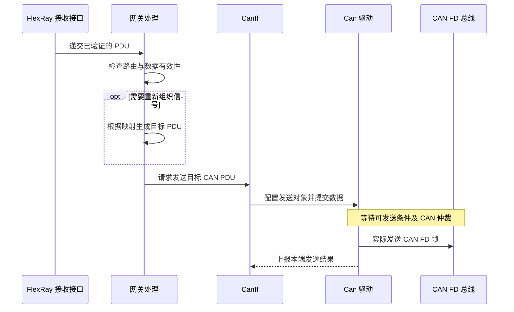

图示说明：单纯 PDU 网关与信号网关可能由不同模块组合实现；上图将它们归入“网关处理”角色，不代表所有项目都把两种逻辑写在同一个软件模块中。发送确认仍不等于最终接收端应用确认，数据是否仍有效应由业务协议、超时和安全设计共同规定。

| 延迟位置 | 技术来源 | 排障所需观测点 |
|---|---|---|
| 源总线接收到上层交付 | FlexRay 帧时隙、接收作业 | 帧时间戳、`FrIf` 接收通知 |
| 网关内部处理 | 路由/信号映射、任务调度、缓冲 | 源 PDU 编号、目标 PDU 编号、队列年龄 |
| 下层接受发送到总线发帧 | CAN 控制器状态和仲裁 | `CanIf` 返回、控制器确认、总线时间戳 |
| 反向 CAN FD 到 FlexRay | 目标 FlexRay 的周期和时隙 | 目标帧触发周期及作业时间 |

## 12. 两种芯片环境中的软件可迁移性

### 12.1 能迁移的是协议认识和配置意图

TC387 与 TC367 都属于 AURIX TC3xx 系列，适合沿用相同的 FlexRay 协议理解、AUTOSAR 模块职责和通信故障追踪方法。但控制器具体资源、芯片衍生型号、MCAL 实现、软件配置生成器、编译器设置和软件交付范围，需要按目标环境分别确认。

| 技术内容 | TC387 实验环境 | TC367 正式环境 |
|---|---|---|
| FlexRay 协议概念 | 可使用隔离实验集群理解与验证 | 同一协议概念，按正式网络落实 |
| `Com`、`PduR`、`FrIf` 的角色 | 可以通过参考源码与实验配置理解 | 以正式 BSW 的接口和功能为准 |
| `Fr` MCAL | 需确认 TC387 可用实现和匹配工具链 | 必须确认 TC367 目标驱动及供货范围 |
| 网络参数与通信矩阵 | 正式输入未知时仅能使用实验数据 | 必须由正式 AS21 网络定义驱动 |
| 生成文件和二进制 | 实验平台的产物 | 不直接继承未经核实的实验产物 |
| 测量及定位方法 | 可沉淀状态观测点、抓包和排障方法 | 在正式软件、网络和实物上重新验证 |

第一环境形成的价值，在于识别各层接口、把数据链路走通，并理解失败的典型原因；它不能替代第二环境的正式配置和集成。对 TC367 平台而言，外部供应商是否提供完整 BSW、仅提供 MCAL、是否包括配置工具与集成支持，目前仍需以实际交付为准，不能在架构图中默认其职责已经落实。

### 12.2 旧版开源参考包的正确位置

`classic-platform-master.zip` 包含 `Com`、`PduR`、`FrIf`、`FrSM`、`FrNm`、`FrTp`、`CanIf`、`CanSM` 等模块源码，可以用来阅读真实接口与调用方式。其 README 提到 Arctic Core 较早的 AUTOSAR 3.1 代码来源，部分通信模块头文件又出现 AUTOSAR 4.0.3 等版本标识，所以不能把整个包视作经过统一验证的某一完整 Release。

其 `drivers/Fr/fr.mod.mk` 中可见部分其他处理器平台的驱动目标选择，没有直接证明针对 TC387/TC367 的 TriCore `Fr` 实现可以构建、配置和运行。`CanIf` 源码中存在 CAN FD 相关条件处理，也不等于底层 CAN FD 驱动及正式通信链路已经齐备。该代码适合**对照模块职责、接口和运行机制**；能否进入产品固件还涉及接口兼容、目标芯片支持和授权条件，不能仅凭目录存在作结论。

## 13. 常见通信故障怎样沿栈定位

### 13.1 先区分“没发出去”还是“发出去了但上层没看到”

**图 12｜FlexRay 目标帧缺失时的分层定位**

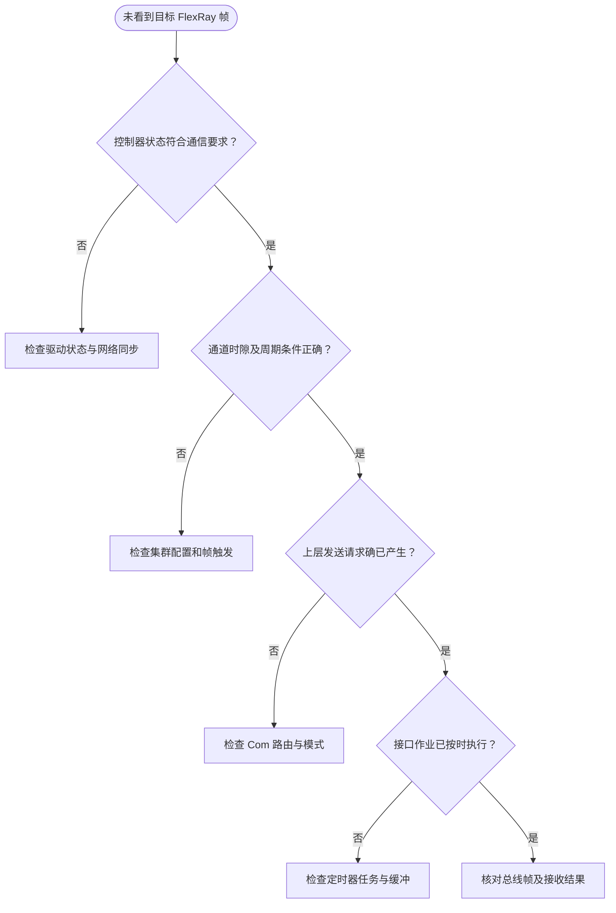

图示说明：本图用于缩小问题范围，不是硬件协议状态机。某一项失败后修复，需要重新核对其前置条件；各判断应有真实状态、配置或抓包作为证据。

### 13.2 用“最早不一致的观测点”缩小范围

| 现象 | 最需要先观察的位置 | 常见原因 |
|---|---|---|
| `Com` 信号改变，发送请求未到 `PduR` | `Com` 主函数、I-PDU 组与发送模式 | 未启用、未达到触发条件、周期任务没执行 |
| `PduR` 有请求，`FrIf` 无目标对象 | PDU 路由引用及接口编号 | 路由表错误、长度不匹配、接口连接错误 |
| `FrIf` 收到请求，总线无对应帧 | 作业清单、控制器状态、帧触发配置 | 未同步、错过发送机会、缓存配置错误 |
| 总线有帧，`Fr` 不上报新接收 | 接收缓冲与接收状态 | 接收资源、周期过滤或状态不匹配 |
| `FrIf` 有数据，`Com` 信号没变 | 接口提取、PDU 路由、信号解包 | 偏移、字节序、更新位或通知路径错误 |
| 接收值短暂正确后变成替代值 | `Com` 接收超时监控 | 后续没有有效更新、主函数和超时配置错误 |
| 部分周期能收到，部分周期收不到 | 周期过滤与网络时间 | 将多周期报文误按每周期报文判断 |
| 网络处于 `NORMAL_PASSIVE` 等非预期状态 | 控制器 POC、启动与同步相关状态 | 集群配置或网络条件不满足 |
| CAN FD 反复出错或 Bus-off | `Can` 错误状态、位时序、帧格式 | 对端不兼容、设置或通信错误 |
| 同一数据时好时坏 | 跨任务数据保护、作业时序 | 缓冲竞争、中断/任务抖动、异步覆盖 |

定位原则是先知道“上一层是否给出正确对象”，再确认“下一层是否在正确时间收到正确对象”。一次只修改一个经过证据支持的关键配置项，比同时改通信周期、任务优先级和缓冲长度更容易查出根因。

### 13.2.1 对同一次通信建立可关联的观测链

单独的“成功”日志不能定位问题。更可靠的办法是把**配置对象身份、模块边界、时间戳和返回状态**放在同一次观察中。不同模块 ID 未必相同，应记录它们之间的配置关联，而不是只记录一个十进制数字。

| 观测层 | 建议记录的信息 | 直接用途 |
|---|---|---|
| 应用 / `Com` | 信号名、I-PDU、值、触发原因、记录时间 | 确认新值何时产生 |
| 路由 | 源 PDU、目标 PDU、返回值 | 确认对象是否路由到正确接口 |
| `FrIf` | 接口 PDU、帧映射、作业周期、宏节拍、更新位 | 分辨映射错误与时间错误 |
| `Fr` | 控制器、POC、消息缓冲、发送/接收状态 | 确认底层有没有取得该对象 |
| 总线分析 | 通道、时隙、周期、帧有效性、载荷 | 证明网络上实际发生的通信 |
| 接收 `Com` / 应用 | 接收通知、更新位、超时状态、读取时刻 | 解释对端为何得到旧值或无效值 |

所有时间戳必须说明来源与分辨率，例如操作系统时钟、控制器全局时间、外部分析仪时钟。不同时间基准未经同步，**不能把两条日志直接相减后声称获得精确链路延迟**。

### 13.3 发送确认、接收通知和总线实测应分别理解

通信日志中经常看到三个看似都很“成功”的事件：`Transmit` 返回成功、`TxConfirmation` 被调用、分析仪看到预期帧。它们的可证明范围不同，且对端应用成功处理还需要额外证据。对于无逐帧远端业务确认的周期报文，更不能推导出“本端有确认，因此对端的状态值一定更新”。

同样，接收通知表示数据在某个模块边界发生交接，不自动证明 `Com` 解包结果正确或应用已按时读取。应把接口结果、数据内容与时间戳一起观察。

## 14. 用一条示意信号串起整套栈

考虑实验用状态信号 `LAB_STATUS`。这一名称只代表示意变量，并非 AS21 已定义的信号。假设它位于一个实验 I-PDU 中，最终由实验 FlexRay 帧承载；所有时隙、周期和长度参数都来自隔离实验配置，不在此虚构具体数值。

为了把“信号值”和“总线载荷”区别开，可以使用一个**纯说明用、非 AS21 配置**的字节对齐例子：在某个实验 I-PDU 内，8 位 `LAB_STATUS` 位于字节 0，16 位 `LAB_COUNTER` 位于字节 1～2，后者采用小端字节顺序。若两个值分别为 `0x12` 与 `0x3456`，那么该 I-PDU 的前三个字节应为 `12 56 34`。若接口层进一步把整个 I-PDU 放在某 FlexRay 帧载荷的字节偏移 4 处，则对应的三字节应出现在帧载荷字节 4～6，而不是帧的协议头或 CRC 区域。

| 数据对象 | 示例内容 | 对应含义 |
|---|---|---|
| `LAB_STATUS` | `0x12` | 8 位信号，写入 I-PDU 字节 0 |
| `LAB_COUNTER` | `0x3456` | 16 位信号，小端编码为 `56 34` |
| 实验 I-PDU | `12 56 34` | `Com` 编码后的有效内容片段 |
| 实验 FlexRay 帧载荷 | 字节 4～6 为 `12 56 34` | `FrIf` 按偏移放置 PDU 的结果 |

此例只用于理解两级装配，不表示项目实际采用这两个信号、长度或帧偏移。它还说明了一个常见误区：抓包中正确出现 `12 56 34` 只证明字节片段匹配，仍要结合帧的通道、时隙和周期条件才能确认其对应的是预期的 FlexRay 发送对象。

发送时，应用先更新 `LAB_STATUS`，`Com` 按定义将其写入 I-PDU。若发送模式触发，`Com` 经路由把 PDU 请求交给 `FrIf`；`FrIf` 按帧装配配置及作业时刻将数据与目标帧关联，`Fr` 驱动再让控制器在合适的通信机会发送。分析仪看到帧后，仍需核对其通道、时隙、周期以及载荷字节，而不只是“出现了一帧”。

反向接收时，先从总线确认目标帧，再查看 `Fr` 接收状态、`FrIf` 提取出的 PDU、`PduR` 递交的目的对象、`Com` 解包的信号，以及应用读取到的最新值。若最早的差异出现在 `FrIf` 到 `PduR` 的边界，先查 PDU 引用和数据布局；若总线压根没有目标帧，则应回到网络同步与作业时刻。

同一条追踪链还要叠加状态和时间两个维度：发送发生时 `FrSM` 与控制器分别处于什么状态，`Com` 主函数何时运行，`FrIf` 作业何时实际取数。这样才能解释“应用已经更新但过了若干通信周期才发出”究竟是配置行为还是故障。

对于 CAN FD 辅助链路，可以采用相同的上层追踪方式，只是 `FrIf`/`Fr` 改为 `CanIf`/`Can`，观察重点改为 CAN 标识符、DLC、BRS、帧格式、位时序和控制器错误状态，而不是 FlexRay 的时隙与同步。

## 15. 关键技术结论

**第一，数据通路、控制通路和时间通路必须一起看。** 只检查 `Com` 的发送函数，既不能证明网络已经启动，也不能证明 FlexRay 帧在正确时隙出现。

**第二，FlexRay 的主线是集群时基与发送机会。** 静态时隙、周期过滤、通道、启动同步、`FrIf` 作业清单和底层控制器状态之间存在连续关系。缺少其中任何一环，软件看似运行也可能始终没有目标帧。

**第三，AUTOSAR 的核心是明确模块边界与配置引用。** `Com` 处理信号，路由层按照选定 Release 连接上下层，`FrIf` 处理 FlexRay 接口时间与帧映射，`Fr` 处理控制器，`FrSM` 处理通信状态。旧版资料中的 `PduR` 与新版 `LSduR` 相邻接口不能混作一套固定调用关系，FlexRay 与 CAN FD 两条路径都需要核对。

**第四，CAN FD 上层的信号与 PDU 思路可以复用，但底层协议不能照搬 FlexRay。** CAN FD 的帧格式、标识符、长度编码、位速率与错误恢复有独立的判断条件。

**第五，TC387 实验环境与 TC367 正式环境的可复用边界在于方法而非现成产物。** 通信架构认识、模块关系和追踪方法可以沿用；驱动、配置生成工具、网络参数、编译产物与运行结果必须以各自环境的实际证据为准。

目前尚不能从现有资料确定 AS21 正式网络的集群参数、通信矩阵、完整 AUTOSAR Release、TC387/TC367 驱动交付范围，以及所有可选通信模块是否启用。本文解释共通的工作机制，不以未确认的工程参数冒充正式配置。

## 附录 A：通信术语中英文对照

| 中文 | 英文 / 缩写 | 在本文中的重点 |
|---|---|---|
| 基础软件 | Basic Software，BSW | AUTOSAR 驱动、接口和服务模块集合 |
| 运行时环境 | Runtime Environment，RTE | 应用访问通信服务的接口层 |
| 微控制器抽象层 | Microcontroller Abstraction Layer，MCAL | 与具体芯片直接关联的底层驱动 |
| 信号 | Signal | 应用关心的业务值 |
| 交互层协议数据单元 | I-PDU | `Com` 组织和交给路由的数据单元 |
| 链路层协议数据单元 | L-PDU | 总线接口和驱动面向的链路层对象 |
| 数据包路由 | PDU Routing，`PduR` | 把 PDU 交给正确的上下层模块 |
| 发送确认 | Tx Confirmation | 某一软件层报告的发送事件，不等于对端应用确认 |
| 接收通知 | Rx Indication | 下层向上层交付接收数据的事件 |
| 触发发送 | Trigger Transmit | 在指定时机向上层请求待发数据的机制 |
| 通信周期 | Communication Cycle | FlexRay 重复运行的时间结构 |
| 静态段 | Static Segment | FlexRay 中按固定时隙组织通信的区段 |
| 动态段 | Dynamic Segment | FlexRay 中按微时隙机制组织通信的区段 |
| 全局时间 | Global Time | FlexRay 网络统一的时间参考 |
| 宏节拍 | Macrotick | FlexRay 控制器用于调度的时间单位 |
| 冷启动 | Coldstart | FlexRay 网络启动过程中的特定能力与角色 |
| 协议操作控制 | Protocol Operation Control，POC | FlexRay 控制器的协议运行状态 |
| 状态管理 | State Management | 网络通信模式及状态的协调 |
| 网络管理 | Network Management，NM | 网络节点通信需求、休眠等协调机制 |
| 传输协议 | Transport Protocol，TP | 长数据的分段、重组与流控等处理 |
| 数据长度码 | Data Length Code，DLC | CAN 帧长度编码，FD 模式含离散长度映射 |
| 位速率切换 | Bit Rate Switching，BRS | CAN FD 数据相位可使用不同位速率 |
| 总线关闭 | Bus-off | CAN 控制器因错误状态进入的总线关闭状态 |
| 接收超时监控 | Deadline Monitoring | 判断期望数据是否在配置时限内更新 |
| 报文网关 | PDU Gateway | 基于 PDU 的跨接口路由或转发 |
| 信号网关 | Signal Gateway | 基于信号内容重新组织的跨网络通信 |

## 附录 B：技术依据与适用说明

- `classic-platform-master.zip`：用于核对 `Com`、`PduR`、`FrIf`、`FrSM`、`FrNm`、`FrTp`、`CanIf` 等模块源码和局部接口；该开源快照并非本项目已确认的完整软件基线。
- [AUTOSAR Classic Platform 官方说明](https://www.autosar.org/standards/classic-platform)：用于理解 Classic 应用、RTE、BSW 的整体分层。不同 Release 的实现细节不能自动互换。
- [AUTOSAR FlexRay Interface 规范（R25-11）](https://www.autosar.org/fileadmin/standards/R25-11/CP/AUTOSAR_CP_SWS_FlexRayInterface.pdf)：参考 `FrIf` 帧装配、时间作业和通信操作的通用概念；R25-11 不是 AS21 已选定版本，且其 `LSduR` 接口变化不应反向套用到旧版代码。
- [AUTOSAR PDU Router 规范（R25-11）](https://www.autosar.org/fileadmin/standards/R25-11/CP/AUTOSAR_CP_SWS_PDURouter.pdf)：参考 PDU 路由及数据提供方式；实际模块边界以项目交付 Release 为准。
- [AUTOSAR CAN Interface 规范（R25-11）](https://www.autosar.org/fileadmin/standards/R25-11/CP/AUTOSAR_CP_SWS_CANInterface.pdf)：参考 CAN 接口层与报文对象的基本职责；CAN FD 具体配置仍依赖正式驱动和目标网络。

本文保留的是协议和软件模块的解释性关系。具体控制器接口、网络数值、信号布局、发送周期和模块配置应由正式技术资料确定。
