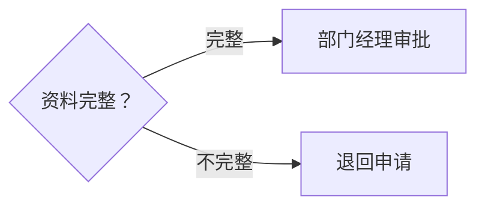
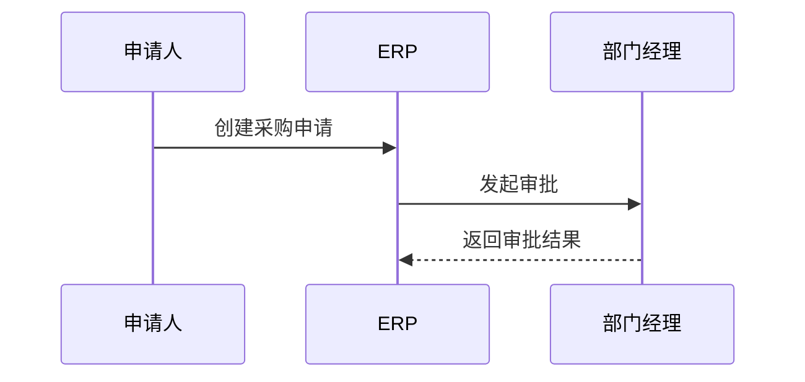
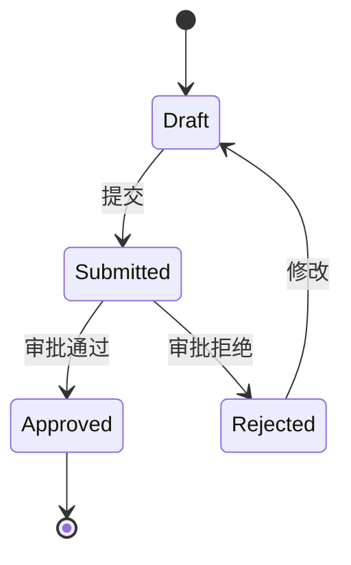
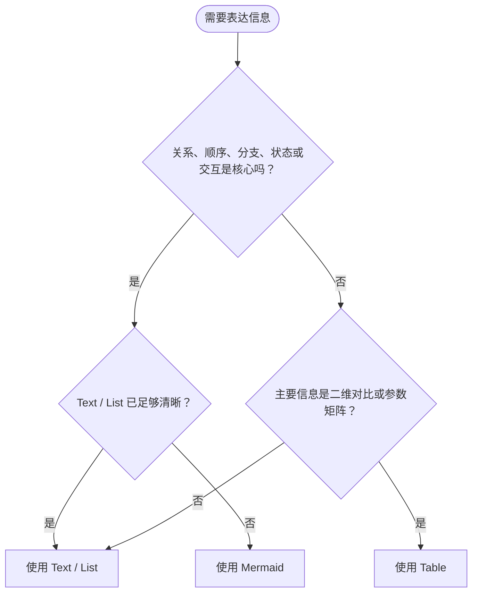
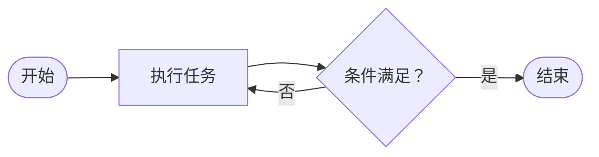

# SSAT Markdown & Mermaid 文档编写规范

| 文档属性 | 值 |
|---|---|
| 规范编号 | SSAT-STD-DOC-0001（Registered） |
| 目标版本 | 2.0.0 |
| 生命周期 | 见 Front Matter `status` |
| 候选迭代 | 见 Front Matter `iteration`（仅 Draft / Review） |
| 变更类型 | Breaking / Major |
| 简介 | 规定 SSAT Markdown 文档、Document ID、Mermaid 图形与数学公式的元数据、身份、版本生命周期、编写、适用性、可读性、校验、机器治理及发布要求。 |
| 适用范围 | SSAT 企业知识库中的 Markdown 文档、Mermaid 结构化图形及数学公式 |
| 核心原则 | Markdown 是知识源代码；Mermaid 是结构化图形源代码；LaTeX Math Subset 是数学表达源格式；飞书等系统属于发布与协作层 |

## 1. 总则

### 1.1 目的

本规范建立 SSAT 统一的文本化企业知识标准，使文档同时满足：

- 人员可直接阅读和编辑；
- AI 可稳定解析、生成和增量修改；
- 程序可校验、索引、转换和发布；
- Git 或等效版本系统可形成有效 Diff；
- 关键事实、决策和变更可追溯；
- 结构化图在源文件、渲染结果和目标平台上均保持可读；
- 可发布至飞书、PDF、Word、HTML 等目标；
- 可脱离单一 SaaS、编辑器或私有文件格式长期保存。

SSAT 对 Markdown 的定位是：

> **Knowledge Source Code**

SSAT 对 Mermaid 的定位是：

> **Diagram Source Code**

SSAT 对数学公式的定位是：

> **Mathematical Expression Source**

### 1.2 适用范围

本规范适用于：

- Policy；
- Standard；
- Process；
- SOP；
- Work Instruction；
- Specification；
- Guide；
- Reference；
- 项目知识；
- 项目状态；
- Meeting；
- Decision；
- Incident；
- Risk / Issue；
- Action Log；
- Index；
- Manifest；
- Glossary；
- ChangeLog；
- AI 自动创建或维护的知识文件。

CAD、PCB、机械工程图、复杂 Excel 模型、原始测试数据等专业文件可继续保留原生格式，但其说明、元数据、关系和索引应纳入 Markdown 知识体系。

### 1.3 设计原则

SSAT 文档工程必须遵循：

1. **Source First**：源文件优先于展示形式。
2. **Single Source of Truth**：同一核心事实具有明确 Canonical Location。
3. **Semantic Structure**：结构首先表达业务语义，而非视觉效果。
4. **Stable Identity**：文档、图节点、业务实体采用稳定 ID。
5. **Minimal Diff**：修改只影响必要内容。
6. **Explicit Evidence**：关键事实能够追溯来源。
7. **Platform Independence**：不得以某个平台私有能力定义核心源格式。
8. **Machine Enforceable**：能够形成 Schema、Lint 和 Quality Gate。
9. **Graceful Migration**：标准升级必须考虑存量知识。
10. **No Silent Loss**：发布转换不得静默丢失内容。
11. **Readable by Default**：正式图形在目标平台正常阅读状态下必须可辨认、可追踪、可理解。
12. **Structure Before Scaling**：图形不可读时优先重构结构，不得仅依靠整体缩小解决版面问题。
13. **Visual Hierarchy**：主流程、辅助路径、异常路径和说明信息必须具有清晰视觉层级。
14. **Style by System**：业务作者负责构图与语义，颜色、字体、线宽、间距和企业主题由 Renderer / Publisher 统一控制。
15. **Accessible by Design**：任何业务含义不得仅依赖颜色、位置或视觉装饰表达。
16. **Right Representation**：应根据内容结构选择 Text、List、Table、Formula、Mermaid、Data Chart 或专业工程 Source；不得为了形式完整而强行画图或写公式。
17. **Context Before Detail**：正式图形应在读者获得必要上下文后出现，并优先遵循由整体到局部、由主流程到异常流程的展现顺序。
18. **Math Only When Mathematical**：只有当数量之间的数学关系本身是信息主体时才使用公式；参数表、阈值映射、业务判断和测试曲线应选择更匹配的载体。
19. **Engineering SSOT Protection**：Mermaid、Formula 和 Markdown Table 均不得复制并取代 DBC、ARXML、A2L、ODX、FIBEX、模型、需求库或测试数据等专业工程 SSOT。
20. **Identity Independence**：Document ID 是知识对象的稳定主键，必须与文件名、版本、生命周期、Owner、组织结构和发布平台解耦；Registered ID 永久冻结且不得复用。
21. **Contract Layering**：自然语言 Standard 定义机器资产的业务语义，Structural Schema 定义数据结构，YAML/JSON Asset 保存受控实例，Executable Tool 执行校验或转换；任何一层都不得静默替代另一层。
22. **Governed Machine Assets**：Schema、Registry、Profile、Manifest 与其发布快照均属于受控机器资产，必须具有明确生命周期、独立版本、维护权限、Digest、变更顺序和 Release Gate。
23. **Derived Packaging**：ZIP / Runtime Bundle / Audit Bundle 属于可重建的交付或归档产物，不是 Normative Dependency、不是 SSOT，也不得仅因缺少可选 Package 阻塞 Review / Effective；治理对象始终是独立受控 Asset、Manifest 与 Evidence。
24. **Minimal Machine Asset**：只有无法由主 Standard + Core Registry 唯一表达、并且机器执行确实需要独立读取的对象，才允许新增 Machine Asset；“更结构化”“更完整”或“Normative”本身不是拆分文件的理由。

### 1.4 规范关键字

| 中文 | 英文 | 含义 |
|---|---|---|
| 必须 | MUST | 强制要求 |
| 禁止 | MUST NOT | 强制禁止 |
| 应 | SHOULD | 正常情况下执行 |
| 不应 | SHOULD NOT | 正常情况下避免 |
| 可以 | MAY | 可选能力 |

MUST 级规则不满足时必须修复或进入正式例外流程。

---

## 2. 技术基线与兼容策略

### 2.1 SSAT-MD Profile

SSAT-MD 2.0.0 定义为：

```text
CommonMark
+
GFM Table Extension
+
GFM Task List Extension
+
SSAT YAML Front Matter
+
SSAT Mermaid Fenced Block
+
SSAT LaTeX Math Subset
```

SSAT-MD **不是完整 GFM**。某个编辑器、网站或 Markdown Renderer 支持某种扩展，并不代表 SSAT 自动允许该扩展。

### 2.2 基础 Markdown

基础语法采用：

```text
CommonMark 0.31.2
```

### 2.3 GFM 扩展

SSAT 仅采用 GFM 中以下扩展：

```text
Tables
Task List Items
```

下列 GFM 扩展不属于 SSAT-MD 2.0.0 的业务标准能力：

```text
Strikethrough Extension
GFM Autolink Extension
其他未明确批准的扩展
```

### 2.4 YAML

Front Matter 使用：

```text
YAML 1.2.2
```

同时执行本规范定义的更严格 SSAT YAML 子集。

### 2.5 Mermaid

Mermaid 语法由 SSAT-MM Profile 管理。

Mermaid Renderer 的具体生产版本不写入普通业务 `.md` 文件，而由部署 Toolchain / Adapter Configuration 锁定。

Mermaid 官方版本会持续演进，主 Standard 不固定“当前最新版本”快照。生产 Validator / Renderer 的精确版本必须在实际部署配置中锁定，并以回归验证结果作为兼容性依据；普通业务 `.md` 不得自行声明 Renderer 版本。只有当兼容矩阵确实需要独立于主 Standard 生命周期维护时，才 MAY 物化独立 Compatibility Registry。

### 2.6 数学表达式

SSAT 数学表达式采用受控的 LaTeX Math Subset，源文件只批准两种定界形式：

```text
Inline:  $...$
Display: $$...$$
```

V1.12.0 的数学允许集合以本 Standard §7 与 Canonical Lint Rule 为规范来源。GitHub、飞书或其他平台支持更多数学语法，并不自动扩大 SSAT 的允许语法集合。若未来确有独立生命周期或工具复用需要，才 MAY 将其投影为独立 Math Profile；该投影不得成为第二个语义 SSOT。

数学表达式必须由 Publication Adapter 显式转换或验证；不得假设不同 Renderer 对全部 LaTeX / MathJax / KaTeX 扩展具有相同行为。

### 2.7 发布平台兼容性

飞书、PDF、Word、HTML 等目标系统的能力属于 `Publication Adapter Compatibility`，而不属于 SSAT-MD 核心语法定义。

平台能力变化时，应优先升级 Adapter，而不是随意修改企业知识源格式。

---

## 3. 文档模型与生命周期

### 3.1 Doc Class

SSAT 文档分为四类：

```text
controlled
knowledge
record
meta
```

### 3.2 CONTROLLED

正式受控文件。

允许的 `doc_type`：

```text
policy
standard
process
sop
wi
spec
```

典型特征：

- 有正式 Owner；
- 有审核或批准流程；
- 有业务文档版本；
- 有生命周期状态；
- 实质变化需要受控。

### 3.3 KNOWLEDGE

持续维护的 Canonical Knowledge。

允许的 `doc_type`：

```text
guide
overview
reference
org
project_status
process_kb
```

例如，正式下载文件可以使用：

```text
org_overview.md
hiring_guide.md
processes_guide.md
security_guide.md
project_status.md
```

此类文档通常依靠 Repository 历史记录变化，可以不维护独立 `document_version`。

### 3.4 RECORD

表示特定事件、时间点或不可覆盖历史。

允许的 `doc_type`：

```text
meeting
decision
project_snapshot
project_review
incident
risk_issue
action_log
```

RECORD 应强调发生时间、来源、事实、决策、Owner、状态和追溯关系。

### 3.5 META

知识库治理文件。

允许的 `doc_type`：

```text
index
manifest
glossary
taxonomy
changelog
template
registry
```

### 3.6 Project Status 的 SSOT

当前项目状态属于：

```text
doc_class: knowledge
doc_type: project_status
```

例如：

```text
kb/50_Projects/<project>/project_status.md
```

项目周报快照、Gate Review 或指定日期状态快照属于 RECORD，例如 `project_snapshot`、`project_review`。

禁止把当前项目状态文件当作不可修改历史 Record。

### 3.7 CONTROLLED 状态

新建 V1.12.0+ CONTROLLED Source Artifact 的作者级生命周期为：

```text
draft
review
approved
effective
```

`obsolete` 是 Document Registry 对已发布 CONTROLLED Version / Document 的**后续治理状态投影**，不是通过原地修改已发布 Effective Source 获得的作者级状态。历史或外部系统中已经物化的 `status: obsolete` MAY 作为 Compatibility Snapshot 解析，但新 V1.12.0+ 流程 MUST 通过 §12.12.1 的 Registry Retirement / Obsolescence Transaction 表达失效，不得回写不可变 Effective Artifact。

### 3.8 KNOWLEDGE 状态

```text
draft
active
archived
```

### 3.9 RECORD 状态

通用状态：

```text
draft
final
superseded
```

特定 Record Type 可以拥有额外状态，但必须在 Document ID Type Registry 的 `allowed_lifecycle_statuses` 中登记；不得依赖未定义的 Doc Type Schema。

### 3.10 META 状态

```text
active
archived
```

---

## 4. Front Matter 与文档身份

### 4.1 Front Matter

所有新建受管控 Markdown 文件必须从第一行开始包含 YAML Front Matter。

示例：

```yaml
---
ssat_md: "2.0.0"
id: "SSAT-SOP-PUR-0001"
id_status: "registered"
title: "采购申请与审批流程"
description: "规定采购申请的创建、审批、结果处理与相关控制要求。"
doc_class: "controlled"
doc_type: "sop"
status: "effective"
document_version: "1.2.0"
owner: "Procurement"
owner_status: "confirmed"
classification: "internal"
language: "zh-CN"
created_date: "2026-06-01"
updated_date: "2026-08-21"
---
```

### 4.2 `ssat_md`

表示文件遵循的 SSAT Markdown Profile，例如：

```yaml
ssat_md: "2.0.0"
```

它不是业务文档版本。

### 4.3 `document_version`

表示 CONTROLLED 文件的业务版本，例如：

```yaml
document_version: "2.3.0"
```

不得继续使用语义不明确的：

```yaml
version: "2.3.0"
```

新文件中 `version` 属于 Deprecated Key。

### 4.4 ID 生命周期

Document ID 是知识对象的稳定身份主键，必须全局唯一，并遵守 §4.17 的 Document ID Naming Convention。

`id_status` 枚举：

```text
proposed
registered
```

Draft 阶段可以：

```yaml
id: "SSAT-STD-DOC-0001"
id_status: "proposed"
```

`proposed` ID 可以在正式注册前调整，但不得被 Review+ / Effective 文档作为稳定长期引用。进入 `review`、`approved`、`effective` 之前必须完成正式注册。

一旦：

```yaml
id_status: "registered"
```

则 Document ID 永久冻结；文件重命名、路径移动、Owner 变化、组织重组、版本升级、飞书迁移或发布平台变化均不得导致 ID 改变。

已注册或已退休的 Document ID 永久不得重新分配给其他知识对象。

### 4.5 Owner 生命周期

`owner_status` 枚举：

```text
unconfirmed
confirmed
```

Draft 阶段允许：

```yaml
owner: "TBD"
owner_status: "unconfirmed"
```

CONTROLLED 文件进入 Review 之前必须确定正式 Owner。

AI 禁止自行创造不存在的部门、Owner 或审批人。

### 4.6 Metadata Key 与 Core Allowlist

Key 必须使用 `lower_snake_case`。

V2.0.0 的 Front Matter 结构约束由**本 Standard §4 + Appendix B 的 FM Rule Set**直接定义，不再依赖单独的 `frontmatter.schema.json`。Stage A2 Parser / Lint Engine 必须按下列 Core Key Allowlist、Doc Class 必填字段和条件规则执行确定性校验。

Core Allowlist：

```text
ssat_md
id
id_status
title
description
doc_class
doc_type
status
document_version
iteration
change_type
supersedes
owner
owner_status
classification
language
created_date
updated_date
approval_date
effective_date
approver
source_refs
tags
normative_refs
planned_normative_refs
informative_refs
extensions
```

机器类型基线：

| Key 类别 | YAML Type |
|---|---|
| `iteration` | integer，且 >= 1 |
| `supersedes` / `source_refs` / `tags` / `normative_refs` / `planned_normative_refs` / `informative_refs` | array of string |
| `extensions` | mapping/object |
| 其他 Core Key | scalar string，除非本节另有明确规定 |

规则：

1. `FM018` 的“未知核心 Metadata Key”以本 Allowlist 为判断基线；
2. Doc Class 必填字段仍以 §4.11～§4.14 为准；
3. Release Metadata 必须与 Lifecycle 严格匹配：`draft` / `review` MUST NOT 声明 `approval_date`、`effective_date`、`approver`；`approved` MAY 声明 `approval_date` / `approver` 但 MUST NOT 声明 `effective_date`；`effective` 按 §4.11 必须声明完整 Release Metadata；
4. `SSAT_CCSD/1` Mutable Key（`status`、`iteration`、`updated_date`、`approval_date`、`effective_date`、`approver`）必须使用**单行顶层 Scalar Lexical Form**；不得使用 YAML Literal / Folded Block Scalar（`|` / `>` 及其 Chomping 变体）、多行 Scalar、Anchor / Alias 或其他会跨物理行表达值的写法；
5. 业务扩展不得直接创造与 Core Key 同义的新顶层 Key；确有扩展需要时使用 `extensions`，并由适用 Standard / Tool 明确解释；
6. Front Matter 的机器校验由 Lint Engine 实现；**Parser / Tool 是执行者，不是第二个规范来源**。

### 4.7 Metadata Value 规则

日期、ID、版本应使用字符串。

推荐：

```yaml
updated_date: "YYYY-MM-DD"
document_version: "2.3.0"
```

禁止使用 YAML Anchor、Alias 或复杂对象承载核心 Metadata。对于 §12.10 `SSAT_CCSD/1` 会 Mask 的 Mutable Core Key，还必须遵守 §4.6 的单行顶层 Scalar Lexical Form；即使 `>-` / `|-` 最终可被 YAML Parser 解析成合法 String，也仍属于禁止形式，因为 Digest 必须能够按确定的物理行删除算法执行。

### 4.8 `description` 简介

所有新建 SSAT 文件必须包含 `description`。

`description` 必须用一句简洁、无歧义的话说明：

- 文档主要规定、记录或说明什么；
- 必要时说明主要适用范围或对象。

推荐长度约 20～80 个中文字符或等价信息量。

正确：

```yaml
description: "规定 SSAT Markdown 文档与 Mermaid 图形的元数据、编写、图形适用性与展现时机、可读性、视觉质量、校验、知识治理及发布要求。"
```

不合格：

```yaml
description: "本文件介绍相关规范。"
```

不得使用“相关内容”“其他说明”“有关信息”等无法独立判断主题的表述。

### 4.9 分类等级

`classification` 枚举：

```text
public
internal
confidential
restricted
```

密码、Token、API Secret、Private Key 等秘密信息禁止进入普通 Markdown Knowledge Repository。

#### 4.9.1 Document Language

`language` 表示当前 Markdown Artifact 的 **Primary Language**，使用受控语言标签。V2.0.0 识别：

```text
zh-CN
en-US
```

规则：

1. CONTROLLED Markdown **MUST** 声明 `language`；
2. V2.0.0 的 CONTROLLED Artifact **MUST** 使用 `zh-CN` 作为唯一 Primary Language：

```yaml
language: "zh-CN"
```

3. 一个 CONTROLLED Artifact 只能声明一个 Primary Language；`language` 必须是单一 scalar string，不得使用数组、逗号拼接或 `zh-CN+en-US` 等自定义组合；
4. Primary Language 约束作者编写的叙述性正文、标题、章节标题、表格叙述性表头及 Mermaid 显示 Label 的主要自然语言。必要的英文专业术语、标准名称、产品固有名称与引用原文不构成第二 Primary Language；
5. Identifier、代码、接口名称、信号名称、工程 Source Identifier、标准缩写、API、AUTOSAR / DBC / A2L / Simulink 等工具链对象 **MUST NOT** 为追求正文语言一致性而翻译、音译或改写；
6. 文件名、YAML Key、Document ID、Mermaid ID 与其他 Machine Identifier 不受正文 Primary Language 影响，继续遵守各自 ASCII / Naming Context 规则；
7. V1.12.0 **不支持同一 Document ID + Document Version 的多个正式 Language Variant**。不得以 `zh-CN` / `en-US` 为由发布两份同时声称为该版本正式 Canonical CONTROLLED Artifact 的平行正文；
8. `en-US` 在 V2.0.0 作为受识别语言标签保留给非 CONTROLLED 文档或未来扩展；它**不是当前 CONTROLLED Artifact 的可选 Primary Language**；
9. 如未来需要正式英文版或其他语言 Variant，必须先扩展 Document Registry / Artifact Governance，明确 Canonical Source、翻译关系、同步责任、版本与审批规则后方可启用。

原则：

> **CONTROLLED 正式源统一中文；工程标识保持原始身份；语言不得制造第二个正式 SSOT。**

### 4.10 日期与时间

日期统一：

```text
YYYY-MM-DD
```

需要精确时间：

```text
YYYY-MM-DDTHH:MM:SS+TZ
```

禁止将“昨天”“最近”“月底”“下周”等相对表述作为唯一正式日期。

### 4.11 CONTROLLED 必填字段

```text
ssat_md
id
id_status
title
description
doc_class
doc_type
status
document_version
owner
owner_status
classification
language
created_date
updated_date
```

此外：

- `language` 必须为单一 scalar `zh-CN`；
- `draft` / `review` CONTROLLED Candidate 必须具有 `iteration`，且 MUST NOT 声明 `approval_date`、`effective_date`、`approver`；
- `approved` / `effective` MUST NOT 保留 `iteration`；`approved` MUST NOT 声明 `effective_date`；
- 如果该目标版本声明 `supersedes`，则必须同时声明 `change_type`；
- 首次创建、经 Authoritative Document Registry 证明不存在任何前序正式版本的文档 MUST 省略 `supersedes`，并 MAY 省略 `change_type`；A1 以 §12.9.3 的 Initial Creation Branch 建立 Reservation，不得伪造一个不存在的“变化类型”；
- 独立 `approved` Snapshot（仅实际物化时）MUST 具有 `approval_date` 与 `approver`，且必须与 §12.10.1 Authoritative Approval Freeze / Approval Evidence 一致；
- `effective` Artifact MUST 具有 `approval_date`、`effective_date` 与 `approver`，并与 Document Registry / Approval Evidence 一致。上述 Release Metadata 即使被 §12.10 的 Source Digest Mask 排除，也必须由 B2 独立验证，不得因 Digest 一致而默认合法。

### 4.12 KNOWLEDGE 必填字段

```text
ssat_md
id
id_status
title
description
doc_class
doc_type
status
owner
owner_status
classification
updated_date
```

### 4.13 RECORD 必填字段

```text
ssat_md
id
id_status
title
description
doc_class
doc_type
status
owner
owner_status
classification
created_date
source_refs
```

### 4.14 META 必填字段

```text
ssat_md
id
id_status
title
description
doc_class
doc_type
status
owner
owner_status
updated_date
```

### 4.15 Internal Normative Dependency 与 Release Core Asset 边界

ordinary Internal Normative Dependency、Reusable Machine Asset Release 与 Authoritative Registry State 必须严格区分：

| 对象 | 主 Standard 中的长期关系 | 精确版本 / Digest 绑定权威 |
|---|---|---|
| ordinary Internal Normative Dependency | `normative_refs`，必须使用稳定 Identity + 已注册正式版本 | `normative_refs` + Repository Evidence |
| Reusable Machine Asset Release | §13.10 定义稳定 Machine Contract；主 Standard **不得为选择具体 Machine Asset Release 而写入其内部 Asset Version** | Authoritative Document Registry 中的 `machine_asset_release` Selection + 对应 `machine_asset_release_manifest.yaml` |
| `document_registry.yaml` | Authoritative Logical Registry 的持续变化 State Snapshot，不属于 Reusable Machine Asset Release | Registry Transaction Revision / Snapshot Digest / Evidence |

确有 ordinary 独立依赖且 Draft 阶段尚未物化时，必须使用 `planned_normative_refs`，并且不得为尚未创建的对象虚构版本号：

```yaml
planned_normative_refs:
  - "<stable-external-dependency-name>"
```

进入 `review`、`approved` 或 `effective` 之前，ordinary Planned Dependency 必须已经创建、注册并转换为带稳定 Identity 与真实正式版本的 `normative_refs`；Repository 必须能够解析该引用。

Reusable Machine Asset Release 不执行上述 `planned_normative_refs → normative_refs` 流程。其内部 8 个 Release Core Asset 各自独立 SemVer；一个 Machine Asset Release 又具有独立 Release Version。某个 `draft.n` / `review.n` / `approved` / `effective` Artifact 实际选择哪个 Machine Asset Release，只记录于 Authoritative Document Registry / Release Evidence，不要求也不得因此重新打包一份“属于该文档”的 Machine Asset ZIP。

**同一个已注册 Machine Asset Release MAY 被多个 Standard Version、多个 Candidate iteration 乃至多个兼容 CONTROLLED 文档复用。** 只有 Machine Asset Release 的组成、所选 Asset Version 或 Release Contract 自身变化时，才创建新的 Machine Asset Release。

### 4.16 Version Candidate Metadata


CONTROLLED 文件采用目标正式版本、生命周期和候选迭代相互分离的模型：

```yaml
document_version: "1.12.0"
status: "draft"
iteration: 1
change_type: "compatible"
supersedes:
  - "1.10.0"
```

字段含义：

| 字段 | 含义 |
|---|---|
| `document_version` | 当前候选最终计划发布的正式版本；使用 `MAJOR.MINOR.PATCH` |
| `status` | 当前生命周期，例如 `draft`、`review`、`approved`、`effective` |
| `iteration` | 当前 Draft / Review 阶段的候选序号，不属于正式版本号 |
| `change_type` | 本次版本变化类型：`editorial`、`compatible`、`breaking`、`security` |
| `supersedes` | 本目标版本计划替代的历史正式版本；只在新版本中声明，不回写旧版本 |

规则：

- `draft` / `review` 状态的 CONTROLLED 候选必须具有正整数 `iteration`；
- `approved` / `effective` / 历史发布 Artifact 不应继续携带候选 `iteration`；
- `iteration` 不得用于判断正式版本大小；
- 当 `supersedes` 非空时，`change_type` 必须存在；首次创建且没有前序正式版本时可以省略二者；
- 已对外发布或进入受控审查的 Candidate Artifact 不得原地覆盖，后续修改必须创建新的 iteration；
- 已发布历史 Artifact 不得为了补充 `superseded_by` 等信息而修改；历史关系由新版本与 Document Registry 管理。


### 4.17 Document ID Naming Convention

#### 4.17.1 定位

Document ID 是 SSAT 知识对象的**稳定、全局唯一、长期不可复用的身份主键**。它服务于：

- Document Registry；
- 跨文档引用；
- 版本关系；
- Index / Manifest；
- 飞书及其他平台对象映射；
- AI / RAG 稳定引用；
- 文件移动、重命名和平台迁移后的持续追踪。

Document ID 与文件名不是同一概念。

| 对象 | 示例 | 是否随版本变化 |
|---|---|---:|
| Document ID | `SSAT-STD-DOC-0001` | 否 |
| Document Version | `1.12.0` | 是 |
| Candidate | `draft.15` | 是 |
| 文件名 | `ssat_md_mermaid_standard_v1.12.0_draft.2.md` | 是 |
| Version-qualified Reference | `SSAT-STD-DOC-0001@1.12.0` | 指向指定版本 |

#### 4.17.2 标准格式

新建 SSAT Document ID 必须采用：

```text
SSAT-<TYPE>-<SCOPE>-<SEQ>
```

例如：

```text
SSAT-STD-DOC-0001
SSAT-SOP-PUR-0027
SSAT-SPEC-BMS-0042
SSAT-DEC-EHCM11-0017
SSAT-MTG-EHCM11-0048
```

四个 Segment 的定义：

| Segment | 含义 | 规则 |
|---|---|---|
| `SSAT` | Namespace | 固定值 |
| `TYPE` | 文档类型代码 | 由 Document ID Type Registry 管理 |
| `SCOPE` | 稳定业务/产品/项目范围代码 | 由 Document Scope Registry 管理 |
| `SEQ` | `TYPE + SCOPE` 范围内的序列号 | 固定 4 位十进制数字，由 Registry 分配 |

Document ID 不得为了“自解释”继续增加第五、第六个动态 Segment。可变化信息必须留在 Metadata 或 Registry 中。

#### 4.17.3 格式基线

V1.12.0 新建 Document ID 的语法基线：

```regex
^SSAT-[A-Z][A-Z0-9]{1,5}-[A-Z][A-Z0-9]{1,7}-(?:000[1-9]|00[1-9][0-9]|0[1-9][0-9]{2}|[1-9][0-9]{3})$
```

即：

- `TYPE`：2～6 个大写 ASCII 字母/数字，首字符必须为字母；
- `SCOPE`：2～8 个大写 ASCII 字母/数字，首字符必须为字母；
- `SEQ`：固定 4 位数字 `0001`～`9999`；
- Segment 之间统一使用半角 `-`；
- Document ID 必须按字符串处理，不得假设其可直接作为 C、MATLAB、AUTOSAR、DBC 或 A2L Identifier。

正确：

```text
SSAT-SOP-PUR-0001
SSAT-SPEC-BMS-0127
SSAT-DEC-EHCM11-0048
```

不合格：

```text
ssat-sop-pur-0001
SSAT_SOP_PUR_0001
SSAT-SOP-采购-0001
SSAT-SOP-PUR-1
SSAT-SOP-PUR-00001
```

#### 4.17.4 TYPE Code

`TYPE` 必须由 Document ID Type Registry 唯一映射到 `doc_type`，作者或 AI 不得临时创造缩写。

初始推荐映射：

| `doc_type` | TYPE |
|---|---|
| `policy` | `POL` |
| `standard` | `STD` |
| `process` | `PRC` |
| `sop` | `SOP` |
| `wi` | `WI` |
| `spec` | `SPEC` |
| `guide` | `GDE` |
| `overview` | `OVW` |
| `reference` | `REF` |
| `org` | `ORG` |
| `project_status` | `PST` |
| `process_kb` | `PKB` |
| `meeting` | `MTG` |
| `decision` | `DEC` |
| `project_snapshot` | `PSN` |
| `project_review` | `PRV` |
| `incident` | `INC` |
| `risk_issue` | `RSK` |
| `action_log` | `ACT` |
| `index` | `IDX` |
| `manifest` | `MNF` |
| `glossary` | `GLO` |
| `taxonomy` | `TAX` |
| `changelog` | `CHG` |
| `template` | `TPL` |
| `registry` | `REG` |

最终映射以已注册的 Document ID Type Registry 为准；V1.12.0 的全部允许 `doc_type` 必须在 Registry 中具有 `registered` TYPE 映射。

#### 4.17.5 SCOPE Code

`SCOPE` 表示稳定业务、产品、系统、知识域或项目范围，而不是当前组织部门名称。

适合：

```text
DOC
PUR
QMS
SW
HW
SYS
BMS
EHCM11
```

不适合：

```text
JOHNTEAM
RDDEPT2
NEWORG
BOSSWANG
```

原则：

> **Scope 的稳定性必须高于组织结构的稳定性。**

Owner、Department、Approver 等易变组织信息必须保存在 Metadata，不得编码进 Document ID。

SCOPE Code 必须由 Document Scope Registry 注册。已有 Scope 被重命名、合并或停止使用时，应通过 Registry 状态和 Alias 管理，不得批量改写已经 Registered 的 Document ID。

#### 4.17.6 SEQ 分配

`SEQ` 必须由 Document Registry 在对应 `TYPE + SCOPE` 命名空间内原子分配。

禁止：

> “目录里最大编号似乎是 0047，所以 AI 自己使用 0048。”

并发创建时只有 Registry 有权确认号码是否已经占用。

Document Front Matter 与 Registry 必须区分身份状态：

- Source Front Matter 使用 `id_status: proposed | registered`；
- Document Registry 使用 `identity_state: reserved | registered | retired`；
- Draft 中的 `id_status: proposed` 对应 Registry 的 `identity_state: reserved`；
- Review Gate 完成正式注册后，新的 Candidate 才可以使用 `id_status: registered`，Registry 同步切换为 `registered`；
- `retired` 只由 Registry 表达，不要求回写历史 Artifact。

`SEQ` 的复用规则采用 **Committed Allocation Never Reuse**：

1. 原子分配事务尚未提交时，可以回滚，不产生永久占号；
2. 一旦 Proposed ID 已写入受控 Registry、形成 Candidate Artifact、进入 Review、被其他受控对象引用或进入审计记录，该号码即永久保留；
3. 后续即使 Candidate 被取消、文档被撤销或身份被退休，也不得重新分配该号码；
4. Registry 必须以 `reserved / registered / retired` 或 Tombstone 方式保留历史占用证据。

`sequence_namespaces[].allocation_state` 描述 **TYPE + SCOPE 分配命名空间**，不是某个 Document Identity 的 `identity_state`。V1.12.0 的语义固定为：

- `reserved`：命名空间已建立但尚无任何永久提交的 SEQ；`last_committed_sequence = 0`；
- `registered`：命名空间至少存在一个永久提交的 SEQ，且仍允许继续分配；`last_committed_sequence >= 1`，`next_sequence_hint` 仅为提示而不是授权；
- `exhausted`：命名空间已无可合法分配的新 SEQ；新分配必须 `BLOCKED`，不得回收已提交号码。

`allocation_state` 与 `last_committed_sequence` / `next_sequence_hint` 的组合必须与上述语义一致，并由 §12.9.4 / `GOV039` 作为 Registry State Invariant 检查；Schema 只允许 Enum，不单独定义这些状态含义。

Registry Tombstone 示例：

```yaml
id: "SSAT-SOP-PUR-0042"
identity_state: "retired"
```

#### 4.17.7 ID 中禁止编码的信息

Document ID 禁止包含以下动态或平台信息：

- 文档版本；
- Draft / Review / Effective 等生命周期；
- Owner / Approver；
- 当前部门名称；
- Classification；
- Language；
- Creation / Effective Date；
- 文件路径；
- Git Branch / Commit；
- 飞书 Token / URL；
- 发布平台；
- Candidate iteration。

错误：

```text
SSAT-SOP-PUR-V2-2026-EFFECTIVE-0001
```

正确：

```text
SSAT-SOP-PUR-0001
```

#### 4.17.8 ID 与文件名的分隔符差异

SSAT Markdown 下载文件名采用 `_`：

```text
ssat_md_mermaid_standard_v1.12.0_draft.2.md
```

Document ID 采用 `-`：

```text
SSAT-STD-DOC-0001
```

这是有意设计，而不是风格不一致：

- 文件名优先考虑汽车电子工具链、脚本和文件系统的 Identifier-Friendly 兼容性；
- Document ID 是 Opaque String Identifier，优先保证 Segment 可辨认和长期稳定。

如果某个技术 Adapter 需要生成 C-like Identifier，必须显式转换，例如：

```text
SSAT-STD-DOC-0001
↓ Adapter mapping
SSAT_STD_DOC_0001
```

不得因此修改 Canonical Document ID。

#### 4.17.9 Version-qualified Reference

无版本 Document ID：

```text
SSAT-STD-DOC-0001
```

表示该知识对象本身；在允许“Current Effective”解析的上下文中，由 Document Registry 解析当前有效版本。

明确引用正式版本时使用：

```text
SSAT-STD-DOC-0001@1.12.0
```

长期 CONTROLLED 引用不应指向 Draft / Review Candidate。

仅在内部评审、调试或审计工具中，可以使用 Candidate-qualified Reference：

```text
SSAT-STD-DOC-0001@1.12.0#review.2
```

此类 Candidate Reference 不得作为 Effective 文档的长期规范性依赖。

#### 4.17.10 Identity Continuity、Split 与 Merge

版本号用于描述：

> **同一个知识对象发生变化。**

新 Document ID 用于描述：

> **产生了新的知识对象身份。**

如果文档内容重大调整但业务身份连续，例如同一《采购申请流程》从 V1 升级 V2，应保留原 Document ID。

如果一个知识对象拆成两个独立受控对象：

```text
SSAT-SOP-PUR-0012
↓ Split
SSAT-SOP-PUR-0043
SSAT-SOP-PUR-0044
```

新对象应获得新 ID，并在 **Document Registry Entry** 中通过 `derived_from` 关系记录来源。例如（以下是 Registry Entry 关系片段，**不是 Front Matter**）：

```yaml
derived_from:
  - "SSAT-SOP-PUR-0012"
```

`derived_from` 不属于 V1.12.0 Core Front Matter Allowlist；不得把上述 Registry 关系片段复制为 Markdown Front Matter Key。旧对象由 Registry 管理其历史状态，不修改历史 Artifact。

如果多个对象真正融合成一个新的独立知识对象，同样应分配新 ID，并通过 Document Registry Entry 的 `derived_from` / 等效已定义关系记录来源。

不得通过 `0012-A`、`0012-B` 等无限扩展后缀替代正常的 Document ID 分配机制。

#### 4.17.11 Registry 是唯一性权威

Regex 只能验证 Document ID **格式**；Document Registry 才能验证：

- 全局唯一性；
- TYPE / SCOPE 合法性；
- SEQ 是否已占用；
- ID 是否 Registered / Retired；
- Canonical Path；
- Version / Candidate；
- Current Effective Version；
- Split / Merge / Supersession 等身份关系。

Document ID 创建流程应为：

```text
选择 doc_type
↓
解析 Registered TYPE Code
↓
选择 Registered Stable Scope
↓
Document Registry 原子分配 SEQ
↓
生成 Proposed ID
↓
Draft
↓
Review 前 Registered
```

AI 不得自行推断 next sequence，也不得将未注册 ID 宣称为 Registered。

#### 4.17.12 Legacy Document ID Compatibility

V1.12.0 的四位 `SEQ` 规则只强制用于**新分配**的 Document ID。V1.11.0 及更早版本中已经合法 `registered` 的三位 SEQ Document ID 可以通过 Document Registry 标记为 `legacy_registered`，继续作为永久稳定身份使用。

例如历史 Registered ID：

```text
SSAT-STD-DOC-001
SSAT-SOP-PUR-027
```

兼容规则：

- 已 Registered 的 Legacy ID **不得为了满足四位新格式而重新编号**；
- Legacy 三位 ID 若符合允许的词法形态，可通过 Stage A2 的兼容入口而不触发 `ID001`；其历史合法性必须在 Stage B1 / B2 由 `ID015` 使用 Registry Evidence 证明；
- 新分配 ID 不得继续使用三位 SEQ；
- 尚未 Registered 的旧 Proposed ID 不享受 Grandfathering，应在进入 Review 前迁移到当前四位格式；
- Legacy ID 与新四位 ID 均进入同一全局唯一性与禁止复用规则；
- Registry 应记录 `id_format_profile` / 等效字段和 Grandfathering 证据，Validator 不得仅凭字符串长度猜测历史合法性。

因此 V1.12.0 新增四位 Document ID Grammar 属于向后兼容的 MINOR 增强，而不是要求历史合法身份强制重编号的 Breaking Change。

---

## 5. Markdown 编写规范

### 5.1 文件编码

必须：

```text
UTF-8
.md
```

新写入推荐：

```text
UTF-8 without BOM
LF
```

读取工具应兼容已有 CRLF 文件。

### 5.2 H1

每个文件必须且只能存在一个 H1。

H1 必须与 Front Matter `title` 一致。

### 5.3 Heading 形式

仅允许 ATX Heading：

```markdown
# H1
## H2
### H3
#### H4
```

不使用 Setext Heading。

### 5.4 Heading 层级

正式文档正常控制于 H1～H4。

H5/H6 产生 WARNING。

不得跳级。

### 5.5 编号与 Heading Level

当 CONTROLLED 文档启用章节编号时：

```markdown
## 5. 一级章节
### 5.1 二级章节
#### 5.1.1 三级章节
```

编号深度必须与 Markdown Heading Level 对应。

### 5.6 标题语义

不推荐：

```markdown
## 说明
## 其他
## 注意
## 问题
```

推荐：

```markdown
## 采购金额审批规则
## EHCM11 高温老化测试异常
## 当前项目交付风险
```

标题脱离上下文后仍应基本能够识别内容主题。

### 5.7 段落与换行

一个段落表达一个主要观点。

不应人为硬换行以适配编辑器窗口宽度。

不得依赖行尾双空格、反斜线或 `<br>` 控制页面布局。

### 5.8 列表

无序列表统一使用 `-`。

有序列表仅用于真正具有顺序含义的内容。

### 5.9 Task List

允许：

```markdown
- [ ] 完成测试
- [x] 完成评审
```

适用于短期执行项和检查表。

### 5.10 行动项

正式 Action Item 应优先采用：

```markdown
| Action | Owner | Due | Status | Notes |
|---|---|---|---|---|
| 完成测试报告 | Zhang San | 2026-08-25 | Doing | - |
```

Status 推荐：`Todo`、`Doing`、`Done`、`Blocked`、`Cancelled`。

未知 Owner 或 Due 使用 `TBD`，禁止 AI 猜测。

### 5.11 Table

允许 GFM Pipe Table。

必须：

- 存在表头；
- 每列具有明确语义；
- 同一列使用同类数据；
- 不使用合并单元格；
- 不嵌套 Table；
- 不使用 HTML Table。

超过约 8～10 列时应评估拆表。

### 5.12 强调与历史表达

可以使用粗体和斜体进行普通强调。

粗体不能作为风险、状态、审批等级等业务语义的唯一载体。

正式业务规则不得依赖删除线保存历史；历史变化交由 Version Control、ChangeLog 或 Superseded Record。

### 5.13 Blockquote

用于注意事项、补充说明或背景解释。

### 5.14 Code Block

必须使用 fenced code block，并标记语言。

### 5.15 Raw HTML

SSAT Source Layer 禁止 Raw HTML，包括但不限于 `<br>`、`<div>`、`<span>`、`<table>`、`<style>`、`<script>`。

### 5.16 平台私有语法

不得把平台专有 Callout、Mention、Wiki Link 方言、Embed、Macro、Emoji Token 等作为企业源文件标准。

---

## 6. Mermaid 编写、可读性与视觉呈现规范

### 6.1 Profile、类型与兼容控制

#### 6.1.1 总则

当顺序、流程、判断、状态、系统交互、数据实体关系、简单结构关系或简单时间计划是信息主体时，应优先使用 Mermaid。

Mermaid 不用于强行替代 CAD、PCB、精密工程图、高复杂度自由布局图、大型精确网络拓扑或需要严格空间坐标的图形。

#### 6.1.2 Mermaid 合格条件

正式 Mermaid 图必须同时满足七个条件：

```text
Applicability Justified
+
Syntax Valid
+
Semantic Valid
+
Structure Coherent
+
Render Readable
+
Visual Quality Acceptable
+
Target Usable
```

“能够成功渲染”不等于“图形合格”；“看起来漂亮”也不能掩盖语义错误或结构混乱。图形还必须证明其相对于纯文本、列表或表格具有实际信息价值。任何一项严重失败，都应视为正式图质量失败。

#### 6.1.3 Source Preservation

所有 Mermaid 必须保留代码：

````markdown

````

禁止只保留 PNG/SVG 并删除 Mermaid Source。

#### 6.1.4 Diagram Type Profile

Mermaid 类型治理必须区分两个概念：

- **Diagram Family**：SSAT 用于治理和表达选择的稳定类别名；
- **Source Declaration**：Mermaid Source 第一条有效声明中实际出现的语法关键字。

二者不得混为一个字段。Mermaid 新版本可能改变或新增 Source Declaration，而 SSAT Diagram Family 应尽量保持稳定。

Diagram Family 分为四个状态：

```text
approved
conditional
prohibited
unverified
```

- `approved`：SSAT 正式支持，可直接用于满足本规范的 CONTROLLED 文档；
- `conditional`：只允许在规定用途且当前目标 Renderer / Adapter 具有可解析的 Compatibility Validation Evidence 时使用；
- `prohibited`：即使 Mermaid 官方支持，SSAT 正式文档也禁止作为标准表达形式；
- `unverified`：未知 Family 或无法映射的 Source Declaration 的默认状态；验证前不得进入正式 CONTROLLED 文档。

Validator 必须先执行 `Source Declaration → Diagram Family` 映射，再判断状态和适用规则。

#### 6.1.5 Approved Diagram Types

V2.0.0 默认 Approved：

| Diagram Family | Source Declaration | 核心信息 | 典型使用时机 | 汽车电子示例 |
|---|---|---|---|---|
| `flowchart` | `flowchart` / `graph` | 流程、判断、路径 | 分支、回退、跨步骤业务流程 | 变更流程、诊断决策逻辑概览 |
| `sequence` | `sequenceDiagram` | 时序交互 | 交互顺序影响结果，或跨多个参与者/系统 | ECU / Tester / Backend / UDS 交互 |
| `state` | `stateDiagram-v2` | 状态转换 | 对象存在明确状态和转换事件 | ECU 模式、功能状态、故障状态 |
| `class` | `classDiagram` | 静态结构 | 软件对象、组件、接口的静态关系 | 软件组件与接口关系 |
| `er` | `erDiagram` | 数据实体关系 | 结构化数据实体、主外键或关系模型 | 配置数据、数据库实体 |

Approved 只代表“允许作为标准图型”，不代表任何内容都应该画成该图。仍必须通过 Diagram Value Gate 和 Placement Gate。

#### 6.1.6 Conditional Diagram Types

以下 Family 有明确价值，但仅限规定用途：

| Diagram Family | Source Declaration | 允许用途 | 禁止替代的 SSOT / 载体 |
|---|---|---|---|
| `gantt` | `gantt` | 高层阶段、里程碑概览 | Jira、Project、飞书项目等正式计划 |
| `requirement` | `requirementDiagram` | 需求关系的解释性概览 | DOORS、Polarion、Jama、OEM Requirement System、正式 Requirement Registry |
| `swimlanes` | `swimlane-beta` | 跨角色/部门职责流程；责任归属本身是核心信息 | 未通过目标 Adapter 验证时禁止用于正式发布 |
| `architecture` | `architecture-beta` | 高层系统/服务架构概览 | ARXML、正式系统架构模型、精确网络/硬件拓扑 |
| `block` | `block` | 简单 Block Diagram | Simulink/专业模型、精密系统图 |
| `packet` | `packet` | 报文/帧字段的解释性示意 | DBC、ARXML、FIBEX、ODX 等通信 SSOT |
| `mindmap` | `mindmap` | KNOWLEDGE、培训、Brainstorming、Overview | CONTROLLED 规则主体 |
| `timeline` | `timeline` | 项目历史、Incident Timeline、事件回顾 | 正式计划 |
| `git_graph` | `gitGraph` | 技术分支/版本关系说明 | 企业业务流程 |
| `ishikawa` | `ishikawa-beta` | 8D、RCA、Incident 因果分析 | 事实证据、正式原因确认记录 |

Conditional Family 必须同时满足：

1. Source Declaration 能够由本 Standard 的当前 Diagram Family 表唯一映射；
2. 业务用途符合上表；
3. 当前 Mermaid Renderer 已验证；
4. 目标 Publication Adapter 已验证；
5. 当前部署的 Mermaid / Adapter Compatibility Evidence 已验证，或存在本 Standard 允许的 Legacy Compatibility；
6. 不复制并取代专业工程 SSOT。

#### 6.1.7 Prohibited 与 Unverified Diagram Types

V2.0.0 在正式 SSAT 文档中默认禁止以下 Family：

| Diagram Family | 典型 Source Declaration | 状态 | 主要原因 / 替代表达 |
|---|---|---|---|
| `pie` | `pie` | prohibited | 数据图表应由真实数据源驱动 |
| `xychart` | `xychart` / `xychart-beta`（由 Registry 兼容映射） | prohibited | 测试曲线/趋势图应由数据工具或 Plot 生成 |
| `sankey` | `sankey` | prohibited | 数据流量型图表应数据驱动 |
| `radar` | `radar-beta` | prohibited | 数据对比图表应数据驱动 |
| `treemap` | `treemap-beta` | prohibited | 数据分布图表应数据驱动 |
| `quadrant` | `quadrantChart` | prohibited | 优先使用 Table 或真实 Scatter / Decision Matrix |
| `kanban` | `kanban` | prohibited | 项目任务应由项目管理系统承载 |
| `journey` | `journey` | prohibited | 非 SSAT 核心工程表达形式 |
| `c4` | `C4Context` / `C4Container` / `C4Component` / `C4Dynamic` / `C4Deployment` | prohibited | 与现有结构/架构表达重叠，避免维护第二套模型语义 |
| `zenuml` | `zenuml` | prohibited | 与 Sequence 能力重叠 |
| `venn` | `venn-beta` | prohibited | 通常 Text / Table 更稳定 |
| `wardley` | `wardley-beta` | prohibited | 特殊战略方法，不进入基础 Profile |
| `cynefin` | `cynefin-beta` | prohibited | 特殊管理框架，不进入基础 Profile |
| `tree_view` | `treeView-beta` | prohibited | 目录/树结构优先 Markdown List 或专业 Registry |
| `event_modeling` | `eventmodeling` | prohibited | 专用性高，未进入 SSAT 基础表达体系 |

V2.0.0 中，上述 Diagram Family / Source Declaration / Status 表属于主 Standard 的规范性 SSOT。任何无法由该表唯一映射的 Source Declaration 默认归为 `unverified`；只有通过主 Standard 版本变更或正式例外流程，才可以升级为 `conditional` 或 `approved`。不得因 Mermaid 官方新增图型而自动开放。

部署工具 MAY 维护派生 Compatibility Matrix 以记录 Renderer / Adapter 测试结果，但该矩阵不得重新定义本表的允许状态。

Mermaid 内嵌数学公式同样禁止。Node、Edge、Note 中不得使用 `$$...$$`、MathML 或 Renderer 特定数学扩展；公式必须在正文中按本 Standard §7 的 Formula Source 规则独立表达。

#### 6.1.8 Renderer 锁定

生产工具链必须锁定 Mermaid Validator / Renderer 版本。

升级前必须：

1. 执行 Mermaid Regression Test；
2. 验证全部现有正式图；
3. 验证目标 Publication Adapter；
4. 更新部署 Compatibility Evidence / Toolchain Binding；
5. 再升级生产环境。

### 6.2 语义建模与稳定身份

#### 6.2.1 Node ID 与稳定身份

Flowchart Node、Sequence Participant 等必须使用稳定且有语义的 ID。

正确：


禁止：


ID 表示稳定业务身份，Label 表示显示文字。业务身份未改变时，不应仅因为 Label 优化而重命名 ID。

对于 **Formal Flowchart**，所有 Edge Endpoint 必须在 Source 中具有显式 Node Declaration，不得依赖 Mermaid 对未声明 ID 的隐式节点创建；所有显式 Node Declaration 必须至少参与一条 Edge。若需要图例、解释或注释，应使用正文、Comment 或本 Standard 明确允许的非 Node 表达，不得创建脱离正式拓扑的孤立 Node。该条件完全由 Source AST / Edge Set 确定，用于保证 `MM052` 可自动审计。

#### 6.2.2 ID 命名

Flowchart、Sequence Participant 推荐 `UPPER_SNAKE_CASE`；Class 推荐 `PascalCase`；ER Entity 推荐 `UPPER_SNAKE_CASE`。

禁止随机 ID、无意义单字母 ID、带空格 ID 或超长显示文字直接作为稳定 ID。

#### 6.2.3 Flowchart 方向

普通业务流程默认使用：

```text
flowchart LR
```

组织层级、结构分解等可使用：

```text
flowchart TB
```

方向必须服务于信息结构和最终可读性。

当默认方向导致明显长宽失调时，作者或 Validator 应比较候选方向的实际渲染结果，而不是机械坚持 LR 或 TB。

#### 6.2.4 节点语义

开始/结束：

```text
START([开始])
END([结束])
```

活动：

```text
CREATE_REQUEST[创建采购申请]
```

判断：

```text
CHECK_DOCUMENT{资料完整？}
```

系统或数据存储：

```text
ERP[(ERP)]
```

子流程：

```text
PURCHASE_REVIEW[[采购评审流程]]
```

#### 6.2.5 判断路径

Decision 出口必须标识条件。

正确：



#### 6.2.6 Subgraph

允许使用 Subgraph 表达业务阶段。

Subgraph ID 必须稳定，Label 必须具有业务语义。

#### 6.2.7 Sequence Diagram

Participant 必须具有稳定 ID。



#### 6.2.8 State Diagram

状态表示对象所处状态，Transition Label 表示动作或事件。



#### 6.2.9 Formal 与 Example

每一个真正的 `mermaid` fenced block **必须**在 Diagram Declaration 之前显式声明一个且仅一个 SSAT Role：

```text
%% ssat:role=formal
%% ssat:figure_id=FIG_PUR_001
```

或：

```text
%% ssat:role=example
```

`formal` 表示正式业务图；`example` 表示纯语法、培训或规范示例。Role 不得省略，也不得同时声明多个值。

规则：

1. `formal` 图必须具有稳定 `figure_id`，以便 Lint、交叉引用、发布验证和图拆分后的关系追踪；
2. `example` 图不要求 `figure_id`，且不得被 Publication / Governance 误判为正式业务图；
3. Validator 不得通过“看起来像示例”之类的语义猜测推断 Role；
4. 仅用于展示 Mermaid Source 片段、且不希望进入 Mermaid AST 的内容应放入 `text` / `markdown` fenced block，而不是 `mermaid` block。

#### 6.2.10 正式图名

正式图应采用：

```markdown
**图 1｜采购申请审批流程**
```

并紧邻 Mermaid Source。

#### 6.2.11 文本等价

关键业务规则不得只存在于 Mermaid 中。

图负责关系、路径、状态和顺序；正文负责规则、约束、责任、例外和业务含义。

#### 6.2.12 图说明

复杂正式图后应提供必要的文本说明，例如：

```markdown
> 图示说明：本图描述正常采购路径；紧急采购流程参见 SSAT-SOP-PUR-0005。
```

### 6.3 可读性、几何与结构重构

#### 6.3.1 源代码复杂度阈值

以下属于 Source Complexity Warning Threshold，而不是最终可读性的唯一判断：

| 指标 | Warning Threshold |
|---|---:|
| Flowchart 节点 | > 25 |
| Subgraph | > 5 |
| Decision 出口 | > 4 |
| 视觉嵌套 | > 3 层 |
| 单节点中文 Label | 约 > 20 字 |

超过阈值应评估重构，但不得仅根据节点数自动判定图不可用。

#### 6.3.2 渲染几何定义

对 Mermaid Render 后的实际图形定义：

```text
W = 图形内容边界宽度
H = 图形内容边界高度
```

定义延展比：

```text
ER = max(W / H, H / W)
```

ER 只描述图形“长宽失调程度”，不单独代表最终可读性。

#### 6.3.3 默认延展比阈值

以下为 SSAT V2.0.0 默认阈值；具体 Publication Adapter 可以在其受控 Adapter Contract / Deployment Configuration 中定义更严格阈值，但不得静默放宽正式质量要求。

| Diagram Type | WARNING | ERROR |
|---|---:|---:|
| flowchart | ER > 2.5 | ER > 3.5 |
| stateDiagram-v2 | ER > 2.5 | ER > 3.5 |
| classDiagram | ER > 2.5 | ER > 3.5 |
| erDiagram | ER > 2.5 | ER > 3.5 |
| sequenceDiagram | ER > 5.0 | ER > 8.0 |
| gantt | ER > 4.0 | ER > 6.0 |

V2.0.0 不定义独立 Exception Registry，也不允许作者对确定性 ERROR 做临时豁免。若某 Target / Diagram Type 确需不同阈值，必须在规则适用性或 Adapter Contract 中预先形成受控、可重复的条件；不得在单个业务源文件中自行关闭规则。

#### 6.3.4 Target Viewport

每一个 Publication Adapter 必须声明用于质量验证的 `Primary Viewport Profile`，并能够在最终 Target 的**正常阅读状态**取得实际显示几何。正常阅读状态指平台默认文档视图、默认页面缩放/浏览器缩放基线，不允许先由用户手工放大图或页面再取样。

例如：

```text
Feishu Desktop Normal View
PDF A4 Portrait Content Area
Internal Web Knowledge Desktop View
```

如果某文档同时正式发布到多个目标，应分别执行 Stage C Validation。

#### 6.3.5 Available Geometry 与 Actual Display Geometry

定义同一图形内容对象在 Renderer Coordinate Space 与最终 Target Visual Space 中的几何：

```text
VW = Target Viewport 可用于图形的有效宽度
VH = Target Viewport 可用于图形的有效高度（适用时）
W  = Renderer Coordinate Space 中图形内容边界宽度
H  = Renderer Coordinate Space 中图形内容边界高度
DW = 最终 Target Normal Reading State 中同一图形内容边界的实际显示宽度
DH = 最终 Target Normal Reading State 中同一图形内容边界的实际显示高度
```

`W/H` 与 `DW/DH` **MUST 指向同一个内容边界对象**；不得用 SVG 外框、宿主容器、裁剪前对象或不同坐标空间的边界互相除算。

`VW / VH` 表示“最多可用多少空间”；`DW / DH` 表示“用户实际看到多大”。二者不得混用。

理论 Fit Scale 仅用于 Authoring / Layout Planning：

```text
S_fit = min(1, VW / W)
```

**`S_fit` MUST NOT 直接用于 Stage C 最终可读性 PASS/FAIL。**

当 Renderer 输出到 Target 的图形内容经历确定性的整体等比变换时，必须解析完整 transformation chain，包括但不限于：

```text
SVG viewBox / preserveAspectRatio
SVG/CSS transform
Host element scale
Publication / export scale
Device-independent CSS px / PDF pt conversion
```

并定义同一内容边界的最终几何缩放：

```text
Sx = DW / W
Sy = DH / H
S_actual = min(Sx, Sy)
```

若存在非等比缩放、嵌套 transform 无法确定合成矩阵、`W/H` 与 `DW/DH` 不是同一对象、或最终 Normal Reading State 无法取得 `DW/DH`，Stage C 必须 `FAIL` / `BLOCKED`；不得用 `VW`、容器宽度或 Renderer 初始尺寸猜测。

#### 6.3.6 Actual Effective Font Size

Stage C 必须验证最终 Target 中关键业务文字的**post-transform final visual font size**。定义：

```text
F_renderer = Renderer Coordinate Space / 未经宿主缩放前的文字字号
F_visual   = 所有 viewBox / transform / host / publication scaling 完成后，
             用户在 Normal Reading State 实际看到的最终视觉字号
EFS_actual = F_visual
```

规则：

1. Target / Adapter 若能提供 transformation-aware final visual glyph/font metric，Validator MAY 直接使用 `F_visual`，但 Evidence 必须证明该值已经包含所有 SVG viewBox、CSS/SVG transform、Host Scale 与 Publication Scale；**仅有 `getComputedStyle(...).fontSize`、SVG `font-size` Attribute 或 Renderer Source Font Size 不足以证明 `F_visual`**；
2. 若最终输出是完整 SVG / Canvas / Image 的确定性整体等比缩放，且能够证明文字与 `W/H → DW/DH` 使用同一变换链，则允许：

```text
F_visual = F_renderer × S_actual
```

3. 若文字还存在独立 transform、nested group transform、非等比 scaling、平台二次缩放或无法证明 metric 是 post-transform visual value，**不得直接采用 pre-transform computed font metric**；必须解析完整变换后计算/实测，否则由 `PUB020` 产生 ERROR / BLOCKED；
4. 对存在不同 Label 字号的图，取关键业务文字中最小 `F_visual` 判定；同时保留对应 Label / Node / Edge 的定位 Evidence。

V2.0.0 默认 Screen Profile：

| EFS_actual | 结果 |
|---:|---|
| ≥ 14 CSS px | PASS |
| ≥ 12 且 < 14 CSS px | WARNING |
| < 12 CSS px | ERROR |

V2.0.0 默认 PDF Profile：

| EFS_actual | 结果 |
|---:|---|
| ≥ 10 pt | PASS |
| ≥ 9 且 < 10 pt | WARNING |
| < 9 pt | ERROR |

Adapter 可以根据企业字体、渲染引擎和输出介质制定更严格值并记录于受控 Adapter Contract / Deployment Evidence，不得静默放宽。

**Historical Baseline Protection**：V1.12.0 或更早已经 Effective 并冻结的历史 Artifact 继续按其历史 Standard + Release Binding 审计，不追溯重判；任何新建或迁移进入 V2.0.0 的 Candidate 均必须满足本节新门槛。

#### 6.3.7 Display Utilization 与 Publisher Under-sizing

定义诊断指标：

```text
DUR = DW / VW
```

`DUR` 不单独决定可读性；小而简单的图不必强制铺满页面。但当 `EFS_actual` 为 WARNING / ERROR，且 Target 仍存在足够未使用宽度、扩大 `DW` 不会引入裁切或横向滚动时，Publisher **MUST 优先扩大实际显示尺寸**，再考虑修改 Mermaid Source。

因此整改顺序必须区分：

```text
Publisher Under-sizing
→ 先扩大 DW / 修正嵌入宽度
→ 重新测量 EFS_actual
→ 若仍不合格，再进行 Source 重构
```

不得让作者为 Publisher 把图显示得过小而承担不必要的拆图或删减业务语义。

#### 6.3.8 正常阅读状态

正式 Mermaid 图在 Primary Viewport 的正常阅读状态下必须满足：

- 主流程关键文字无需额外放大即可辨认；
- `EFS_actual` 满足适用最低要求；
- 节点不被裁切；
- Label 不溢出节点到不可辨认程度；
- 箭头方向和连线能够辨认；
- Edge Label 能够辨认；
- 主流程可以连续追踪；
- 不依赖用户把浏览器放大到异常比例才能理解；
- 不依赖横向滚动才能理解主要流程。

若目标平台本身采用专门的大画布交互模式，该模式必须在 Adapter Contract 中明确，不得默认把普通飞书文档视图等同于无限画布。

#### 6.3.9 横向滚动

普通文档型 Primary Viewport 中，如果正式 Flowchart、State Diagram、Class Diagram 或 ER Diagram 必须通过横向滚动才能理解主流程，应判定发布失败。

Sequence Diagram 与 Gantt 可根据 Adapter Profile 允许有限横向浏览，但必须保证角色、时间轴和关键 Label 在产品设计允许的交互中清晰可读。

#### 6.3.10 禁止“缩小即修复”与可读性整改优先级

不得通过持续降低整体缩放比例来人为满足版面尺寸限制。若最终 Target 的 `EFS_actual`、箭头、条件 Label 或节点内容低于可读阈值，必须先判断是否属于 Publisher Under-sizing。

整改优先级：

1. **修复 Publisher Display Geometry**：若页面有可用空间而实际 `DW` 过小，先扩大嵌入/显示尺寸；
2. **调整方向**：比较 LR、TB 等适当候选方向的实际渲染效果；
3. **按业务阶段拆图**：将一张巨大图拆为总体图与子流程图；
4. **正常路径与异常路径拆分**：避免大量异常分支破坏主线；
5. **提取可复用子流程**：使用稳定 Subprocess 引用，避免复制完整流程；
6. **重组分支和 Subgraph**：减少无意义交叉线和远距离回边；
7. **精简 Label**：在不牺牲业务语义的前提下缩短节点文字；
8. **Renderer 层布局优化**：仅在不改变业务语义和稳定 ID 的前提下使用。

禁止把“减小字号”作为第一整改手段。

#### 6.3.11 拆图原则

拆图必须按业务语义进行，而不是按屏幕宽度机械切割。

推荐：

```text
图 1｜采购端到端总体流程
图 2｜采购审批子流程
图 3｜采购异常处理流程
图 4｜收货与验收子流程
```

不推荐：

```text
图 1 上半部分
图 2 中间部分
图 3 下半部分
```

#### 6.3.12 拆图后的稳定引用

Formal Diagram 拆分后：

- 原图 `figure_id` 不得被无意义复用到不同业务语义；
- 新图必须获得新的稳定 `figure_id`；
- 原文相关引用必须同步更新；
- 如果原图被新的总体图取代，应保留可追溯的 ChangeLog。

#### 6.3.13 正常与异常路径

当异常路径数量、回边或交叉线显著破坏主流程可读性时，应优先拆分为：

```text
Normal Flow
Exception Flow
```

正文负责说明异常流程由何处进入、完成后返回何处。

#### 6.3.14 子流程复用

跨文档或跨流程重复出现的复杂逻辑应优先定义为独立子流程并通过稳定 Document ID / Figure ID 引用。

不得为“图看起来完整”而在多个 Mermaid 中复制同一复杂流程；这会制造图形层面的重复 SSOT。

### 6.4 视觉构图、主题与可访问性

#### 6.4.1 样式职责

业务 Mermaid Source 负责语义、节点、路径、拓扑和状态。

Renderer / Publication Layer 负责 Theme、Color、Font、Spacing 和 Visual Rendering。

#### 6.4.2 禁止的作者级配置

业务 Mermaid 中禁止：

```text
style
classDef
linkStyle
click
自定义 CSS
外部脚本
外部图片依赖
Diagram Front Matter Renderer Config
%%{init: ...}%%
```

禁止原因是 SSAT 的统一渲染、可移植性和安全治理要求，而不是假设 Mermaid 本身不支持这些能力。

普通 Mermaid Comment `%% comment` 允许使用。

#### 6.4.3 视觉构图原则

正式 Mermaid 图的视觉质量目标是：

```text
清晰
平衡
一致
克制
专业
```

视觉质量服务于信息理解，不追求装饰性。不得以增加颜色、边框、图标或复杂布局制造“看起来高级”的效果。

业务 Source 层应主要控制：

- 信息分组；
- 阅读方向；
- 主次关系；
- 节点文字长度；
- 分支数量；
- 子流程拆分；
- 异常路径组织；
- 图形整体密度。

Renderer / Publisher 层应统一控制：

- 企业主题；
- 字体；
- 字号；
- 节点 Padding；
- 线宽；
- 箭头样式；
- 圆角；
- 颜色；
- 背景；
- Light / Dark 适配。

#### 6.4.4 主流程视觉层级

Formal Flowchart 必须能够在短时间内识别主阅读路径。

主流程应：

- 从主要入口到主要出口连续可追踪；
- 尽量沿一个主要方向推进；
- 不被大量异常支路、回边或辅助说明遮蔽；
- 不通过颜色作为唯一手段区分主次。

当异常路径的视觉权重明显高于正常路径时，应优先拆为独立异常流程图。

#### 6.4.5 视觉平衡与留白

正式图应避免无业务原因的明显视觉失衡，例如：

- 一侧节点高度聚集，另一侧大面积空白；
- 单一分支远长于其他业务阶段；
- 一个超长 Label 将整张图横向撑开；
- 为填满画布而增加无意义连接或重复节点；
- 为减少空白而压缩到难以阅读。

留白属于信息结构的一部分。图形不应以牺牲节点间距、阶段间距或字号为代价追求“填满页面”。

#### 6.4.6 连线交叉与回边

应尽量减少 Edge Crossing、远距离回边和穿越多个业务阶段的连线。

判定原则：

| 情况 | 处理 |
|---|---|
| 少量非关键路径交叉，主流程仍清晰 | 可接受 |
| 多处交叉增加阅读负担 | WARNING |
| 交叉导致主流程、条件或箭头方向无法可靠辨认 | ERROR |

整改优先采用调整方向、拆分异常路径、提取子流程或重组 Subgraph，而不是通过更细的线、更小的箭头掩盖问题。

#### 6.4.7 Node Label 语言风格

同类节点应保持一致的语言模式。

Flowchart Activity 推荐使用：

```text
动词 + 对象
```

例如：

```text
创建申请
检查资料
审批订单
通知结果
```

Decision 推荐使用明确问题：

```text
资料完整？
金额超限？
审批通过？
```

同一正式图中不应混用“审批”“财务进行审核”“Manager Approve”“CHECK”等不一致表达风格，除非这些术语本身属于正式业务名称。

#### 6.4.8 节点视觉尺寸协调

同层级、同类型节点应尽量保持接近的文字密度和视觉尺寸。

如果某节点包含大量说明文字并明显撑大整张图，应将详细内容移至正文、表格或图后说明，仅保留能够识别业务动作的短 Label。

不得为了视觉尺寸一致而删除关键业务语义。

#### 6.4.9 视觉密度

Visual Density 用于描述单位可视区域中的节点、连线、文字和分支负荷。

V1.12.0 不规定跨所有 Renderer 通用的绝对面积公式，但 Formal Flowchart 采用以下源级指导值：

| 节点数 | 评价 |
|---:|---|
| ≤ 15 | 优选 |
| 16–25 | 正常可接受，仍需通过 Render Validation |
| 26–35 | WARNING，应评估拆图 |
| > 35 | 默认 ERROR；除非目标介质和业务场景获得正式例外 |

节点数不是唯一指标。即使节点较少，如果存在大量交叉线、长 Label 或高分支度，也可能判定 Visual Density 不合格。

#### 6.4.10 SSAT Mermaid Visual Theme

SSAT 应维护统一的 `Mermaid Visual Theme`，并由 Renderer / Publication Adapter 应用。

Theme 应至少定义：

- 基础字体与回退字体；
- 正文字号；
- 图标题字号；
- Activity / Decision / System / Terminal 的视觉差异；
- 节点边框和线宽；
- 箭头；
- 节点 Padding；
- Stage / Subgraph 间距；
- Light / Dark 背景适配；
- Warning / Critical 等有限语义色。

业务 `.md` 文件不得复制 Theme 配置。

#### 6.4.11 色彩语义

颜色只用于增强，不得成为业务含义的唯一表达渠道。

允许的颜色语义应由 Theme Registry 集中定义，例如：

| 语义角色 | 说明 |
|---|---|
| Neutral | 普通 Activity |
| Accent | Decision 或当前关注点 |
| Secondary | 外部系统、辅助对象 |
| Warning | 风险、警告 |
| Critical | 拒绝、严重错误或关键阻断 |
| Terminal | Start / End |

作者不得自行定义“红色代表我觉得重要”“紫色代表 IT”等个人规则。

#### 6.4.12 可访问性与黑白输出

任何业务状态、路径或分类必须能够在以下条件下仍被理解：

- 色觉差异；
- 黑白打印；
- 灰度 PDF；
- 截图压缩；
- Dark / Light Theme 切换。

例如必须使用：

```text
APPROVED[审批通过]
REJECTED[审批拒绝]
```

而不是只依赖绿色与红色区分两个均写为“状态”的节点。

#### 6.4.13 对比度与背景

Renderer / Adapter 必须保证正文 Label、Edge Label、节点边界与背景之间具有足够视觉对比。

V2.0.0 不在业务 Source 中硬编码具体颜色值。Theme Registry 应通过企业可访问性基线定义对比度要求，并在 Stage C 执行实际渲染检查。

如果颜色或背景导致关键文字、箭头或节点边界在目标平台不可辨认，应判定发布失败。

#### 6.4.14 一致性优先于个性化

同一知识库、同一 Doc Type、同一业务域中的 Mermaid 应优先保持：

- 方向选择逻辑一致；
- Node Label 命名模式一致；
- 同类节点语义一致；
- 图标题格式一致；
- Theme 一致；
- 视觉密度策略一致。

除非业务语义确有需要，不应通过作者个人风格制造明显不同的图形语言。

#### 6.4.15 Visual Quality Review

Formal Diagram 的 Visual Quality Review 分为：

```text
Deterministic Checks
+
Rendered Geometry Checks
+
Visual Composition Review
```

Deterministic Checks 可自动判断节点数、Label 长度、ER、`EFS_actual`、裁切等；Stage C 的 `EFS_actual` 必须来自最终 Target 实测。

Rendered Geometry Checks 可判断边界、交叉、重叠、空白分布和 Target Viewport 适配。

Visual Composition Review 用于判断主次关系、视觉平衡、密度、一致性和整体专业度，可以由受控 AI Review 或人工 Review 执行。

AI / Human Visual Review 不得覆盖确定性的 ERROR。V2.0.0 不提供按文档临时豁免 ERROR 的机制；确有平台差异时必须先修改受控适用性条件或 Adapter Contract，再重新验证。

#### 6.4.16 禁止“装饰性修复”

以下做法不得被视为解决结构或可读性问题：

- 增加更多颜色；
- 增加阴影或装饰；
- 缩小字体；
- 缩细线条；
- 隐藏 Edge Label；
- 删除关键文字；
- 依靠图标替代业务文本；
- 仅通过换 Theme 掩盖拥挤布局。

正确顺序仍应是：

```text
语义重构
→
结构重构
→
布局优化
→
统一 Theme 呈现
```

### 6.5 适用性、展现时机与位置

#### 6.5.1 Mermaid 适用性原则

Mermaid 是否出现，首先由信息结构决定，而不是由作者偏好、模板惯例或“看起来更专业”的需求决定。

核心判断：

> **当关系、顺序、分支、状态或交互本身具有显著信息价值，并且图形能够降低理解成本或误解风险时，才应使用 Mermaid。**

Mermaid 必须相对于 Text、List 或 Table 提供额外信息价值。仅把三行文字改画成三个方框，不属于有效可视化。

#### 6.5.2 Diagram Value Gate

作者或 AI 在创建 Formal Diagram 前应执行 Diagram Value Gate：

| 判断问题 | Yes Score |
|---|---:|
| 是否存在多个实体之间的重要关系？ | +1 |
| 是否存在分支、并行、回退、循环或状态转换？ | +1 |
| 是否存在明显时间或交互顺序？ | +1 |
| 纯文本是否难以快速建立整体结构？ | +1 |
| 图形是否能够明显减少理解时间或误解风险？ | +1 |

默认解释：

| Score | 处理 |
|---:|---|
| 0–1 | SHOULD NOT 使用 Mermaid，优先 Text / List / Table |
| 2 | MAY，根据目标读者和复杂度决定 |
| 3 | SHOULD 使用 Mermaid |
| 4–5 | Strong SHOULD；若属于 CONTROLLED 核心复杂流程，通常视为 MUST，除非有合理豁免 |

Score 不是替代专业判断的机械公式。若图形会显著降低可读性、造成重复信息或无法在目标平台可靠呈现，即使 Score 较高也必须调整表达方式。

#### 6.5.3 应优先使用 Mermaid 的场景

以下情况通常应优先采用 Mermaid：

| 内容特征 | 推荐图型 | 默认级别 |
|---|---|---|
| 多步骤且存在明显业务顺序 | flowchart | SHOULD |
| 存在判断、分支、回退或循环 | flowchart | SHOULD |
| 跨 3 个及以上角色/系统且交互顺序重要 | sequenceDiagram | SHOULD |
| 同一对象存在 3 个及以上重要状态及转换 | stateDiagram-v2 | SHOULD |
| 多实体结构关系决定理解结果 | erDiagram / classDiagram | SHOULD |
| 核心流程约 7 个及以上关键活动，纯文字难以快速建立全局结构 | flowchart | SHOULD |
| CONTROLLED 核心流程包含重要分支、并行、回退或跨角色协同 | flowchart / sequenceDiagram | MUST，除非已有经批准的等价结构化图或正式例外 |

不得仅以“步骤数量达到阈值”机械生成图；是否存在结构关系和实际理解价值仍是核心判断。

#### 6.5.4 不应使用 Mermaid 的场景

以下内容通常不应为了形式完整而生成 Mermaid：

| 内容 | 优先表达 |
|---|---|
| 2～3 个简单线性步骤 | Ordered List |
| 若干无关系的要求 | Bullet List |
| 参数、阈值、责任矩阵或二维对比 | Table |
| 单一公式或计算关系 | Formula / Text |
| 单一结论或短说明 | Paragraph |
| 单一角色的短操作步骤 | Ordered List |
| Mermaid 与邻近正文完全重复且没有新增关系信息 | 保留正文，删除冗余图 |

“能画出来”不是“应该画”的理由。

#### 6.5.5 Text、List、Table 与 Mermaid 的选择

应优先选择与信息结构最匹配的表达方式：

```text
Narrative / Explanation → Text
Simple Sequence → Ordered List
Two-dimensional Comparison / Parameters → Table
Relationship / Branch / State / Interaction → Mermaid
```

例如，“不同金额对应不同审批角色”通常更适合 Table；如果重点是“金额判断如何改变端到端审批路径”，则 Flowchart 更合适。

#### 6.5.6 Formal Diagram 的默认展现位置

Formal Diagram 默认遵循：

```text
章节标题
→
必要的背景 / 目的 / 范围说明
→
Formal Diagram
→
图示说明
→
详细规则 / 步骤 / 表格
```

推荐原则：

> **先建立上下文，再展示整体关系，再展开细节。**

图不应在读者尚不知道“这张图解决什么问题”时突然出现。

#### 6.5.7 图前上下文要求

除 `overview` 类型外，Formal Diagram 前必须存在足够上下文，通常至少一句话明确以下一种或多种信息：

- 图描述的对象；
- 图覆盖的范围；
- 图的目的；
- 图不覆盖的边界或例外。

以下属于不推荐结构：

```text
章节标题
→
一张大型 Formal Diagram
→
之后才解释图是什么
```

#### 6.5.8 Overview Diagram 例外

承担 Executive / Architecture / Process Overview 作用的 Formal Diagram 可以紧跟文档或章节标题出现，但必须通过 SSAT Comment 声明：

```text
%% ssat:purpose=overview
```

Overview Diagram 后仍应提供简短说明，并在后续章节展开细节。

#### 6.5.9 Diagram Placement Pattern

SSAT 推荐四种基本模式：

| Pattern | 适用内容 | 结构 |
|---|---|---|
| A — Overview First | Architecture、System Overview、大型 Process | Context → Overview Diagram → Details |
| B — Explain Then Diagram | SOP、Business Process、Decision Flow | Purpose/Scope → Diagram → Procedure |
| C — Supporting Diagram | 技术解释、局部 State / Interaction | Detailed Explanation → Supporting Diagram |
| D — No Diagram | 简单规则、短步骤、参数表、FAQ | Text / List / Table |

作者和 AI 应主动选择 Pattern，而不是默认所有章节都采用 Pattern A 或 B。

#### 6.5.10 图形展现顺序

同一主题存在多张 Formal Diagram 时，应优先采用：

```text
Overview
→
Main Process / Main Structure
→
Sub-process / Detail
→
Exception / Edge Case
```

如果 Detail 或 Exception 必须先出现，正文必须给出充分理由或明确指向尚未展示的上位图。

#### 6.5.11 多张 Formal Diagram 的间隔

两张 Formal Diagram 之间原则上应存在至少一种结构性间隔：

- 解释性正文；
- 规则表；
- 子章节边界；
- 明确的比较说明。

不应连续堆放多张图而不说明它们之间的关系。

连续图确属同一组对比对象时可以例外，但必须在图前或图间明确说明比较维度。

#### 6.5.12 异常流程独立成图的触发条件

当异常流程满足以下任意两项时，应优先从主流程拆为独立 Formal Diagram：

- 异常路径约 5 个及以上节点；
- 存在独立 Decision 或多级判断；
- 存在独立责任角色；
- 存在多个回到主流程的位置；
- 引入大量回边或 Edge Crossing；
- 导致主流程 ER、`EFS_actual`、Visual Density 或主路径追踪明显恶化。

拆图后正文必须说明异常流程从主流程何处进入，以及完成后返回何处或如何结束。

#### 6.5.13 AI / Author Diagram Decision

AI 或作者在生成图形前应执行以下决策：



该决策的目标不是“尽可能画图”，而是选择信息损失最小、理解成本最低、目标平台最稳定的表达形式。

---


## 7. 数学表达式与公式规范

### 7.1 总则

当数量之间的数学关系本身是信息主体时，应使用 Formula；当信息主体是流程、状态、交互、参数列表、阈值映射或数据趋势时，应选择更匹配的载体。

SSAT 公式的目标是：

```text
Mathematically Precise
+
Text Editable
+
Machine Parseable
+
Cross-platform Convertible
+
Engineering Meaning Traceable
```

公式不是“让文档看起来更专业”的装饰。

### 7.2 批准的公式源格式与定界语法

SSAT-MD 2.0.0 只批准受控 LaTeX Math Subset，并只允许两种定界形式：

Inline Formula：

```text
$...$
```

Display Formula：

```text
$$
...
$$
```

为了保证 Parser、AI、Publisher 和不同平台的一致行为，V1.12.0 进一步规定：

1. Code Fence 与 Inline Code Span 中的 `$` 永远不参与数学定界解析；
2. 转义的 `\$` 表示普通美元字符，不是数学定界符；
3. Inline Formula 必须在同一自然行内闭合，内容不得为空，不得跨行；
4. Display Formula 的开始 `$$` 与结束 `$$` 必须各自独占一行，除空白外不得附带正文；
5. 不允许 Inline / Display Formula 相互嵌套；
6. 无法唯一配对或存在歧义的 `$` 必须判为 Source Validation Error，而不是交给目标 Renderer 猜测；
7. 正式业务货币表达优先采用 `USD 100`、`CNY 100` 等 ISO Currency 形式；必须使用美元符号字面量时写成 `\$`。

解析优先级固定为：

```text
Fenced Code
→ Inline Code
→ Display Formula
→ Inline Formula
→ Plain Text
```

例如：

```markdown
车辆速度为 $v = \frac{s}{t}$。

功率损耗按下式计算：

$$
P_{\mathrm{loss}} = I_{\mathrm{RMS}}^2 R
$$
```

#### 7.2.1 Formal Formula 判定与示例隔离

在 CONTROLLED 文档中，任何位于普通正文 AST 中、实际使用 `$...$` 或 `$$...$$` 的数学表达式，默认均视为**正式数学内容**并接受全部适用 EQ 规则。Validator 不得通过“作者可能只是举例”来豁免。

如果作者只是展示公式语法、模板或反例，而不希望该表达式成为文档正式数学内容，必须把完整示例放入 `markdown`、`text` 或其他批准的 fenced code block。Code Fence / Inline Code 中的 `$` 不参与 Math AST。

因此：

```text
实际 Math Source → Formal Formula Rules
语法/培训示例 → fenced code example
```

该规则用于消除 Formula Role 的主观判定，不额外引入 `formula_role` 私有语法。

### 7.3 Inline Formula 的使用时机

Inline Formula 用于短小、局部、不会打断正文阅读的数学关系，例如：

- 简单变量或符号；
- 简短物理关系；
- 正文句子中需要引用的公式结果；
- 单行可清晰理解的表达式。

复杂矩阵、长分式、多条件关系或推导不得强行塞入 Inline Formula。

### 7.4 Display Formula 的使用时机

Display Formula 用于公式本身是章节的重要信息时，例如：

- 物理量计算关系；
- 控制算法数学定义；
- Scaling / Conversion Function；
- 容差与误差计算；
- 滤波、积分、统计定义；
- 测试判定中的数学关系；
- 需要被后文稳定引用的工程公式。

### 7.5 批准的 LaTeX Math Subset

V2.0.0 默认允许工程文档常用数学结构：

```text
^  _
\frac{}{}
\sqrt{}
\sum  \prod  \int  \lim
\sin  \cos  \tan
\log  \ln  \exp
\alpha \beta \gamma \theta \omega
\Delta \Sigma
\mathrm{}  \text{}
\begin{bmatrix}...\end{bmatrix}
\begin{cases}...\end{cases}
\begin{aligned}...\end{aligned}
```

本节列出的允许能力与本 Standard 的 EQ Lint Rule 共同构成 V1.12.0 的 Canonical Math Subset。未被本 Standard 明确允许的命令默认不得进入 CONTROLLED 文档。

### 7.6 禁用的公式格式

SSAT-MD 2.0.0 禁止以下公式源形式：

````text
```math ... ```
\(...\)
\[...\]
Raw MathML
AsciiMath
公式截图作为唯一 Source
````

GitHub、MathJax、KaTeX 或其他平台即使支持这些格式，也不得自动成为 SSAT 标准语法。

### 7.7 禁用的 LaTeX 能力

业务公式中禁止：

```text
\newcommand
\renewcommand
\def
\require
\includegraphics
\href
\htmlClass
\style / color-specific renderer macros
外部资源或脚本依赖
```

禁止目的不是限制数学能力，而是降低 Parser 分支、Renderer 差异、安全风险和平台锁定。

### 7.8 禁止 Mermaid 内嵌公式

禁止在 Mermaid Node、Edge、Note 或其他 Label 中嵌入数学公式。

错误：

```text
CALC["$$P = UI$$"]
```

正确：

```text
Mermaid: CALC_POWER[计算功率]
正文:   功率按公式 EQ_POWER_001 计算。
```

复杂数学表达必须独立存在于正文 Math Block 中。

### 7.9 Formula Applicability Gate

作者或 AI 创建公式前必须判断：

1. 数学关系是否是当前信息主体？
2. Text / Table 是否会丢失必要数学精度？
3. 公式是否比自然语言更准确、更短或更可验证？
4. 变量、单位和适用条件是否能够明确？
5. 公式是否只是复制专业工程 SSOT 中已有定义？

建议：

```text
0–1 个 Yes → 不使用 Formula
2 个 Yes   → MAY
3 个 Yes   → SHOULD
4–5 个 Yes → 强烈 SHOULD；若为核心工程关系，通常应正式表达
```

### 7.10 不应使用 Formula 的场景

以下信息通常不应公式化：

| 信息类型 | 优先表达 |
|---|---|
| 简单参数范围 | Table / Text |
| 电压、温度、扭矩等规格限值 | Table |
| 阈值到状态/动作的映射 | Table / Flowchart |
| 业务审批判断 | Flowchart / Decision Table |
| 少量线性操作步骤 | Numbered List |
| 测试数据趋势 | Data Chart |
| 真实测量序列 | Data File / Table |

例如“工作电压 9–16 V”优先写成参数表，而不是为了数学感改写为 `$9 \le V \le 16$`。

### 7.11 Formula、Table 与 Mermaid 的选择

| 信息主体 | 推荐载体 |
|---|---|
| 流程、路径、判断 | Mermaid `flowchart` |
| 系统交互顺序 | Mermaid `sequenceDiagram` |
| 状态转换 | Mermaid `stateDiagram-v2` |
| 静态结构关系 | Mermaid `classDiagram` / `erDiagram` |
| 数学关系 | Formula |
| 参数列表、阈值、枚举映射 | Table |
| 少量顺序步骤 | Numbered List |
| 测试曲线、趋势、统计分布 | Data Chart |
| 原始测量数据 | Data File / Table |
| ECU 可执行算法 | Code / Model + Formula Explanation |
| CAN Signal 定义 | DBC / ARXML + 文档解释 |
| Calibration 定义 | A2L / Calibration DB + 文档解释 |
| 报文 Bit Layout | 工程 SSOT；`packet` 仅作 Conditional Explanation |
| Requirement SSOT | Requirement System |
| Requirement Relationship Overview | Conditional Mermaid |

### 7.12 Symbol 与 Unit Definition

正式工程公式出现两个及以上非显然变量时，应提供符号说明；CONTROLLED SPEC 中涉及物理量的关键公式必须明确单位。

推荐写法示例：

````markdown
**Formula ID:** `EQ_POWER_LOSS_001`

$$
P_{\mathrm{loss}} = I_{\mathrm{RMS}}^2 R
$$

| Symbol | Meaning | Unit |
|---|---|---|
| $P_{\mathrm{loss}}$ | 功率损耗 | W |
| $I_{\mathrm{RMS}}$ | RMS 电流 | A |
| $R$ | 电阻 | Ω |
````

不得依靠“大家应该知道”省略关键单位。

### 7.13 公式适用条件与约束

Formal Formula 应在必要时明确：

- 适用范围；
- 初始条件；
- 输入范围；
- 采样周期；
- 近似条件；
- 单位系统；
- 饱和/截断规则；
- 是否为离散或连续域；
- 版本或标定条件。

如果条件改变会导致公式不成立，则这些条件属于公式的一部分，而不是可省略背景。

### 7.14 Formula ID 与引用

需要跨章节、跨文件或测试用例引用的正式公式应具有稳定 ID，例如：

```text
EQ_TORQUE_TARGET_001
EQ_ADC_CONVERSION_002
```

ID 使用 `UPPER_SNAKE_CASE`，并在业务身份未改变时保持稳定。

公式编号的视觉显示可以由 Publisher 生成，但 Source 中的稳定 ID 不得依赖页面顺序。

Formal Formula 推荐使用紧邻公式的可见结构化标识：

```markdown
**Formula ID:** `EQ_POWER_LOSS_001`

$$
P_{\mathrm{loss}} = I_{\mathrm{RMS}}^2 R
$$
```

不得使用 Raw HTML Comment 隐藏 Formula ID。

### 7.15 Formula 的容器与位置限制

- Display Formula 必须作为独立 Block，不得嵌套于 Markdown Table、Heading、Link Text、Mermaid Label 或 Code Block 中；
- Inline Formula 可以出现在普通段落；在 Table Cell 中使用时必须经过目标 Adapter 兼容验证；
- Heading 中不应使用公式，标题应使用稳定自然语言描述；
- 业务文档表示货币时优先使用 `USD 100`、`CNY 100` 等 ISO Currency 表达，避免 `$` 与 Inline Math 定界符产生歧义；
- 公式前后应保留正常段落边界，不通过硬换行、HTML 或手工空格控制位置。

### 7.16 Engineering SSOT Protection

Markdown Formula 不得成为下列专业工程数据的手工影子副本：

```text
DBC
ARXML
A2L
ODX
FIBEX
Simulink / Model Source
Requirement Database
Calibration Database
Test Data Source
```

当公式解释上述 SSOT 中的定义时，必须明确引用来源、适用版本或对象 ID。

如果 Markdown 与专业工程源冲突，以已批准的专业 SSOT 为准，并触发文档纠正，而不是默默维持两个“正确版本”。

### 7.17 Formal Formula 的默认展现顺序

推荐结构：

```text
Context
↓
Formula
↓
Symbol / Unit Definition
↓
Assumptions / Constraints
↓
Example / Validation
```

公式不应在章节开头无上下文突然出现，除非该章节标题和前置内容已经明确其业务含义。

### 7.18 公式与测试验证

关键算法、转换或判定公式应能够追溯到验证方式，例如：

- 单元测试；
- Model-in-the-Loop；
- Software-in-the-Loop；
- Hardware-in-the-Loop；
- 测试报告；
- 手工计算样例；
- 标定验证记录。

文档不要求重复测试系统的数据，但必须能够定位验证依据。

### 7.19 Canonical Math Validation

Stage A2 不得使用“目标平台能不能渲染”代替 Source Formula Validation。

V2.0.0 的 Source Formula 合法性由本 Standard §7 与 Appendix B 的 EQ Rule Set 定义。Lint Engine / Validator MUST 按这些规则产生确定性的 Validation Result；**本 Standard 不要求为 Math 再维护一个独立 Registry、Profile YAML 或 Reference Validator 文件**。

实现可以采用独立 Math Validator，但只有在它确实作为部署组件独立版本化时，才需要由 Toolchain Manifest 锁定 Implementation Version，并执行 Regression Test。无论使用何种实现，目标平台 MathJax、KaTeX、飞书公式组件或其他 Renderer 只属于 Stage C Compatibility / Rendering Validation，不能反向改变 Stage A2 的合法语法集合。

`EQ001 Formula Parse Failure` 的 Canonical 语义仍以本 Standard 与 `lint_rules.yaml` 为准；Executable Tool 是执行者，不是第二个规范来源。

### 7.20 Formal Formula Object Binding

为了让 Formula ID、公式、Symbol / Unit Table 和 Constraints 能被机器稳定绑定，Formal Formula 应构成一个连续 Formula Object：

```text
Formula ID
↓
Display Formula
↓
Symbol / Unit Table（如适用）
↓
Constraints / Assumptions（如适用）
```

规范要求：

1. `**Formula ID:** ` 行必须紧邻其 Display Formula，中间除空行外不得出现其他业务 Block；
2. Symbol / Unit Table 必须是该 Display Formula 后的第一个 Table，且不得跨越 Heading 或另一个 Formula ID；
3. Constraints / Assumptions 如存在，必须使用明确标签并位于同一 Formula Object 内；
4. Formula Object 在遇到下一个 Heading、下一个 Formula ID 或明显的新业务段落时结束；
5. `EQ013` 的变量定义检查必须基于已经成功绑定的 Formula Object 执行；
6. 无法唯一判断 Formula ID、Symbol Table 或 Constraints 归属时必须产生 Binding Error，不得由 AI 静默猜测。

推荐结构：

```markdown
**Formula ID:** `EQ_POWER_LOSS_001`

$$
P_{\mathrm{loss}} = I_{\mathrm{RMS}}^2 R
$$

| Symbol | Meaning | Unit |
|---|---|---|
| $P_{\mathrm{loss}}$ | 功率损耗 | W |
| $I_{\mathrm{RMS}}$ | RMS 电流 | A |
| $R$ | 电阻 | Ω |

**Constraints:**

- 适用于稳态 RMS 电流定义；
- $R$ 使用对应工作温度下的电阻值。
```

## 8. 文件、资源、来源与 SSOT

### 8.1 目录原则

SSAT 采用：

> **Domain First，Document Type Second**

不要求为了 `doc_type` 再复制一套平行目录树。

### 8.2 文件与 Artifact 命名

文件名采用英文 ASCII、`lower_snake_case`、语义明确、避免 `final/latest/new` 等模糊词。除版本、Candidate iteration 与扩展名中的 `.` 外，不使用空格、中文或 `-` 作为普通 Markdown 文件名分隔符。

#### 8.2.1 CONTROLLED Artifact

CONTROLLED 文件必须由 `document_version` 驱动正式版本名：

```text
Effective:
<short_semantic_english_name>_v<major>.<minor>.<patch>.md

Draft / Review:
<short_semantic_english_name>_v<major>.<minor>.<patch>_draft.<iteration>.md
<short_semantic_english_name>_v<major>.<minor>.<patch>_review.<iteration>.md

Approved Snapshot（仅当实际物化）：
<short_semantic_english_name>_v<major>.<minor>.<patch>_approved.md
```

例如：

```text
ssat_md_mermaid_standard_v1.12.0.md
ssat_md_mermaid_standard_v1.12.0_draft.2.md
ssat_md_mermaid_standard_v1.12.0_review.2.md
```

如业务必须形成独立 Approved 下载快照，其文件名必须使用 `_approved.md`；默认情况下 Approved 可以只作为 Workflow / Registry 状态存在，不要求额外生成 Approved Artifact。

推荐正则：

```text
Effective:
^[a-z][a-z0-9]*(?:_[a-z0-9]+)*_v[0-9]+\.[0-9]+\.[0-9]+\.md$

Draft/Review:
^[a-z][a-z0-9]*(?:_[a-z0-9]+)*_v[0-9]+\.[0-9]+\.[0-9]+_(?:draft|review)\.[1-9][0-9]*\.md$

Approved Snapshot:
^[a-z][a-z0-9]*(?:_[a-z0-9]+)*_v[0-9]+\.[0-9]+\.[0-9]+_approved\.md$
```

#### 8.2.2 KNOWLEDGE / RECORD / META

这三类文档默认依赖 Stable Document ID + Repository History 追踪变化，**不要求也不定义 `publication_version` Metadata**。Canonical Source 文件名应保持稳定、语义明确，不得因为每次内容更新而人为递增文件名版本。

推荐：

```text
org_overview.md
ehcm11_project_status.md
mtg_20260829_project_review.md
inc_20260829_ehcm11_overheat.md
```

如果某个外部发布流程确实需要带版本的 Export Filename，该版本属于 Publication / Release System 的派生 Build Metadata，应记录在 Export Manifest，而不是回写为 SSAT Core Front Matter Key。

历史已经发布的两段式版本文件或旧命名文件保持原文件名，不得仅为符合新规则而批量重命名；发生实质修改时按 Touch-to-Migrate 处理。

文件名应在脱离父目录后仍能基本判断主题。推荐主体约 20～50 个字符；超过 64 个字符应产生 WARNING。

选择 `_` 是保守工具链兼容策略，不代表 AUTOSAR / DBC / A2L / C / Simulink 对象必须复用同一命名规则。

### 8.3 版本号、生命周期与文件名来源

CONTROLLED Artifact 的命名信息必须来自 Front Matter，不得由导出脚本猜测：

| 文件名片段 | 唯一来源 |
|---|---|
| `v<major>.<minor>.<patch>` | `document_version` |
| `_draft` / `_review` | `status` |
| `.<iteration>` | `iteration` |

规则：

- CONTROLLED 新版本使用三段式 `MAJOR.MINOR.PATCH`；
- Draft / Review 文件名必须同时反映 lifecycle 与 iteration；
- Effective 文件名不得带 `_draft.n` / `_review.n`；
- `iteration` 不是正式版本号；
- 禁止根据文件修改时间、Git Commit 数量或目录中文件数量自动递增正式版本；
- 发布脚本可以从 Metadata 生成 CONTROLLED 文件名，但不得反向猜测业务版本。

示例 Candidate：

```text
example_standard_v1.12.0_draft.3.md
```

对应：

```text
document_version = 1.12.0
status = draft
iteration = 3
```

### 8.4 缩写规则

允许使用以下类型的缩写：

- 行业通用缩写，例如 `api`、`ui`、`ux`、`qa`、`hr`、`it`；
- SSAT 标准文档缩写，例如 `md`、`sop`、`wi`、`kb`；
- 已登记的项目、产品、系统代码，例如 `ehcm11`；
- 能够在 Document Registry 或 Terminology Registry 中稳定解析的缩写。

禁止为了缩短名称临时创造只有作者能够理解的缩写。

### 8.5 各类文件命名示例

CONTROLLED Candidate：

```text
ssat_md_mermaid_standard_v1.12.0_draft.2.md
ssat_sop_pur_0001_purchase_request_v1.2.0_review.2.md
```

CONTROLLED Effective：

```text
ssat_md_mermaid_standard_v1.12.0.md
ssat_sop_pur_0001_purchase_request_v1.2.0.md
```

Meeting / Record：

```text
mtg_20260829_project_review.md
inc_20260829_ehcm11_overheat.md
```

持续维护知识的正式下载文件：

```text
ehcm11_project_status.md
org_overview.md
security_guide.md
```

不合格：

```text
final_v1.12.0.md
latest_standard_v1.12.0.md
document_v1.12.0.md
ssat_std_new_v1.12.0.md
ssat-md-mermaid-standard-v1.12.0.md
ssat__md_standard_v1.12.0.md
_ssat_md_standard_v1.12.0.md
最终规范_v1.12.0.md
ssat_md_mermaid_standard_v1.12.0_draft.md
ssat_md_mermaid_standard_v1.12.0_draft.0.md
```

### 8.6 Naming Context & Toolchain Compatibility

文件名规则不得直接复制到所有汽车电子技术对象。不同对象必须遵守其所在语法、工具和 OEM / 项目规则。

| Naming Context | SSAT 默认建议 | 示例 | 说明 |
|---|---|---|---|
| Markdown 下载文件名 | `lower_snake_case` + 三段式版本 / 候选后缀 | `ssat_md_mermaid_standard_v1.12.0_draft.2.md` | 采用 Identifier-Friendly 基线 |
| Machine Asset 文件名 | `lower_snake_case` | `document_registry.yaml` | Schema / Registry / Profile / Manifest 等机器资产统一使用 `_`，避免同一 Repository 内混用 `-` / `_` |
| YAML Key | `lower_snake_case` | `document_version` | 与 SSAT Metadata Schema 一致 |
| Mermaid Node / Participant ID | `UPPER_SNAKE_CASE` | `FINANCE_REVIEW` | 稳定身份与显示 Label 分离 |
| Mermaid `figure_id` | `UPPER_SNAKE_CASE` | `FIG_DOC_PIPELINE` | 便于 Lint、引用和 Registry 管理 |
| C / C++ Identifier | 项目编码规范 | `BatteryState` / `battery_state` | 本规范不覆盖 MISRA/OEM 编码规则 |
| MATLAB / Simulink 文件及元素 | 项目/MAAB/工具规则；优先 `_` 兼容 | `Battery_Controller.slx` | 不假设 `-` 可安全映射到模型或生成代码 |
| AUTOSAR `SHORT-NAME` | AUTOSAR + OEM Naming Convention | 项目定义 | 不把 SSAT 文件名规则强制套用到 ARXML Identifier |
| AUTOSAR C-like Identifier | AUTOSAR / 代码生成规则 | 项目定义 | `_` 通常比 `-` 更符合 Identifier 约束 |
| DBC Message / Signal | OEM / DBC Naming Convention | `BMS_Status` | 禁止假设 Markdown 文件名规则等同 DBC 规则 |
| A2L / ASAP2 Identifier | ASAM / OEM / 工具规则 | `Engine_Speed` | 使用目标工具允许字符集和长度限制 |
| 外部原始文件 | 保持来源追溯优先 | 原始供应商文件名 | 重命名可能破坏校验、追溯或外部引用时不得擅改 |

核心原则：

> **一个命名上下文，一套明确规则。**

SSAT 使用 `_` 作为 Markdown 文件名分隔符，是为了提高跨工具链保守兼容性；这不意味着所有 AUTOSAR、DBC、A2L、代码、模型对象都必须使用相同大小写或分隔方式。

当外部工具拥有更严格规则时，必须遵守目标工具规则；不得为了追求“全公司看起来统一”而破坏工具可解析性、代码生成或外部接口兼容性。

### 8.7 图片

必须提供有效 Alt Text。

```markdown

```

### 8.8 Asset 文件名

SSAT 自管 Asset 推荐使用与 Markdown 文件一致的 `_` 分隔基线：

```text
<document_or_context>_fig_01_<slug>.png
```

例如：

```text
ehcm11_test_setup_fig_01_wiring.png
```

禁止正式库长期保留 `截图1.png`、`image.png` 等无语义名称。

外部供应商、测试设备或工具生成的原始 Asset 如因校验值、引用关系或追溯要求不宜重命名，应保留原名，并在 Manifest 中建立稳定映射。

### 8.9 Base64

禁止将 Base64 图片作为长期知识资源直接嵌入 Markdown。

### 8.10 内部链接

源文件优先使用相对路径。

重要文档引用应同时保留稳定 Document ID。

### 8.11 相关文档关系

跨文档业务关系优先使用稳定 Document ID。关系可以通过正文中的稳定 ID 链接/引用表达，也可以由 Document Registry 中已定义的关系字段承载。

`related_docs` **不是 V1.12.0 Core Front Matter Key**；不得因为本节讨论“相关文档”概念而自行向 Front Matter 增加 `related_docs`。飞书 URL 不得成为唯一关系标识。

### 8.12 SSOT

同一个核心事实必须有一个明确 Canonical Location。

其他文件应引用，而不是复制并独立维护。

### 8.13 事实类型

内容必须能够区分 Fact、Opinion、Hypothesis、Decision。

AI 不得把推断或缺失信息自动补写为事实。

### 8.14 `source_refs`

RECORD 必须记录来源。

来源未知必须明确为 `TBD`，禁止 AI 伪造来源。

### 8.15 Standard / Spec References

STANDARD 和 SPEC 可以使用 `normative_refs` 与 `informative_refs`。

---

## 9. AI 生成与修改规范

### 9.1 AI 创建文件

AI 创建 SSAT Markdown 时必须：

1. 遵守目标 `ssat_md` Profile；
2. 使用已登记 Doc Class / Doc Type；
3. 不伪造 Document ID 注册状态；
4. 不伪造 Owner；
5. 不伪造审批人；
6. 不伪造 Due Date；
7. 不自行降低 Classification；
8. 不伪造 Source；
9. 不把 Hypothesis 写成 Fact；
10. 不绕过 Lint 和 Quality Gate。

### 9.2 Draft Placeholder

当信息未知且业务允许 Draft 时，AI 应显式使用 `TBD`。

### 9.3 最小必要变更

AI 修改现有文件时必须优先 Minimal Necessary Change。

禁止为了修改一项内容而重写整篇文档、重排无关章节、全部更换 Mermaid Node ID 或自动润色全部历史信息。

### 9.4 Mermaid 修改

AI 修改 Mermaid 时必须保持未发生业务身份变化的稳定 Node ID、Participant ID 和 Figure ID。

### 9.5 可读性重构

当 AI 判断 Mermaid 出现以下情况时，应提出或执行结构重构：

- ER 超过适用阈值；
- 最终 Target 实测 `EFS_actual` 低于阈值；
- 主路径需横向滚动才能理解；
- 节点或 Label 裁切；
- 大量交叉线导致主流程无法连续追踪；
- 单图承载多个相互独立业务主题。

AI 不得将“减小字号”“缩小整体图”作为默认修复方案。

### 9.6 自动方向比较

工具可以在不修改 Source 的预检阶段临时比较 LR/TB 等候选方向，以推荐更优方案。

最终正式方向必须写回 Source 并经过正常 Review；Publication Adapter 不得在不同目标平台上静默改变业务图方向。

### 9.7 表达形式与 Diagram Decision

AI 不得因为章节标题包含“流程”“架构”“状态”等词就默认生成 Mermaid。

创建图前必须：

1. 判断信息主体属于 Narrative、Simple Sequence、Tabular Comparison 还是 Relationship / State / Interaction；
2. 执行 Diagram Value Gate；
3. 在 Text、List、Table、Formula、Mermaid、Data Chart 或专业工程 Source 中选择信息结构最匹配的表达方式；
4. 如果选择 Mermaid，确定适用 Placement Pattern 和 `ssat:purpose`；
5. 对核心复杂流程缺图的情况给出可视化建议；
6. 对低价值、重复或装饰性图形主动避免生成。

AI 生成 Formal Diagram 后，还必须验证它在文档中的位置是否符合“上下文 → 图 → 细节”或批准的 Overview Pattern。

### 9.8 Formula Decision

AI 不得因为内容包含数字、公式符号或“计算”二字就默认生成数学公式。

创建公式前必须：

1. 执行 Formula Applicability Gate；
2. 在 Text、List、Table、Formula、Mermaid、Data Chart 中选择最匹配载体；
3. 检查是否存在 DBC / ARXML / A2L / Model / Requirement DB 等更高优先级 SSOT；
4. 对关键物理量补齐 Symbol、Unit、适用条件和稳定 Formula ID；
5. 禁止把 Mermaid Label 变成公式容器；
6. 禁止通过 LaTeX 自定义 Macro 或 Renderer 特性“修饰”公式。

### 9.9 联动检查

AI 写入 Repository 后必须按影响检查 `updated_date`、相关文档关系、Index、Manifest、ChangeLog、Broken Links、Assets、Formula References、Mermaid References 和 SSOT。

---

## 10. Repository 治理与发布

### 10.1 Source Layer

对于纳入 SSAT Markdown 管理范围的知识：

```text
Markdown Repository = Canonical Source Layer
```

### 10.2 Publication Layer

飞书、PDF、Word、HTML 等属于 Publication / Collaboration Layer。

### 10.3 单向主链

默认主链保持：

```text
Source
→ Validate
→ Review
→ Repository
→ Publish
```

不将自由双向同步设计成默认模式。

### 10.4 飞书人工编辑

飞书可以用于阅读、评论、协作讨论和非受控批注。

CONTROLLED 正文不应长期形成“只存在于飞书”的修改版本。

### 10.5 Emergency Edit

紧急情况下直接修改飞书正式内容后必须：

1. 标识 Emergency Edit；
2. 回写 Markdown Source；
3. 执行 Review；
4. Commit；
5. 重新 Publish；
6. 验证 Source 与飞书一致。

### 10.6 Mermaid 飞书适配

Publication Adapter 不得假设 Markdown Mermaid fenced block 在飞书中会自动渲染为图。

Feishu Adapter 必须显式识别 Mermaid Source，转换为飞书可承载的文本绘图或批准的等价对象，并执行发布后验证。

如果目标系统无法正确渲染，必须 Fail 或使用正式批准的 Fallback，禁止静默丢图。

### 10.7 Formula 飞书与目标平台适配

Publication Adapter 必须显式识别 Inline / Display Formula，并转换为目标平台批准的公式对象或受控等价表示。

Feishu Adapter 应优先映射为飞书云文档公式能力，并执行发布后验证。不得假设原始 `$...$` / `$$...$$` 在所有导入路径中会自动得到一致渲染。

如果目标平台不支持某条已批准公式：

1. Formal Formula 必须 Fail 或采用批准 Fallback；
2. Fallback 不得只生成不可编辑图片而丢失 Source；
3. 必须保留可追溯的原始 LaTeX Math Source；
4. 关键 Symbol、Unit 与 Formula ID 不得丢失。

### 10.8 Adapter Readability Configuration

每个 Adapter 必须定义正式图的目标 Readability Configuration；它属于部署实现配置，不是主 Standard 的额外 Normative Profile。至少包括：

```text
Primary Viewport
Available Diagram Width / Height
Normal Reading State
Renderer Coordinate Boundary Method (W/H)
Final Target Content Boundary Method (DW/DH)
Transformation Chain Resolution Method
Post-transform Visual Font Metric Method or Proven Uniform-scale Fallback
Minimum Actual Effective Font Size
Horizontal Scroll Policy
Cropping Policy
Diagram Type Overrides
```

Adapter 只声明 `VW` 而不能取得最终 `DW / DH`，只知道 CSS / SVG pre-transform `font-size` 而不能证明 `F_visual`，或者无法将 `W/H` 与 `DW/DH` 绑定到同一内容对象时，不能声称完成 Stage C Readability Validation。

当 Standard Candidate 本身改变 Mermaid Readability ERROR Threshold、Actual Geometry Measurement Contract 或 Font Measurement Contract 时，进入 B1 前必须至少具有一个**真实 Primary Target / Adapter Acceptance Evidence**。**Acceptance Evidence 只指满足本节全部字段且最终 `result = PASS` 的真实 Target Case；完整记录但最终为 `FAIL` 的案例属于 Negative Regression / Problem Evidence，MUST NOT 用来满足 `GOV044` / `PUB021` 的 Acceptance 要求。**合成 Fixture 只能证明算法，不得替代真实 Target Acceptance。

#### 10.8.1 Real Primary Target Acceptance Evidence Contract

用于关闭 B1 Readability Acceptance 的每个真实 Target Case 至少必须记录：

```yaml
target_acceptance:
  evidence_id: "<stable-evidence-id>"
  target_identity: "<real-primary-target>"
  adapter_identity: "<adapter-id>"
  adapter_version: "<version-or-build-id>"
  source_artifact_ref: "<diagram/source/artifact-ref>"
  renderer_content_width: "<W>"
  renderer_content_height: "<H>"
  display_content_width: "<DW>"
  display_content_height: "<DH>"
  transformation_chain: "<resolved-chain-or-matrix-evidence-ref>"
  post_transform_f_visual: "<minimum-critical-text-size>"
  threshold_profile: "<screen/pdf/approved-adapter-profile>"
  result: "PASS"
  measured_at: "<timestamp>"
  evidence_ref: "<immutable-evidence-ref>"
```

确定性要求：

1. `target_identity` 必须解析到实际 Primary Target / Adapter 环境，不得仅写“Web”“截图”“浏览器”等不可复现标签；
2. `W/H` 与 `DW/DH` 必须绑定同一个最终渲染对象；Transformation Chain 必须能够解释 Renderer Coordinate 到 Normal Reading State 的全部缩放；
3. `post_transform_f_visual` 必须按 §6.3.6 得到并应用当前适用阈值；
4. **B1 Acceptance 只有 `result = PASS` 才成立。** `FAIL` Case 仍是有效 Regression / Problem Evidence，但不得计入 Acceptance PASS 数量；
5. 对本 Standard Candidate 这种 Breaking Readability Contract，B1 Precheck 至少需要 `real_primary_target_acceptance_pass_count >= 1`；
6. Acceptance Evidence 必须具有可重放的 Target / Adapter / Source / Measurement Identity 与不可变 Evidence Ref。仅有最终截图、人工“看起来可以”或缺少 Transformation Chain 的记录不得判 PASS。

### 10.9 多目标发布

同一文档发布至多个正式目标时，每个目标分别执行 Stage C Readability Validation。

某图在飞书 PASS，不自动代表在 A4 PDF 中也 PASS。

### 10.10 Index、Manifest 与 ChangeLog

新建适用 Record 后必须同步对应 Index 或 Registry。

Manifest 至少记录 Document ID、Canonical Path、Doc Class、Doc Type、Owner、SSAT-MD Profile 和 Publication Status。

受控知识的新增、删除、移动、重命名或实质修改必须记录 ChangeLog。

### 10.11 文件移动

移动或重命名文件必须联动 Internal Links、Index、Manifest、ChangeLog 和 Broken Link Check。

---

## 11. Lint 与质量门禁

### 11.1 三阶段 Validation

SSAT Validation 保持三个顶层 Stage，但 Stage A 与 Stage B 使用明确的受控 Checkpoint：

```text
Stage A — Candidate Preparation & Source Validation
  A1 — Candidate Initialization Gate
  A2 — Source Authoring Validation

Stage B — Repository & Lifecycle Governance
  B1 — Pre-Review Governance Gate
  B2 — Release / Effective-State Mutation Gate

Stage C — Publication Validation
```

Checkpoint 编号表示正式执行顺序，不得把 `A1` 解释为可选预处理，也不得在 `A1` 未通过时直接创建受控 Draft Artifact。

### 11.2 Stage A — Candidate Preparation & Source Validation

#### 11.2.1 Stage A1 — Candidate Initialization Gate

A1 回答：**“这个受控 Candidate 是否有资格被创建？”**

对于新建或新版本 CONTROLLED Artifact，A1 必须在形成 `draft.1` 之前完成。至少执行：

1. 解析或分配稳定 Document ID，并确认其 Identity State；
2. 从 Authoritative Document Registry 判断该 Document ID 属于 **Initial Creation** 还是 **Revision**；
3. Revision：解析 `current_effective_version` 并使用可审计 Release / Registration Evidence 证明当前 Effective Baseline；若最新 Effective 无法可靠确定，必须 `BLOCKED`，不得猜测；
4. Initial Creation：Registry 必须能够确定性证明不存在任何前序正式版本；此时 `baseline_effective_version = null`、`baseline_evidence_status = not_applicable`，不得伪造 Baseline、`supersedes` 或 `change_type`；
5. Revision 按 §12.3 确定本次 `change_type` 与目标 `document_version`；Initial Creation 将目标 `document_version` 作为明确的受控输入：V1.12.0 不规定全局默认初始版本，A1 只验证三段式格式、授权来源与未占用状态，不得从虚构的 `change_type` 推导；
6. 执行 Effective Version Reuse Guard：目标版本不得已被同一 Document ID 的 Effective / 正式发布 Artifact 或终态 Cancelled Reservation 占用；
7. 在 Document Registry 中原子建立唯一 Active Version Reservation，并按 §12.9.2 / §12.9.3 绑定 Baseline、Change Type（如适用）与初始化 Evidence；
8. 验证不存在冲突的 Active Version Reservation 或并发 Current Candidate；
9. A1 Gate 满足 `FAIL = 0`、Required `BLOCKED = 0`、Required `NOT_EVALUATED = 0` 后，才允许创建首个 Draft Artifact。

A1 的 Registry 读取不是 Stage B 的替代物。A1 只负责 Candidate 创建资格与版本预留；Repository 完整性、Review 前治理和 Release 状态转换仍由 B1 / B2 负责。

#### 11.2.2 Stage A2 — Source Authoring Validation

A2 在 Candidate Artifact 已形成后执行，检查 Front Matter、Markdown、Formula Source、Mermaid Source、Links、Assets、Schema，以及能够从 Source 静态判断的公式适用性、数学语法、单位/符号定义、Mermaid 适用性、展现位置、复杂度、Label 一致性、Visual Density 和结构风险。

A2 不得重新猜测或自行分配 `document_version`。Front Matter 中的 `document_version` 必须能够解析到 A1 已建立的 Active Version Reservation / Candidate Baseline。

### 11.3 Stage B — Repository & Lifecycle Governance

检查 Document ID Registry、SSOT、Index、Manifest、ChangeLog、Classification 和跨文档关系。

Stage B 是**生命周期感知的 Repository Governance**，执行两个受控检查点：

1. **Stage B1 — Pre-Review Governance Gate**：在正式 Review 对 Reviewer 可见之前执行。B1 先对最后一个 Current Draft Candidate 做只读 Precheck；PASS 后按 §12.9.5 形成新的 `review.n` Artifact，从最终文件执行 A2 / Final Artifact Re-read，再原子提交 Candidate Registry State。只有该 Review-entry Transaction 完成后，`review.n` 才正式进入 Review；
2. **Stage B2 — Release / Effective-State Mutation Gate**：承载两种互斥 Transaction Profile：
   - **Release Profile**：Review 经 §12.10.1 Approval Freeze 后按 §12.10.2 执行 **Precheck → Effective Artifact Materialization → Registry Atomic Apply → Frozen Machine Asset Release Selection Verification → Read-after-write Verification → Commit Finalization / Activation**；
   - **Retirement Profile**：不形成新 Effective Artifact 时，按 §12.12.1 执行 Obsolescence / Retirement Transaction。Release-only Rule 在该 Profile 中必须按确定适用性返回 `NOT_APPLICABLE`，不得要求虚构 Approved Candidate、Active Reservation 或 Toolchain Release。

A1、B1、B2 对关键版本不变量形成三层防线；后续 Gate 不得以“前一 Gate 已通过”为理由跳过当前要求的 Registry 再验证。B2 不同 Profile 及同一事务的 Precheck / Apply / Finalization 状态不得混为同一时点。Toolchain Manifest 只有在本次存在正式 Toolchain Release 或部署契约要求精确组件锁定时才属于 Required 条件。

### 11.4 Stage C — Publication Validation

检查 Adapter Conversion、Target Rendering、Formula Rendering、Mermaid 原始几何、Actual Display Geometry、`EFS_actual`、Visual Composition、Theme / Contrast、Assets、Internal Navigation 和 Source / Target Integrity。

### 11.5 Finding Severity

Lint Rule 的严重度（Severity）定义为：

```text
ERROR
WARNING
INFO
```

Severity 表示**确认发现不合规时的严重程度**，不表示该规则已经执行，也不等同于 Evaluation Status。

- `ERROR`：确认违反时阻止当前阶段进入正式下一阶段；
- `WARNING`：确认存在问题时必须可见并纳入 Review；
- `INFO`：提示、改进建议或非阻断性父规则。

### 11.6 Evaluation Status

每一条适用 Rule 的执行结果必须记录独立的 Evaluation Status：

| Status | 含义 | Gate 处理 |
|---|---|---|
| `PASS` | 已执行且符合规则 | 通过 |
| `WARNING` | 已执行并产生 Warning 级 Finding | 可继续，但必须可见 |
| `FAIL` | 已执行并确认违反 Error 级规则 | 阻断 |
| `INFO` | 已执行并产生 Info 级结果 | 不阻断 |
| `NOT_APPLICABLE` | 规则经确定条件判断对当前对象不适用 | 不阻断 |
| `NOT_EVALUATED` | 规则适用，但本次尚未执行 | Required Rule 阻断 |
| `BLOCKED` | 规则适用，但因 Registry、Validator、权限、目标环境等依赖缺失无法执行 | Required Rule 阻断 |

必须明确区分：

```text
Severity ≠ Evaluation Status
```

例如 `EQ001` 的 Severity 为 `ERROR`；Lint Engine 必须按本 Standard §7 的确定 Grammar 执行。若当前执行环境缺少实际解析能力，结果应为 `BLOCKED`，不得因为目标 Renderer 能显示而伪造 `PASS`。

### 11.7 Quality Gate

正式阶段转换必须同时满足：

```text
FAIL = 0
Required BLOCKED = 0
Required NOT_EVALUATED = 0
```

WARNING 必须进入 Review Report；`NOT_APPLICABLE` 必须能够说明适用性判定依据。

因此不得用“没有发现 ERROR”替代“所有 Required Validation 均已完成”。

凡 Gate / Self-check 的判断对象已经形成不可变 Artifact（包括 A2、B1 的 Review-entry Artifact 校验、B2 Release Profile 与相应 Artifact 自检），必须执行 **Final Artifact Re-read**：

1. 先写入最终 Artifact；
2. 从最终文件重新读取 Front Matter、正文与所需 Machine Asset；
3. 计算并记录最终 SHA-256；
4. Validation Evidence 必须绑定该精确 SHA-256；
5. 若 PASS 后 Artifact 字节发生变化，原 PASS 自动失效并必须重新执行对应 Gate。

A1 是 `draft.1` 形成前的 Registry Initialization Gate，因此不存在可供重读的 Markdown Candidate Artifact；A1 必须改为绑定**最终提交后的 Authoritative Registry Transaction Revision / Digest 与不可变 Evidence Ref**。不得为了满足 Re-read 形式要求而先生成一个未经 A1 授权的 Draft Artifact。

对 A2/B1/B2 中已形成 Artifact 的检查，不得使用生成前内存对象、预期值、中间文件或旧 Hash 代替最终文件；违反时由 `GOV038` 阻断。

### 11.8 Mermaid 可读性质量门

Formal Diagram 在 Stage C 必须同时通过：

```text
Render Complete
Same-boundary W/H ↔ DW/DH Evidence
Transformation Chain Resolved
Post-transform F_visual Measured or Proven
Actual Effective Text Readable
No Critical Cropping
Main Flow Traceable
Viewport Policy Compliant
No Viewport-only / Pre-transform Metric Substitution
```

如果图仅能通过整体缩小到不可读尺寸才能“放进页面”，应判定失败；如果页面本身有足够空间但 Publisher 把图嵌得过小导致 `EFS_actual` 不合格，也必须判定 Publisher / Adapter 失败，而不是把 Source 误判为必须拆图。

### 11.9 Mermaid 视觉质量门

Formal Diagram 在 Stage C 还必须满足：

```text
Main Flow Visually Dominant
Composition Reasonably Balanced
Visual Density Acceptable
Edge Crossings Non-Disruptive
Node Labels Consistent
Semantic Meaning Not Color-Only
Theme Consistent
Critical Contrast Acceptable
```

视觉质量门不是“审美打分比赛”。其目标是保证不同作者、不同文档和不同目标平台输出具有稳定、专业、可理解的视觉语言。

### 11.10 Mermaid 适用性与展现位置质量门

Formal Diagram 在 Stage A2 还必须检查：

```text
Diagram Adds Information Value
Representation Type Appropriate
Required Context Present
Placement Pattern Reasonable
Overview Before Detail Where Applicable
Consecutive Diagrams Explained
Critical Rules Also Exist in Text / Table
Complex Exception Split When Needed
```

该质量门既检查“已有图是否应该存在”，也检查“复杂核心内容是否缺少必要的结构化可视化”。

低价值 Mermaid 默认不应因为能够解析而通过 Review；缺少上下文或位置明显不合理的 Formal Diagram 应在源文件阶段整改，而不是交给 Publisher 猜测。

### 11.11 Mathematical Expression 质量门

正式 Formula 在 Stage A2 / C 必须按适用阶段检查：

```text
Formula Applicability Justified
Approved Delimiter Used
Approved Math Commands Only
No Mermaid Embedded Math
Symbols Defined Where Required
Units Defined Where Required
Assumptions / Constraints Present Where Required
Engineering SSOT Not Duplicated
Source Preserved
Target Rendering Verified
```

公式能够渲染并不代表公式合格。错误单位、未定义变量、错误适用条件或复制过期工程 SSOT 都属于更严重的工程质量问题。

### 11.12 Lint Enforcement Method

Lint 不得把所有规则都伪装成同一种“机器确定性”。每一条 Rule 必须在 Lint Registry 中显式绑定一个 Method：

| Method | 含义 | 是否允许自动阻断 |
|---|---|---|
| `AUTO` | 仅依赖 Source AST、Schema、Render Metric 或确定算法 | 可以 |
| `REGISTRY` | 依赖已批准 Registry / Validator / Compatibility Data 后可确定计算 | 可以；依赖缺失时必须 `BLOCKED` |
| `SEMANTIC_REVIEW` | 需要业务语义、AI 评审或人工判断 | 默认不因模型单次判断直接阻断 |

`SEMANTIC_REVIEW` 规则的处理原则：

1. 默认产生 Review Finding / WARNING；
2. 只有当 Document ID Type Registry 明确 `required_visualization: true`，或经过授权 Reviewer 对本次对象作出阻断性语义判定时，才可以升级为 FAIL；
3. AI 的单次主观判断不得作为唯一 FAIL 依据；
4. Lint Report 必须记录 Rule ID、Method、Severity、Evaluation Status、证据来源与执行器版本。

例如“该文档类型必须有图”只有在 Document ID Type Registry 对对应 `doc_type` 明确 `required_visualization: true` 时，`REGISTRY` 规则才可以自动判 FAIL；普通 Template 文本不能私自扩大规范义务。

### 11.13 Canonical Rule Ownership 与去重

同一个根因只能有一个 Canonical Emitting Rule。父规则、兼容 Alias 或跨域镜像规则可以保留 Rule ID，但不得重复 Emit 同一 Finding。

V2.0.0 至少采用以下 Canonical Ownership：

| 问题 | Canonical Rule | 兼容/父规则处理 |
|---|---|---|
| Review+ 仍有未物化 Planned Dependency | `GOV008` | `FM021` 为非独立 Emit 的兼容 Alias |
| Mermaid 中嵌入数学公式 | `EQ011` | `MM046` 为非独立 Emit 的跨域 Alias |
| Mermaid Type 合法性 | `MM044` / `MM045` / `MM047` / `MM051` | `MM002` 仅作为 Parent Policy，不独立 Emit |
| Document ID 重复 / 多 Canonical 对象 | `ID004` | `FM013` / `GOV003` 为兼容 Alias，不独立 Emit |
| Review+ Document ID 未注册 | `ID009` | `FM014` 为兼容 Alias，不独立 Emit |

Lint Report 应指向 Canonical Rule，并可以附带 Alias ID 供旧工具映射；禁止一次根因同时输出多条等价 ERROR。

### 11.14 Document Identity 与 Candidate 初始化质量门

Document Identity / Version Validation 分为三个执行层次：

**Stage A1 — Candidate Identity & Version Initialization**

```text
Document ID Resolved / Allocated
Revision: Current Effective Baseline Proven
Initial Creation: No Prior Formal Version Proven
Revision: Change Type Determined
Initial Creation: change_type Omitted
Target Document Version Determined
Effective Version Reuse Check PASS
Version Reservation Created Atomically
No Conflicting Active Reservation
A1 Registry Transaction Revision / Digest Bound to Evidence
```

**Stage A2 — Source Identity Validation**

```text
Document ID Syntax Valid or Registry-Proven Legacy Compatible
ID Segment Structure Valid
No Forbidden Dynamic Segment
Metadata ID / id_status Coherent
Front Matter Version Matches A1 Reservation
Version-qualified Reference Syntax Valid
```

**Stage B1 / B2 — Registry Identity Governance**

```text
TYPE Code Registered and Matches doc_type
SCOPE Code Registered
Document ID Globally Unique
SEQ Allocation Valid
Registered ID Immutable
Retired ID Not Reused
Review+ ID Registered
Version / Candidate Reference Exists
Canonical Candidate / Current Candidate Unique
Version Reservation State Consistent
B1 Review-entry / Review-update Transaction Consistent
Approval Freeze / Approval Evidence Bound to Current Review Candidate
B2 Release Precheck: Reservation = active
B2 Effective Artifact + Frozen Machine Asset Release Selection Bound to Same Transaction
B2 Release Finalization: Reservation = consumed
Current Effective / Registered Version Pointer Consistent
```

A1 负责“能否创建”；A2 负责“Source 是否与已初始化身份一致”；B1/B2 负责“Repository 与生命周期状态是否持续一致”。任何层次都不得通过修改文件名或 Front Matter 绕过 Authoritative Registry。跨字段不变量以 §12.9.4 为 Canonical Semantic Definition，并由 `GOV039` 统一 Emit，避免多个 GOV Rule 对同一 Registry State Drift 重复报错。

## 12. 版本、生命周期、Legacy 与兼容

### 12.1 五个相互独立的版本维度

SSAT 文档工程必须区分以下概念：

| 概念 | 示例 | 回答的问题 |
|---|---|---|
| `document_version` | `1.12.0` | 该业务文档计划/已经发布成哪个正式版本？ |
| `status` | `draft` / `review` / `effective` | 当前处于哪个生命周期？ |
| `iteration` | `1` / `2` / `3` | 当前 Draft / Review 阶段形成了第几个受控候选 Artifact？ |
| `ssat_md` | `1.12.0` | 该文件遵循哪一版 SSAT Source Profile？ |
| `toolchain_release` | `2026.08-r1` | 当前部署使用哪一组已锁定机器组件？ |

禁止将上述概念压缩到一个多义 `version` 字段中。

#### 12.1.1 Canonical Governance Object Model

V2.0.0 的版本治理必须先区分对象，再讨论状态。下列对象不得共享一个含义模糊的 Lifecycle 字段：

| Governance Object | Canonical State / Field | 语义权威 | 核心职责 |
|---|---|---|---|
| Document Identity | `identity_state` | Main Standard + Document Registry | 长期知识对象身份；`reserved / registered / retired` |
| Document Version | `registered_versions[].lifecycle_status` | Main Standard + Document Registry | 已批准/已生效/已被替代/已废止的正式版本关系 |
| Candidate Artifact | Front Matter `status` + Registry `candidate_state` | Main Standard | `draft / review` 表示作者级阶段；`current / historical / withdrawn / cancelled` 表示该不可变 Candidate 在目标版本中的治理角色 |
| Version Reservation | `version_reservations[].reservation_state` | Main Standard + Document Registry | 在 Candidate 创建前占用目标 `Document ID + document_version`，防止版本复用和并发冲突 |
| Document Retirement | `retirement` + Version lifecycle projection | Main Standard + Document Registry | 表达知识对象/正式版本停止规范效力，不修改历史 Effective Artifact |

对象边界规则：

1. Candidate `withdrawn` 不等于 Version Reservation 被取消；Review Candidate 因范围级重设计撤回时，目标 Version Reservation 通常继续 `active`；
2. Version Reservation `cancelled` 表示整个目标正式版本被放弃并永久关闭，不是“暂时不编辑”；
3. `superseded` 表示有后继 Effective Version 接替；`obsolete` 表示规范效力被撤销且不以同一事务中的后继 Effective Version 替代；二者都由 Registry 演进关系表达，不回写历史 Artifact；
4. Schema 可以约束字段 Shape / Type / Enum / 确定性 Cross-field Constraint，但**不得单独发明状态含义或转换**。凡 Machine Asset 中出现的治理状态，必须能够回指本章的 Canonical Semantic Definition；
5. Gate、Lint、Registry Transaction 必须从本对象模型派生，不得各自维护第二套状态语义；
6. 早期 Document Registry 的 Document Entry 顶层 `lifecycle_status` 是语义含混的兼容字段。V1.12.0 新 Registry 写入 MUST NOT 以该字段表达 Canonical Lifecycle；`document_registry.schema.json` 仅保留其可选兼容解析，Canonical 状态必须从本表对应对象字段确定。

### 12.2 正式版本格式

V1.12.0 起，CONTROLLED 文档正式版本采用：

```text
MAJOR.MINOR.PATCH
```

例如：

```text
1.10.0
1.10.1
1.12.0
2.0.0
```

历史两段式版本按以下规则解释，不重命名历史 Artifact：

```text
1.8  ≡ 1.8.0
1.9  ≡ 1.9.0
1.10 ≡ 1.10.0
```

### 12.3 Version Decision Gate

准备新正式版本时依次回答：

1. **一个在上一正式版本完全合规的文件，不做任何修改，交给新规则后是否可能直接 FAIL 且没有兼容路径？**
   - 是：`MAJOR`；
   - 否：继续判断。
2. **新版本是否改变规范行为、增加能力、字段、规则或机器要求？**
   - 是：`MINOR`；
   - 否：`PATCH`。

简化决策：

```text
是否造成不可兼容？
    ├── 是 → MAJOR
    └── 否
         ├── 是否改变规范行为？ → 是 → MINOR
         └── 否 → PATCH
```

### 12.4 PATCH

PATCH 只允许非语义或非规范行为变化，例如：

- 错别字、语法、排版修正；
- 示例错误修复，但规范判定逻辑不变；
- Informative Reference 更新；
- 解释文字澄清，不改变 MUST / SHOULD / Lint 结果；
- 非语义 Mermaid 布局或视觉示例优化。

PATCH 不得新增或删除 MUST、改变 ERROR 条件、修改已有字段语义、改变 Approved / Conditional / Prohibited 状态或扩大/缩小允许语法集合。

示例：

```text
1.10.0 → 1.10.1
```

### 12.5 MINOR

MINOR 用于向后兼容的规范增强，例如：

- 新增可选字段；
- 新增 Approved 能力；
- 新增向后兼容 Lint / Registry；
- 新增模板或 Publisher 能力；
- 提高要求，但为已有合法对象提供明确 Grandfather / Compatibility 路径。

旧版完全合规文件不得仅因为 MINOR 升级而被迫修改才能继续保持历史合法性。

示例：

```text
1.12.0 → 2.0.0
```

本 V2.0.0 候选属于 **MAJOR / Breaking**：V1.12.0 Effective 下原本合规的 Mermaid 输出，在不改变 Source 内容时，可能因为新的最终视觉字号门槛、post-transform Measurement Contract 或缺少 Actual Display Geometry Evidence 而直接产生新的 ERROR；该变化没有对进入 V2.0.0 新 Candidate 的兼容执行路径。历史 V1.12.0 及更早 Effective Artifact 继续按其冻结时的 Standard / Release Binding 审计，只属于历史不可变性保护，不构成 V2.0.0 的兼容路径。

### 12.6 MAJOR

以下情况通常属于 MAJOR：

- 删除已有字段且无兼容映射；
- 重新定义已有字段含义；
- 原合法文件在新规则下直接 FAIL 且没有兼容路径；
- 将原 Approved 能力改为 Prohibited 且不保留历史兼容；
- 核心语法或 Doc Class 模型发生不可自动迁移的变化。

示例：

```text
1.x.x → 2.0.0
```

### 12.7 Security / Emergency Breaking Release

安全性优先于兼容性。若已批准能力存在安全风险，可以立即禁止，即使这构成 Breaking Change。

此时必须：

- 使用新的 MAJOR 版本；
- `change_type: security`；
- 发布 Migration / Security Advisory；
- 禁止为了等待普通版本窗口继续保留不安全能力。

### 12.8 `change_type`

对已有正式 Baseline 的修订版本候选应记录：

```text
editorial
compatible
breaking
security
```

Initial Creation 不是“从上一版本发生变化”，因此在 Registry 已证明不存在前序正式版本时 MAY 不声明 `change_type`；不得为了满足字段存在性而伪造 `compatible`。

通常对应：

| `change_type` | 通常版本影响 |
|---|---|
| `editorial` | PATCH |
| `compatible` | MINOR |
| `breaking` | MAJOR |
| `security` | 根据兼容影响决定；Breaking 时必须 MAJOR |

### 12.9 Draft / Review Candidate 进化规则

Draft / Review 不属于 Semantic Version，而是同一个目标正式版本的候选过程。

正常链路：

```text
1.12.0_draft.1
       ↓
1.12.0_draft.2
       ↓
1.12.0_review.1
       ↓
1.12.0_review.2
       ↓ Approved
1.12.0
```

规则：

1. **不是每次保存都增加 iteration。** 只有形成需要分享、审查、留档或比较的 Candidate Artifact 时才增加；普通编辑由 Git Commit 等版本系统承担。
2. Draft iteration 在 `draft` 生命周期内单调递增；Review iteration 在 `review` 生命周期内单调递增；已经发出的序号永久不可重用。
3. Draft → Review 时，最后 Draft 与第一个 Review 可以正文完全相同；`status` / iteration 变化由 §12.9.5 B1 Review-entry Transaction 产生，只有该事务完成后才代表正式进入评审。
4. 进入 Review 后，普通 Review Finding 整改继续生成 `review.n+1`，不应反复退回 Draft。
5. 如果评审发现需要范围级重新设计，可以将当前 Review Candidate 标记为 `withdrawn`，返回 Draft，并使用下一个从未使用的 `draft.n`；重新进入 Review 时同样使用下一个从未使用的 `review.n`，不得把 Review iteration 重置为 1。
6. 如果评审发现目标版本类型判断错误，例如原计划 MINOR 实际产生 Breaking Change，应取消当前目标版本 Candidate，开启新的正确目标版本，例如 `2.0.0_draft.1`；新目标正式版本可以重新从各阶段 iteration 1 开始。
7. Approved 之后到 Effective 之间不得出现未经 Review 的语义变化。任何业务规则、Schema、Lint 语义或正文规范性内容变化都必须重新产生 Review Candidate。

#### 12.9.1 Candidate State

`candidate_state` 只描述一个已经形成且不可变的 Draft / Review Candidate Artifact 在同一目标版本中的治理角色：

| State | 含义 | 是否终态 |
|---|---|---|
| `current` | 当前目标版本唯一继续推进的 Candidate | 否 |
| `historical` | 被同一目标版本后续 iteration 正常替代，保留审计历史 | 是 |
| `withdrawn` | 该 Candidate 被主动撤回；目标 Version Reservation MAY 继续 `active` 并产生新的 Draft / Review iteration | 是（对该 Artifact） |
| `cancelled` | 该 Candidate 所属目标 `document_version` 已整体取消 | 是 |

同一 Document ID 在同一时点 MUST NOT 存在两个 `candidate_state = current`。形成新的 Current Candidate 时，前一个正常被替代的 Current Candidate 必须在同一 Registry Transaction 中转为 `historical`；不得通过覆盖旧 Artifact 实现。

#### 12.9.2 Version Reservation State

V2.0.0 新写入只使用以下 Reservation 状态：

```text
active → consumed
   └──→ cancelled
```

- `active`：目标 `Document ID + document_version` 已被唯一预留，Candidate 生命周期仍开放；
- `consumed`：B2 Release Profile 已完成 Read-after-write Verification 与 Commit Finalization / Activation；终态，不得恢复为 `active`；
- `cancelled`：目标正式版本被放弃并永久关闭；终态，不得重新建立同一 `Document ID + document_version` 的 Active Reservation。

早期 V1.12.0 Machine Asset 中出现的 Reservation `withdrawn` 仅作为 Compatibility State 保留解析；其治理效果等同“非 Active 的历史终态”，新写入 MUST NOT 再产生该值。Candidate `withdrawn` 时，不得自动把 Reservation 改成 `withdrawn` / `cancelled`。

#### 12.9.3 Initial Creation Branch

首次创建 CONTROLLED Document 时，A1 必须先由 Authoritative Document Registry 证明：该 Document ID 不存在任何已批准/已生效正式版本，也不存在冲突的历史发布 Evidence。只有证明成立，才允许：

```text
baseline_effective_version = null
baseline_evidence_status = not_applicable
change_type = omitted
supersedes = omitted
reservation_state = active
```

Initial Creation 的目标 `document_version` 必须由授权流程明确给出；V2.0.0 不规定统一的 `0.1.0` / `1.0.0` 默认值。A1 不得根据文件名、模板或 `change_type` 自动猜测初始版本。

`baseline_evidence_status` 的语义由本 Standard 定义：

- `verified_materialized`：Revision Baseline 的正式 Effective Artifact 精确字节可取得，Registry Version Relation、Artifact SHA-256 与 Evidence 已完成验证；
- `legacy_registered_unmaterialized`：能够证明正式 Baseline 已注册/生效，但当前无法取得其精确历史 Artifact 字节；该状态可以证明版本关系，不能证明历史字节一致性；
- `not_applicable`：仅用于 §12.9.3 Initial Creation，必须与 `baseline_effective_version = null` 同时出现。

Revision 不得使用 `not_applicable`；Initial Creation 不得使用 `verified_materialized` / `legacy_registered_unmaterialized` 伪造 Baseline。Schema 只约束 Enum / Shape，不得替代上述语义。

若 Registry 无法证明“确实首次创建”，必须 `BLOCKED`；不得把“当前查不到文件”当作首次创建证据。

#### 12.9.4 Canonical Registry State Invariants

Document Registry 至少必须满足以下确定性不变量：

1. `canonical_candidate != null` 时，必须恰有一个 `candidate_state = current`，且其 `artifact_path` 等于 `canonical_candidate`；`canonical_candidate = null` 时不得存在 Current Candidate；
2. 同一 Document ID 同一时点最多一个 `reservation_state = active`。**A1 Pre-candidate Window** 中允许“唯一 Active Reservation + `canonical_candidate = null` + 无 Current Candidate”，因为 Reservation 必须先于 `draft.1`；一旦首个 Candidate 已提交为 Current，其 `document_version` 必须与该 Active Reservation 相同；
3. `current_effective_version != null` 时，`registered_versions` 中必须恰有一个相同版本且 `lifecycle_status = effective` 的 Current Effective Record；
4. Collection Key 必须唯一：`registered_versions[].version` 不得重复；`version_reservations[].document_version` 不得重复；`candidate_artifacts[].artifact_path` 不得重复，且 `(document_version, status, iteration)` 三元组不得重复；
5. `sequence_namespaces[].allocation_state` 必须满足 §4.17.6 的命名空间语义；已有永久提交 SEQ 的命名空间不得仍声明为 `reserved`，`exhausted` 命名空间不得继续授权新分配；
6. B1 Review-entry Commit 后，必须恰有一个新的 `review.n` Current Candidate；被正常替代的 Draft Current Candidate 必须转 `historical`，且 Active Reservation 保持不变；
7. B2 Release Precheck 期间 Reservation 必须为 `active`；只有 Read-after-write Verification PASS 并完成 Commit Finalization 后，同一 Reservation 才可持久化为 `consumed`，且不得仍存在同目标版本 Active Reservation；
8. Target Version 被 `cancelled` 后，其 Current Candidate 必须清除/转 `cancelled`，`canonical_candidate` 必须不再指向它，并且该 `Document ID + document_version` 永久禁止重新预留；
9. `retirement.retired = true` 时，不得继续产生新的 Current Candidate 或 Active Reservation，除非未来 Standard 明确定义 Reactivation 流程；V2.0.0 不定义 Reactivation；
10. 这些关系由 `GOV039` 作为 Canonical Emitting Rule 统一检查；其他 GOV Rule 可以检查各自前置条件，但不得为同一 State Drift 重复 Emit。

#### 12.9.5 B1 Review-entry Transaction

Draft → Review 必须使用单一受控 Review-entry Transaction：

1. **B1 Precheck**：以最后一个 Current Draft Candidate 的最终 Artifact + SHA-256、Authoritative Registry Candidate Record 及其 `machine_asset_release` Selection 为输入；验证 Active Reservation、Version Reuse、Document ID / TYPE / SCOPE、Required Validation、ordinary Normative Dependency、所选 Machine Asset Release Manifest / Digest 与 Registry Snapshot Evidence；
2. **Review Artifact Materialization**：Precheck PASS 后，使用下一个从未使用的 `review.n` 创建新的不可变 Artifact。除 Front Matter 的 `status`、`iteration`、`updated_date` 外，规范性 Source MUST 与 B1 输入 Draft Candidate 保持一致；正文不得包含以本 Artifact 自身为 referent、且必须随 Candidate lifecycle / iteration 改写的自指身份文本；
3. **Materialization Verification**：从最终 `review.n` 文件重新读取并执行 A2 / `GOV038`。按 §12.10 的 `SSAT_CCSD/1` 计算 Draft 输入与 Review Artifact，二者必须一致；
4. **B1 Registry Apply（可回滚）**：暂态登记新的 Review Candidate 为 `current`、旧 Draft 转 `historical`、切换 `canonical_candidate`，并在 Review Candidate Record 中冻结所选 `machine_asset_release`。若 Machine Asset Release Selection 没有变化，MUST 复用同一 Release Identity / Version / Digest，不得重新生成 Release ZIP；
5. **Registry Snapshot / Selection Verification**：形成 Apply 后的不可变 `document_registry.yaml` Transaction Snapshot / Digest Evidence，并验证 Review Candidate Record、Machine Asset Release Manifest、Release Digest、§12.9.4、`GOV033`、`GOV034`、`GOV038`、`GOV041` 与 Required B1 Rule；
6. **B1 Commit Finalization / Formal Review Start**：只有全部 PASS 后才 Finalize Registry Transaction 并进入正式 Review。失败必须回滚 Authoritative Registry State；已经注册的独立 Machine Asset Release 不因该 Candidate Transaction 失败而被改写或删除。

普通 Review Finding 整改使用 **Review-update Transaction**：`review.n` → 受控修改 → A2 → Final Artifact Re-read → Registry Apply → Registry Snapshot / Release-selection Verification → Finalization。只有当 Review Finding 实际改变 Machine Asset Release 的组成、Asset Version 或机器契约时，才必须先发布新的独立 Machine Asset Release 并让 `review.n+1` 选择它；否则 MUST 继续复用原 Machine Asset Release。

### 12.10 Approved 与 Effective Artifact

默认情况下：

- `approved` 可以作为 Workflow / Approval Record / Registry Projection 状态存在；
- 若组织需要独立 Approved 下载快照，可生成 `_approved.md`；
- 正式 Effective Artifact 使用无生命周期后缀的文件名，例如 `..._v1.12.0.md`。

最后一个被批准的 Review Candidate 与 Effective Artifact 的**规范性 Source 必须可确定地证明一致**。不得使用 LLM “看起来语义一致”的判断代替 Release Gate。

V2.0.0 固定使用 **`SSAT_CCSD/1`（Canonical CONTROLLED Source Digest v1）**。该算法用于 §12.9.5 Draft → Review Source Identity，以及 §12.10.1 Approval Freeze / §12.10.2 Approved → Effective Source Identity：

1. 读取 Artifact 的精确字节并按 UTF-8 解码；若存在且仅存在一个开头 UTF-8 BOM（`EF BB BF`），Digest 输入时移除该 BOM；其他解码错误必须 `FAIL`；
2. 将 `CRLF` 与单独 `CR` 确定性归一为 `LF`；除此之外不得改写空格、引号、Unicode 字符、Markdown 正文或 YAML Scalar；
3. Front Matter 必须从第一行精确的 `---` 开始，并在后续独立一行 `---` 结束。对 Front Matter 只 Mask 以下顶层 Core Key：`status`、`iteration`、`updated_date`、`approval_date`、`effective_date`、`approver`；
4. 上述 Mutable Key 在 Front Matter 中最多出现一次，且必须符合 §4.6 的**单行顶层 Scalar Lexical Form**（`iteration` 为单行整数）；Digest 计算时删除该完整物理行。任何 `|` / `>` Block Scalar、多行 Scalar、重复 Key、嵌套写法或无法唯一定位的 Mutable Key 都必须 `FAIL`，不得猜测；
5. 除删除这些固定 Mutable Key 行外，Front Matter 其余行与 Markdown 正文在完成 LF 归一化后逐字节保留；**不得重新排序 Key、不得 Scalar Normalization、不得 YAML 重新序列化**；
6. 对重新连接后的 UTF-8 字节串计算 SHA-256。Approval Record 与后续 Effective Registry Record 中的 `approved_source_digest` 在 V2.0.0 中均表示 `SHA-256(SSAT_CCSD/1 input)`；
7. 最后批准的 Review Candidate 与 Effective Artifact 必须按同一算法得到完全相同 Digest；不一致由 `GOV013` 阻断并必须产生新的 Review Candidate。

V2.0.0 的 `release_mutable_fields` 因此**固定且封闭**为：`status`、`iteration`、`updated_date`、`approval_date`、`effective_date`、`approver`。不得通过 `extensions`、Publication Metadata 或 Tool 私自扩大 Mask 集合；如未来确需增加字段，必须通过 Standard 版本变更。

任何业务规则、Schema/Profile 绑定、Document ID、`document_version`、`change_type`、`supersedes` 或 Markdown 规范性正文变化均不得被 Mask。Release Metadata 虽被 Source Digest Mask 排除，但必须按 §4.11、§12.10.1 与 `GOV040` 独立验证其存在性及与 Approval / Registry Evidence 的一致性。

#### 12.10.1 Approval Freeze 与 Approval Evidence Binding

Review 的“批准”不是一句非结构化状态文字。B2 Release Profile 之前必须形成一个**唯一、不可变、可解析的 Approval Freeze / Approval Evidence**，至少绑定：

```text
Document ID
Target document_version
Approved Review Candidate-qualified Reference
Approved Review Artifact SHA-256
SSAT_CCSD/1 approved_source_digest
approval_date
approver / authorized reviewer identity
approval scope / decision
immutable evidence identity or digest
```

规则：

1. Approval Freeze 只能指向当时唯一的 Current `review.n` Candidate；其 Artifact SHA-256 与 `SSAT_CCSD/1` 必须从最终 Review Artifact 重新计算；
2. Approval Freeze 不得提前把 `current_effective_version` 切换到目标版本，不得消费 Active Reservation，不得提前提交 `planned_supersedes`；旧 Effective Version 继续有效；
3. `approved` MAY 仅作为 Workflow / Approval Record 存在；**不要求**为了表示批准而生成独立 `_approved.md`。若确实物化 Approved Snapshot，则必须按 §8.2.1 / `MD028` 命名、按 §4.11 填写 Approval Metadata，并在 Registry / Approval Evidence 中继承被批准 Review Candidate 的同一 `machine_asset_release` Selection；不得仅因 Approved Snapshot 物化而重建 Machine Asset Release；
4. Authoritative Document Registry MAY 投影 `lifecycle_status = approved`，但 B2 的权威输入始终是能够解析到精确 Review Candidate + SHA-256 + `approved_source_digest` + Reviewer Decision 的 Approval Evidence；Schema 中存在 `approved` Enum 不得替代该 Evidence；
5. 一旦 Approval Freeze 后又产生任何新的 `review.n+1` Candidate，先前 Approval Freeze 对 B2 自动失效；必须对新的 Current Review Candidate 重新完成 Review / Approval Freeze，不得沿用旧 Digest 或旧 Reviewer Decision；
6. B2 Precheck 必须由 `GOV042` 验证当前目标版本只有一个有效 Approval Freeze，且其 Candidate Ref、Artifact SHA-256、`approved_source_digest`、日期与 Approver 均与当前被批准 Review Candidate / Authoritative Evidence 一致。
7. Approval Freeze 前必须执行 `MD029`，确认规范性正文不存在把**本 Artifact 自身**写死为当前 Draft / Review / Candidate 的 lifecycle 自指文本；否则 Effective Artifact 若保持 `SSAT_CCSD/1` 将继承错误状态描述，必须先产生新的 Review Candidate 整改。

#### 12.10.2 B2 Atomic Release Transaction

B2 Release Profile 必须使用支持原子回滚与 Read-after-write 的 Authoritative Registry Transaction，并区分五个时点：

**1. Precheck（只读验证）**

```text
Current Review Candidate has Valid Approval Freeze / Evidence
Approved Candidate SSAT_CCSD/1 Digest PASS
Selected Machine Asset Release Resolvable / Registered / Digest PASS
Release Metadata / Approval Evidence PASS
Effective Version Reuse Guard PASS
Reservation = active
Canonical Candidate / Registry Invariants PASS
planned_supersedes 可提交
Toolchain Manifest PASS（仅适用时）
Required FAIL/BLOCKED/NOT_EVALUATED = 0
```

Precheck 必须记录 Registry 的事务 Revision / ETag / 等效并发令牌；基线变化时必须重新执行 Precheck。

**2. Effective Artifact Materialization（未 Activation）**

从 Approval Freeze 绑定的 Review Candidate 形成最终 Effective `.md` 字节，只允许修改 `release_mutable_fields`；从最终 Effective 文件重新读取 Artifact SHA-256 与 `SSAT_CCSD/1`，后者必须与 Approval Freeze 完全一致。Effective Artifact 在 Finalization 前属于受控 Staging。

**3. Registry Atomic Apply（事务内暂存）**

在同一未 Finalize 的 Registry Transaction 中暂存：

1. 新建/更新目标 `registered_versions[]` Effective Record，绑定 Effective Artifact SHA-256、Approved Candidate Ref / Digest / Evidence 以及被批准 Review Candidate 的**同一 `machine_asset_release` Release ID / Version / Digest**；
2. 提交 `planned_supersedes`；
3. 将旧 Effective 暂存为 `superseded`；
4. 暂存新的 `current_effective_version`；
5. 清除 `canonical_candidate`，Review Candidate 转 `historical`；
6. Reservation `active → consumed`。

此 Apply 不创建新的 Machine Asset Release。若所选 Machine Asset Release 在 Approval Freeze 后发生变化，B2 必须 `FAIL`，返回 Review 重新批准。

**4. Read-after-write Verification（Activation Barrier 内）**

从事务暂存结果、最终 Effective Artifact、最终 Registry Snapshot 与被选择的独立 Machine Asset Release 重新读取并验证：

- §12.9.4 Registry Invariants；
- `GOV042` Approval Freeze；
- `SSAT_CCSD/1` 与 Approved Review Candidate 一致；
- Release Metadata 一致；
- Supersession / Current Pointer / Effective Record / Reservation 完整一致；
- Effective Record 的 `machine_asset_release` 与 Approved Review Candidate 完全一致；
- `machine_asset_release_manifest.yaml` 的 Release ID / Version / Release Digest、8 个 Release Core Asset Hash 与实际不可变 Artifact 一致；
- `document_registry.yaml` Snapshot 与当前 Transaction Revision / Evidence 一致，但**不属于 Machine Asset Release ZIP**。

任何验证失败必须原子 Abort / Rollback 到 Precheck 前 Registry State，并撤销/隔离未激活 Effective Artifact。已注册 Machine Asset Release 保持原样，不属于本次 Registry Rollback 对象。

**5. Commit Finalization / Activation**

只有 Read-after-write Verification 全部 PASS 后，才允许 Finalize Registry Transaction 并 Activation Effective Artifact。此时 `consumed` 才成为 Reservation 的持久终态，新的 `current_effective_version` 才成为 Current Effective。Machine Asset Release 是预先独立注册并被本 Release **选择**的可复用对象，不随 Standard Activation 复制或重发。

### 12.11 Artifact Immutability 与版本号不可复用

任何已经：

- 对外发布；
- 提交正式 Review；
- 作为受控 Candidate Artifact 分发；

的文件都视为不可变 Artifact。

禁止：

```text
发布 1.12.0_review.2
→ 原地覆盖同一个文件内容
```

必须：

```text
1.12.0_review.2
→ 修改
→ 1.12.0_review.3
```

任何已经对外可见的正式版本号或 Candidate iteration 永久不得重用。发现错误后应产生新的 PATCH / MINOR / MAJOR 或新的 Candidate iteration。

**Effective Version Reuse Guard：**一旦 Document Registry 已记录某 `Document ID + document_version` 为 `effective` 或存在可证明的正式发布 Artifact，该版本号即永久关闭 Candidate 空间。后续任何内容不同的 `draft.n` / `review.n` 若继续使用同一 `document_version`，必须由 `GOV011` 判定为 `FAIL`；不得通过重新开始 iteration、修改文件名或重新登记 Candidate 绕过。

**Version Reservation Invariant：**新 CONTROLLED 版本在创建 `draft.1` 前必须由 A1 在 Document Registry 中建立唯一 Active Version Reservation。Revision Reservation 至少绑定 `Document ID`、目标 `document_version`、`baseline_effective_version`、`change_type`、状态与 Evidence；Initial Creation 按 §12.9.3 使用 `baseline_effective_version = null`、`baseline_evidence_status = not_applicable`，且 `change_type` MAY 省略。作者、AI、模板或文件名均无权绕过 Registry 自行“宣布”一个新正式版本号。若 Baseline / Initial Creation 无法证明，或 Reservation 已被其他 Candidate 占用，A1 必须 `BLOCKED` / `FAIL`。`consumed` / `cancelled` Reservation 均为终态，同一目标版本不得重新 Active。

### 12.12 Supersession 与历史版本关系

已发布旧版本文件不回写 `superseded_by`。

正确模型：

```text
旧版 1.11.0 Artifact
    ↑ 不修改

新版 2.0.0
    └── supersedes: 1.11.0

Document Registry
    ├── 1.12.0 → current/effective（直到 2.0.0 真正生效）
    └── 2.0.0 → candidate
```

新版本可以声明：

```yaml
supersedes:
  - "1.11.0"
```

反向关系 `1.12.0 superseded_by 2.0.0` 只在 2.0.0 真正 Effective 后由 Document Registry 推导，不要求修改历史 Artifact。

Draft / Review Candidate 中的 `supersedes` 只是目标关系声明。Document Registry 在 Candidate 阶段必须使用 `planned_supersedes` / 等效字段记录计划关系，正式 `supersedes` 状态转换尚未生效。只有新版本达到 `effective` 后：

- Registry 才将经过验证的 `planned_supersedes` 提交为正式 `supersedes` 关系；
- Document Registry 才可以把旧版本状态切换为 `superseded`；
- `current_effective_version` 指针才可以切换到新版本；
- 如果新版本只是 `approved` 但尚未生效，旧 Effective 版本仍是当前有效版本。

原则：

> **历史 Artifact Immutable；关系状态由 Registry 管理并允许随新版本演进。**

#### 12.12.1 Obsolescence 与 Retirement

`superseded` 与 `obsolete` 必须区分：

- `superseded`：已有新的 Effective Version 在同一知识对象内接替旧版本；
- `obsolete`：某已发布 CONTROLLED Version 的规范效力被撤销，且该治理事务本身没有以新的 Effective Version 接替；
- Document Identity 永久停止新写入时，Document Registry 使用 `retirement.retired = true`、`retired_date` 与 `reason` 表达 Document Retirement。

V2.0.0 的 Obsolescence / Retirement 必须通过 **B2 Retirement Profile** 的受控 Registry Transaction 执行，不得把历史 Effective `.md` 原地改成 `status: obsolete`。该 Profile 不要求新的 Approved Candidate / Effective Artifact；与新版本发布专属的 GOV Rule 必须返回 `NOT_APPLICABLE`。事务至少必须：

1. 记录授权 Evidence、日期与原因；
2. 将适用 Version 的 Registry lifecycle projection 标记为 `obsolete`；
3. 如该 Version 是 `current_effective_version`，清除 Current Effective Pointer，除非同一原子事务中另有后继 Effective Version 接替（该场景应使用 Supersession）；
4. 清除/取消未完成 Current Candidate 与 Active Reservation，且被取消的目标版本永久关闭；
5. Document Retirement 时设置 `retirement.retired = true`，并禁止新的 Candidate / Reservation；
6. 保留所有历史 Artifact 与 Digest，不允许 Reactivation。V1.12.0 如需恢复已 retired Document，必须创建新的 Document Identity 或由未来 Standard 明确定义新的受控 Reactivation 模型；
7. 事务写入必须采用与 §12.10.2 相同的并发基线、Atomic Apply、Read-after-write Verification 与失败回滚要求；`GOV039` 必须在 B2 Retirement Profile 中验证最终 Retirement / Pointer / Candidate / Reservation Invariant。

### 12.13 Legacy 与迁移原则

未包含 `ssat_md` 的已有文档视为 legacy，而不是自动判损坏。

采用：

> **New File Strict + Touch-to-Migrate + Compatibility Grandfathering**

V1.12.0 起新 Candidate / Effective Artifact 使用三段式版本和本章生命周期规则。

历史两段式 Artifact，例如：

```text
ssat_md_mermaid_standard_v1.10.md
```

继续作为合法历史文件保留，不得仅为满足新命名规则而重命名或回写 Metadata。

### 12.14 Compatibility Grandfathering

V1.7 中 `gantt` 曾属于 Approved，而 V1.8 起调整为 Conditional。已有合法且 Source 未发生语义修改的 `gantt` 可以在 Compatibility Mode 中获得 `legacy_approved`；一旦结构、数据、用途或业务语义改变，必须按当前 Conditional 规则重新审批。

V1.11.0 已发布文档不会仅因 V1.12.0 新增三段式版本、Candidate Lifecycle、Toolchain Manifest、四位新 Document ID 基线或机器资产定义而自动失效；发生实质修改或形成新正式版本时按 V1.12.0 Touch-to-Migrate。

V1.11.0 及更早已经 Registered 的三位 Document ID 按 §4.17.12 `legacy_registered` 规则永久保留，不得仅为了四位格式重新编号。尚未 Registered 的旧 Proposed ID 不享受此兼容例外。

V1.5 已发布的 `kebab-case` 文件及 V1.11.0 以前的历史版本文件均可作为历史发布物保留。

### 12.15 Deprecated Metadata

旧版 `version` 在 Compatibility Mode 下可以映射为 `document_version`，同时产生 WARNING。

### 12.16 Profile、组件与部署版本分离

必须分开管理：

```text
SSAT-MD Profile Version
Document Version
Candidate Iteration
Core Structural Schema Version
Core Registry Version
Lint Registry Version
Optional Executable Component Version（仅实际独立部署时）
Publisher / Feishu Adapter Version
Renderer Version
Toolchain Release ID
```

上述组件可以独立升级，不得为了让数字“看起来一致”而强制全部跟随主 Standard 升级。

## 13. 机器实现与治理架构

### 13.1 Machine Asset Model

V1.12.0 将机器实现对象分为五类，但**类型存在不代表必须为每类创建文件**：

| 类型 | 典型对象 | 定义 | 默认是否独立物化 |
|---|---|---|---:|
| Schema | Core `*.schema.json` | 定义受控 Machine Asset 的结构约束 | Core Asset 必须 |
| Registry | `lint_rules.yaml`、Document Registry | 保存必须独立治理的身份/规则数据 | 按必要性 |
| Profile | Mermaid / Math 等企业子集 | 仅当需要独立生命周期、跨 Standard 复用或运行时读取时物化 | 默认否 |
| Executable Component | Lint Engine、Publisher Adapter | 真正执行解析、检查、转换或发布的软件 | Toolchain 按需 |
| Toolchain Manifest | 部署锁定清单 | 为实际部署锁定精确组件版本 | 部署按需 |

主 Standard 是 V2.0.0 Markdown / Mermaid / Math 规则的语义 SSOT；`lint_rules.yaml` 是规则执行目录；Document Identity 三个 Registry 是身份治理 SSOT。

新增独立 Machine Asset 必须先回答：

1. 主 Standard / 现有 Core Registry 是否已经唯一表达该事实？
2. 机器运行是否必须独立读取它？
3. 它是否需要独立生命周期或独立版本？
4. 拆分后是否会制造第二个语义 SSOT？

只有前两项至少一项具有明确必要性，且第 4 项为否，才 MAY 新增 Machine Asset。为了“结构化”“规范化”“未来可能用到”而重复投影主文档规则，不构成新增理由。

权威链默认简化为：

```text
Main Standard
    ↓ semantic rules
Core Structural Schema / Core Registry
    ↓ machine contracts & governed data
Validator / Tool
    ↓ execution
Validation / Publication Result
```

当未来确实物化独立 Profile / Compatibility Matrix 时，它只能作为主 Standard 明确授权的独立契约或派生运行数据，并必须声明其权威边界。

### 13.2 Front Matter Structural Validation Ownership

V1.12.0 **不要求独立 `frontmatter.schema.json`**。Front Matter 的结构与条件规则由本 Standard §4 和 Appendix B 的 FM Rule Set 直接定义，并由 Stage A2 Parser / Lint Engine 执行。

至少必须校验：

- Core Metadata Key Allowlist；
- Required Field；
- 字段基本类型与格式；
- `doc_class` / `doc_type` / `status` 组合；
- CONTROLLED 的 `document_version` / `iteration` / `change_type` 条件；
- Document ID / Owner / Classification / Date 等适用规则。

如果未来确有多个 Standard 共享同一 Front Matter 结构、且独立 Schema 能减少重复而不会制造第二个语义 SSOT，可以按 §13.1 的 Minimal Machine Asset 判定另行物化；在 V2.0.0 当前基线中不得把不存在的 `frontmatter.schema.json` 当作 Review / Effective 前置依赖。

### 13.3 Lint Registry

`lint_rules.yaml` 是全部检查规则的机器可读目录，不等于 Lint Engine。

每条 Rule 至少维护：

```text
Rule ID
Stage
Method
Severity
Canonical Owner
Emit
Description
Applicable Profile
```

Lint Engine 读取 Lint Registry 并执行 `AUTO` / `REGISTRY` / `SEMANTIC_REVIEW` 规则。

`lint_rules.yaml` 必须通过 `lint_rules.schema.json` 的结构校验。`rule_count`、`method_summary`、`severity_summary`、`domain_summary` 等统计字段属于 **Derived Data**，不得成为 Rule SSOT；其值必须能够由 `rules[]` 确定性重算。

`applicable_profile` 表示稳定 **Profile Family**，不是当前 Standard Release Version。V2.0.0 的 SSAT Markdown Rule 使用稳定值 `SSAT-MD`；不得仅因主 Standard 从 `2.0.0` 升级到后续版本就把全部 Rule 改写为新的版本字符串。只有 Rule 自身的适用契约发生变化时，才按 Lint Registry 自身 SemVer 产生新版本。历史 `SSAT-MD/<version>` 值允许兼容读取，但新写入不得继续用它制造 Standard Version 耦合。

### 13.4 Mermaid Rule Ownership

V2.0.0 的 Mermaid Diagram Family、Source Declaration、Role、适用性、可读性、视觉质量、Placement、Theme 原则与 Compatibility Policy 以本 Standard §6 和 Appendix B 的 Mermaid Rule 为规范来源。

**不要求**为这些内容另外创建 `mermaid_profile.yaml`、`mermaid_diagram_types.yaml`、`readability_profiles.yaml`、`visual_quality_profiles.yaml`、`diagram_applicability.yaml`、`theme_registry.yaml` 或 `compatibility.yaml`。

只有当某个数据集合需要独立于 Standard 高频变化、由运行工具动态读取，或需要跨多个 Standard 共享时，才 MAY 受控物化；一旦物化，必须避免复制一套会与主 Standard 漂移的语义规则。

### 13.5 Math Rule Ownership

V2.0.0 的数学语法、允许命令、禁止能力、Formula Binding、Symbol / Unit / Constraint 与 Engineering SSOT 规则以本 Standard §7 和 Appendix B 的 EQ Rule 为规范来源。

**不要求**另外创建 `math_profile.yaml`、`math_validator.yaml` 或 `expression_selection.yaml`。Validator 可以把这些规则编译为内部配置，但不得把内部投影升级为第二个 Normative SSOT。

### 13.6 Executable Validator / Engine

Executable Component 是真正执行机器规则的软件，例如：

```text
Markdown Parser
Front Matter Validator
Lint Engine
Mermaid Validator / Renderer
Math Validator / Renderer
Link / Asset Checker
```

执行组件必须记录自身版本，并在 Validation Report 中能够回溯到实际使用的 Standard、Core Schema / Registry 以及任何确实部署的可选 Profile / Component 版本。

### 13.7 Feishu Adapter

Feishu Adapter 是 Publisher Adapter 的一个具体 Executable Component。

输入：

```text
Validated SSAT Markdown AST
```

输出：

```text
Feishu Document Blocks / Knowledge Base Objects
```

典型转换：

```text
Heading → Feishu Heading
Table → Feishu Table
Mermaid Source → Feishu Text Drawing / Approved Fallback
Formula Source → Feishu Formula Object
Image → Upload + Feishu Image Block
Document ID → Feishu KB Link
```

Feishu Adapter 必须执行 Post-publish Verification，不得只以 API 返回“成功”作为完整发布成功依据。

### 13.8 Toolchain Manifest

主 Standard 不应写死执行软件的“最新版本”。具体部署组合可由不可变 Toolchain Manifest 锁定。Toolchain Manifest **不是 Reusable Machine Asset Release 的默认必备文件**；只有部署环境需要精确锁定 Parser / Renderer / Adapter / Validator 时才要求。

最小示例：

```yaml
toolchain_release: "2026.09-r1"
standard:
  id: "SSAT-STD-DOC-0001"
  version: "2.0.0"
components:
  markdown_parser: "<registered-version>"
  lint_engine: "<registered-version>"
  mermaid_renderer: "<registered-version>"
  feishu_adapter: "<registered-version>"
```

要求：

- 正式 Manifest 中不得保留 `<registered-version>` 占位符；
- 不得为了“看起来专业”虚构不存在的组件版本；
- 只锁定实际部署的组件，不要求为不存在的 Profile / Registry 创建占位条目；
- Toolchain Manifest 发布后不可原地覆盖，必须使用新的 `toolchain_release`。

### 13.9 机器组件独立版本

机器组件采用独立 Semantic Version，不要求与主 Standard 数字一致。Machine Asset Version 由**该 Asset 自身的结构、数据或治理语义变化**决定，不由消费它的 Standard Version、Candidate iteration 或 Bundle 文件名决定。

同一个 Registered Machine Asset Version MAY 被多个 Machine Asset Release 复用；同一个 Registered Machine Asset Release MAY 被多个后续正式 Standard Version / Candidate iteration / 兼容文档复用。Machine Asset / Machine Asset Release / Standard Document 三者均有独立版本线，不得以文件名或数字相似制造伴随式版本关系。

示例规则：

| 组件 | PATCH | MINOR | MAJOR |
|---|---|---|---|
| Core Structural Schema | 描述/注释修正 | 新增可选字段或兼容约束 | 新增 Required / 删除字段 / 类型变化导致旧实例失效 |
| Lint Registry | Rule 文案修正 | 新增兼容 Rule | 改变既有 Rule 语义并导致旧合规对象失效 |
| 可选独立 Profile（如实际物化） | 说明修正 | 新增批准能力 | 删除合法能力且无兼容路径 |
| Machine Asset Release | Manifest 非行为性修正 | 向后兼容地选择新 Asset Version / 增加兼容能力 | Release Contract 或所选组合导致既有 Consumer 无兼容路径 |
| Feishu Adapter | Bug Fix | 新增转换能力 | 输入/输出契约 Breaking Change |

组件正式创建前其版本应为 `TBD / planned`，不得提前占用实际版本号。

### 13.10 Machine Configuration Baseline

V2.0.0 的 Machine Governance 分为两层：

**A. Reusable Machine Asset Release Core（7 个稳定 Artifact）**

```text
document_registry.schema.json
document_id_types.schema.json
document_id_types.yaml
document_scopes.schema.json
document_scopes.yaml
lint_rules.schema.json
lint_rules.yaml
```

**B. Authoritative Mutable Registry State（不进入 Reusable Machine Asset Release）**

```text
document_registry.yaml
```

`document_registry.schema.json` 是可复用结构契约；`document_registry.yaml` 是持续变化的权威状态快照。将两者都塞进“每个文档自己的 Machine Asset Bundle”会把 Registry Transaction 生命周期错误传播给全部稳定 Machine Asset，因此 V2.0.0 明确禁止该模型。

主文档已经完整定义的 Mermaid、Math、Readability、Visual Quality、Theme、Expression Selection 等规则，不因“可以转成 YAML”而自动新增长期 Machine Asset。`machine_asset_release_manifest.yaml` 是 Release Selection Manifest，不是新的业务语义 SSOT。

#### 13.10.1 Machine Asset Common Contract

正式受控且独立物化的 Registry / Profile YAML 必须包含可机器解析的公共契约信息。V2.0.0 的四个 Core YAML 均适用；未来新增可选资产时也必须先满足 §13.1 的必要性判定。最低结构：

```yaml
registry:
  name: "<stable-name>"
  registry_version: "<MAJOR.MINOR.PATCH>"
  registry_status: "draft | review | registered | deprecated | retired"
  standard_target: "<stable-Standard-Document-ID>"
  updated_date: "YYYY-MM-DD"
  source_of_truth: true

contract:
  normative_standard: "<stable-Standard-Document-ID>"
  normative_sections:
    - "<section-reference>"
  structural_schema:
    status: "planned | draft | registered | deprecated | retired"
    planned_file: "<schema-file-when-planned-or-draft>"
    schema_ref: "<stable-schema-id-when-versioned>"
    schema_version: "<schema-version-when-versioned>"
    schema_sha256: "<sha256-when-immutable-artifact-exists>"

maintenance:
  authority: "<authorized-role-or-controlled-tool>"
  change_control: "controlled"
  versioning: "semver"
  release_gate: "SSAT_MACHINE_ASSET_RELEASE_GATE/1.0"
  allowed_writers:
    - "<role-or-tool-id>"
```

要求：

1. `registry_version` 必须使用三段式 Semantic Version；
2. `registry_status=registered` 时，`structural_schema.status` 必须为 `registered`；Review+ 新资产不得绑定 `planned` / `draft` / `deprecated` / `retired` Schema；
3. `planned_file` 只允许 Planned / Draft / Migration 使用，不得出现在正式 Toolchain Release；
4. `schema_ref`、`schema_version`、`schema_sha256` 在 Registered Schema Binding 中必须能够解析到对应不可变 Artifact；
5. **Registered / Deprecated / Retired Machine Asset MUST NOT 绑定某个 `draft.n` / `review.n` Candidate。** 已冻结资产可以被多个后续 Candidate 复用；Machine Asset Version 被哪个 Machine Asset Release 选择只由 `machine_asset_release_manifest.yaml` 记录；Standard Artifact 选择哪个 Machine Asset Release 由 Authoritative Document Registry / Release Evidence 记录；
6. Draft / Review 状态的机器资产 MAY 临时记录开发 Candidate，但该字段不得成为稳定 Asset Identity 的组成部分；
7. `updated_date` 不得作为 Asset Identity；Asset Identity 由稳定名称 +版本决定；
8. `source_of_truth: true` 只表示该 Registry 对**本 Standard 明确分配给它的治理域**是 SSOT，例如 Type Registry 只对 TYPE 映射负责；它不得覆盖 Main Standard 的语义规则；
9. Review+ / Registered Machine Asset 必须声明 `maintenance` 权限边界；受保护写入必须经过授权 Role / Tool 和受控 Change Evidence；
10. `registry.standard_target` / `contract.normative_standard` 对 Release Core Asset 表示**稳定 Governing Standard Identity / Standard Family**，新写入 MUST 使用不带 `@version` 的稳定 Document ID；历史 `Document-ID@version` MAY 兼容读取，但不得继续作为新 Asset 的 Release-selection 机制。某个 Machine Asset Release 选择该 Asset 的精确 Version / Digest 由 §13.10.20 `machine_asset_release_manifest.yaml` 表达；Standard Artifact 再通过 §13.10.21 Registry Selection 选择该 Machine Asset Release。

#### 13.10.2 Core YAML Structural Schema Set

以下四个 YAML 属于 V2.0.0 Document Engineering Core Machine Assets，必须各自具有独立结构 Schema：

| YAML Asset | Structural Schema | 结构契约最低职责 |
|---|---|---|
| `document_registry.yaml` | `document_registry.schema.json` | Document Identity、Sequence Namespace、Document Entry、Candidate Artifact、Tombstone、Audit 的字段结构与类型 |
| `document_id_types.yaml` | `document_id_types.schema.json` | TYPE Code Policy、Entry Status、`TYPE ↔ doc_type`、新写入 Lifecycle 与 Compatibility Lifecycle Entry 结构 |
| `document_scopes.yaml` | `document_scopes.schema.json` | Scope Code Policy、Scope Kind、Scope Entry 结构 |
| `lint_rules.yaml` | `lint_rules.schema.json` | Stage / Method / Severity Enum、Canonical Ownership、Rule Entry 结构及 Derived Summary 一致性前提 |

这些 Schema 只定义 **Shape / Type / Required / Enum / Deterministic Structural Constraint**，不得把自然语言 Standard 中的业务语义偷偷复制成另一套独立规则。业务语义仍以绑定的 Standard / Profile 为权威来源。

`machine_asset_release_manifest.yaml` 是独立 Release Governance Manifest，不属于上述四个业务 Core YAML，但由于它承载 Release Identity、Composition、Digest Algorithm 与 Maintenance Boundary，**MUST 由独立 `machine_asset_release_manifest.schema.json` 做结构约束**。该 Manifest Schema 只定义 Manifest Shape / Type / Required / Enum / Exact Entry Set / Unknown-field Policy；Release 业务语义仍由本 Standard §13.10.20 定义。

#### 13.10.3 Minimum Required Structure

V2.0.0 对四个 Core YAML 的最低 Top-level Contract 如下：

| Asset | Required Top-level Keys |
|---|---|
| `document_registry.yaml` | `registry`, `contract`, `identity_policy`, `identity_state_values`, `sequence_namespaces`, `documents`, `retired_ids`, `audit` |
| `document_id_types.yaml` | `registry`, `contract`, `type_code_policy`, `entry_status_values`, `types` |
| `document_scopes.yaml` | `registry`, `contract`, `scope_code_policy`, `entry_status_values`, `scope_kind_values`, `scopes` |
| `lint_rules.yaml` | `registry`, `contract`, `enums`, `canonical_ownership_policy`, `rules` |

进一步要求：

- `document_registry.yaml` 的 Document Entry 至少必须能够表示 `identity_state`、`source_id_status`、`type_code`、`scope_code`、`sequence`、`doc_class`、`doc_type`、Canonical Location、Version / Candidate Relation 与 Retirement State；Document 顶层 `lifecycle_status` 仅允许作为历史兼容字段解析，新写入不得依赖它；
- `document_id_types.yaml` 中每个 TYPE Entry 至少具有 `doc_type`、`entry_status`、`description`、`aliases`；当前 Registered Entry 还应能够声明 `document_class`、`allowed_lifecycle_statuses` 与 `required_visualization`。若历史 Source Snapshot 需要接受不再允许新写入的 Lifecycle Value，必须使用独立 `compatibility_lifecycle_statuses`，不得把 Compatibility Value 混入新写入 Allowlist；并满足 `doc_type ↔ TYPE Code` 唯一映射；
- `document_scopes.yaml` 中每个 Scope Entry 至少具有 `name`、`scope_kind`、`entry_status`、`aliases`，Scope Code 必须满足 Stable Scope Policy；
- `lint_rules.yaml` 中每条 Rule 至少具有 `rule_id`、`domain`、`stage`、`method`、`severity`、`canonical_owner`、`emit`、`description`、`applicable_profile`；
- 结构 Schema 应在受控对象边界默认拒绝未知字段，确需扩展时必须通过显式 `extensions` / Registry-approved Extension Point，而不是任意增加同义 Key；
- Summary / Count / Snapshot 等可由 Canonical Entry 重算的数据必须标记为 Derived，不得作为独立 SSOT。

#### 13.10.4 Structural Schema Versioning 与 Binding

Structural Schema 独立采用 Semantic Version：

| 变化 | Schema Version |
|---|---|
| 描述、注释、非行为性修正 | PATCH |
| 增加可选字段或向后兼容的约束表达 | MINOR |
| 新增 Required Field、删除字段、改变类型/枚举导致旧合法实例失效且无兼容路径 | MAJOR |

V2.0.0 **不在主 Standard 正文维护“当前选用 Schema Version”表**。具体 Machine Asset Release 选择哪个 Schema / YAML Asset Version 与 Digest，只由 §13.10.20 的不可变 Release Manifest 记录；否则 Machine Asset 独立升级会反向迫使 Standard 仅为同步版本数字而改版。

Toolchain Manifest 如适用，必须分别锁定实际部署的 YAML Asset Version 与其 Structural Schema Version / Digest。

#### 13.10.5 Authority Hierarchy 与 Conformance Layers

机器资产必须区分“语义合法”“结构合法”“引用合法”和“治理合法”。权威优先级为：

```text
Normative Standard / Approved Profile
        ↓ Semantic Authority
Registered Structural Schema
        ↓ Structural Authority
Versioned YAML / JSON Machine Asset
        ↓ Current Governed State
Executable Validator / Tool
        ↓ Execution
Validation / Publication Result
```

规则：

1. Standard / Approved Profile 是字段和状态含义的最高语义权威；Schema 不得通过“结构允许”把 Standard 禁止的语义变成合法。
2. Structural Schema 是实例结构权威；YAML / JSON 未通过绑定 Schema 时不得进入 Referential / Governance Validation。
3. YAML / JSON Registry / Profile 只在其职责范围内作为当前治理状态 SSOT，不得反向修改 Standard 语义。
4. Executable Tool 只能执行已绑定契约；Tool 行为与 Standard / Schema / Registry 不一致时视为 Tool Defect，不得以“实现就是这样”覆盖规范。
5. 任一层无法确定绑定版本、Digest 或兼容关系时必须产生 `BLOCKED`，不得静默选择“最新”版本。

Machine Asset Conformance 至少分三层：

| Layer | 典型检查 | 结论 |
|---|---|---|
| Structural Validation | Required Key、Type、Enum、Pattern、Object / Array Shape | “文件结构是否合法” |
| Referential Validation | `schema_ref`、TYPE、SCOPE、Rule、Document ID、Profile Reference 是否可解析 | “引用是否存在且唯一” |
| Governance Validation | Lifecycle Transition、Immutability、Version、权限、Grandfathering、Release Gate | “状态变化是否被治理允许” |

因此：

> **JSON Schema PASS 只证明 Structural Validation PASS，不等于整个 Machine Asset 合规。**

#### 13.10.6 Structural Schema 与 YAML Machine Asset Lifecycle

Structural Schema Lifecycle 统一为：

```text
planned → draft → registered → deprecated → retired
```

YAML / JSON Machine Asset Lifecycle 统一使用：

```text
draft → review → registered → deprecated → retired
```

规则：

- `planned`：只表示实施计划；可以只有目标文件名，不得作为正式 Validation Dependency；
- `draft`：Artifact 已存在，可用于开发、Schema 自校验和回归测试，但不得用于 Review+ 新资产的正式约束；
- `review`：Machine Asset Candidate 已提交受控评审，但尚未成为正式 Toolchain Component；
- `registered`：稳定身份、版本与 Digest 已冻结；一般情况下可以被 Review+ / Toolchain Manifest 正式绑定。其 Governing Standard Identity 只建立稳定治理来源；某次 Candidate / Effective Release 是否选择该 Asset，必须由 §13.10.20 Manifest Release-selection Binding 决定。
- `deprecated`：必须继续支持历史解析，但禁止新资产默认绑定，除非 Migration Policy 明确允许；
- `retired`：只允许历史审计/解析，不得用于新写入、新注册或新 Toolchain Release。

Schema Artifact 应在根对象使用保留 Annotation `x-ssat` 记录自身治理元数据，例如：

```json
{
  "$schema": "https://json-schema.org/draft/2020-12/schema",
  "$id": "urn:ssat:schema:document_registry:<schema-version>",
  "x-ssat": {
    "schema_version": "<schema-version>",
    "schema_status": "registered",
    "normative_standard": "SSAT-STD-DOC-0001",
    "change_type": "compatible"
  }
}
```

`x-ssat` 属于治理 Annotation，不得改变 JSON Schema 标准关键字的解释。

禁止非法逆向迁移，例如 `retired → registered`、同一版本 `registered → draft`。如确需恢复能力，必须创建新的 Schema / Asset Version。

#### 13.10.7 Standard、Schema 与 YAML Asset 独立演进

Standard Version、Structural Schema Version 与 YAML Asset Version 必须独立管理。示意：

```text
SSAT-STD-DOC-0001@<standard-version>
document_registry.schema.json  <schema-version>
document_registry.yaml         <snapshot-version>
```

三者数字不要求一致，也不得为了“看起来配套”强制同步升级。

典型决策：

| 变化 | Standard | Schema | YAML Asset |
|---|---|---|---|
| Standard 叙述/业务规则变化，但该 Asset Contract 与数据均未变化 | 按 Standard Version Gate | 不升级 | 不升级，可由既有或新的 Machine Asset Release 继续选择原版本 |
| 仅新增/修改 Registry 数据，结构不变 | 通常不因数据变化升级 | 不升级 | 按 Asset 变化升级 |
| Schema 注释/描述修正 | 通常不升级 | PATCH | 通常不升级 |
| 新增可选字段 / 扩大兼容 Enum | 如字段具有规范含义则按 Standard Gate | MINOR | 使用新字段时升级 |
| 新增 Required / 删除字段 / 类型变化且旧实例失效 | 如影响 Standard Contract 则按 Standard Gate | MAJOR | 必须迁移并升级 |
| YAML Rule / Registry 自身语义变化但结构不变 | 仅当主 Standard 语义也变化时升级 | 不一定升级 | 按 Asset 自身 SemVer 升级 |

**Release-selection 与 Asset Version 必须分离**：一个 Standard Artifact 选择哪个已注册 Asset Version，不属于该 Asset 自身内容变化。Asset → Machine Asset Release 的精确选择只进入 `machine_asset_release_manifest.yaml`；Standard Artifact → Machine Asset Release 的选择只进入 Document Registry / Release Evidence。不得回写 Asset，也不得每个 Standard Artifact 重建一份 Release Package。

#### 13.10.8 Machine Asset Change Sequence


任何 Machine Asset 变更必须先分类为 **Data-only / Compatible Structural / Breaking Structural / Semantic Governance**，然后按顺序执行。

**Data-only Change：**

```text
Edit YAML Data
→ Structural Validation
→ Referential Validation
→ Governance Validation
→ Recompute Derived Data / Digest
→ Update Toolchain Binding if released
```

结构未变化时禁止无意义升级 Schema。

**Compatible Structural Change：**

```text
Update Standard / Profile when new field has normative meaning
→ Create New Schema MINOR Version
→ Meta-schema + Regression Validation
→ Register Schema Version / Digest
→ Update YAML Asset
→ Cross-asset Validation
→ Update Toolchain Manifest
```

**Breaking Structural Change：**

```text
Version Decision / Approved Change
→ New Schema MAJOR Version
→ Migration + Compatibility Plan
→ Regression Fixtures for Old and New Forms
→ Register New Schema
→ Migrate YAML / Tool
→ Release New Toolchain Combination
```

禁止先把新字段写入正式 YAML、再回头寻找或修改 Schema 来“让它通过”。

#### 13.10.9 Maintenance Authority 与 Controlled Write

Machine Asset 必须声明维护责任。推荐职责边界：

| Asset | Primary Maintenance Authority | Protected Write |
|---|---|---|
| Normative Standard | Standard Owner / Authorized Reviewer | 受控 Candidate / Review Workflow |
| Structural Schema | Schema / Tooling Maintainer | Schema Registration Workflow |
| `document_registry.yaml` | Document Registry Maintainer / Controlled Allocator | Atomic Allocation / Registry Transaction |
| `document_id_types.yaml` / `document_scopes.yaml` | Identity Governance Maintainer | Approved Registry Change |
| `lint_rules.yaml` | Standard / Lint Maintainer | Canonical Rule Synchronization |
| Toolchain Manifest | Toolchain / Release Maintainer | Immutable Release Creation |

要求：

- 人员和 AI 均可以提出 Patch / Change Proposal；
- 受保护写入必须经过 `maintenance.allowed_writers` 或等效授权机制；
- Document ID SEQ 不得通过直接编辑 `next_sequence_hint` / `last_committed_sequence` 完成分配；
- Review+ / Registered Asset 的变更必须具有 Change Record / Git Evidence / 等效审计证据；
- “管理员手工改过”不能代替受控维护流程。

##### 13.10.9.1 Equivalent Authorization Evidence Contract

“等效授权机制”不是对 `maintenance.allowed_writers` 的口头绕过。只有当授权记录能够**确定性绑定当前受控 Principal、治理身份来源、精确 Target / Action 与不可变 Change Evidence**时，才可用于 `GOV025`。

最低 Evidence Contract：

```yaml
authorization_evidence:
  evidence_id: "<stable-evidence-id>"
  authorization_mode: "<role_binding|delegated_authority|owner_attestation|controlled_tool>"
  principal_ref: "<authenticated-project-principal-or-controlled-tool-id>"
  target_ref: "<asset/release/registry-transaction identity>"
  action_scope: "<exact protected-write/registration/review-entry action>"
  decision: "authorized"
  issued_at: "<timestamp>"
  authorization_mechanism_id: "<role/delegation/owner-attestation/tool-policy-id>"
  authority_basis: "<allowed-writer-binding|delegated-authority|owner-authority|controlled-tool>"
  authority_proof_ref: "<immutable authority evidence ref>"
  transaction_or_change_evidence_ref: "<immutable change/audit evidence>"
```

判定规则：

1. `principal_ref` 必须解析到当前受控 Project / Repository / Workflow Session 中的 Principal，或受控 Tool Identity；不得只记录一个无法关联到当前操作会话的显示名；
2. `target_ref + action_scope` 必须精确覆盖本次受保护写入，泛化的“可以修改项目”不得自动扩展为 Machine Asset Registration、Registry Transaction 或 Review-entry 权限；
3. `role_binding` / `delegated_authority` / `controlled_tool` 模式必须提供可解析 Role、Delegation 或 Tool Policy 作为 `authority_proof_ref`；
4. 当组织或项目**不存在可用于该工作流的 IAM / SSO / Role Directory / Digital Signature 证明系统**时，MAY 使用 **Owner Attestation Mode**，不得因不存在外部权限系统而永久阻断受控文档生命周期；
5. Owner Attestation Mode 只有同时满足以下条件才可 PASS：
   - Governing CONTROLLED Artifact 已声明 `owner_status: "confirmed"`，且 `owner` 为明确非占位值；
   - 当前 Project / Workflow Principal 明确声明其与该 `owner` 为同一治理主体，并对**精确 Target + Action**给出授权决定；
   - Evidence 记录 `principal_ref`、Owner Binding、Target / Action、时间、授权原文或其 Digest、目标 Artifact / Release Digest，以及当前 Transaction / Change Evidence Ref；
   - `authority_proof_ref` 指向该不可变 **Owner Attestation Evidence**；该模式证明的是本 Standard 定义的 Owner Governance Authority，**不得冒充外部 IAM Role、员工目录身份或数字签名**；
   - 不存在与当前 Owner Binding 冲突的受控 Registry / Front Matter 记录；若存在冲突，必须 `BLOCKED`；
6. **自由文本自我声明本身仍不足以 PASS。** 只有“Confirmed Owner Binding + 当前受控 Principal + 精确 Target/Action 授权 + 不可变 Attestation Evidence”整体满足时，Owner Attestation 才构成可重放的 Authority Proof；
7. `issued_at`、Authorization Mechanism、Authority Proof 与 Change / Transaction Evidence 必须可审计且在目标事务适用窗口内有效；
8. `GOV025` PASS 必须能够由上述字段唯一重放；Required 字段缺失、Owner Binding 不一致、Target / Action 不精确或 Evidence 不可解析时，Review+ / Registration Gate 必须 `BLOCKED` / `FAIL`。

Owner Attestation Evidence 至少应包含：

```yaml
owner_attestation:
  evidence_id: "<stable-evidence-id>"
  principal_ref: "<current-project-principal>"
  owner_name: "<confirmed-owner>"
  owner_binding_ref: "<controlled-artifact-ref + owner/owner_status>"
  external_authority_system: "not_available"
  target_ref: "<exact-target>"
  action_scope: "<exact-action>"
  decision: "authorized"
  attested_at: "<timestamp>"
  attestation_text_or_digest: "<exact-text-or-digest>"
  target_digest: "<sha256-or-logical-release-digest>"
  transaction_or_change_evidence_ref: "<immutable-evidence-ref>"
```

#### 13.10.10 Cross-Asset Consistency Contract

以下关系必须确定性一致：

```text
YAML.contract.structural_schema.schema_ref
    = Structural Schema.$id

YAML.contract.structural_schema.schema_version
    = Structural Schema.x-ssat.schema_version / Registered Version

YAML.contract.structural_schema.schema_sha256
    = SHA-256(Exact Schema Artifact)

YAML.registry.standard_target
    = Stable Governing Standard Document ID

YAML.contract.normative_standard
    = Same Stable Governing Standard Document ID

machine_asset_release_manifest.yaml
    = Exact 8 Release Core Asset Version/Digest Selection

Document Registry Candidate / Registered Version.machine_asset_release
    = Exact Machine Asset Release ID + Version + Release Digest

Toolchain Manifest（如适用）
    = Exact deployed YAML Version/Digest + Exact Schema Ref/Version/Digest + Executable versions
```

此外：

- `document_registry.yaml` 中 `type_code` / `scope_code` 必须能够解析到当前允许的 Type / Scope Registry；
- `lint_rules.yaml` 的 Rule ID、Method、Severity、Canonical Ownership 与 Standard Appendix B 必须一致；
- Derived Count / Summary 必须由 Canonical Entry 重算；
- 同一稳定 Asset / Schema Identity + Version 只能对应一个 Digest；
- `document_registry.yaml` MUST NOT 进入 Reusable Machine Asset Release；其 Snapshot Identity / Digest 由 Registry Transaction Evidence 冻结；
- 其余 Registered Release Core Asset MUST NOT 仅因 Standard Version / Candidate iteration 变化而改写字段或升级版本；
- Standard Artifact 只选择一个已注册 Machine Asset Release，不直接展开并绑定其内部 8 个 Asset Version。

#### 13.10.11 Machine Asset Release Gate

一个 Core Machine Asset 要进入 `review` / `registered` 或被正式 Toolchain Manifest 绑定，至少必须满足：

```text
Structural Schema Resolvable
Schema Lifecycle Allowed
Schema Meta-validation PASS
YAML Structural Validation PASS
Referential Validation PASS
Governance Validation PASS
Compatibility / Migration Check PASS
Regression Test PASS
Schema / Asset Digest Verified
Cross-asset Binding PASS
Required FAIL = 0
Required BLOCKED = 0
Required NOT_EVALUATED = 0
```

Schema 自身进入 `registered` 前必须至少具有：

- 唯一 `$id`；
- 三段式 Schema Version；
- 明确 Lifecycle / `x-ssat` Metadata；
- JSON Schema Meta-schema Validation PASS；
- 兼容性分类；
- Regression Fixture / Test Evidence；
- 不可变 SHA-256。

Draft 阶段允许部分 Governance Dependency 为 `BLOCKED`；Review+ 不允许 Required Gate 留有 `BLOCKED` / `NOT_EVALUATED`。

一个 Machine Asset Release 进入 `registered` 还必须额外满足：

- 8 个 Release Core Asset 均已冻结并通过各自 Release Gate，其中包括 `machine_asset_release_manifest.schema.json`；
- `machine_asset_release_manifest.yaml` 必须通过其精确绑定的 Manifest Structural Schema，且只列允许的 8 个 Release Core Asset；
- Manifest 必须声明 `maintenance.authority`、`maintenance.allowed_writers`、`maintenance.change_control`、`maintenance.release_gate` 与 `change_evidence_required`；进入 `registered` 前必须有可解析的授权注册 / Controlled Change Evidence；
- `document_registry.yaml` 不在 Release Package；
- `SSAT_MAR_DIGEST/2` 重算一致；
- 同一 Release ID + Version 未出现不同 Digest；
- Release 不绑定单一 Standard Candidate / Lifecycle。

#### 13.10.12 Migration、Deprecation 与 Backward Validation

机器资产升级必须保护历史可解析性：

1. 已注册旧 Schema 不得因新 Schema 发布而删除或原地覆盖；
2. `deprecated` Schema 必须保留用于历史 Artifact Validation；
3. 新资产默认不得绑定 Deprecated Schema；
4. Breaking Schema 必须提供字段映射、默认策略、人工决策点或迁移脚本说明；
5. 若 Toolchain 处于迁移窗口，可以临时支持 Old + New Dual Read，但写入格式必须唯一且由 Toolchain Manifest 明确；
6. `retired` 只表示禁止新使用，不表示删除历史 Schema / Digest / Registry Evidence。

Migration 不得通过“直接修改历史 Artifact”实现。

#### 13.10.13 Machine Asset Immutability 与 Snapshot Policy

逻辑 Registry 可以持续演进，但每个已发布版本快照必须不可变：

```text
Logical Document Registry: mutable over time

0.3.0 snapshot → immutable once released
0.4.0 snapshot → new immutable release
```

因此：

- Draft Working Copy 可以持续编辑；
- 一旦某 Asset / Schema Version 被 Review、Registered 或 Toolchain Release 引用，其精确 Artifact + Digest 不得原地改变；
- 修复必须产生新的 PATCH / MINOR / MAJOR；
- 同一 Identity + Version 出现不同 Digest 必须 FAIL；
- Package ZIP 只是发布载体，不是新的 SSOT；Canonical Source 仍是 Repository 中的独立受控 Artifact。

#### 13.10.14 Derived Package Policy

Machine Asset、Machine Asset Release Manifest、Registry State 与 Audit Evidence 都是受控治理对象，但 ZIP 容器本身不是第二个 SSOT。

Machine Asset Release 可以使用 ZIP 作为交付容器；其稳定 Release Identity 由 Manifest + Logical Release Digest 决定，不由 ZIP 时间戳、压缩实现或容器原始字节决定。Runtime / Distribution / Audit Package 仍属于 Derived Build / Distribution Artifact。

#### 13.10.15 Canonical Repository Asset Boundary

V2.0.0 的长期 Canonical Machine Governance Boundary 为：

```text
Reusable Release Core Assets (8)
  machine_asset_release_manifest.schema.json
  document_registry.schema.json
  document_id_types.schema.json
  document_id_types.yaml
  document_scopes.schema.json
  document_scopes.yaml
  lint_rules.schema.json
  lint_rules.yaml

Mutable Authoritative Registry State (separate)
  document_registry.yaml
```

`machine_asset_release_manifest.yaml` 记录一次独立 Release 的选择集合；它不得复制业务语义。`document_registry.yaml` 因 Candidate / Reservation / Effective Pointer 等状态变化可以产生新 Snapshot，但这种变化 **MUST NOT** 触发 8 个 Release Core Asset 或 Machine Asset Release 跟随重发。

#### 13.10.16 Optional Distribution / Runtime Build

Parser、Renderer、Publisher Adapter、专用 Validator、Compatibility Matrix、Regression Fixture、Toolchain Manifest 等对象可以因实现或部署需要独立存在，但不是默认 Release Core Asset。只有实际部署契约要求时才生成 Runtime / Distribution Package；其 Entry Set 必须是受控 Manifest / Export Profile 的确定性投影。

#### 13.10.17 Audit Evidence 与 Optional Audit Bundle

注册、审批、Machine Asset Release、Standard Review / Release 都必须保留可审计 Evidence，但不要求统一 Audit ZIP。Evidence 可以作为 Repository 独立受控文件、CI Artifact、审计系统记录或归档 Bundle 保存；Audit ZIP 如生成，只包含必要 Evidence 或 Canonical Artifact 不可变引用。

#### 13.10.18 Package Profile、Size Control 与 Applicability

Package 是否需要生成采用 Applicability-first。Machine Asset Release Package 是某个 **Machine Asset Release** 的交付物，不是某个 Standard Artifact 的伴随物；只有 Machine Asset Release 自身创建新版本时才重建。Standard Draft / Review / Effective 仅选择已有 Release 时，不得生成新 Machine Asset Release ZIP。

#### 13.10.19 Registration / Review / Effective Gate 与 Release Selection

Standard Gate 必须基于 Canonical Standard Artifact、Authoritative Registry State、其 `machine_asset_release` Selection、被选择 Release Manifest / Digest 及适用 Evidence。

正确：

```text
Standard Artifact
+ Registry Selection -> SSAT_MD_MACHINE_ASSETS@<release-version>
+ Machine Asset Release Manifest PASS
+ Registry Transaction Snapshot PASS
→ Gate can PASS
```

错误：

```text
Standard review.2 created
→ copy same 7 Machine Assets again
→ rename ZIP to review.2
→ treat the new ZIP as a new Machine Asset release
```

#### 13.10.20 Reusable Machine Asset Release

Machine Asset Release 是独立于任何单一 Standard Artifact 的受控 Release Object。V2.0.0 定义稳定 Release ID：

```text
SSAT_MD_MACHINE_ASSETS
```

Machine Asset Release 自身使用独立 Semantic Version，与 Standard Version 数字无对应关系。

V2.0.0 的 Machine Asset Release Package Contract 为 **9 files exactly**：

```text
machine_asset_release_manifest.yaml
+ machine_asset_release_manifest.schema.json
+ document_registry.schema.json
+ document_id_types.schema.json
+ document_id_types.yaml
+ document_scopes.schema.json
+ document_scopes.yaml
+ lint_rules.schema.json
+ lint_rules.yaml
= 9 files exactly
```

`document_registry.yaml` 明确禁止进入该 Package。

其中 `machine_asset_release_manifest.yaml` 是 Release Governance Manifest；它自身不是 `entries[]` 中的 Release Core Asset。`entries[]` **MUST 恰好包含 8 项且每个允许文件恰好出现一次**。Manifest 不使用语义含混的 `entry_count`；Package 总文件数由本节固定为 9，Asset Entry 数由 Structural Schema 固定为 8。

Manifest 至少具有：

```yaml
release:
  release_id: "SSAT_MD_MACHINE_ASSETS"
  release_version: "<MAJOR.MINOR.PATCH>"
  release_status: "draft | review | registered | deprecated | retired"
  created_date: "YYYY-MM-DD"
  logical_release_digest: "<sha256>"
  governing_standard: "SSAT-STD-DOC-0001"
  digest_algorithm: "SSAT_MAR_DIGEST/2"
  manifest_schema:
    schema_ref: "urn:ssat:schema:machine_asset_release_manifest:<version>"
    schema_version: "<MAJOR.MINOR.PATCH>"
    schema_sha256: "<64-lowercase-hex>"
entries:
  - file: "<release-core-asset>"
    version: "<asset-or-schema-version>"
    status: "draft | review | registered | deprecated | retired"
    sha256: "<64-lowercase-hex>"
maintenance:
  authority: "<authorized-role-or-controlled-tool>"
  change_control: "controlled"
  versioning: "semver"
  release_gate: "SSAT_MACHINE_ASSET_RELEASE_GATE/1.0"
  allowed_writers:
    - "<role-or-tool-id>"
  change_evidence_required: true
```

`machine_asset_release_manifest.schema.json` MUST 使用 `additionalProperties: false` 或等价 Strict Contract，并确定性约束 Required Field、Enum、8 个 Exact Asset Entry 与每个文件恰好一次。任何 Manifest 新字段必须先通过 Schema 版本变更，不得“先写 Manifest、再让工具猜字段”。

V2.0.0 固定使用 **`SSAT_MAR_DIGEST/2`**。Digest 对 Manifest 的 Release Identity、Schema Binding、Maintenance Boundary 与 8 个 Asset Selection 做逻辑规范化，不依赖 YAML Key 顺序：

```text
release_id=<release_id>
release_version=<release_version>
release_status=<release_status>
created_date=<created_date>
governing_standard=<governing_standard>
digest_algorithm=SSAT_MAR_DIGEST/2
manifest_schema_ref=<schema_ref>
manifest_schema_version=<schema_version>
manifest_schema_sha256=<schema_sha256>
maintenance_authority=<authority>
maintenance_change_control=<change_control>
maintenance_versioning=<versioning>
maintenance_release_gate=<release_gate>
maintenance_change_evidence_required=<true|false>
maintenance_allowed_writer=<writer>    # allowed_writers 按 ASCII 排序，每个一行
<filename>|version=<version>|status=<status>|sha256=<sha256>    # 8 个 filename 按 ASCII 排序
```

每行（包括最后一行）以单个 LF 结束，对精确 UTF-8 字节计算 SHA-256。`logical_release_digest` 字段本身不进入输入。Schema 必须保证参与 Digest 的字段类型唯一；布尔值规范化为小写 `true` / `false`。

规则：

- 同一 `release_id + release_version + release_status=registered` 只能对应一个 Logical Release Digest；Registered Release 发布后不可原地覆盖；
- Draft / Review Release Candidate MAY 在注册前改变，同一 Release Version 进入 `registered` 时必须以最终 Manifest / Asset Bytes 重新计算 Digest 并形成不可变 Registration Evidence；
- `registered` 前，Manifest Schema 与所有 8 个 Release Core Asset 必须达到允许的 Review+/Registered 状态并满足 Machine Asset Release Gate；
- Release Core Asset 未变化时，不得仅因 Standard Draft / Review / Effective 状态变化而重发；
- 一个 Registered Release MAY 被任意多个兼容 Standard Artifact / Document 选择；
- Standard Artifact 的文件名、版本、Lifecycle 不进入 `SSAT_MAR_DIGEST/2`；
- 若 Release 内任一 Asset Version / Status / Digest、Manifest Schema Binding、Maintenance Boundary 或 Release Contract 改变，必须按 Machine Asset Release 自身 SemVer 产生合法的新 Release Artifact；
- `SSAT_MD_MACHINE_ASSETS@1.0.0` 作为历史不可变 Release 保留；从 8-file/7-entry Contract 迁移到本节 9-file/8-entry + Manifest Schema Contract 属于 Breaking Release Contract，因此使用新的 MAJOR Lineage。

文件名：

```text
# 未注册候选，可显式带 lifecycle suffix
ssat_md_machine_asset_release_v<version>_draft.zip
ssat_md_machine_asset_release_v<version>_review.zip

# Registered Release
ssat_md_machine_asset_release_v<version>.zip
```

不得仅通过改 ZIP 文件名把 Draft Release 冒充 Registered Release。

#### 13.10.21 Standard Artifact → Machine Asset Release Selection

Authoritative Document Registry 的 Candidate Record 与 Registered Version Record MAY/SHALL（适用时）使用以下结构冻结选择：

```yaml
machine_asset_release:
  release_id: "SSAT_MD_MACHINE_ASSETS"
  release_version: "<MAJOR.MINOR.PATCH>"
  release_digest: "<64-lowercase-hex>"
```

规则：

1. `draft.n` 一旦形成 Current Candidate，应具有可解析的 Machine Asset Release Selection；Draft Candidate MAY 选择 `draft` / `review` / `registered` Release Candidate，但其状态必须由 Manifest 唯一解析；**B1 / Review+ 必须选择 `registered` Machine Asset Release**；
2. Draft → Review 若机器契约未变化，Review Candidate MUST 继承完全相同的 Release Selection；不得重建 ZIP；
3. Review Finding 若确实要求修改 Release Core Asset，必须先形成新的 Machine Asset Release，再让新的 `review.n+1` 选择新 Release，并重新完成 Review；
4. Approval Freeze 必须同时冻结 Approved Review Candidate 的 Machine Asset Release Selection；
5. B2 Effective Record 必须继承完全相同的 Release ID / Version / Digest；Approval Freeze 后不得静默换 Release；
6. Historical Standard Artifact 的 Release Selection 按其 Registry Transaction Evidence 永久冻结；未来新的 Machine Asset Release 不得追溯改变历史绑定；
7. `document_registry.yaml` Snapshot Version / Digest 只绑定 Registry Transaction，不属于上述 Release Selection；
8. ordinary Internal Normative Dependency 仍按 §4.15 使用 Version-qualified `normative_refs`；本节模型只管理本 Standard 定义的 Reusable Machine Asset Release。

因此：**Main Standard owns Machine Contract semantics; Machine Assets own independent versions; Machine Asset Release owns a reusable exact Asset Set; Document Registry owns which Release a specific Standard Artifact selects.**

### 13.11 Document Identity Registries 与 Document Registry


Document Identity 的独立机器治理对象只有三类：

1. `document_id_types.yaml`：维护 `doc_type ↔ TYPE Code` 唯一映射、状态和 Alias；
2. `document_scopes.yaml`：维护 Stable Scope Code、名称、状态、Alias 和适用范围；
3. `document_registry.yaml` / 等效服务：负责 ID 原子分配、唯一性和生命周期关系。

`doc_class`、`doc_type` Lifecycle、文件命名和 Naming Context 等规范性规则已经由主 Standard 定义，不要求再创建 `doc_types.yaml`、`statuses.yaml`、`classifications.yaml` 或 `naming_contexts.yaml`。

对应结构契约分别为 `document_id_types.schema.json`、`document_scopes.schema.json`、`document_registry.schema.json`。YAML 实例在进入 Registry Governance 前必须先通过对应 Structural Schema；结构合法不代表 TYPE / SCOPE 已获批准，后者仍由 Registry State 决定。

Document Registry 至少负责：

```text
Document ID
Source `id_status` Mirror (proposed / registered)
Registry `identity_state` (reserved / registered / retired)
ID Format Profile / Grandfathering Evidence
TYPE Code
SCOPE Code
SEQ Allocation
Canonical Path
Registered Versions + Release Evidence
Current Effective Version
Approved / Effective Digest Evidence
Candidate Artifacts
Version / Candidate / Retirement State
Owner
Supersedes Relations
Derived-from / Split / Merge Relations
Artifact Hash
Tombstone / Retirement State
```

早期 Registry 中 Document Entry 顶层 `lifecycle_status` MAY 为兼容读取继续存在，但它不是 V2.0.0 的 Canonical State，也不得参与 Current Effective / Candidate / Retirement 的权威判断。新写入应省略该字段；兼容读取时若它与 Canonical Object State 冲突，必须以 §12.1.1 / §12.9.4 为准并产生治理 Finding。

Document Registry 必须提供并发安全的 Sequence Allocation；AI、模板或普通脚本不得通过扫描目录猜测 next sequence。

已发布旧 Artifact 不需要保存 `superseded_by`；Registry 可以根据新版本 `supersedes` 关系反向计算。任何已提交到受控 Registry 的 Reserved / Registered / Retired ID 都不得重新分配；仅未提交的原子分配事务允许回滚。

Document Registry 的 Version `evidence_status` 语义固定为：

- `materialized`：所引用的正式/候选 Evidence Artifact 精确字节可取得，并且 `artifact_path` / `sha256`（适用时）已经验证；
- `legacy_registered_unmaterialized`：在 Document Registry 建立之前已经生效/注册的历史版本能够由可信 Registration / Release Evidence 证明，但当前无法取得其精确原始 Artifact 字节；不得伪造不存在的 Digest。

对于在 Document Registry 建立之前已经生效、但当前 Repository 无法取得原始 Artifact / SHA-256 的历史版本，可以登记为 `legacy_registered_unmaterialized`。该记录至少必须保留版本号、生命周期、历史关系和可解析 Evidence Ref；不得伪造不存在的 Artifact Digest。此兼容记录可以证明版本关系存在，但不能被用于重新生成历史正文或证明字节一致性。

Document ID Type Registry 与 Document Scope Registry 的 `entry_status` 使用同一治理语义：`proposed` 仅用于候选治理、不得作为新 Review+ 身份依赖；`registered` 可用于新写入；`deprecated` 仅允许历史解析/显式 Grandfather，不得作为新分配默认值；`retired` 只保留历史审计，禁止新分配。Type / Scope Registry 可以保存 Alias，但 Alias 不得让 `deprecated` / `retired` Entry 重新获得新写入资格。

### 13.12 Mermaid Diagram Type 与 Compatibility

Mermaid Diagram Family、Source Declaration 与批准状态由本 Standard §6.1 直接定义；Renderer / Adapter Compatibility 属于部署验证证据。V2.0.0 **不要求**独立 `mermaid_diagram_types.yaml` 或 `compatibility.yaml`。

若未来由于 Renderer 高频升级而需要单独维护 Compatibility Matrix，可以将测试结果外置，但其职责仅是记录“某部署组合是否通过”，不得修改主 Standard 对 Diagram Family 的 Approved / Conditional / Prohibited 状态。

### 13.13 Readability Rule Ownership

Readability 的 `EFS_actual`、ER、Available/Actual Display Geometry、Viewport、横向滚动和目标适用性规则由本 Standard §6.3 直接定义，并由 MM / PUB Lint 执行。V2.0.0 不要求独立 `readability_profiles.yaml`。

### 13.14 Visual Quality Rule Ownership

Visual Density、Edge Crossing、Main Flow Hierarchy、Grayscale / Contrast、Visual Review 等规则由本 Standard §6.4 直接定义。V2.0.0 不要求独立 `visual_quality_profiles.yaml`。

### 13.15 Diagram Applicability Rule Ownership

Diagram Value Gate、Representation Selection、Placement Pattern、Overview、Consecutive Diagram 和 Exception Split 等规则由本 Standard §6.5 直接定义。V2.0.0 不要求独立 `diagram_applicability.yaml`。

### 13.16 Math Rule 与 Validator Boundary

数学语法和 Formula Governance 由本 Standard §7 + EQ Lint Rule 定义。V2.0.0 不要求独立 `math_profile.yaml`、`math_validator.yaml` 或专用 Reference Validator 文件。

实际 Lint Engine MAY 使用专门 Math Parser / Validator 作为内部实现；如该组件需要独立部署版本，Toolchain Manifest 应锁定它，但它不因此成为 Reusable Machine Asset Release 的必要 Core Asset。

### 13.17 Expression Selection Rule Ownership

Text / List / Table / Formula / Mermaid / Data Chart / Engineering Source 的选择规则由本 Standard §1.3、§6.5、§7 与相关 Lint 直接定义。V2.0.0 不要求独立 `expression_selection.yaml`。

### 13.18 Theme Boundary

Theme 的业务约束——不得依赖颜色表达唯一语义、必须满足对比度/灰度可读性、同一知识库视觉语言应一致——由本 Standard 定义。具体字体、字号、颜色 Token 和 Renderer Theme 配置属于 Publisher / Renderer Implementation，V2.0.0 不要求独立 `theme_registry.yaml`。

### 13.19 Publisher Contract

每一个 Publisher Adapter 必须定义 Supported Source Features、Conversion Rules、Unsupported Features、Fallback Policy、其实际实现采用的 Math / Mermaid / Readability / Visual Quality 能力基线、Theme、Validation Method 和 Post-publish Verification；这些实现配置不得被误写成主 Standard 的额外 Normative Dependency。

### 13.20 Implementation Boundary

Agent Rule、Template、脚本、IDE 配置、CI 配置、Publisher Adapter 与其他实现源可以用于落实本 Standard，但它们**不是本 Standard 的 Normative Dependency、Required Machine Asset 或生命周期治理对象**。

边界规则：

1. 本 Standard 的 `draft → review → approved → effective` Gate 只依据本 Standard 自身、其明确声明的 ordinary Normative Dependency、Authoritative Registry State、当前 Artifact 选择的已注册 Machine Asset Release 及适用的受控验证证据；
2. 实现源的版本、目录、打包方式、更新状态或与本 Standard 的同步状态，不得成为本 Standard Review / Approved / Effective 的独立阻断条件；
3. 实现源 MAY 读取、检查或执行本 Standard，但不得反向改变 Standard 的语义、Rule Severity、Document Identity 或 Lifecycle；
4. Template Source MAY 使用占位符；只有其渲染结果形成正式 SSAT Document Artifact 时，才按该 Artifact 的 Doc Class 接受本 Standard 校验；
5. 实现环境中的不一致可以作为改进输入或部署风险记录，但不得被误写成主 Standard 的 Machine Asset Governance。

### 13.21 文档工程流水线

**图 1｜SSAT 文档工程流水线**

```mermaid
%% ssat:role=formal
%% ssat:purpose=overview
%% ssat:figure_id=FIG_DOC_PIPELINE

flowchart LR
    REQUEST[人员或 AI 发起新建 / 变更]
    INIT[Stage A1 Candidate Initialization]
    SOURCE[Markdown Candidate Source]
    AUTHORING[Stage A2 Source Validation]
    CANDIDATE[(Candidate Repository)]
    GOVERN_PRE[Stage B1 Pre-Review Gate]
    REVIEW_ARTIFACT[Review Candidate Materialization + Verification]
    REVIEW[业务 Review]
    REVIEW_UPDATE[Review Finding 整改 → review.n+1 / A2 / Re-read / Registry Selection Finalization]
    APPROVAL[Approval Freeze + Approval Evidence]
    GOVERN_RELEASE[Stage B2 Release Precheck]
    EFFECTIVE_STAGE[Effective Artifact Materialization / Staging]
    APPLY[Registry Atomic Apply]
    RELEASE_SELECT[Verify Frozen Machine Asset Release Selection]
    RELEASE_VERIFY[Read-after-write Verification]
    ACTIVATE[Commit Finalization / Activation]
    REPO[(Effective SSAT Repository)]
    PUBLISH[Publication Adapter]
    VERIFY[Stage C 发布验证]
    FEISHU[飞书知识库]
    OTHER[PDF / Word / HTML]
    AI[AI / RAG]

    REQUEST --> INIT
    INIT -->|通过| SOURCE
    INIT -->|失败 / 阻断| REQUEST
    SOURCE --> AUTHORING
    AUTHORING -->|通过| CANDIDATE
    AUTHORING -->|失败| SOURCE
    CANDIDATE --> GOVERN_PRE
    GOVERN_PRE -->|Precheck 通过| REVIEW_ARTIFACT
    GOVERN_PRE -->|失败| SOURCE
    REVIEW_ARTIFACT -->|A2 / Re-read / B1 Finalization 通过| REVIEW
    REVIEW_ARTIFACT -->|失败| SOURCE
    REVIEW -->|整改| REVIEW_UPDATE
    REVIEW_UPDATE -->|新 Review Candidate 激活| REVIEW
    REVIEW -->|批准| APPROVAL
    APPROVAL -->|Approval Freeze 有效| GOVERN_RELEASE
    GOVERN_RELEASE -->|通过| EFFECTIVE_STAGE
    GOVERN_RELEASE -->|失败| REVIEW
    EFFECTIVE_STAGE --> APPLY
    APPLY --> RELEASE_SELECT
    RELEASE_SELECT --> RELEASE_VERIFY
    RELEASE_VERIFY -->|通过| ACTIVATE
    RELEASE_VERIFY -->|失败 / 回滚| GOVERN_RELEASE
    ACTIVATE --> REPO
    REPO --> PUBLISH
    PUBLISH --> VERIFY
    VERIFY -->|通过| FEISHU
    VERIFY -->|通过| OTHER
    VERIFY -->|失败| PUBLISH
    REPO --> AI
```



> 图示说明：A1 必须先于首个受控 Draft Source；A2 只验证已形成 Candidate Source。B1 先 Precheck Draft，再形成并验证最终 `review.n` Artifact，Finalization 后才进入正式 Review。普通 Review Finding 通过 `review.n+1` Review-update Transaction 留在 Review，不回退到 Draft。批准必须先形成唯一 Approval Freeze / Approval Evidence。B2 Release Profile 随后按 Precheck → Effective Artifact Staging → Registry Atomic Apply → Frozen Machine Asset Release Selection Verification → Read-after-write Verification → Commit Finalization / Activation 执行；Machine Asset Release 是预先独立注册的复用对象，不在 B2 中重建。Obsolescence / Retirement 使用同一 B2 Checkpoint 的 Retirement Profile，不经过 Release 主链。Toolchain Manifest 仅在部署契约要求时锁定本次执行所用机器组件。飞书不是 Source of Truth，发布失败不得反向改变 Source 语义。

## 附录 A：标准模板

### A.1 CONTROLLED 模板

```markdown
---
ssat_md: "2.0.0"
id: "SSAT-SOP-XXX-0001"
id_status: "proposed"
title: "XXX作业流程"
description: "说明 XXX 作业流程的目的、职责、步骤、控制要求与异常处理。"
doc_class: "controlled"
doc_type: "sop"
status: "draft"
iteration: 1
document_version: "0.1.0"
owner: "TBD"
owner_status: "unconfirmed"
classification: "internal"
language: "zh-CN"
created_date: "YYYY-MM-DD"
updated_date: "YYYY-MM-DD"
---

# XXX作业流程

## 1. 目的

## 2. 适用范围

## 3. 定义与术语

## 4. 角色与职责

## 5. 输入与前提

## 6. 操作流程

### 6.1 流程图

### 6.2 操作步骤

## 7. 控制要求

## 8. 异常处理

## 9. 输出与记录

## 10. 相关文件
```

### A.2 Formal Mermaid 模板

````markdown
**图 1｜XXX流程**



> 图示说明：说明本图的范围、例外及相关子流程。
````

### A.3 Formal Formula 模板

```markdown
### X.X 功率损耗计算

本公式用于说明指定工作条件下的电阻功率损耗。

**Formula ID:** `EQ_POWER_LOSS_001`

$$
P_{\mathrm{loss}} = I_{\mathrm{RMS}}^2 R
$$

| Symbol | Meaning | Unit |
|---|---|---|
| $P_{\mathrm{loss}}$ | 功率损耗 | W |
| $I_{\mathrm{RMS}}$ | RMS 电流 | A |
| $R$ | 电阻 | Ω |

**Constraints:**

- 输入为 RMS 电流；
- 电阻值使用当前批准温度条件下的有效值；
- 计算关系不得替代正式模型或标定数据库中的权威定义。
```

### A.4 Project Status 模板

```markdown
---
ssat_md: "2.0.0"
id: "SSAT-PST-PRJX-0001"
id_status: "proposed"
title: "XXX项目状态"
description: "汇总 XXX 项目的当前进展、里程碑、风险、阻塞项与下一步。"
doc_class: "knowledge"
doc_type: "project_status"
status: "active"
owner: "TBD"
owner_status: "unconfirmed"
classification: "internal"
updated_date: "YYYY-MM-DD"
---

# XXX项目状态

## 当前摘要

## 目标

## 里程碑

## 当前进展

## 风险与问题

## 阻塞项

## 资源

## 下一步

## 最近更新
```

> 模板说明：`SSAT-PST-PRJX-0001` 仅用于展示 Document ID 结构；实例化模板时必须由 Document Registry 使用已注册项目 SCOPE 和合法 SEQ 分配真实 Proposed ID，不得直接复制该示例 ID。

---

## 附录 B：Lint Registry V2.0.0

### B.1 Front Matter

| Rule ID | Stage | Method | Level | Rule |
|---|---|---|---|---|
| FM001 | A2 | AUTO | ERROR | 新规范文件缺少 Front Matter |
| FM002 | A2 | AUTO | ERROR | `ssat_md` 缺失或不受支持 |
| FM003 | A2 | AUTO | ERROR | `id` 缺失 |
| FM004 | A2 | AUTO | ERROR | `title` 缺失 |
| FM005 | A2 | AUTO | ERROR | 非法 `doc_class` |
| FM006 | A2 | AUTO | ERROR | 非法 `doc_type` |
| FM007 | A2 | AUTO | ERROR | `doc_type` 与 `doc_class` 不匹配 |
| FM008 | A2 | AUTO | ERROR | `status` 与 Doc Class 不匹配 |
| FM009 | A2 | AUTO | ERROR | CONTROLLED 缺少 `document_version` |
| FM010 | A2 | AUTO | ERROR | 日期格式非法 |
| FM011 | A2 | AUTO | ERROR | Classification 非法 |
| FM012 | A2 | AUTO | ERROR | Required Field 缺失 |
| FM013 | B1/B2 | REGISTRY | INFO | Deprecated compatibility alias of `ID004`; Validator MUST NOT emit independently |
| FM014 | B1/B2 | REGISTRY | INFO | Deprecated compatibility alias of `ID009`; Validator MUST NOT emit independently |
| FM015 | B1/B2 | REGISTRY | ERROR | CONTROLLED Review+ Owner 未确认 |
| FM016 | A2 | AUTO | WARNING | 使用 Deprecated Metadata Key |
| FM017 | A2 | AUTO | WARNING | Metadata 顺序不符合推荐 |
| FM018 | A2 | AUTO | ERROR | Strict Mode 中出现未知核心 Metadata Key |
| FM019 | A2 | AUTO | ERROR | 新建文件缺少 `description` |
| FM020 | A2 | SEMANTIC_REVIEW | WARNING | `description` 语义模糊、过短或不能独立判断文档主题 |
| FM021 | B1/B2 | REGISTRY | INFO | Deprecated compatibility alias of `GOV008`; Validator MUST NOT emit independently |
| FM022 | B1/B2 | REGISTRY | ERROR | ordinary Internal `normative_refs` 无法解析到已注册、带版本的实际对象；Release Core Asset / Machine Asset Release Selection 不由本 Rule 检查，而由 GOV033/GOV034/GOV043 验证 |
| FM023 | A2 | AUTO | ERROR | CONTROLLED `draft` / `review` Candidate 缺少正整数 `iteration` |
| FM024 | A2 | AUTO | ERROR | `iteration` 出现在非 `draft` / `review` 生命周期 Artifact 中 |
| FM025 | A2/B1/B2 | REGISTRY | ERROR | 修订版 CONTROLLED 声明 `supersedes` 但目标历史正式版本不存在、未注册或自引用 |
| FM026 | A2 | AUTO | ERROR | V1.12.0+ 新 CONTROLLED `document_version` 不符合 `MAJOR.MINOR.PATCH` |
| FM027 | A2/B1/B2 | SEMANTIC_REVIEW | ERROR | `change_type` 与实际规范变化类别不一致，例如经 Review 确认属于 Breaking Change 却声明 `compatible` |
| FM028 | A2 | AUTO | ERROR | `supersedes` 非空但缺少 `change_type`；首次创建且无前序版本时允许二者同时省略 |
| FM029 | A2 | AUTO | ERROR | CONTROLLED Markdown 缺少 `language` |
| FM030 | A2 | AUTO | ERROR | `language` 不是 V1.12.0 识别的单一语言标签 `zh-CN` / `en-US`，或使用数组/组合值 |
| FM031 | A2 | SEMANTIC_REVIEW | ERROR | CONTROLLED Artifact 已声明受识别 `language`，但 Primary Language 不是 `zh-CN` |
| FM032 | A2 | AUTO | ERROR | CONTROLLED 的 `SSAT_CCSD/1` Mutable Core Key 使用 Block / 多行 Scalar、非单行顶层 Lexical Form 或其他无法按确定物理行 Mask 的写法 |
| FM033 | A2 | AUTO | ERROR | Release Metadata 与 Lifecycle 不匹配，例如 `draft` / `review` 声明 `approval_date` / `effective_date` / `approver`，或 `approved` 提前声明 `effective_date` |

### B.2 Document Identity

| Rule ID | Stage | Method | Level | Rule |
|---|---|---|---|---|
| ID001 | A2 | AUTO | ERROR | Document ID 既不符合当前四位 Syntax / Segment Grammar，也不符合允许进入 Legacy Compatibility Check 的三位词法形态 |
| ID002 | B1/B2 | REGISTRY | ERROR | TYPE Code 未注册，或与 `doc_type` 的唯一映射不一致 |
| ID003 | B1/B2 | REGISTRY | ERROR | SCOPE Code 未注册、已禁用且无合法 Grandfather，或无法解析 |
| ID004 | B1/B2 | REGISTRY | ERROR | 同一 Document ID 被分配给多个独立知识对象 |
| ID005 | B1/B2 | REGISTRY | ERROR | `registered` Document ID 在后续版本、路径迁移或平台迁移中被修改 |
| ID006 | B1/B2 | REGISTRY | ERROR | `retired` / Tombstone Document ID 被重新分配 |
| ID007 | A2 | AUTO | ERROR | Document ID 编码了版本、生命周期、日期、Owner、平台 Token 等禁止动态信息 |
| ID008 | B1/B2 | REGISTRY | ERROR | `doc_type` 与 Document ID TYPE Code 不匹配 |
| ID009 | B1/B2 | REGISTRY | ERROR | CONTROLLED 文件进入 Review+ 时 `id_status` 仍不是 `registered` |
| ID010 | B1/B2 | REGISTRY | WARNING | `proposed` Document ID 被 Review+ / Effective 文档作为稳定长期引用 |
| ID011 | B1/B2 | REGISTRY | ERROR | Version-qualified Reference 指向不存在、未注册或不允许引用的正式版本 |
| ID012 | B1/B2 | REGISTRY | ERROR | Draft / Review Candidate-qualified Reference 被用作 Effective 文档的长期规范性依赖 |
| ID013 | B1/B2 | REGISTRY | ERROR | SEQ 不是由 Document Registry 合法分配，存在碰撞、越权或重复占用 |
| ID014 | B1/B2 | SEMANTIC_REVIEW | WARNING | Split / Merge / Scope 变化中知识对象身份连续性判断不清，可能错误保留或错误创建 Document ID |
| ID015 | B1/B2 | REGISTRY | ERROR | 三位 Legacy Document ID 无法由 Document Registry / Compatibility Evidence 证明为 V1.12.0 生效前已 Registered，或新分配对象违规使用三位 SEQ |

### B.3 Markdown

| Rule ID | Stage | Method | Level | Rule |
|---|---|---|---|---|
| MD001 | A2 | AUTO | ERROR | H1 数量不为 1 |
| MD002 | A2 | AUTO | ERROR | H1 与 `title` 不一致 |
| MD003 | A2 | AUTO | ERROR | Heading 跳级 |
| MD004 | A2 | AUTO | WARNING | 使用 H5/H6 |
| MD005 | A2 | AUTO | ERROR | Heading 编号深度与 Heading Level 不一致 |
| MD006 | A2 | AUTO | ERROR | Raw HTML |
| MD007 | A2 | AUTO | ERROR | 使用未批准 Markdown 扩展 |
| MD008 | A2 | AUTO | WARNING | 图片缺少有效 Alt Text |
| MD009 | A2 | AUTO | WARNING | Table 过宽 |
| MD010 | A2 | SEMANTIC_REVIEW | WARNING | 标题语义模糊 |
| MD011 | A2 | AUTO | WARNING | 使用硬换行控制排版 |
| MD012 | A2 | SEMANTIC_REVIEW | WARNING | 使用删除线保存正式历史 |
| MD013 | A2 | AUTO | ERROR | Base64 Image |
| MD014 | A2 | AUTO | ERROR | V1.12.0+ 新下载 Artifact 缺少 `v<major>.<minor>.<patch>` 三段式版本号 |
| MD015 | A2 | AUTO | ERROR | V1.12.0+ 下载 Artifact 不符合小写 ASCII `snake_case` 基线，或包含中文、空格、连字符 `-` / 其他未批准符号 |
| MD016 | A2 | SEMANTIC_REVIEW | WARNING | 文件名语义不足，脱离父目录后无法基本判断主题 |
| MD017 | A2 | SEMANTIC_REVIEW | WARNING | 文件名使用未登记、非常见或有歧义的缩写 |
| MD018 | A2 | AUTO | WARNING | 文件名主体超过 64 个字符 |
| MD019 | A2 | AUTO | ERROR | 文件名使用 `final`、`latest`、`new` 等模糊状态词代替版本治理 |
| MD020 | A2 | AUTO | ERROR | 文件名以数字或 `_` 开头、以 `_` 结尾，或包含连续 `__` |
| MD021 | A2/B1/B2 | AUTO | ERROR | CONTROLLED Artifact 文件名中的版本 / lifecycle / iteration 与 `document_version`、`status`、`iteration` 不一致 |
| MD022 | A2 | SEMANTIC_REVIEW | WARNING | 文件命名规则被错误套用到 AUTOSAR / DBC / A2L / 代码等不同 Naming Context |
| MD023 | A2 | SEMANTIC_REVIEW | WARNING | 外部原始文件被无必要重命名，可能破坏来源追溯、校验或工具引用 |
| MD024 | A2 | AUTO | ERROR | `draft` / `review` Candidate 文件名中的生命周期或 iteration 与 Metadata 不一致 |
| MD025 | A2 | AUTO | ERROR | `effective` Artifact 文件名仍包含 `_draft.n` / `_review.n`，或 Candidate Artifact 缺少规定后缀 |
| MD026 | A2 | AUTO | WARNING | Legacy 两段式版本被用于新 V1.12.0+ Artifact，而不是仅作为历史兼容文件 |
| MD027 | A2 | SEMANTIC_REVIEW | ERROR | 为满足正文语言一致性而翻译、音译或改写代码、接口、信号、工程 Source Identifier 或其他必须保持身份稳定的技术标识 |
| MD028 | B2 | AUTO | ERROR | 独立 Approved Snapshot 已物化，但文件名未使用 `_approved.md`，或 `_approved.md` 与 `status=approved` 不一致 |
| MD029 | A2/B1/B2 | SEMANTIC_REVIEW | ERROR | CONTROLLED 规范性正文以本 Artifact 自身为 referent，写入必须随 lifecycle / iteration 改写的 Draft / Review / Candidate 自指身份文本；通用生命周期规则、历史 ChangeLog 与明确示例除外 |

### B.4 Mermaid Source 与结构

| Rule ID | Stage | Method | Level | Rule |
|---|---|---|---|---|
| MM001 | A2 | AUTO | ERROR | Mermaid Parse Failure |
| MM002 | A2 | REGISTRY | INFO | Parent policy for Mermaid Type legality; specific failures由 `MM044` / `MM045` / `MM047` / `MM051` Emit |
| MM003 | A2 | AUTO | WARNING | 无语义 Node / Participant ID |
| MM004 | A2 | AUTO | WARNING | Flowchart 节点超过 Source Complexity Threshold |
| MM005 | A2 | AUTO | ERROR | 使用禁止的作者级 Style / Config |
| MM006 | A2 | AUTO | WARNING | Decision 出口缺 Edge Label |
| MM007 | A2 | AUTO | WARNING | Formal Diagram 缺图名 |
| MM008 | A2 | AUTO | WARNING | Node Label 过长 |
| MM009 | A2 | AUTO | ERROR | 使用 `click`、脚本或外部交互依赖 |
| MM010 | A2 | AUTO | ERROR | 使用 Diagram Front Matter 或 Init Directive 修改 Renderer |
| MM011 | A2 | SEMANTIC_REVIEW | WARNING | 关键 Formal Diagram 缺文本等价 |
| MM012 | A2 | SEMANTIC_REVIEW | WARNING | 无业务身份变化却重命名稳定 ID |
| MM013 | A2 | AUTO | ERROR | Formal Diagram 缺稳定 `figure_id` |
| MM052 | A2 | AUTO | ERROR | Formal Flowchart 的 Edge 引用了未显式声明的 Node ID，或任一显式 Node Declaration 完全不参与任何 Edge |

### B.5 Mermaid Render、可读性、视觉质量、适用性与展现

| Rule ID | Stage | Method | Level | Rule |
|---|---|---|---|---|
| MM014 | C | AUTO | WARNING | Formal Diagram ER 超过对应图型 Warning Threshold |
| MM015 | C | AUTO | ERROR | Formal Diagram ER 超过对应图型 Error Threshold 且无批准例外 |
| MM016 | C | AUTO | WARNING | 最终 Target 实测 `EFS_actual` 低于推荐 PASS 值但未低于最低可读值 |
| MM017 | C | AUTO | ERROR | 最终 Target 实测 `EFS_actual` 低于适用最低可读值 |
| MM018 | C | AUTO | ERROR | 节点、Label、箭头或关键图形发生裁切/严重溢出 |
| MM019 | A2/C | SEMANTIC_REVIEW | WARNING | 主流程过长，应评估改方向、拆图或提取子流程 |
| MM020 | A2/C | SEMANTIC_REVIEW | WARNING | 异常分支、交叉线或回边显著破坏主流程可读性 |
| MM021 | C | AUTO | ERROR | 普通文档 Primary Viewport 需横向滚动才能理解主要流程 |
| MM022 | C | AUTO | ERROR | Formal Diagram 仅通过缩小到不可读比例才能适配页面 |
| MM023 | C | AUTO | WARNING | 不同正式输出目标的同一图可读性结果不一致 |
| MM024 | A2 | SEMANTIC_REVIEW | WARNING | 同类 Activity / Decision 的 Label 命名模式明显不一致 |
| MM025 | A2/C | AUTO | WARNING | 同层级节点 Label 长度或视觉尺寸差异过大 |
| MM026 | C | AUTO | WARNING | Formal Diagram 存在过多 Edge Crossing 或远距离回边 |
| MM027 | C | AUTO | ERROR | Edge Crossing / Overlap 导致主流程、条件或箭头方向无法可靠辨认 |
| MM028 | A2/C | AUTO | WARNING | Visual Density 超过推荐阈值 |
| MM029 | A2/C | AUTO | ERROR | Formal Flowchart 节点数 > 35 且无批准例外，或密度导致正常阅读失败 |
| MM030 | C | SEMANTIC_REVIEW | WARNING | 构图明显失衡或存在无业务原因的大面积单侧空白 |
| MM031 | C | SEMANTIC_REVIEW | WARNING | 异常/辅助路径视觉权重明显压过主流程 |
| MM032 | C | SEMANTIC_REVIEW | ERROR | 关键业务含义仅通过颜色、位置或装饰表达 |
| MM033 | C | AUTO | ERROR | 关键文字、箭头或节点边界对比不足，目标平台不可可靠辨认 |
| MM034 | C | AUTO | ERROR | 灰度/黑白输出导致关键业务状态或路径无法区分 |
| MM035 | C | SEMANTIC_REVIEW | WARNING | 同一知识库同类图的方向、Label 风格或视觉语言明显不一致 |
| MM036 | A2 | SEMANTIC_REVIEW | INFO | 简单线性或低关系价值内容可能无需 Mermaid，应优先评估 Text / List / Table |
| MM037 | A2 | SEMANTIC_REVIEW | WARNING | Semantic Review 判断核心复杂流程可能缺少必要可视化；未由 Document ID Type Registry 明确 `required_visualization: true` 时不得自动阻断 |
| MM038 | A2 | SEMANTIC_REVIEW | WARNING | 非 Overview Formal Diagram 前可能缺少必要上下文说明；属于 Semantic Review |
| MM039 | A2 | AUTO | WARNING | 连续多个 Formal Diagram 之间缺少解释性正文、规则表或章节边界 |
| MM040 | A2 | SEMANTIC_REVIEW | WARNING | Detail / Exception Diagram 无合理说明地先于 Overview / Main Process 出现 |
| MM041 | A2 | SEMANTIC_REVIEW | WARNING | Mermaid 与邻近 Text / List / Table 基本重复且没有增加关系信息价值 |
| MM042 | A2 | SEMANTIC_REVIEW | ERROR | MUST 级控制规则、关键参数、责任或例外仅存在于 Mermaid 中，没有文本/表格等价表达 |
| MM043 | A2/C | SEMANTIC_REVIEW | WARNING | 主流程与复杂异常流程未合理拆分，导致结构、可读性或展现位置质量下降 |
| MM044 | A2 | REGISTRY | ERROR | 使用 `prohibited` Mermaid Diagram Type |
| MM045 | A2 | REGISTRY | ERROR | `conditional` Diagram Type 超出批准用途或缺当前 Compatibility Approval |
| MM046 | A2 | AUTO | INFO | Cross-domain compatibility alias of `EQ011`; Validator MUST NOT emit independently |
| MM047 | A2 | AUTO | ERROR | Mermaid Source Declaration 无法按本 Standard §6.1 唯一映射到批准的 Diagram Family |
| MM048 | A2 | REGISTRY | ERROR | Document ID Type Registry 明确 `required_visualization: true`，但文档缺少批准的结构化图 |
| MM049 | A2/B1/B2 | SEMANTIC_REVIEW | ERROR | Legacy Compatibility 对象已发生语义修改，却继续使用 `legacy_approved` 绕过当前 Conditional Approval |
| MM050 | A2 | AUTO | ERROR | `mermaid` fenced block 缺少唯一有效的 `%% ssat:role=formal` 或 `%% ssat:role=example` |
| MM051 | A2 | AUTO | ERROR | CONTROLLED 使用 `unverified` Mermaid Diagram Family；必须先由本 Standard 建立可确定映射/状态后才能使用 |

### B.6 Mathematical Expression

| Rule ID | Stage | Method | Level | Rule |
|---|---|---|---|---|
| EQ001 | A2 | AUTO | ERROR | Formula Source 无法按本 Standard §7 定义的 Delimiter / Formula Grammar 解析 |
| EQ002 | A2 | AUTO | ERROR | 使用非批准数学定界形式 |
| EQ003 | A2 | AUTO | ERROR | 使用 `math` fenced block |
| EQ004 | A2 | AUTO | ERROR | 使用 Raw MathML 或 AsciiMath |
| EQ005 | A2 | REGISTRY | ERROR | 使用自定义 Macro、外部资源或未批准 Renderer-specific Command |
| EQ006 | A2 | SEMANTIC_REVIEW | WARNING | Formal Formula 变量较多但缺 Symbol Definition |
| EQ007 | A2 | AUTO | ERROR | CONTROLLED 工程公式中的关键物理量缺必要 Unit Definition |
| EQ008 | A2 | SEMANTIC_REVIEW | WARNING | 简单参数、规格限值或阈值映射被不必要地公式化 |
| EQ009 | A2 | SEMANTIC_REVIEW | ERROR | 关键公式只有图片/截图，没有文本 Source |
| EQ010 | A2 | SEMANTIC_REVIEW | WARNING | Formula 与邻近 Text / Table 完全重复且没有提高数学精度或理解价值 |
| EQ011 | A2 | AUTO | ERROR | Mermaid 内嵌数学公式 |
| EQ012 | A2 | SEMANTIC_REVIEW | WARNING | Formal Formula 缺必要适用条件、输入范围或约束 |
| EQ013 | A2 | AUTO | ERROR | Formula 引用了未定义且非通用常量的变量 |
| EQ014 | A2 | SEMANTIC_REVIEW | WARNING | 公式结果或关键变量的量纲/单位含义不明确 |
| EQ015 | A2/B1/B2 | SEMANTIC_REVIEW | ERROR | Formula 手工复制专业工程 SSOT 定义且未建立来源/版本关系 |
| EQ016 | A2 | SEMANTIC_REVIEW | WARNING | 需要跨章节/测试引用的关键公式缺稳定 Formula ID |
| EQ017 | C | REGISTRY | ERROR | Target 无法正确渲染 Approved Formula 且无批准 Fallback |
| EQ018 | C | AUTO | ERROR | Publication 过程中丢失 Formula Source、Formula ID、Symbol 或 Unit 信息 |
| EQ019 | A2 | AUTO | ERROR | Display Formula 嵌套于 Table、Heading、Link、Mermaid 或 Code Block 等禁止容器 |
| EQ020 | A2 | SEMANTIC_REVIEW | WARNING | 货币 `$` 与 Inline Math 定界符存在歧义，正式文档应优先使用 ISO Currency 表达 |
| EQ021 | A2 | AUTO | ERROR | `$` / `$$` 不满足 SSAT Delimiter Grammar，存在未闭合、跨行、嵌套或歧义配对 |
| EQ022 | A2 | AUTO | ERROR | Formal Formula Object 的 Formula ID、Display Formula、Symbol Table 或 Constraints 无法唯一绑定 |
| EQ023 | A2/B1/B2 | REGISTRY | ERROR | 仅当部署将 Math Validator 作为独立版本化组件时，其 Toolchain Binding / Regression Evidence 缺失或不一致 |

### B.7 Links 与 Assets

| Rule ID | Stage | Method | Level | Rule |
|---|---|---|---|---|
| LINK001 | A2 | AUTO | ERROR | Internal Link Broken |
| LINK002 | A2 | AUTO | ERROR | Asset Missing |
| LINK003 | A2 | SEMANTIC_REVIEW | WARNING | 内部业务关系只有平台 URL |
| LINK004 | B1/B2 | REGISTRY | WARNING | 关键引用缺稳定 Document ID |
| LINK005 | A2 | SEMANTIC_REVIEW | WARNING | Asset 文件名无语义 |

### B.8 Governance

| Rule ID | Stage | Method | Level | Rule |
|---|---|---|---|---|
| GOV001 | B1/B2 | REGISTRY | ERROR | 应登记 Index 的新 Record 未登记 |
| GOV002 | B1/B2 | REGISTRY | ERROR | 受控实质写入未更新 ChangeLog |
| GOV003 | B1/B2 | REGISTRY | INFO | Cross-domain compatibility alias of `ID004`; Validator MUST NOT emit independently |
| GOV004 | B1/B2 | SEMANTIC_REVIEW | WARNING | 检测到疑似重复 SSOT |
| GOV005 | B1/B2 | REGISTRY | ERROR | Classification 未授权下降 |
| GOV006 | B1/B2 | SEMANTIC_REVIEW | WARNING | 关键事实缺 Source |
| GOV007 | B1/B2 | REGISTRY | ERROR | Manifest 与 Repository 不一致 |
| GOV008 | B1 | REGISTRY | ERROR | CONTROLLED Standard 进入 Review+ 时仍存在未物化的 `planned_normative_refs` |
| GOV009 | B1/B2 | REGISTRY | INFO | Deprecated implementation-alignment rule；实现环境同步不属于本 Standard Lifecycle Gate，Validator MUST NOT emit independently |
| GOV010 | B1/B2 | REGISTRY | ERROR | 已发布或已提交受控 Review 的 Artifact 被原地修改，违反 Artifact Immutability |
| GOV011 | A1/B1/B2 | REGISTRY | ERROR | 已使用的正式版本号或 Candidate iteration 被复用到不同内容；若 Document Registry 已记录某 Document ID + Version 为 effective/正式发布，随后任何同版本 draft/review Candidate 必须 FAIL |
| GOV012 | B1/B2 | REGISTRY | ERROR | Supersession 关系只能通过修改历史 Artifact 才能成立，或 Document Registry 版本关系不一致 |
| GOV013 | B2 | REGISTRY | ERROR | Effective Artifact 按 Canonical Approved Candidate Digest 算法计算的 `approved_source_digest` 与最后批准的 Review Candidate 不一致 |
| GOV014 | B2/C | REGISTRY | ERROR | 正式 Toolchain Release 缺少锁定到精确已注册版本的 Toolchain Manifest |
| GOV015 | B2/C | REGISTRY | ERROR | Toolchain Manifest 引用了未注册、未批准或不存在的机器组件版本 |
| GOV016 | B1/B2 | REGISTRY | ERROR | 新版本尚未 `effective`，Document Registry 已提前把旧 Effective 版本标记为 `superseded` 或切换 Current Version Pointer |
| GOV017 | A2 | AUTO | ERROR | Core Machine Asset YAML 未通过其声明的 Structural Schema，或 Required Key / Type / Enum 不满足结构契约 |
| GOV018 | B1/B2 | REGISTRY | ERROR | Review+ Normative Machine Asset 的 Structural Schema 仍为 `planned`、无法解析或未注册版本 |
| GOV019 | A2 | AUTO | ERROR | `lint_rules.yaml` 的 `rule_count` / Summary / Snapshot 等 Derived Data 与 Canonical `rules[]` 重算结果不一致 |
| GOV020 | B1/B2 | REGISTRY | ERROR | 已注册的 Machine Asset / Structural Schema 同一稳定身份与版本对应多个不同 Digest，违反 Artifact Immutability |
| GOV021 | B2/C | REGISTRY | ERROR | Toolchain Manifest 锁定 Core YAML Asset 时未同时锁定其 Structural Schema Version / Digest |
| GOV022 | A2 | AUTO | ERROR | Machine Asset 声明的 `schema_ref` / `schema_version` / `schema_sha256` 与实际 Structural Schema Artifact 不一致 |
| GOV023 | B1/B2 | REGISTRY | ERROR | Structural Schema / Machine Asset Lifecycle Transition 非法，或 Review+ 新资产绑定了不允许状态的 Schema |
| GOV024 | B1/B2 | REGISTRY | ERROR | Breaking Structural Schema Change 未使用 MAJOR Version，或缺少 Migration / Compatibility Evidence |
| GOV025 | B1/B2 | REGISTRY | ERROR | Review+ / Registered Machine Asset 或 Machine Asset Release Manifest 缺少授权维护边界，或受保护写入 / Release Registration 缺少 Controlled Change / Authorization Evidence |
| GOV026 | B1/B2 | REGISTRY | ERROR | Core Machine Asset Structural PASS 后仍存在未解析的 Cross-Asset / Registry Reference |
| GOV027 | B2/C | REGISTRY | ERROR | Machine Asset Release Gate 存在 Required FAIL / BLOCKED / NOT_EVALUATED 或缺少必要 Regression / Validation Evidence |
| GOV028 | B2/C | REGISTRY | ERROR | Toolchain Manifest Binding 与 YAML Contract 或实际 Asset / Schema Version / Digest 不一致 |
| GOV029 | B2/C | AUTO | ERROR | 当 Runtime / Distribution Package 实际生成时，其 Entry Set 与声明的 Toolchain Manifest / Export Profile Allowlist 不一致；未生成且未被部署契约要求时为 NOT_APPLICABLE |
| GOV030 | B2/C | SEMANTIC_REVIEW | ERROR | 当 Audit Bundle 实际生成时，经授权 Review 判断其重复复制大量 Canonical / Runtime Asset、展开无必要的大量 Fixture，或包含当前归档目的无关的历史/附件 |
| GOV031 | B2/C | REGISTRY | ERROR | 已归档 Package 的 Build Identity、Export Profile、内部 Component Version/Digest Binding 不一致，或同一 Build Identity 对应不同内容集合 |
| GOV032 | B2/C | AUTO | ERROR | Required Registration / Approval / Regression / Digest / Toolchain Evidence 缺失或不可解析；可选通用 Runtime ZIP / Audit ZIP 本身缺失不得触发本 Rule |
| GOV033 | A2/B1/B2 | REGISTRY | ERROR | Current Standard Artifact 缺少可解析的 `machine_asset_release` Selection，或 Release ID / Version / Digest 与 Authoritative Registry / Approval / Release Evidence 不一致 |
| GOV034 | A2/B1/B2 | AUTO | ERROR | 被选择 Machine Asset Release 的 `SSAT_MAR_DIGEST/2` / 9-file Package Allowlist 与实际 8 个 Release Core Asset Version/Status/Digest 不一致，或 Package 含 `document_registry.yaml` / 额外文件 |
| GOV035 | A1/B1/B2 | REGISTRY | INFO | Language Variant 版本复用专项 Alias of `GOV011`；同一 Document ID + Document Version 出现多个正式 CONTROLLED 语言正文时由 `GOV011` Emit，本 Rule MUST NOT 独立 Emit |
| GOV036 | A1 | REGISTRY | ERROR | CONTROLLED Candidate 初始化时既无法证明当前 Effective Baseline，也无法按 §12.9.3 证明合法 Initial Creation；不得猜测 current_effective_version / 首次创建，A1 必须 BLOCKED/FAIL |
| GOV037 | A1/B1/B2 | REGISTRY | ERROR | A1/B1/B2 Precheck 中 CONTROLLED 目标 document_version 缺少唯一 Active Version Reservation，或 Reservation 的 baseline/change_type（如适用）/evidence 与 Candidate 不一致，或存在冲突的并发 Active Reservation |
| GOV038 | A2/B1/B2 | AUTO | ERROR | Validation / Self-check Evidence 不是从最终落盘 Artifact 重新读取并绑定精确 SHA-256，或 Artifact 在 PASS 后发生变化导致报告与最终字节不一致 |
| GOV039 | A1/B1/B2 | REGISTRY | ERROR | Document Registry 违反 §12.9.4 Canonical Registry State Invariants，包括 A1 Pre-candidate Window、Collection Key / Sequence Namespace State、Current Candidate / Reservation / Effective Pointer、Cancellation / Retirement 或 B1/B2 Transaction 后状态不一致 |
| GOV040 | B2 | REGISTRY | ERROR | 实际物化的 Approved Snapshot / Effective Artifact 的 Release Metadata 缺失、`iteration` 状态错误，或 `approval_date` / `effective_date` / `approver` 与 Authoritative Approval / Registry Evidence 不一致；未物化 Approved Snapshot 不得仅因不存在而 FAIL |
| GOV041 | B1/B2 | REGISTRY | ERROR | `document_registry.yaml` Snapshot 被错误纳入 Reusable Machine Asset Release，或 Registry Snapshot / Transaction Evidence 无法解析到该 Standard Artifact Finalization 所绑定的精确 Revision 与 Machine Asset Release Selection |
| GOV042 | B2 | REGISTRY | ERROR | B2 Release Precheck 缺少唯一有效 Approval Freeze / Approval Evidence，或其 Review Candidate Ref、Artifact SHA-256、`approved_source_digest`、`approval_date` / `approver` 与当前被批准 Review Candidate 不一致，Approver 未获授权，或已被后续 Review Candidate 使其失效 |
| GOV043 | B1/B2 | REGISTRY | ERROR | Standard / Machine Asset 使用 Version-coupled `standard_target` / `normative_standard` / `applicable_profile` 或 per-Artifact Bundle 建立伴随式版本耦合，而不是通过 Stable Governing Identity + Independent Machine Asset Release + Registry Selection 解耦 |
| GOV044 | B1 | REGISTRY | ERROR | Standard Candidate 改变既有 Publication ERROR Threshold / Actual Geometry / Font Measurement Contract，却缺少至少一个真实 Primary Target / Adapter Acceptance Evidence；Synthetic Fixture 不得代替真实 Target Evidence |
| GOV045 | A2/B1/B2 | AUTO | ERROR | `machine_asset_release_manifest.yaml` 未通过其精确绑定的 `machine_asset_release_manifest.schema.json`，出现未知字段、非 8 项 Exact Entry Set、重复/缺失 Asset 或 Schema Binding 不一致 |

### B.9 Publication

| Rule ID | Stage | Method | Level | Rule |
|---|---|---|---|---|
| PUB001 | C | AUTO | ERROR | Adapter Conversion Failure |
| PUB002 | C | AUTO | ERROR | Source 内容在 Target 丢失 |
| PUB003 | C | AUTO | ERROR | Formal Mermaid 未正确发布 |
| PUB004 | C | AUTO | ERROR | Target Asset Missing |
| PUB005 | C | AUTO | ERROR | Target Internal Navigation Failure |
| PUB006 | C | SEMANTIC_REVIEW | WARNING | Target Formatting 与 Source Semantic Structure 明显不一致 |
| PUB007 | C | REGISTRY | ERROR | Adapter 未声明目标 Viewport、可用宽度或本 Standard §6.3 要求的 Readability Validation Baseline |
| PUB008 | C | AUTO | ERROR | 正式图未执行 Target Readability Validation |
| PUB009 | C | AUTO | ERROR | 通过静默改变图方向或业务结构规避可读性失败 |
| PUB010 | C | SEMANTIC_REVIEW | WARNING | Secondary Target 可读性低于 Primary Target |
| PUB011 | C | REGISTRY | ERROR | Adapter 未声明或未应用其实际 Mermaid Theme / Render Configuration，导致 Theme 绑定不可追溯 |
| PUB012 | C | SEMANTIC_REVIEW | ERROR | Formal Diagram 未执行 Visual Quality Validation |
| PUB013 | C | SEMANTIC_REVIEW | ERROR | Target Theme 导致关键语义依赖颜色或对比不足 |
| PUB014 | C | SEMANTIC_REVIEW | WARNING | Target 输出的视觉语言与同一知识库批准 Theme 明显不一致 |
| PUB015 | C | REGISTRY | ERROR | Adapter 未声明对本 Standard §7 Formula Source Subset 的支持、转换或 Fallback 策略 |
| PUB016 | C | AUTO | ERROR | Formal Formula 未执行 Target Formula Rendering Validation |
| PUB017 | C | AUTO | ERROR | Formula 转换后数学语义、单位或符号关系发生变化 |
| PUB018 | C | AUTO | ERROR | 公式 Fallback 仅保留静态图片且丢失可编辑 Source |
| PUB019 | C | REGISTRY | ERROR | Target Formula 渲染结果被用于绕过 Stage A2 Source Validation，或 Stage A2 结果不可追溯 |
| PUB020 | C | AUTO | ERROR | Mermaid Stage C 未取得同边界 `W/H ↔ DW/DH`、无法解析完整 Transformation Chain / post-transform `F_visual`，或使用 `VW` / `S_fit` / pre-transform CSS/SVG font metric 冒充最终 `EFS_actual` |
| PUB021 | B1 | REGISTRY | ERROR | 当前 Standard / Adapter Readability Contract 要求的真实 Primary Target Acceptance Evidence 缺失、不可解析，或未记录 `W/H`、`DW/DH`、Transformation Chain 与 post-transform `F_visual` |

### B.10 Semantic Review Rule Set

Lint Registry 的 `Method` 列是执行方式的唯一规范来源。以下列表仅作为 V2.0.0 的审计快照，机器实现不得另行维护第二套 Method 映射：

```text
FM020 FM027 FM031 ID014 MD010 MD012 MD016 MD017 MD022 MD023 MD027 MD029 MM011 MM012 MM019 MM020 MM024 MM030 MM031 MM032 MM035 MM036 MM037 MM038 MM040 MM041 MM042 MM043 MM049 EQ006 EQ008 EQ009 EQ010 EQ012 EQ014 EQ015 EQ016 EQ020 LINK003 LINK005 GOV004 GOV006 GOV030 PUB006 PUB010 PUB012 PUB013 PUB014
```

其中规则等级表示“确认不合规后的严重度”，不表示任何 LLM 可以凭一次判断直接产生阻断性 ERROR。

---

## 附录 C：机器配置基线

### C.1 V2.0.0 Canonical Machine Governance Objects

V2.0.0 的 Canonical Machine Governance Boundary 分为三类：

```text
Reusable Release Core Assets (8)
  machine_asset_release_manifest.schema.json
  document_registry.schema.json
  document_id_types.schema.json
  document_id_types.yaml
  document_scopes.schema.json
  document_scopes.yaml
  lint_rules.schema.json
  lint_rules.yaml

Per-Release Governance Manifest
  machine_asset_release_manifest.yaml

Mutable Authoritative Registry State (separate)
  document_registry.yaml
```

其中四组业务 Schema / YAML 结构关系仍为：

```text
document_registry.schema.json   ↔ document_registry.yaml
document_id_types.schema.json   ↔ document_id_types.yaml
document_scopes.schema.json     ↔ document_scopes.yaml
lint_rules.schema.json          ↔ lint_rules.yaml
```

`machine_asset_release_manifest.schema.json` 专门约束 `machine_asset_release_manifest.yaml`，但 Manifest 本身是每个 Machine Asset Release 的 Release Governance Object，不作为 `entries[]` 内的 Release Core Asset。

Structural Schema 使用 JSON Schema Draft 2020-12，并至少约束 Required Key、Type、Enum、Pattern、Array/Object 结构、Exact Entry Set 与受控 Extension / Unknown-field Policy。

职责：

- `document_registry.yaml`：Document ID 分配、身份状态、Candidate / Version / Supersession、Artifact Digest 与 Machine Asset Release Selection；
- `document_id_types.yaml`：`doc_type ↔ TYPE Code`；
- `document_scopes.yaml`：Stable Scope Code；
- `lint_rules.yaml`：Appendix B Rule 的机器执行目录；
- `machine_asset_release_manifest.yaml`：某一独立 Machine Asset Release 的 Identity、8-Asset Selection、Logical Digest 与 Maintenance Boundary。

### C.2 Reusable Machine Asset Release

V2.0.0 不再为每个主文档 Artifact 生成 Companion Machine Asset Bundle。

Reusable Machine Asset Release 按 §13.10.20 独立形成；当前 Package Contract 固定为：

```text
machine_asset_release_manifest.yaml
+ machine_asset_release_manifest.schema.json
+ document_registry.schema.json
+ document_id_types.schema.json
+ document_id_types.yaml
+ document_scopes.schema.json
+ document_scopes.yaml
+ lint_rules.schema.json
+ lint_rules.yaml
= 9 files exactly
```

`document_registry.yaml` 作为 Authoritative Registry Transaction Snapshot 单独保存；某个 Standard Artifact 选择的 Machine Asset Release Identity / Version / Digest 记录在该 Snapshot 的 Candidate / Registered Version Record 中。

同一个 **Registered** Machine Asset Release 可以被多个 Draft / Review / Effective Artifact 直接复用；Draft Candidate 可以临时选择 Draft/Review Release Candidate，但进入 B1 前所选 Release 必须已经 `registered`。

### C.3 Optional Implementation Assets

Parser、Renderer、Publisher Adapter、专用 Validator、Compatibility Matrix、Regression Fixture、Toolchain Manifest、Audit Evidence 等对象可以因实现或部署需要独立存在，但**不是本主 Standard 默认 Required Machine Asset Set，也不得仅因存在历史文件就自动升级为 Normative Dependency**。

新增 Release Core Asset 必须修改主 Standard、说明独立机器必要性，并同步修改 Machine Asset Release Allowlist。

### C.4 Validation Result Model

Validation Engine 至少支持：

```yaml
evaluation_status:
  - PASS
  - WARNING
  - FAIL
  - INFO
  - NOT_APPLICABLE
  - NOT_EVALUATED
  - BLOCKED
required_gate:
  fail: 0
  blocked: 0
  not_evaluated: 0
```

该模型可以由 Tool 内部实现，不要求额外 `validation_results.yaml`。

## 附录 D：参考基线

### D.1 Normative References

1. CommonMark Specification 0.31.2。
2. GitHub Flavored Markdown Specification 0.29-gfm，其中仅采用 Table 与 Task List Item 扩展。
3. YAML Specification 1.2.2。
4. JSON Schema Draft 2020-12 Core and Validation。

#### D.1.1 Core Machine Contract Families

V2.0.0 本版本定义 **8 个 Reusable Release Core Asset Family**，另有 1 个 Per-Release Governance Manifest 与 1 个独立 Authoritative Registry State；此列表表达职责/契约家族，不构成对某个具体 Version 的长期绑定：

1. SSAT Machine Asset Release Manifest Structural Schema。
2. SSAT Document Registry Structural Schema。
3. SSAT Document ID Type Registry Structural Schema。
4. SSAT Document ID Type Registry。
5. SSAT Document Scope Registry Structural Schema。
6. SSAT Document Scope Registry。
7. SSAT Lint Registry Structural Schema。
8. SSAT Lint Registry。

Per-Release Governance Manifest：`machine_asset_release_manifest.yaml`（每个 Release 一份，不进入自身 `entries[]`）。

Authoritative Registry State：`document_registry.yaml`（独立 Transaction Snapshot，不进入 Reusable Machine Asset Release）。

各 Release Core Asset 独立采用自身 Semantic Version；Machine Asset Release 再采用独立 Release Version。某一具体 `draft.n` / `review.n` / `approved` / `effective` Artifact 只选择一个 §13.10.20 Machine Asset Release，不展开复制其内部 Asset Version。

上述 Release Core Asset **不是 ordinary Internal Normative Dependency 的精确版本列表**，不得复制到 Front Matter `normative_refs`。`document_registry.yaml` 属于持续变化的 Authoritative Logical Registry State Snapshot，其精确 Snapshot 必须绑定对应 Registry Transaction Revision / Evidence。

Mermaid、Math、Readability、Visual Quality、Theme、Diagram Applicability 与 Expression Selection 的规范性内容由本 Standard 自身定义，不再通过额外 Registry / Profile 形成第二套 Normative Source。

#### D.1.2 Planned Internal Normative Dependencies


V2.0.0 本版本没有未物化的 ordinary Internal Normative Dependency。未来只有在通过 §13.1 Minimal Machine Asset 判定后，才允许新增 `planned_normative_refs`。

### D.2 Informative / Compatibility References

1. Mermaid 官方文档与生产 Renderer 兼容性测试结果。
2. GitHub Markdown Mathematical Expressions Documentation（兼容性参考，不定义 SSAT 允许语法全集）。
3. 飞书云文档 LaTeX 公式能力与 Publication Adapter 兼容性验证结果。
4. 飞书 Markdown、文本绘图、知识库及 Publication Adapter 能力说明。
5. SSAT 各目标输出格式的 Adapter Compatibility Matrix。
6. MathWorks MAAB `ar_0001` 与 High-Integrity Guideline `hisl_0031` 的文件命名兼容性要求。
7. AUTOSAR、ASAM、OEM 与具体工具链适用的 Identifier / Naming Convention。

CONTROLLED Standard 的内部 Normative Reference 必须绑定稳定名称/ID 与版本；不得仅引用一个会持续变化的无版本 Registry 名称。

外部软件增加新能力，不自动改变本规范的 Allowed Profile。

---

## 附录 E：受控版本变更历史

### E.1 Rebaseline 原因

在准备进入 Review 时确认：`SSAT-STD-DOC-0001@1.11.0` 已存在正式 Effective / Release 基线。因此，后续任何内容不同的 `1.11.0_draft.*` 或 `1.11.0_review.*` 都不能继续作为合法候选使用。

本次采用 **Forward Rebaseline**，不修改已分发历史 Artifact：

```text
V1.11.0 Effective     → 保持不可变、继续作为当前 Effective
误编号 1.11.0 Candidates → withdrawn，仅保留审计历史
V1.12.0 Draft.1       → 新的合法候选基线
```

### E.2 Version Governance 修正

- `document_version` 从错误复用的 `1.11.0` 重基线为 `1.12.0`；
- `supersedes` 改为 `1.11.0`；
- 新增/强化 Effective Version Reuse Guard，由 `GOV011` 作为唯一阻断规则；
- `Document Registry.current_effective_version` 校正为 `1.11.0`；
- 误编号的 `1.11.0_draft.1`～`draft.15` 与 `1.11.0_review.1` 在 Registry 中标记为 `withdrawn`，不得恢复为 Current Candidate；
- 当前工作候选从 `1.12.0_draft.1` 重新开始 iteration。

### E.3 Machine Asset Rebinding

因为 8 个 Core Asset 的受控契约都精确声明 `normative_standard` / `standard_target`，本次不得只改 ZIP 文件名。8 个 Core Asset 均执行最小版本化重绑定：

| Asset | V1.11 Candidate Binding | V1.12.0 Draft.1 | 变化性质 |
|---|---:|---:|---|
| `document_registry.schema.json` | 1.2.0 | 1.2.1 | Annotation / normative binding PATCH |
| `document_registry.yaml` | 1.1.3（误 Review 快照） | 1.1.4 | Registry data / lifecycle correction PATCH |
| `document_id_types.schema.json` | 1.2.0 | 1.2.1 | Annotation / normative binding PATCH |
| `document_id_types.yaml` | 1.1.0 | 1.1.1 | Standard binding PATCH |
| `document_scopes.schema.json` | 1.1.1 | 1.1.2 | Annotation / normative binding PATCH |
| `document_scopes.yaml` | 1.0.2 | 1.0.3 | Standard binding PATCH |
| `lint_rules.schema.json` | 1.1.1 | 1.1.2 | Annotation / normative binding PATCH |
| `lint_rules.yaml` | 1.7.0 | 1.7.1 | Standard/Profile rebinding + GOV011 clarification PATCH |

### E.4 Companion Bundle

Companion Bundle 继续保持精确 9 文件；Bundle Profile 规范化为 `SSAT_MD_COMPANION_CORE/1.0.0`。

```text
ssat_md_mermaid_standard_v1.12.0_draft.1.md
ssat_md_machine_assets_v1.12.0_draft.1.zip
```

V1.11.0 正式发布 Artifact 的精确字节若不在当前工作区，不得伪造 SHA-256；Document Registry 可以以 `legacy_registered_unmaterialized` 记录其已确认的正式状态，待真实 Artifact 可用时再补充证据。

---


### E.5 Draft.1 → Draft.2：Validation Checkpoint 与 Candidate Initialization

- Stage A 从单一 `Authoring Validation` 明确拆分为 `A1 Candidate Initialization Gate` 与 `A2 Source Authoring Validation`；
- A1 在 `draft.1` 创建前解析 Authoritative Document Registry、证明 Current Effective Baseline、执行 Version Decision / Effective Version Reuse Guard，并原子预留目标 `document_version`；
- B1 / B2 继续承担 Repository 与 Lifecycle Governance，并对 A1 的 Version Reservation 和版本不可复用状态重复验证，形成 A1 → B1 → B2 三层防线；
- `GOV011` 执行点扩展为 `A1/B1/B2`；新增 `GOV036`（Effective Baseline Evidence Gate）与 `GOV037`（Version Reservation Gate）；
- Lint Registry 的 Stage Vocabulary 从顶层 `A/B/C` 迁移到明确 Checkpoint：`A1`、`A2`、`B1`、`B2`、`C` 及批准组合；
- Document Registry Structural Schema 增加可选 `version_reservations` 结构：`document_registry.schema.json` 升级为 `1.3.0`，`document_registry.yaml` 升级为 `1.2.0`；Draft.2 当时将 Lint checkpoint vocabulary 扩展记录为 `lint_rules.schema.json 1.2.0` / `lint_rules.yaml 1.8.0`。Draft.3 依据 Structural Schema SemVer 重新审计后确认该 Enum 迁移属于 Breaking Schema Change，并在 E.6 纠正为 `2.0.0`；
- 修正 Draft.1 Front Matter 残留的 `supersedes: 1.10.0`，正式恢复为 `supersedes: 1.11.0`；
- 新增 `GOV038`：A2/B1/B2 中以已形成 Artifact 为对象的 Validation / Self-check 必须从最终落盘 Artifact 重新读取并绑定精确 SHA-256，不得使用生成前内存对象、预期值或中间文件替代最终文件验证；
- 本次仍为 V1.12.0 MINOR 候选内部迭代，不改变目标正式版本。

### E.6 Draft.2 → Draft.3：Governance Object / State / Transaction Root Fix

- 建立 §12.1.1 Canonical Governance Object Model，明确 Document Identity、Document Version、Candidate Artifact、Version Reservation 与 Retirement 的状态归属，禁止 Schema / Gate 各自发明第二套状态语义；
- 建立 Candidate / Version Reservation 状态机与 §12.9.4 Canonical Registry State Invariants；Reservation 新写入收敛为 `active → consumed | cancelled`，旧 `withdrawn` 仅 Compatibility 解析；
- 补齐 Initial Creation Branch：Registry 证明无前序正式版本时允许 `baseline_effective_version = null`、`baseline_evidence_status = not_applicable` 且 `change_type` 省略；无法证明则 A1 BLOCKED；
- 将 B2 重构为 Precheck → Atomic Release Commit → Post-commit Verification，明确 Reservation 在 Precheck 为 `active`、成功 Commit 后为 `consumed`，并将 Effective Record、Supersession、Current Pointer、Canonical Candidate 清理纳入单一原子事务；
- 定义 `obsolete` / Document Retirement 为 Registry 后续治理状态，不允许原地修改历史 Effective Artifact；Cancelled Target Version 永久关闭；
- 新增 `GOV039` 作为 Registry Cross-field State Invariant 的唯一 Canonical Emitting Rule，避免为每个状态漂移继续堆叠重复 GOV Rule；
- 定义 §13.10.21 Reserved-target Binding，解决主 Standard 与 Required Core Machine Asset 的自举闭环，同时保持普通 `@version` Reference 语义不变；
- `document_registry.schema.json` 升级为 `1.4.0`，兼容支持 Initial Creation Reservation 结构；`document_registry.yaml` 升级为 `1.2.1`；
- 纠正 Draft.2 的 Lint Stage Enum SemVer：`lint_rules.schema.json` 从错误的 `1.2.0` 重新发布为 Breaking `2.0.0`；新增/修订治理 Rule 使 `lint_rules.yaml` 升级为 `1.9.0`；
- 修正文档工程 Formal Mermaid，使 A1 → Source → A2 → B1 → Review → B2 Precheck → Atomic Commit 成为真实连通主链；
- 本次为 V1.12.0 Candidate 内部根因修复，不改变目标正式版本 `1.12.0`。

### E.7 Draft.3 → Draft.4：Non-root Consistency Cleanup

- 明确 `derived_from` 是 Document Registry Entry 关系字段，不属于 Core Front Matter；
- 将 §8.11 从未定义机器 Key `related_docs` 收敛为“相关文档关系”概念，并明确其通过稳定 Document ID / Registry 关系表达；
- 移除当前规范正文中裸 `Draft.10` / `Draft.12` 切换条件，历史 Candidate 时点只保留在本 Appendix；
- 将 `FM031` 的执行方式从不适合正文语义判断的 `AUTO` 修正为 `SEMANTIC_REVIEW`；
- 增加 `MM052`，要求 Formal Flowchart 显式声明 Edge Endpoint 且不得存在孤立业务节点；
- 补齐可选 Approved Snapshot 的确定性 `_approved.md` 命名与 `MD028` 检查；
- `lint_rules.yaml` 因新增兼容 Rule 与 Method 修正升级为 `1.10.0`；`document_registry.yaml` 因 Current Candidate / Audit 数据更新升级为 `1.2.2`；其余 Core Asset 版本保持不变；
- 本次只处理已确认的非根源性一致性问题，不改变 Draft.3 建立的治理对象、状态机与 B2 事务模型，也不改变目标正式版本 `1.12.0`。

### E.8 Draft.4 → Draft.5：Review-entry / Release Determinism Closure

- 明确 A1 的合法 Pre-candidate Window：Active Version Reservation 必须先于 `draft.1`，此时允许尚无 Current Candidate；A1 Evidence 绑定最终 Registry Transaction Revision / Digest，而不适用 Markdown Final Artifact Re-read；
- 建立 §12.9.5 B1 Review-entry Transaction：Draft Precheck → `review.n` Materialization → A2 / Re-read / `SSAT_CCSD/1` Verification → Registry Commit → Formal Review Start；
- 将 Approved / Effective Source Identity 固定为 `SSAT_CCSD/1`，明确 UTF-8/BOM、CRLF/CR→LF、固定 Release Mutable Key 行删除、禁止 YAML 重排/重新序列化，从而使 `approved_source_digest` 跨实现确定；
- B2 Release Profile 收敛为 Precheck → Atomic Apply → Read-after-write Verification → Commit Finalization / Activation，Verification 失败必须原子回滚；Backend 无法提供事务隔离/回滚时 B2 BLOCKED；
- B2 增加 Retirement Profile，使 Obsolescence / Retirement 有正式 Validation Checkpoint；Release-only Rule 在该 Profile 中按适用性返回 `NOT_APPLICABLE`；
- 扩展 §12.9.4 Collection Key 唯一性，并明确 Document Entry 顶层 `lifecycle_status` 仅为历史兼容解析，新 Registry 写入不再依赖该模糊字段；`document_registry.schema.json` 升级为 `1.5.0`，`document_registry.yaml` 升级为 `1.3.0`；
- `document_id_types.schema.json` 升级为 `1.3.0`，新增可选 `compatibility_lifecycle_statuses`；`document_id_types.yaml` 升级为 `1.2.0`，CONTROLLED 新写入 Allowlist 移除 `obsolete`，历史 `obsolete` Snapshot 通过 Compatibility Lifecycle 单独表达；
- `MM052` 收敛为完全可自动判断的 Node/Edge 条件；`GOV030` 改为 `SEMANTIC_REVIEW`；新增 `GOV040` 负责被 Source Digest Mask 排除的 Release Metadata / Approval Evidence 一致性；`lint_rules.yaml` 升级为 `1.11.0`；
- 修复 Document Registry 中对尚未 Effective `@1.12.0` 的裸 Evidence Reference，内部审计引用改为 Candidate-qualified Reference；
- 本次仍为 V1.12.0 Candidate 内部确定性与 Review-entry 收口，不改变目标正式版本 `1.12.0`。

### E.9 Draft.5 → Draft.6：Review Freeze / Mutable Registry Snapshot Closure

- 将首页生命周期 / Candidate iteration 改为由 Front Matter 动态解释，移除规范性正文中必须随 Draft → Review 改写的当前 Candidate 身份文本；
- 修正 §8.3 的候选示例为稳定示例，消除 Draft.5 文件名却写 `iteration = 4` 的残留错误；
- 明确 `document_registry.yaml` 是 Authoritative Logical Registry 的不可变 State Snapshot，而不是主 Standard Front Matter `normative_refs` 中的稳定语义依赖；
- 将 B1 Review-entry 扩展为 Precheck → Review Artifact → Registry Apply → Review Registry Snapshot / Bundle → Read-after-write Verification → Commit Finalization；Apply 后失败必须回滚 Current Candidate；
- 新增 `GOV041` 检查 Mutable Registry Snapshot Boundary；`lint_rules.yaml` 因新增兼容 Governance Rule 升级为 `1.12.0`；
- `document_registry.yaml` 仅因 Current Candidate / Audit 状态推进形成新的 Snapshot PATCH，不改变其 Structural Schema；
- 本次仍为 V1.12.0 Candidate 内部 Review Freeze 收口，不改变目标正式版本。

### E.10 Review.1 → Review.2：Formal Review Determinism Closure

- Review.1 独立评审发现 `SSAT_CCSD/1` 的“删除完整物理行”算法与 YAML Block / Multi-line Scalar 仍存在词法歧义；Review.2 明确 Mutable Key 必须使用单行顶层 Scalar Lexical Form，并新增 `FM032`；
- 明确 Release Metadata 与 Lifecycle 的禁止组合，防止 Draft / Review 通过 CCSD Mask 偷带 Approval / Effective Metadata；新增 `FM033`；
- 新增 §12.10.1 Approval Freeze / Approval Evidence Binding，使 Review “批准”必须绑定精确 Review Candidate Ref、Artifact SHA-256、`SSAT_CCSD/1`、日期与 Approver；新增 `GOV042`；
- 收敛 `GOV040` 适用性：只有实际物化的 Approved Snapshot / Effective Artifact 才检查其文件级 Release Metadata；未物化 Approved Snapshot 的批准事实由 Approval Freeze / `GOV042` 负责，不得因“没有 Approved 文件”而误判；
- 将 B2 Release Profile 扩展为 Effective Artifact Materialization → Registry Atomic Apply → Effective Companion Snapshot / Bundle → Read-after-write Verification → Finalization / Activation，关闭 Effective Artifact / Bundle 生成时点缺口；
- Formal Pipeline 修正普通 Review Finding 的 `review.n+1` 闭环，不再把整改错误送回 Draft / Pre-Review 主链，并加入 Approval Freeze 与 Effective Release Set Staging；
- 定义 `sequence_namespaces[].allocation_state`、`baseline_evidence_status`、Version `evidence_status` 与 Type / Scope `entry_status` 的主 Standard 语义，避免 Schema / Registry 反向成为第二语义源；当前 `STD:DOC` Namespace 的 `allocation_state` 从错误的 `reserved` 修正为 `registered`；
- 修正 `GOV041` 的时间语义：历史 Companion Bundle 必须与其 Finalization 绑定的 Registry Transaction Revision 对齐，而不是与未来 live Current Registry State 比较；
- `lint_rules.yaml` 因新增 `FM032`、`FM033`、`GOV042` 及 Governance Rule 澄清升级为 `1.13.0`；`document_registry.yaml` 因 Sequence Namespace State 修正与 Review.2 Current Candidate Transaction 升级为 `1.4.0`；
- 本次属于 Review Finding 正常整改，保持 `status = review`、目标正式版本 `1.12.0` 与 Active Version Reservation 不变。


### E.11 Review.2 → Review.3：Approval Freeze 前 Lifecycle-self-reference Closure

- Final Review 发现 Appendix D 两处以本 Artifact 自身为 referent 的“V1.12.0 当前候选”表述；该文字不属于 `SSAT_CCSD/1` Mutable Field，若直接 Approval Freeze / Effective 将在保持 Source Digest 的同时继承错误 Candidate 状态描述；
- 将上述表述改为 release-stable 的“V1.12.0 本版本”，不改变依赖集合本身；
- 扩展 §12.9.5 Review Artifact Materialization 规则，禁止规范性正文写入必须随 lifecycle / iteration 改写的 self-referential Candidate 身份文本；
- 新增 `MD029`（`A2/B1/B2` / `SEMANTIC_REVIEW` / `ERROR`），并在 §12.10.1 Approval Freeze 前显式要求通过该检查；
- `lint_rules.yaml` 因新增 Rule 升级为 `1.14.0`；`document_registry.yaml` 仅因 Review.3 Current Candidate / Audit State 更新为新的 PATCH Snapshot；
- 本次属于普通 Review Finding 整改，目标正式版本保持 `1.12.0`，不改变 Draft.6 建立的治理对象与 Release Transaction 架构。

### E.12 V1.12.0 Effective → V1.13.0 Draft.1：Machine Asset Release-selection Decoupling

- V1.12.0 Effective 保持不可变，V1.13.0 作为新的 MINOR Candidate 启动；Current Effective Baseline 为 `1.12.0`，目标 `1.13.0` 使用新的 Active Reservation；
- ordinary Internal Normative Dependency 与 Reusable Release Core Machine Asset 正式分层：前者继续通过 Version-qualified `normative_refs`，后者不再把精确资产版本写入 Front Matter；
- §13.10.20 确立 `machine_asset_bundle_manifest.yaml` 为某个 Standard Artifact 所选 Core Asset **精确 Version + Digest 的唯一 Release-selection Authority**；
- Core YAML 的 `registry.standard_target` / `contract.normative_standard` 从 Version-qualified Release Target 收敛为稳定 Governing Standard Document ID；历史 `@version` 仅兼容读取；
- Lint Rule `applicable_profile` 从 `SSAT-MD/1.12.0` 收敛为稳定 Profile Family `SSAT-MD`，避免 Standard 每次改版导致全部 Rule 无意义重发；
- §13.10.21 重构为 Standard Family / Manifest Release-selection Binding：同一 Registered Machine Asset Version MAY 被多个后续 Standard Version / Candidate Bundle 复用，只有 Asset 自身结构、数据、Rule 行为或治理契约变化时才升级自身版本；
- 四个 Core Structural Schema 仅为兼容接受稳定 Standard Document ID 形成 MINOR 新版本；Type/Scope Registry 仅做一次性治理来源重绑定，之后可跨 Standard Release 复用；
- `lint_rules.yaml` 进入新的 `2.0.0` lineage，用于纠正 1.x 已发生的 Breaking Rule Contract 演进，并同时完成 stable `applicable_profile` 与 FM022/GOV043 Binding Rule 收口；该 `2.0.0` 与主 Standard `1.13.0` 数字无对应关系；
- Companion Bundle Profile 升级为 `SSAT_MD_COMPANION_CORE/1.1.0`，只改变 Release-selection 语义，不新增第 9 个 Canonical Machine Asset。

一次性解耦迁移的 Machine Asset 版本如下；这些数字由各 Asset 自身变化决定，与 `1.13.0` 不建立数值对应：

| Asset | V1.12.0 Effective Binding | V1.13.0 Draft.1 Binding | 版本原因 |
|---|---:|---:|---|
| `document_registry.schema.json` | 1.5.0 | 1.6.0 | 兼容放宽 Governing Standard Identity：允许稳定 Document ID，保留历史 `@version` 读取 |
| `document_registry.yaml` | 1.4.2 | 1.5.0 | Stable Governing Standard Identity + 新 1.13.0 Reservation / Current Candidate，属于兼容治理语义变化 |
| `document_id_types.schema.json` | 1.3.0 | 1.4.0 | 兼容放宽 Governing Standard Identity |
| `document_id_types.yaml` | 1.2.0 | 1.3.0 | 一次性从 Version-qualified Standard Binding 迁移到 Stable Standard Family |
| `document_scopes.schema.json` | 1.1.2 | 1.2.0 | 兼容放宽 Governing Standard Identity |
| `document_scopes.yaml` | 1.0.3 | 1.1.0 | 一次性从 Version-qualified Standard Binding 迁移到 Stable Standard Family |
| `lint_rules.schema.json` | 2.0.0 | 2.1.0 | 保留 Checkpoint Schema，同时兼容放宽 Governing Standard Identity |
| `lint_rules.yaml` | 1.14.0 | 2.0.0 | Breaking lineage correction + stable `SSAT-MD` Profile Family + FM022/GOV043 Binding Contract |

### E.13 V1.13.0 Draft.1 → Draft.2：Reusable Machine Asset Release / Actual Display Geometry Closure

- 发现 Draft.1 虽已让单个 Asset 独立 SemVer，但仍要求每个 Standard Artifact 重建 9-file Companion Bundle，导致 Bundle lifecycle 继续跟随 Draft / Review / Effective；Draft.2 删除该一一对应模型；
- 建立独立 `SSAT_MD_MACHINE_ASSETS` Machine Asset Release：7 个稳定 Release Core Asset + 1 个 `machine_asset_release_manifest.yaml`，`document_registry.yaml` 从 Release ZIP 移出并继续作为 Authoritative Registry Transaction Snapshot；
- Standard Candidate / Registered Version 通过 Registry `machine_asset_release` 对象选择 Release ID / Version / Digest；同一个 Release 可以服务多个 Standard Version / Candidate / 兼容文档；
- `document_registry.schema.json` 因新增可选 `machine_asset_release` Selection 结构形成兼容 MINOR；`document_registry.yaml` 因 Draft.2 Current Candidate / Selection Snapshot 形成新版本；
- Mermaid Stage C 从理论 `S_fit = min(1, VW/W)` 改为最终 Target Actual Display Geometry；`VW` 只表示可用空间，`DW/DH` 表示用户实际看到的尺寸；
- Screen 默认门槛调整为 `≥14 px PASS / 12–14 WARNING / <12 ERROR`，PDF 调整为 `≥10 pt PASS / 9–10 WARNING / <9 ERROR`；V1.12.0 及更早 Effective Artifact 保留历史 Release Binding，不追溯重判；
- `MM016` / `MM017` 改为检查 `EFS_actual`；新增 `PUB020` 阻断使用理论 Viewport / Fit Scale 冒充最终 Target 实测；Lint Registry 因既有对象在新 Machine Release 下可能出现新的 ERROR，按自身 SemVer 进入新的 MAJOR lineage；
- Draft.2 不生成 `ssat_md_machine_assets_v1.13.0_draft.2.zip`；改为独立发布 `ssat_md_machine_asset_release_v<release-version>.zip`，并由 Draft.2 Registry Snapshot 选择该 Release。


### E.14 V1.13.0 Target Cancellation → V2.0.0 Draft.1：Breaking Rebaseline / Manifest Contract Closure

- 独立 Review 判定 V1.13.0 Draft.2 的 Mermaid 新 ERROR 阈值与 Actual Geometry / Font Measurement Contract 会使上一 Effective Rule Set 下合规对象在不修改 Source 时直接 FAIL；按 §12.3 Version Decision Gate，该变化属于 Breaking，不能继续使用 `1.13.0 / compatible`；
- Authoritative Document Registry 将 `1.13.0` Version Reservation 转为 `cancelled`，Draft.1 / Draft.2 Candidate 转为 `cancelled` 历史 Artifact；新建 `2.0.0` Active Reservation，Baseline 仍为 V1.12.0 Effective，`change_type = breaking`；
- Machine Asset Release `SSAT_MD_MACHINE_ASSETS@1.0.0` 保持不可变历史，不原地修复；新 Lineage 使用 2.0.0，并将 Release Package Contract 从 8-file / 7-entry 改为 9-file / 8-entry；
- 新增 `machine_asset_release_manifest.schema.json`，对 Release Manifest 的 Required Field、Unknown-field Policy、Exact Entry Set、Manifest Schema Binding 与 Maintenance Boundary 建立确定性结构契约；删除语义含混的 `entry_count`；
- `SSAT_MAR_DIGEST/2` 将 Release Status、Manifest Schema Binding、Maintenance Boundary、Allowed Writer 与每个 Asset 的 Version / Status / Digest 纳入 Logical Release Identity；
- Manifest 明确 `maintenance.authority / allowed_writers / change_control / release_gate / change_evidence_required`；未取得可解析 Registration Authorization 前不得冒充 Registered Release；
- Mermaid `EFS_actual` 收敛为 post-transform `F_visual`：所有 SVG viewBox、SVG/CSS Transform、Host Scale 与 Publication Scale 必须纳入最终视觉字号；pre-transform CSS/SVG `font-size` 不得直接当作 Actual；
- 新增 `GOV044` 要求 Breaking Readability Contract 在 B1 前具有至少一个真实 Primary Target / Adapter Acceptance Evidence；新增 `GOV045` 检查 Machine Asset Release Manifest Structural Contract；新增 `PUB021` 检查真实 Target Acceptance Evidence；
- 本 Draft.1 只提供算法与合成回归，不伪造 Feishu/Web/PDF 真实 Target PASS；在真实 Target Evidence 与 Machine Asset Release Registration Evidence 未闭合前，B1 必须保持 BLOCKED。

### E.15 V2.0.0 Draft.1 → Draft.2：Authorization / Real Target Acceptance Determinism Closure

- 独立 Review 发现“`maintenance.allowed_writers` 或等效授权机制”缺少最低证明合同，导致同一会话授权可能被不同实现分别判 PASS / BLOCKED；Draft.2 新增 §13.10.9.1 `Equivalent Authorization Evidence Contract`，要求 Principal、Target/Scope、Decision、Mechanism、Authority Basis、Authority Proof 与不可变 Change Evidence 全部可解析；
- 明确会话中的授权指令可以作为 Change Intent / Decision Evidence，但**不能在缺少 Authority Proof 时自动证明组织 Role / Tool 权限**，从而关闭 `GOV025` 的跨实现歧义；
- 独立 Review 发现 §10.8 的 Real Target Acceptance 允许记录 `PASS/FAIL`，但未明确 B1 至少需要一个 PASS；Draft.2 新增 §10.8.1，将 Acceptance 定义为完整真实 Target Case 且 `result = PASS`，`FAIL` Case 只能作为 Negative Regression / Problem Evidence；
- 对 Breaking Readability Contract，B1 明确要求 `real_primary_target_acceptance_pass_count >= 1`，并要求 Target / Adapter / Source / `W/H` / `DW/DH` / Transformation Chain / post-transform `F_visual` / Threshold / Evidence Ref 可重放；
- 本次只修改主 Standard 的 Governance Semantic Definition；已注册 `SSAT_MD_MACHINE_ASSETS@2.0.0` 的 9-file Asset Set、Version 与 Digest 不因 Standard Draft iteration 变化而重发，继续由 Draft.2 Registry Candidate Selection 精确复用；
- 当前已提供的 Mermaid 截图继续作为 Real Target Negative Regression Evidence，不得伪装为 Acceptance PASS；现有 Machine Asset Registration Authorization 也必须按 Draft.2 新合同重新判定，不因历史状态字段写为 `registered` 而跳过 `GOV025`。


### E.16 V2.0.0 Draft.2 → Draft.3：Owner Attestation / Practical Authorization Closure

- 独立 Review 与实际执行确认：部分项目没有可导出的 IAM / SSO / Role Directory / Digital Signature 系统，若规范只接受外部 Role Proof，会造成无法满足的永久 B1 阻断；
- §13.10.9.1 新增 `authorization_mode = owner_attestation`：当 Governing CONTROLLED Artifact 已有 `owner_status = confirmed`、外部授权系统不可用、当前受控 Project Principal 明确声明与 Owner 同一并对精确 Target / Action 授权时，可由不可变 Owner Attestation Evidence 形成本 Standard 内的 Authority Proof；
- 明确 Owner Attestation 不声称外部 IAM / 员工目录身份，不允许单独凭自由文本 PASS；必须绑定 Confirmed Owner、当前 Principal、Target / Action、时间、原文或 Digest、目标 Digest 与 Change / Transaction Evidence；
- 当前项目已有主文档 `owner = Leonard Chen / owner_status = confirmed`、Owner 明确身份声明、Machine Asset Release 2.0.0 精确授权，以及真实 HTML Mermaid Acceptance PASS；这些 Evidence 可按新模式进入 B1 重放；
- 修正 §13.10.10 两处遗留的“7 个 Release Core Asset”为实际 V2.0.0 Contract 的“8 个 Release Core Asset”；该修正只纠正文档派生描述，不改变已注册 Machine Asset Release 2.0.0 的 9-file / 8-entry Contract、Version 或 Digest；
- 本次不新增 Lint Rule、不改变 Appendix B Rule Set；已注册 `SSAT_MD_MACHINE_ASSETS@2.0.0` 继续一对多复用，不因 Draft.2 → Draft.3 重新发布。

---

## 附录 F：V2.0.0 核心检查清单

一份正式 SSAT 文档在进入 Publication 之前，至少必须回答：

```text
A1 是否从 Authoritative Document Registry 证明当前 Effective Baseline，或确定性证明合法 Initial Creation？
目标 document_version 是否已由 A1 原子预留；Initial Creation 是否使用 `not_applicable` Baseline 且未伪造 change_type？
A1 / B1 / B2 Release Precheck 是否都重新执行 Effective Version Reuse Guard？A1 Pre-candidate Window 是否允许 Reservation 已 Active 但尚无 Current Candidate？B2 Finalization 后 Reservation 是否已转 `consumed`？
A2 Source 中的 Document ID / document_version 是否与 A1 Reservation 一致？
正式版本是否使用 MAJOR.MINOR.PATCH？
当前 `document_version`、`status`、`iteration` 是否表达三个不同概念？
当前目标 `document_version` 是否尚未被同一 Document ID 的 Effective/正式发布 Artifact 占用？
Candidate Artifact 的 lifecycle / iteration 是否与文件名一致？
本次变化属于 PATCH、MINOR 还是 MAJOR，`change_type` 是否匹配？
已对外可见的版本号或 Candidate iteration 是否被复用？
历史发布 Artifact 是否保持不可变，而不是被回写 `superseded_by`？
新版本 `supersedes` 与 Document Registry 关系是否一致？
旧 Effective 版本是否只在新版本真正生效后才被 Registry 标记为 superseded？
Review-entry Draft / Review 与 Approved / Effective Source 是否分别通过 `SSAT_CCSD/1` 得到确定性一致 Digest？所有 CCSD Mutable Key 是否使用单行顶层 Scalar Lexical Form？
Approval Freeze 是否唯一绑定当前被批准 Review Candidate 的 Candidate Ref、Artifact SHA-256、`approved_source_digest`、日期与 Approver，且未被后续 Review Candidate 失效？
Approval Freeze 前，规范性正文是否不存在必须随本 Artifact lifecycle / iteration 改写的 Draft / Review / Candidate 自指身份文本？
B2 是否先物化未激活 Effective Artifact，再在 Registry Atomic Apply 中冻结与 Approved Review 相同的 Machine Asset Release Selection，并完成 Registry Snapshot / Read-after-write Verification？
若本次部署契约要求 Toolchain Manifest，其是否锁定实际、已注册的机器组件精确版本？
Core YAML 是否声明并通过对应 Structural Schema？
Review+ Machine Asset 的 Structural Schema 是否已物化、注册并版本绑定？
Toolchain Manifest 是否同时锁定 Core YAML 与 Structural Schema Version / Digest？
Machine Asset 是否分别完成 Structural / Referential / Governance Validation？
Review+ / Registered Machine Asset 是否声明 Maintenance Authority 与 Controlled Write 边界？
若项目没有可用 IAM / SSO / Role Directory，是否按 §13.10.9.1 使用 Owner Attestation Mode，并同时冻结 Confirmed Owner Binding、当前 Principal、精确 Target/Action 与不可变 Attestation Evidence？
Schema / YAML Lifecycle Transition 是否合法且没有逆向复用？
Breaking Structural Schema Change 是否使用 MAJOR 并具有 Migration / Compatibility Evidence？Document Registry / Type Registry 的 Compatibility 字段是否与新写入语义明确分离？
Machine Asset Release Gate 是否满足 Required FAIL = 0、BLOCKED = 0、NOT_EVALUATED = 0？
当前流程是否真的要求生成 Runtime / Distribution Package；若不要求，Package Rule 是否正确为 NOT_APPLICABLE？
若已生成 Package，其 Entry 是否严格来自 Versioned Export Profile / Toolchain Manifest Allowlist？
Required Registration / Approval / Regression / Digest Evidence 是否可解析，而不是依赖某个 Audit ZIP 才存在？
所选 Machine Asset Release 是否为独立 Release，精确包含 1 个 Manifest + 8 个 Release Core Asset（含 Manifest Structural Schema），并且没有 `document_registry.yaml` 或额外文件？
Review-entry / Release 时 `document_registry.yaml` 是否仅作为动态 Registry Transaction Snapshot 保存，而没有进入 Reusable Machine Asset Release？历史 Standard Artifact 的 Machine Asset Release Selection 是否按其 Registry Transaction Evidence 永久冻结？
已归档 Package 的 Build Identity / Profile / Component Version / Digest 是否一致且未复用？
Derived Summary / Count / Snapshot 是否能够由 Canonical Entry 确定性重算？
文件名是否全英文、简短、语义明确、采用 `_` 分隔并包含可追溯版本号？
简介是否能够独立、无歧义地说明文档用途？
CONTROLLED Markdown 是否声明且仅声明 `language: "zh-CN"`？
正文 Primary Language 是否为中文，同时保留必要工程 Identifier / API / 信号 / Source 名称的原始身份？
同一 Document ID + Document Version 是否只存在一个正式 Canonical CONTROLLED Language Artifact？
若显式声明了外部 Internal Normative Reference，它是否确有独立机器必要性、真实存在并绑定稳定版本？
Mermaid Readability Contract 若发生 Breaking 变化，B1 是否已有至少一个真实 Primary Target / Adapter Acceptance Evidence，而不是只有 Synthetic Fixture？
Mermaid Source Declaration 是否能够按本 Standard §6.1 唯一映射到 Diagram Family？
Math Formula 是否通过本 Standard §7 + EQ Lint 定义的 Source Validation？
它是谁？
Document ID 是否符合 `SSAT-<TYPE>-<SCOPE>-<SEQ>`，或由 Registry 证明属于合法 Legacy Registered ID？
新分配 SEQ 是否严格为 `0001～9999`，且不存在 `0000`？
TYPE / SCOPE 是否已注册，SEQ 是否由 Registry 原子分配？
Source `id_status` 与 Registry `identity_state` 是否使用正确且一致？
Registered ID 是否保持不变且未复用？
谁负责？
属于什么类型？
现在是什么状态？
哪个文件是真源？
事实从哪里来？
相关知识在哪里？
图是否仍可编辑？
这段信息最适合 Text、List、Table、Formula、Mermaid、Data Chart 还是专业工程 Source？
数学关系是否真的需要 Formula，而不是更简单的 Text / Table？
公式是否只使用本 Standard §7 批准的 `$...$` / `$$...$$` 与 Formula Source Grammar？
Mermaid Block 是否全部具有唯一明确的 `ssat:role`？
每条适用 Lint 是否具有明确 Method 与 Evaluation Status？
Required Validation 是否不存在 `BLOCKED` / `NOT_EVALUATED`？
同一根因是否只由 Canonical Rule Emit 一次？
关键公式是否定义了必要 Symbol、Unit、适用条件和稳定 Formula ID？
公式是否错误复制了 DBC / ARXML / A2L / Model / Requirement DB 等工程 SSOT？
这段内容是否真的需要 Mermaid，而不是更简单的 Text / List / Table？
Mermaid 是否提供了纯文本之外的关系信息价值？
核心复杂流程是否反而缺少必要的结构化可视化？
Formal Diagram 前是否已有足够上下文？
图的位置是否符合批准的 Placement Pattern？
多图是否遵循 Overview → Main → Detail → Exception 的合理顺序？
连续 Formal Diagram 之间是否解释了相互关系？
复杂异常流程是否应该从主流程独立成图？
图在目标平台正常视图下是否看得清？Stage C 是否实际测量最终 `DW/DH` 与 `EFS_actual`，而不是仅使用 `VW` / 理论 Fit Scale？
图是否长宽严重失调？
图是否只能靠缩小、横向滚动或放大才能理解？
主流程是否一眼可识别且连续可追踪？
构图是否平衡，并保留足够留白？
是否存在过多交叉线、回边或视觉拥挤？
同类节点的 Label 风格和视觉尺寸是否一致？
异常路径是否在视觉上压过正常主流程？
关键语义是否在黑白/灰度状态下仍可理解？
目标平台 Theme、对比度和视觉语言是否一致？
是否应改方向、拆图或提取子流程？
AI 修改是否保留稳定身份？
内部链接是否有效？
Repository 是否同步？
发布目标是否完整呈现？
```

最终目标：

```text
人能读
AI 能懂
程序能查
Git 能比
来源能追
版本能审
图形能看
视觉专业
飞书能发
平台能换
```

如果 Mermaid 唯一的优点只是“渲染成功了”，但读者需要拖横向滚动条、放大 200%，或者面对一团颜色和交叉线猜主流程，那不是合格图，只是一张成功生成的故障现场。
