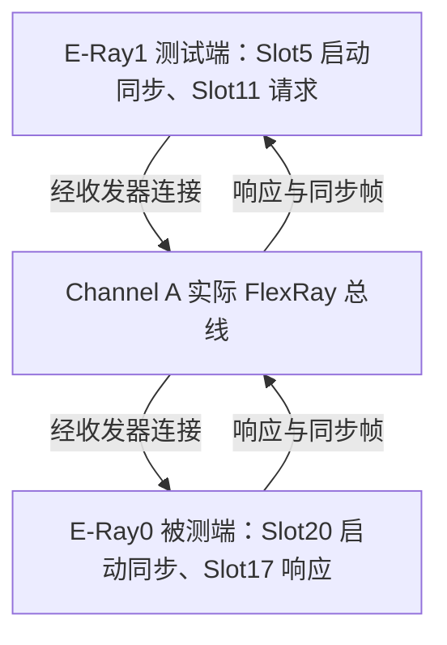
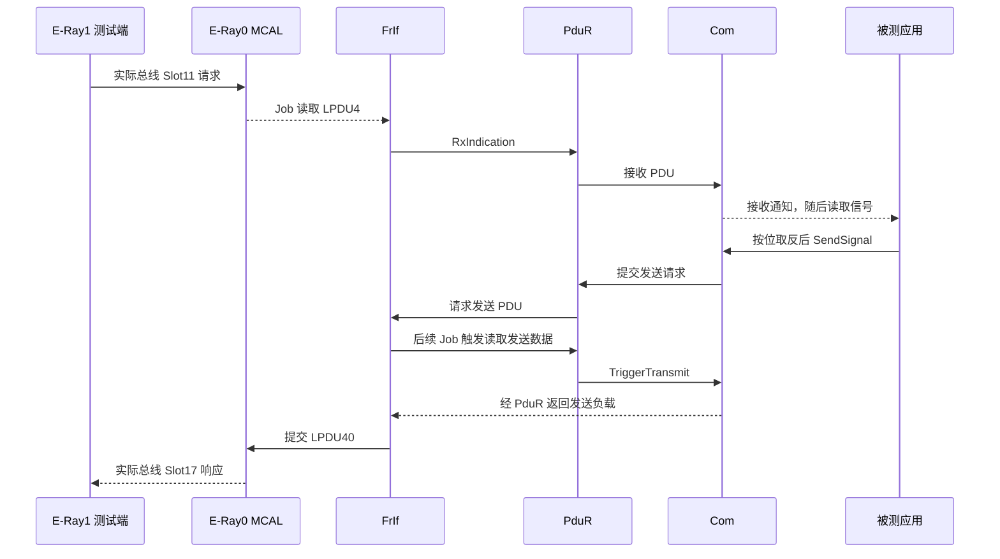

# AS21 无 VN7610 双 E-Ray 通信栈测试方案

## 1. 评估结论与讨论范围

**方案可行，但当前程序尚不能直接完成这个实验。** 当前只启动 E-Ray0；它仍是非冷启动节点，依赖外部节点建立网络。需要让 E-Ray0、E-Ray1 都具备实际冷启动能力，再由 E-Ray1 发送请求、接收响应，验证 E-Ray0 的完整通信栈。

本文件是供讨论的方案概述，所有“拟修改”“建议”均未实施。本轮仅恢复方案和项目文档约定，不修改 C 代码、MCAL 配置或 FIBEX。

文档按 [SSAT-STD-DOC-0001](ssat_md_mermaid_standard_v2.0.0.md) 的知识文档草案形式编写。Document ID 仅为提议值，未证明全局唯一，Owner 待确认；不是已注册、已批准或已发布的受控规格。

### 1.1 实验要证明什么

- 不连接 VN7610，两个控制器能建立并持续维持 FlexRay 通信。
- E-Ray1 发出的请求经过实际总线进入 E-Ray0。
- E-Ray0 依次经过 MCAL、FrIf、PduR、Com，应用通过 Com 读取信号并按位取反。
- 响应依次经过 Com、PduR、FrIf、MCAL，通过实际总线到达 E-Ray1。
- 调试器可以区分启动失败、接收失败、路由失败、应用失败和发送失败。

### 1.2 本阶段不扩大的范围

不恢复旧 gateway，不添加 DCM、FrSM、网络管理或真实车辆信号解码；不给 E-Ray1 再搭第二套 Com/PduR。E-Ray1 是实验用对端，E-Ray0 是被测通信栈。

同一 MCU 上的实验不能替代独立 ECU 的时钟偏差、真实车辆网络和正式产品验证。

## 2. 当前工程的事实

以下是 2026-11-09 读取当前源码得到的事实；硬件接线和运行效果未验证。

| 项目 | E-Ray0 | E-Ray1 |
|---|---|---|
| MCAL 是否已有配置 | 是，42 个 LPDU | 是，43 个 LPDU |
| 通道 | A | A |
| 冷启动 / 同步开关 | 关闭 / 关闭 | 开启 / 开启 |
| Key Slot | 17 | 5 |
| 启动帧发送模式 | Slot17 当前是普通应用单次发送 | Slot5 当前配置为单次发送，需处理持续发送 |
| Slot11 | RX，LPDU4，硬件 MB5 | TX，LPDU5，硬件 MB5 |
| Slot17 | TX，LPDU40，硬件 MB0 | RX，LPDU41，硬件 MB41 |
| 当前运行代码是否初始化并启动控制器 | 是 | 否 |
| 当前是否纳入 FrIf | 是 | 否 |

**LPduIdx 是驱动逻辑编号，硬件 MB 是消息缓冲区编号，二者不能混用。**

集群现有参数包括：10 Mbit/s、4900 MT 每周期、宏节拍 1 μs、38 个静态时隙、每个静态时隙 92 MT、静态负载 32 个双字节字，即 64 字节。本实验建议沿用这些时序，不另造一套集群。

当前运行逻辑位于 [AS21_Communication.inc](../BSW/Infra/Integration/AS21_Communication.inc)，只调用控制器0的初始化和通信启动，没有调用允许冷启动接口。FrIf 的驱动表已经绑定 `Fr_17_Eray_AllowColdstart`，不需要重新编写该驱动服务。

## 3. 两种修改方式与推荐选择

| 方式 | 如何处理 E-Ray0 的启动帧 | 好处 | 对现有验证的影响 |
|---|---|---|---|
| A：复用 Slot17 | 将现有响应帧同时作为启动/同步帧 | 沿用现有 Key Slot 和 MB0，配置变更较少 | 启动前就要准备该帧，之后需要持续发送；会改变“收到请求才发响应”的行为和发送确认含义 |
| B：独立 Slot20，建议采用 | E-Ray0 用 Slot20 持续启动/同步，Slot17 保持普通响应帧 | 网络启动与应用响应分开，测试证据清晰，保留现有 Com/PduR 语义 | 需要调整 Key Slot、LPDU 与硬件 MB 映射以及 FIBEX |

**推荐 B。** 之前提到 E-Ray0 可以使用 Slot17 冷启动，在控制器能力上成立；但它不是这次完整通信栈闭环实验最清晰的配置方式。

Slot20 来自原 FIBEX 的外部冷启动节点。在无 VN7610 的独立实验配置中，建议把其发送归属转移给 E-Ray0，E-Ray1 继续使用 Slot5。它们都处于现有静态段内，不改变集群总时长。

本节是建议，尚未得到用户对具体时隙和缓冲区安排的确认。

## 4. 推荐方案的节点和报文安排

| 发送节点 | Slot | 用途 | 负载长度 | 调度和发送策略 |
|---|---|---|---|---|
| E-Ray1 | 5 | 启动 / 同步 | 64 字节 | Base0、Repetition1，持续发送，独立于测试请求 |
| E-Ray0 | 20 | 启动 / 同步 | 64 字节 | Base0、Repetition1，持续发送，独立于应用响应 |
| E-Ray1 | 11 | 测试请求 | 64 字节 | Base0、Repetition1，测试程序按需提交单次发送 |
| E-Ray0 | 17 | 测试响应 | 64 字节 | Base0、Repetition1，现有完整通信栈按需提交单次发送 |

请求和响应仍只定义 Byte0 的一个 8 位信号；其余 63 字节置零。`0x12` 只是初始测试值，响应应为 `0xED`；后续还测试 `0x00`、`0x80`、`0xFF` 和重复值。

持续发送的是两个启动/同步帧，**不是反复发送旧的 Slot17 响应**。静态时隙没有有效数据发送时可能出现协议空帧；不能仅凭“看到 Slot17”判断应用已经返回有效响应。

网络和数据分工如图1所示，正文中的时隙表是拟定配置的阅读说明；最终工程配置仍以 C 配置和实验 FIBEX 为准。

**图 1｜双 E-Ray 实验职责**

> 图示说明：这不是 MCU 内部回环；请求和响应必须通过收发器及实际总线，不能通过共享变量直接交付对方。

## 5. MCAL 配置如何调整

### 5.1 E-Ray0：保留应用 LPDU，复用未使用的接收配置

当前 FrIf 只使用 E-Ray0 的 LPDU4 和 LPDU40。建议将尚未被当前通信栈引用的 **LPDU0，从 Slot1 接收改为 Slot20 启动/同步发送**，避免增加 LPDU 数组和驱动缓冲区数量。

| E-Ray0 配置项 | 当前 | 建议 |
|---|---|---|
| LPDU0 | Slot1 RX，硬件 MB1 | Slot20 TX，硬件 MB0，持续模式 |
| LPDU4 | Slot11 RX，硬件 MB5 | 保持不变 |
| LPDU40 | Slot17 TX，硬件 MB0 | Slot17 TX，硬件 MB1，保持单次模式 |
| Key Slot | 17 | 20 |
| Startup / Sync | 0 / 0 | 1 / 1 |
| LPDU 和硬件 MB 数量 | 42 / 42 | 保持 42 / 42 |

这会取消 E-Ray0 原有的 Slot1 接收配置，但当前实验没有使用它。若仍需要保留 Slot1 接收，应改为新增 LPDU，并重新核算消息 RAM，不在未确认时擅自扩大配置。

上述 MB0、MB1 交换涉及两个相同的 64 字节静态缓冲区，但仍须完整核对：

- LPDU 到 MB 映射和反向映射是否唯一。
- MB0 对应新的 Key Slot，静态与动态缓冲区布局约束是否满足。
- 数据区起点、大小、边界和消息 RAM 总占用。
- 控制器寄存器配置与 `Fr_ReadCCConfig` 使用的参数数组是否一致。
- Header CRC 按新的 Startup/Sync 属性、Frame ID 和负载长度重新计算并交叉核对。

驱动的 `DataPointerOffsetPtr` **按硬件 MB 编号索引**，不是按 LPDU 编号索引，不能跟着 LPDU 映射随意交换偏移。

### 5.2 E-Ray1：保留已有时隙，处理启动帧持续发送

保留 LPDU0 的 Slot5 启动/同步、LPDU5 的 Slot11 请求、LPDU41 的 Slot17 接收。Slot5 的单次模式应在控制器初始化前改为持续模式，并核验 Header CRC。

建议在现有 `Generated/MCAL` 配置中定点调整，保留修改前备份；EB 可用时优先在 EB 中配置并生成。若生成器固定输出单次模式，应把该差异作为明确的生成后适配项记录，不能重新生成后悄悄丢失。

本方案不修改厂商 `Fr_17_Eray.c` 算法，不通过 READY 状态下强写受保护帧头来修补配置。

### 5.3 为什么必须改 MCAL 配置

原 MCAL 能采集报文，证明了原网络角色和原配置下的接收能力。现在实验要求两个板载节点自己建立网络，E-Ray0 的角色发生变化，因此需要调整**配置数据**，不等于原驱动实现有问题，也不需要替换整个 MCAL。

## 6. 启动管理和文件职责

### 6.1 现有职责保持清晰

| 文件或模块 | 拟承担职责 |
|---|---|
| `BSW/AS21_Mcal/src/AS21_McalInit.c` | 保持 Mcu、Port、Gpt、Fr 驱动级初始化；只调用一次 `Fr_17_Eray_Init` |
| `BSW/Infra/Integration/AS21_Communication.h/.inc` | 管理双控制器初始化、启动帧准备、允许冷启动、状态监督和协调恢复；继续管理 E-Ray0 的 FrIf 在线状态 |
| `BSW/EcuAbstr/ComHwAb/FrIf/src/FrIf_Cfg.inc` | 保持 E-Ray0 Slot11/17 应用调度和 LPDU4/40 逻辑编号，核验驱动绑定 |
| `BSW/Services/ComSrv/PduR`、`Com` | 保持现有两条路由、两个 PDU、两个信号和 I-PDU 组 |
| `APPS/main/AS21_FlexRayLab.h/.inc` | 保持被测应用通过 Com 读信号、取反、写响应 |
| 拟新增 `APPS/main/AS21_FlexRayPeer.h/.inc` | E-Ray1 的请求生成、响应读取、比较、超时及 RAM 诊断；不管理控制器启动 |
| `Cpu0_Main.c` | 按现有 `.inc` 单次编译方式接入测试端周期处理 |

测试端允许直接调用**控制器1**的 MCAL 收发接口；它不能调用 E-Ray0 的接收回调，也不能把响应直接从 `g_AS21_FlexRayLab` 读来作为总线接收结果。

### 6.2 拟定启动顺序

1. 完成公共 MCAL 初始化，初始化 PduR、Com 和 E-Ray0 FrIf。
2. 通过 FrIf 初始化 E-Ray0，通过 MCAL 初始化 E-Ray1；分别检查是否进入 READY。
3. 在 READY 状态分别提交各自启动 LPDU 的 64 字节初始数据；等待有限时间确认输入缓冲区传输完成，并检查发送请求已建立。
4. 两个控制器均调用允许冷启动接口，再调用启动通信接口；每一步检查返回值。
5. 周期读取两个控制器的 POC 状态。只有正常通信时才运行相应的收发逻辑；E-Ray0 的 Com 和 FrIf 在线条件继续由 E-Ray0 状态决定，测试端仅在双方正常时提交新请求。
6. 任一步失败留下阶段、错误和状态快照，按有限重试和退避策略处理，不在循环中反复重新初始化。

两个控制器应先完成准备，再依次发起启动，不依赖一次 CPU 调用实现“同时启动”。谁成为实际 leading coldstart node 由协议启动过程决定；验收不要求固定某一方始终领先。

旧工程中曾有启动帧持续模式适配、预装载和 `AllowColdstart` 处理，可作为原因分析资料；不恢复旧 gateway 的映射、队列、策略和日志实现。

### 6.3 状态异常和恢复

原监督仅为一个非冷启动控制器设计，不能只增加一个控制器1的启动调用就结束。

- 区分 READY、STARTUP、NORMAL_ACTIVE、NORMAL_PASSIVE、HALT 和状态查询失败。
- 初期建议采用简单的双节点协调重启：任一方发生已确认的通信故障，停止新请求、退出被测应用在线状态，清除软件待处理数据，再重新准备两个节点。
- 恢复时核验硬件旧 TX 请求及新数据状态；不能只清 RAM 标志就认定旧响应不会出现。
- 保留当前 FrIf 软件队列清理和 Timer0 重调度路径，验证恢复后 IRQ 重新使能。
- 暂定 500 ms 启动超时和 200 ms 重试退避作为实验参数，属于待验证建议，不是协议规定或已测结果；采用 STM 经过时间计算。

## 7. E-Ray1 如何生成和验证测试数据

建议先采用**单个未完成请求**模式，不做 FIFO 或多个并发请求。

1. 两端均处于 NORMAL_ACTIVE，且 E-Ray0 的 FrIf 已在线、Com 接收组已启动后，先清理并记录旧响应状态；不能仅凭两端 POC 正常就发送首个请求。
2. 测试端通过 MCAL 向 E-Ray1 LPDU5 提交 64 字节请求，记录本次请求值、期望值和提交结果。
3. 单独检查发送完成状态，`E_OK` 仅代表提交成功，不能当成对端已经收到。
4. 周期通过 MCAL 读取 E-Ray1 LPDU41，只接受新的、长度为 64 字节的有效数据。
5. 检查 Byte0 等于本次请求按位取反后的值，并检查其余字节为零。成功后再允许下一笔请求。
6. 暂定 100 ms 响应超时、自动模式请求间隔不小于 100 ms；这是便于调试的实验参数，实施和实测后可调整。

先实现调试器触发的单次请求，再启用自动轮询值表。自动测试交替使用不同值；相同请求的重复测试需结合新的接收事件和 E-Ray0 计数变化判断，不能用上次残留的相同响应冒充本次成功。

若一次请求超时，不立即沿用未清理会话继续匹配下一笔响应；先清理或恢复，并记录失败。当前只有一个 8 位信号，不具备严格的跨故障事务编号；若后续需要精确关联，再另行讨论增加序号信号。

**图 2｜一次有效请求的完整路径**

> 图示说明：应用处理在主循环，FrIf Job 由定时中断执行；响应可能使用后续周期的 Slot17，不承诺请求所在周期内返回。发送确认还需按现有 FrIf、PduR、Com 路径单独检查。

## 8. 调度、中断和并发约束

保留 E-Ray0 现有每周期 1200 MT 的 FrIf Job，覆盖 Cycle0～63。它在 Slot11 后接收，在 Slot17 前准备发送；跨周期响应仍是允许的。

E-Ray1 初期使用现有约 1 ms 的 STM 主循环服务进行状态和 MCAL 收发轮询，不增加第二套 FrIf Job 或 E-Ray1 中断。静态时隙发送由硬件按集群时间完成，主循环只在允许时提交负载。

复用现有通信临界区，避免 CPU0 主循环操作与 E-Ray0 Job ISR 的驱动访问交叉。MCAL 调用及等待必须有限时，测量长临界区是否影响 1200 MT Job；不能把长轮询等待放进中断。

实施时审核 E-Ray1 的 SRC、ILE、SIES 等中断使能，保证不会打开没有处理函数的服务请求。E-Ray0 原 IRQ 仍负责 FrIf Timer0；本次不重新引入 NDAT/MBSC 的旧 gateway 中断搬运。

## 9. FIBEX 和硬件准备

### 9.1 单独建立实验 FIBEX

建议保留 [原 FIBEX](AS21_VN7610_Slave.xml)，另建 `docs/AS21_DualEray_Lab.xml`，避免把原 CANoe 场景与双 E-Ray 场景混用。

拟定修改包括：

- E-Ray0 节点使用 Slot20 作为 Startup/Sync，继续发送 Slot17、接收 Slot11。
- 新增明确命名的 E-Ray1 实验节点，使用 Slot5 作为 Startup/Sync，发送 Slot11、接收 Slot17。
- 两个原 VN7610 虚拟节点不再拥有实验帧的发送权；最小实验副本仅保留需要的帧和节点，删除引用时一并检查依赖闭合。
- 保留 Slot11/17 的两个 PDU、两个 UINT8 信号及相同的位布局；启动帧使用独立帧定义，不冒用应用 PDU。
- XML ID、FrameTriggering、Connector 和输入输出引用全部核对，保持每个时隙和周期组合的发送归属唯一。

没有 CANoe 时，FIBEX 用于记录和核对实验网络；**板子不会读取 XML 自动配置自己**，实际运行仍依赖 C 配置。后续接回 CANoe 时，需使用匹配场景，避免重复发送启动帧或应用帧。

### 9.2 必须确认的硬件条件

- 两个 E-Ray 的 Channel A 都连接了可用的 FlexRay 收发器，并有可接出的总线端子。
- 两路收发器处于正常工作模式，供电、使能和待机引脚正确。
- 总线侧 BP 对 BP、BM 对 BM，参考地及终端按实际板卡和拓扑要求连接。
- 采用适合 10 Mbit/s 的短双绞连接；不将 MCU 的 TX/RX 引脚直接短接。

代码中 E-Ray0 Channel A 使用 `FR_RXSEL3`，E-Ray1 使用 `FR_RXSEL0`，它们是各控制器的输入选择值，不表示两路已经在板内相连。实际封装引脚、收发器型号、连接器针脚、终端电阻和使能电路仍需核对本板原理图；不能直接套用未确认型号的 TC397 开发板图纸。

硬件条件不满足时，应先解决连接，不能把无法启动全部归因于协议栈。

## 10. 拟修改文件清单

| 文件 | 计划修改内容 | 核验方式 |
|---|---|---|
| `Generated/MCAL/src/Fr_17_Eray_PBcfg.c` | E-Ray0 Key Slot20、Startup/Sync、LPDU0/40 映射；两端启动帧持续模式、CRC 和参数一致性 | 配置解析、消息 RAM 区域核算、CRC 交叉核对 |
| `Generated/MCAL/inc/Fr_17_Eray_Cfg.h` | 推荐方案数量不变，预期无需修改；若发现依赖则单独说明 | 数组长度、数量宏及驱动边界检查 |
| `BSW/Infra/Integration/AS21_Communication.h/.inc` | 双节点启动监督、独立启动帧准备、阶段诊断、协调恢复和测试端服务时序 | 模拟驱动返回与 POC 转换，实板观察状态 |
| `BSW/MCAL/Irq/Fr_17_Eray_Irq/Fr_17_Eray_Irq.c` | 仅在核对后确有需要时补 E-Ray1 未使用 IRQ 的关闭处理 | 检查 SRC 和中断计数；保持 E-Ray0 定时 Job |
| 拟新增 `APPS/main/AS21_FlexRayPeer.h/.inc` | 控制器1请求、响应校验、单请求状态和诊断 | 模拟正常、超时、旧数据、错误长度和提交失败 |
| `Cpu0_Main.c` | 单次包含测试端实现、接入初始化和周期服务 | 编译链接和调用顺序检查 |
| 拟新增 `docs/AS21_DualEray_Lab.xml` | 独立双 E-Ray 实验拓扑和帧归属 | XML 解析、引用完整性、C 配置一致性 |

FrIf、PduR、Com 和取反应用的业务配置预期保持原样。启动 LPDU 不通过 Com/PduR 业务路径管理；不得因 MB 映射调整把 FrIf 的 `Fr_Buffer` 从 LPDU40 错改为硬件 MB1。

## 11. 分阶段实施与验收

| 阶段 | 工作 | 通过标准 |
|---|---|---|
| 0：讨论与硬件确认 | 确认方案 B、Slot20、复用 LPDU0 和真实接线 | 方案确认，硬件条件明确；此前不修改运行代码 |
| 1：静态配置 | 调整 MCAL 配置，建立实验 FIBEX | LPDU/MB 唯一、消息 RAM 不重叠、CRC 正确、XML 引用有效、TASKING 编译链接成功 |
| 2：双节点启动 | 完成预装载、允许冷启动和双节点监督；先不发应用请求 | 无 VN7610 时两端进入 NORMAL_ACTIVE，周期计数持续变化；建议先稳定观察 60 s |
| 3：单笔闭环 | 手动触发 `0x12` | E-Ray0 接收、Com 读取、写响应、FrIf 触发及发送确认有证据；E-Ray1 新收到有效 64 字节响应 `0xED`，其余字节为零 |
| 4：边界与重复 | 测试 `0x00`、`0x80`、`0xFF`、重复值和自动交替值 | 每笔请求有新响应证据，无残留数据误判；建议连续 100 笔正常请求全部匹配 |
| 5：异常恢复 | 模拟提交失败、无响应、状态查询失败；实板验证单端停止与恢复 | 超时可定位，停止期间不报成功；重新启动后能建立新会话并再次闭环 |

测试代码模拟用于验证控制逻辑、错误处理和回调绑定，不能模拟证明物理冷启动和总线时序。不得用编译成功、主机测试通过或单个 `E_OK` 代替实板闭环证据。

## 12. 调试器观察和结果判定

保留 `g_AS21_Communication`、`g_AS21_FlexRayLab`。建议增加独立的双节点启动阶段诊断，以及 `g_AS21_FlexRayPeer`，包含：

- 两端 POC、ControllerInit / Prime / AllowColdstart / Start 返回值。
- 启动成功、失败、超时和重试次数，最近失败阶段。
- 请求提交数、发送完成数、有效响应数、匹配数、不匹配数、超时数。
- 当前请求值、期望值、实际响应值、实际长度、会话编号和响应字节快照。

关键寄存器用于辅助确认：两端 `CCSV.POCS`、`SUCC1.TXST/TXSY`、`MTCCV`、`TXRQ`；E-Ray0 的 Timer0、中断路由和对应新数据位。调试器观察到的硬件 POC 编码与 `Fr_POCStateType` 软件枚举不是同一套值，应分别解释。

**只有 E-Ray1 从总线收到新的正确响应，同时 E-Ray0 的各层证据对应增长，才能说明本次请求完成了通信栈闭环。** 普通发送确认不能证明对端应用正确接收。

## 13. 待讨论决策

| 编号 | 建议 | 未确认时的处理 |
|---|---|---|
| D1 | 采用独立 Slot20 启动帧，不复用 Slot17 响应 | 保持当前代码不动 |
| D2 | 将 E-Ray0 未使用的 LPDU0 从 Slot1 RX 改为 Slot20 TX | 若要保留 Slot1，则改评估新增 LPDU |
| D3 | E-Ray1 只做 MCAL 测试端，不加第二套完整通信栈 | 当前目标仍是验证 E-Ray0 |
| D4 | 两端电气连接和收发器正常模式有实际硬件依据 | 未确认前不提供具体接插件针号 |
| D5 | 接受实验期的简单协调恢复及暂定超时参数 | 实施前确定，实测后再调整 |

本方案批准后再展开具体实现和测试，不把本次文档交付视为代码修改授权。

## 14. 来源与校验边界

### 14.1 主要来源

- [MCAL 控制器、LPDU、硬件 MB 和集群配置](../Generated/MCAL/src/Fr_17_Eray_PBcfg.c)。
- [MCAL 控制器数量和功能开关](../Generated/MCAL/inc/Fr_17_Eray_Cfg.h)。
- [MCAL 驱动实现](../BSW/MCAL/Fr/src/Fr_17_Eray.c)：`AllowColdstart`、MB0 约束及按硬件 MB 索引的数据偏移。
- [FrIf 驱动绑定、应用帧和 Job 配置](../BSW/EcuAbstr/ComHwAb/FrIf/src/FrIf_Cfg.inc)。
- [当前运行集成](../BSW/Infra/Integration/AS21_Communication.inc)、[取反应用](../APPS/main/AS21_FlexRayLab.inc)。
- [当前 FIBEX](AS21_VN7610_Slave.xml)：外部 Slot5/20 Startup/Sync、Slot11/17 PDU 和信号。
- [英飞凌 TC3xx 用户手册 Part 2](https://community.infineon.com/gfawx74859/attachments/gfawx74859/jpaurix/4290/2/Infineon-AURIX_TC3xx_Part2-UserManual-v02_00-EN.pdf)：E-Ray 启动、同步和消息缓冲区约束。

### 14.2 本次校验范围

本次恢复上一版方案，重查当前冷启动配置与启动调用，并对恢复后的文档执行元数据、标题、链接、Mermaid 源和编码检查，记录最终文件 SHA-256。检查记录不能代替完整 SSAT 认证。

企业 Document Registry、正式身份注册及 Owner 确认未提供；不声明 Stage B 治理通过。本文件为 KNOWLEDGE 草案，不创建 CONTROLLED Candidate 或虚构其 A1 版本预留。目标发布平台的正式渲染、几何和视觉验收尚未完成，不声明 Stage C 通过。

编译、主机逻辑测试、实板冷启动和真实总线闭环均留待实现阶段执行，目前没有这些新结果。
